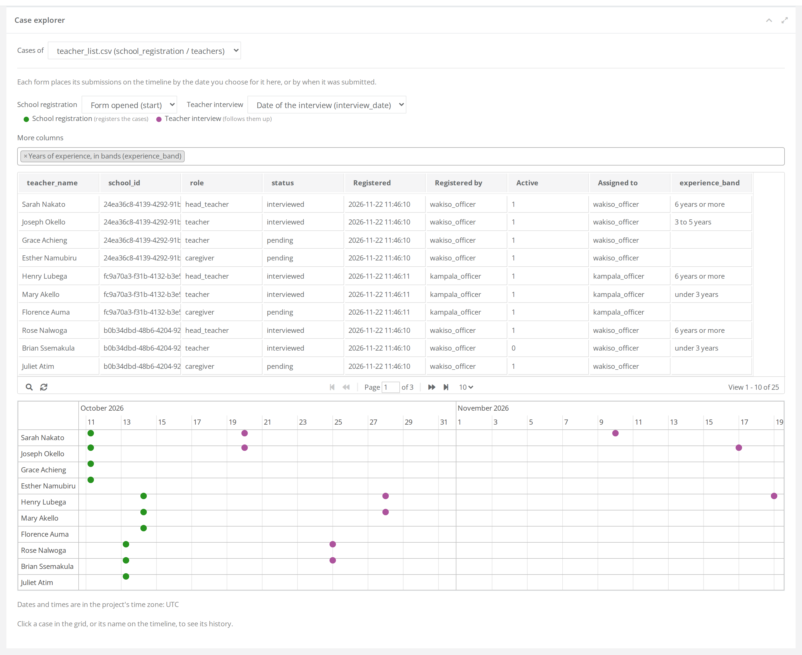
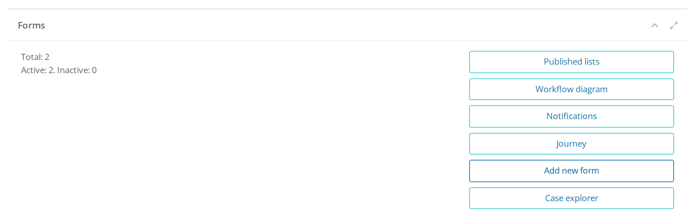

# Case Explorer

The Case Explorer is one page per project that shows the cases of its [published lists](../../data-management/case-management/published-lists.md): who registered each case and when, whether it is still active, whom it is assigned to, every follow-up it has had, and everything that changed it. It is also the only place in FormShare where a case is given to another assistant.

It is built for longitudinal studies set up with [case management](../../data-management/case-management/README.md). Where the rest of FormShare shows submissions one form at a time, the Case Explorer shows them case by case: a teacher's registration and each of their interviews, side by side.

<figure><figcaption>
The cases of a list, and the timeline of their submissions.
</figcaption></figure>

| Page | What it covers |
| --- | --- |
| [Walkthrough: follow up teachers and share them out](walkthrough.md) | Reading a list's cases, a teacher's history, and giving a school's teachers to another officer, step by step. |
| [The grid and the timeline](grid-and-timeline.md) | The columns of the grid, adding more, the timeline and the date each form is placed by. |
| [A case's history](case-history.md) | What the history of a case lists: registration, follow-ups, what each action changed, edits, reassignments, changes taken back. |
| [Reassigning cases](reassigning-cases.md) | Giving a case to another assistant: who can, to whom, what moves with it, and when devices see it. |

## Who uses it

| Role in the project | What they can do |
| --- | --- |
| Owner, administrator, editor | Browse the cases, read their histories, and give a case to another assistant |
| Member | Browse the cases and read their histories |

Assistants do not see the Case Explorer: it is a page of the project, not of the field team's access.

## Where to find it

On the project's page, the **Case explorer** button is in the Forms panel, with the other project tools, once the project has a workflow: a published list of cases from a form with a repository.

<figure><figcaption>
The button appears once a list of cases exists.
</figcaption></figure>

## What it needs

- A [published list](../../data-management/case-management/published-lists.md) of the rows of a form whose repository is built. A list of values, one with a key column such as a list of districts, is not a list of cases and is not offered.
- Follow-up forms whose [case link](../../data-management/case-management/case-links.md) selects from that list. Without them, each case shows its registration only.


**For server administrators:** the Case Explorer is a QLands plugin, not part of FormShare's open source code. Like the published lists, it needs the `workflows` feature; without it, neither the page nor its button appears.


## What's next

* Follow "[Walkthrough: follow up teachers and share them out](walkthrough.md)" to use the page step by step.
* Read "[Who receives which cases](../../data-management/case-management/who-receives-which-cases.md)" for how an assignment decides which devices receive a case.
