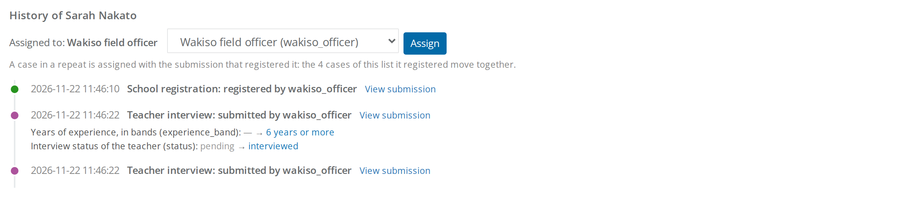

# A case's history

Click a case's row in the grid, or its name on the timeline, and its history opens under the timeline: everything that happened to that case, oldest first, each entry with its date, what it was and who did it.

<figure><figcaption>
A teacher registered with her school and interviewed twice. The first interview's action changed two of her properties; the second changed nothing.
</figcaption></figure>

## What it lists

| Entry | What it says |
| --- | --- |
| The registration | The form that registered the case, and who sent it |
| Each follow-up | The follow-up form, who sent it, and what its [action](../../data-management/case-management/case-actions.md) changed on the case: each property or column with its old and new value, or that the case was deactivated or reactivated |
| A follow-up whose action failed | That the action failed on it and changed nothing. The reason, and a **Retry** button, are in the runs of the follow-up form's **Form actions** page |
| Changed by the action of another form | What another submission's action changed on the case: a follow-up of a child case can write to its parent, and a form without a case link can act on its own rows |
| Edited by | A change no action made: an answer edited in Clean data, or a change through the API |
| Reassigned by | The case given to another assistant, by whom, from whom to whom. See "[Reassigning cases](reassigning-cases.md)" |
| Taken back when the submission was deleted | A change a follow-up's action made, put back when that follow-up was deleted or moved to the logs |

Each submission has a **View submission** link, which opens it.

An encrypted answer is shown as *encrypted*, never with its values.

## When an entry is dated

An entry is dated when it happened on the server: a submission when it arrived, an edit or a reassignment when it was made. The [timeline](grid-and-timeline.md#the-timeline) can place submissions by another date, such as the date of a visit, so the two can differ: a week of visits sent together arrives at one time.

## Who did it

The history names the assistant who sent a submission, and the person who edited or reassigned a case. When the audit log does not say who made a change, the history says *someone unknown*.

## What's next

* Read "[Reassigning cases](reassigning-cases.md)" for the control at the top of the history.
* Read "[Form actions](../../data-management/case-management/case-actions.md)" for the changes a follow-up can make.
