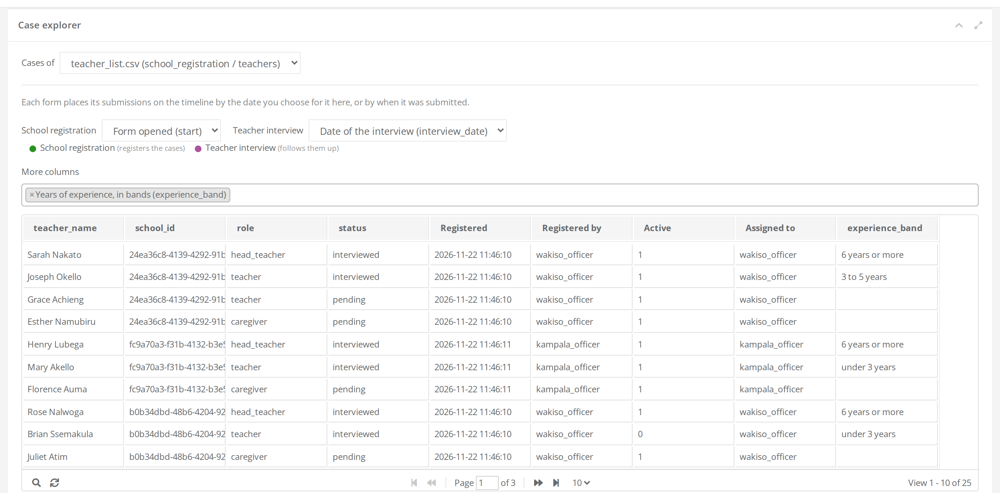
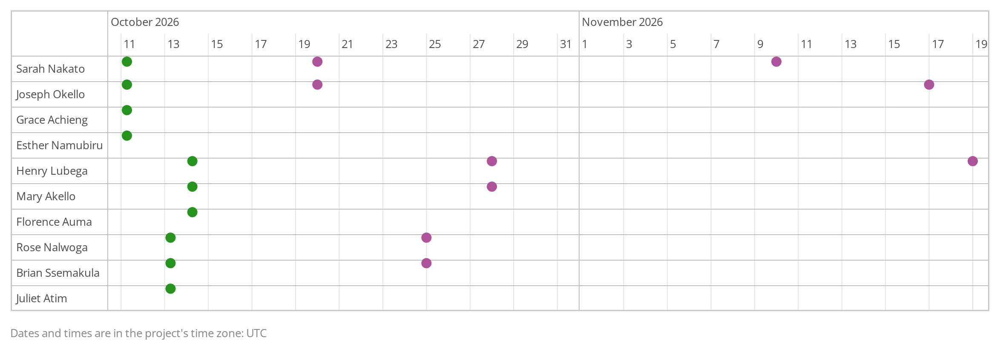

# The grid and the timeline

The top of the Case Explorer is the list you are looking at. **Cases of** offers every published list of cases in the project, named by its file and by the form and table its cases come from. Everything below it, the grid, the timeline and a case's history, is about that list.

## The grid

Each row is a case: a row of the list's source table. The grid shows:

| Column | What it holds |
| --- | --- |
| The list's label and served columns | What devices receive: the label the field team picks from, and each column the list serves, under the name it serves it as |
| Registered | When the submission that registered the case arrived |
| Registered by | The assistant who sent it |
| Active | 1 while the case is in play, 0 once it is deactivated, for example by an [action](../../data-management/case-management/case-actions.md) |
| Assigned to | The assistant the case is assigned to; see "[Reassigning cases](reassigning-cases.md)" |

The grid shows ten cases a page; the pager at its foot changes the page and how many it shows, and the magnifying glass searches it.

<figure><figcaption>
The teacher list, with one column added.
</figcaption></figure>

### More columns

**More columns** adds any other column of the list's source table, or another [property](../../data-management/case-management/properties.md) of its cases, as a column of the grid. Type part of its name or description and choose it; remove it with its cross.

What is offered leaves out what the page cannot show as it is: FormShare's own columns, whose names start with an underscore, and columns that are never read raw (a geometry, a column MySQL derives, an encrypted answer).

The columns you add are remembered by your browser, for that list. Another person, or you on another computer, starts without them.

## The timeline

Under the grid, the timeline has a row for each case on the grid's current page, and a dot for each of its submissions: the one that registered it, and each follow-up. Each form has its own colour, shown above the grid with what the form does: *registers the cases* or *follows them up*.

<figure><figcaption>
Each school registered in October, and each teacher's interviews after it.
</figcaption></figure>

Click a dot to open its submission. Click a case's name, on the left, to open its [history](case-history.md).

### The date each form is placed by

Each form places its submissions by the date you choose for it, above the grid:

| Choice | Places a submission at |
| --- | --- |
| Submission date | When it reached FormShare |
| Form opened (start), Form finished (end) | When the enumerator opened or finished the form, as the device recorded it |
| Any other date question of the form's main table | The date the enumerator gave, such as the date of a visit |

Choose the date the visit really happened, when the form asks for it: devices that sync once a week would otherwise pile a week of visits on one day. A submission that left the chosen date unanswered is placed by when it was submitted, and pointing at its dot says so.

Your choices are remembered by your browser, as the added columns are.

Dates and times are shown in the project's time zone, which the line under the timeline names.

## What's next

* Read "[A case's history](case-history.md)" for what opens when you click a case.
* Follow "[Walkthrough: follow up teachers and share them out](walkthrough.md)" for the page step by step.
