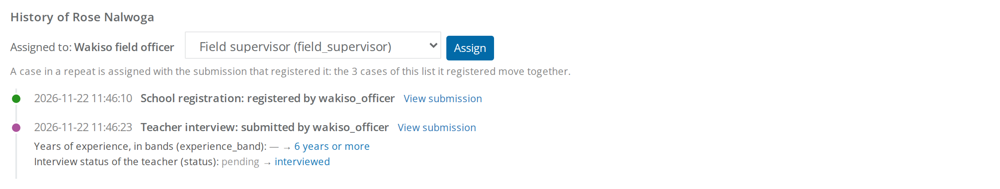
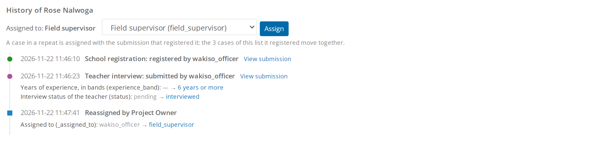

# Reassigning cases

Every case is assigned to an assistant: to whoever registered it, until someone gives it to another. The Case Explorer is the only place in FormShare where that happens.

The assignment matters most for a list whose [case accessibility](../../data-management/case-management/who-receives-which-cases.md) is **Each assistant receives the cases assigned to them**: there, giving a case to another assistant moves it from one field team member's device to another's. In the other modes the grid still shows the assignee, and a reassignment is still recorded, but it does not change who receives the case.

## Who can reassign

Owners, administrators and editors of the project. A member sees whom a case is assigned to, without the control.

## How

At the top of a case's [history](case-history.md), **Assigned to** names the current assignee, beside a list of assistants and **Assign**. Choose the assistant and click **Assign**.

<figure><figcaption>
The list offers the assistants who receive the list.
</figcaption></figure>

The list offers the assistants who receive the list: those with access to a form that follows it up. When the current assignee is not one of them, for example after losing access to the form, the page says so beside their name.

## A case in a repeat moves with its submission

A case that is a row of a repeat, such as a teacher registered in a school's repeat of teachers, is assigned with the submission that registered it. Reassigning one teacher gives the new assistant every teacher that school's registration registered, and the note above the history says how many cases move together.

## What happens next

- The change is recorded in the repository's audit log, as made by you, and shows in the case's history as **Reassigned by**, from whom to whom.
- The grid's **Assigned to** column shows the new assistant.
- Devices receive the change at their next update: the new assistant's device gets the case, and the previous assistant's device no longer does, unless it holds the case because it registered it and has not sent it yet.

<figure><figcaption>
The reassignment, in the case's history.
</figcaption></figure>


No action can change an assignment, and Clean data shows the assignee read-only: the Case Explorer is the one place it changes, so that every reassignment is made by a person and recorded.


## What's next

* Read "[Who receives which cases](../../data-management/case-management/who-receives-which-cases.md)" for the case accessibility of a list.
* Follow "[Walkthrough: follow up teachers and share them out](walkthrough.md)" for a reassignment step by step.
