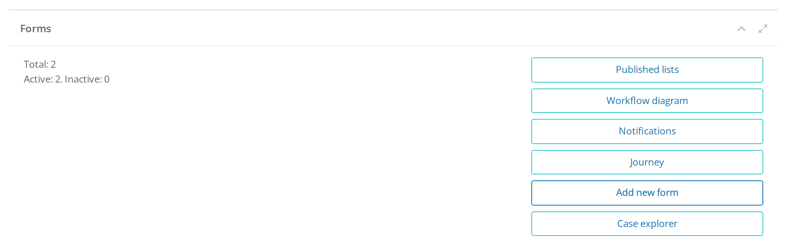
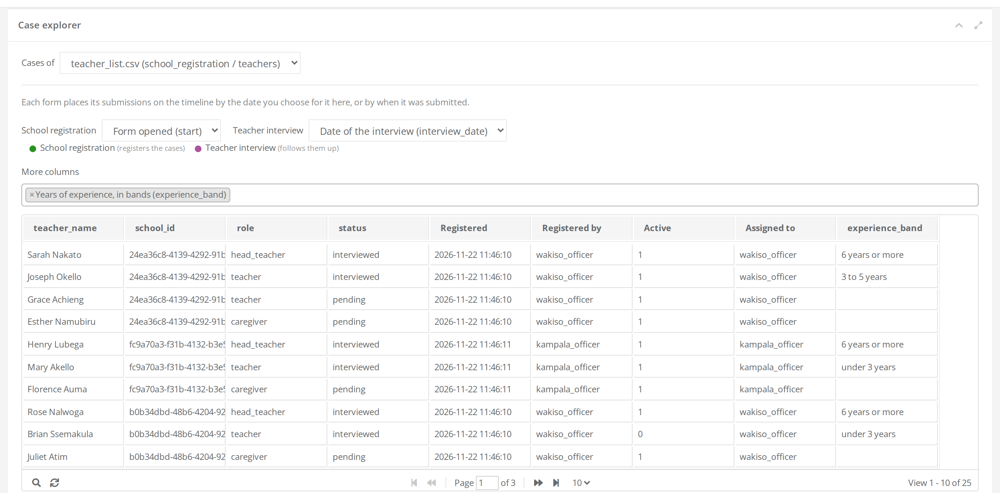
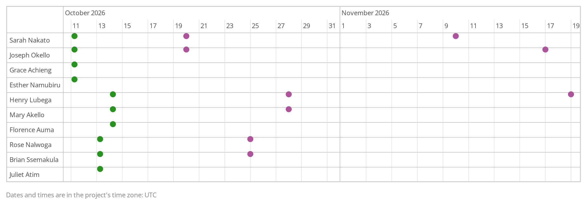
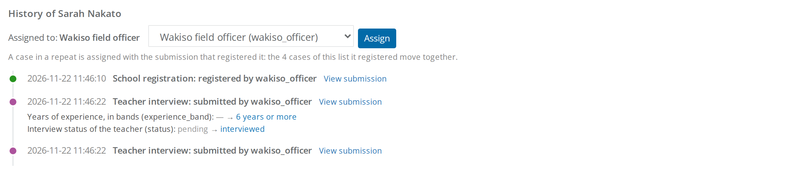
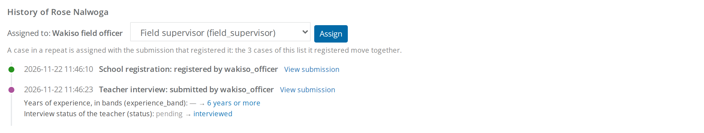
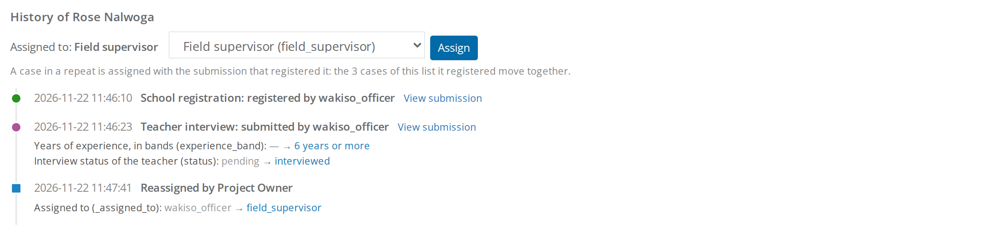

# Walkthrough: follow up teachers and share them out

This walkthrough uses the project built in "[Walkthrough: schools and teachers](../../data-management/case-management/walkthrough.md)": eight schools registered with their teachers, `teacher_list.csv` published from the repeat of teachers, and a teacher interview whose case link is that list. The interview has an [action](../../data-management/case-management/case-actions.md) that marks each teacher interviewed and records their experience in bands, as in "[Update cases with actions](../../data-management/case-management/walkthrough-actions.md)".

The field officers have been interviewing teachers for five weeks. You want to see where they stand, and the Wakiso field officer is about to go on leave: the supervisor will take over one of their schools.



## Serve each officer the teachers assigned to them

On **Published lists**, click **Edit** on `teacher_list.csv`, open the **Case accessibility** tab, choose **Each assistant receives the cases assigned to them** and click **Change**.

Each officer's device now receives the teachers of the schools that officer registered. The rest of this walkthrough changes that for one school. See "[Who receives which cases](../../data-management/case-management/who-receives-which-cases.md)" for the other choices.



## Open the Case Explorer

On the project's page, click **Case explorer** in the Forms panel.

<figure><figcaption>
The button appears once the project has a list of cases.
</figcaption></figure>



## Choose the teachers, and the dates that matter

Under **Cases of**, choose `teacher_list.csv (school_registration / teachers)`.

Then tell the timeline which date places each form's submissions. Set **School registration** to **Form opened (start)**, the day the officer was at the school, and **Teacher interview** to **Date of the interview (interview_date)**, the date the officer recorded. Left at **Submission date**, a week of interviews sent together would land on one day.

Under **More columns**, type `experience` and choose **Years of experience, in bands (experience_band)**: the grid gains the property the interview's action writes.

<figure><figcaption>
Your browser remembers the dates and the added column for this list.
</figcaption></figure>

The grid already answers a few questions: who has been interviewed (**status**), who registered each school and who now has its teachers (**Registered by**, **Assigned to**), and Brian Ssemakula's **Active** is 0, because his interview said he no longer works at his school.



## Read the timeline

Under the grid, each teacher on the page has a row: a green dot for the day their school was registered, a purple dot for each interview.

<figure><figcaption>
Four teachers on this page have not been interviewed yet.
</figcaption></figure>

Grace Achieng, Esther Namubiru, Florence Auma and Juliet Atim have no purple dot: they are still waiting for their interview. Click a dot to open that submission. Use the pager under the grid to see the next ten teachers.



## Open a teacher's history

Click **Sarah Nakato** in the grid. Her history opens under the timeline.

<figure><figcaption>
The demo's submissions were all sent the same day, so their arrival times are close together; the timeline places them by the dates chosen above.
</figcaption></figure>

The first interview's action set two of her properties; the second found them already set and changed nothing. Any edit in Clean data, or a reassignment, would show here too. See "[A case's history](case-history.md)".



## Give a school's teachers to the supervisor

Kasangati Community School is the Wakiso officer's. While they are away, the field supervisor will interview its teachers.

Click **Rose Nalwoga**, Kasangati's head teacher. At the top of her history, choose **Field supervisor (field_supervisor)** and click **Assign**.

<figure><figcaption>
The list offers only the assistants who receive the teacher list.
</figcaption></figure>

The note says what happens to the rest of the school: a teacher is a row of the registration's repeat, so the three teachers that registration registered move together. You give the supervisor the whole school, which is what you wanted.



## Check the change

Rose's history now ends with the reassignment, by you, from `wakiso_officer` to `field_supervisor`, and the grid's **Assigned to** column says the same for her school's three teachers.

<figure><figcaption>
Every reassignment is recorded, with who made it.
</figcaption></figure>

At their next update of the forms, the supervisor's device receives Kasangati's teachers in `teacher_list.csv`, and the Wakiso officer's device no longer offers them. When the officer is back, give the school back the same way.



## What's next

* Read "[The grid and the timeline](grid-and-timeline.md)" for every column and date choice.
* Read "[Reassigning cases](reassigning-cases.md)" for who can reassign and what devices see.
