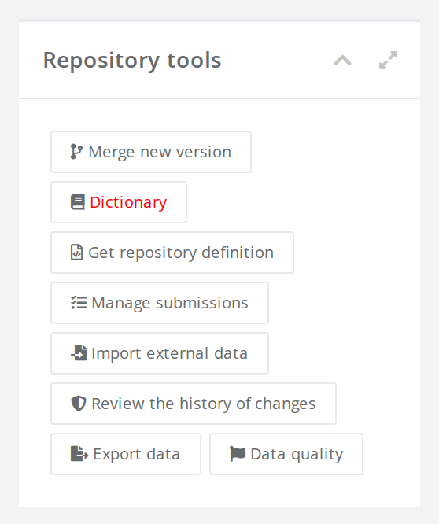
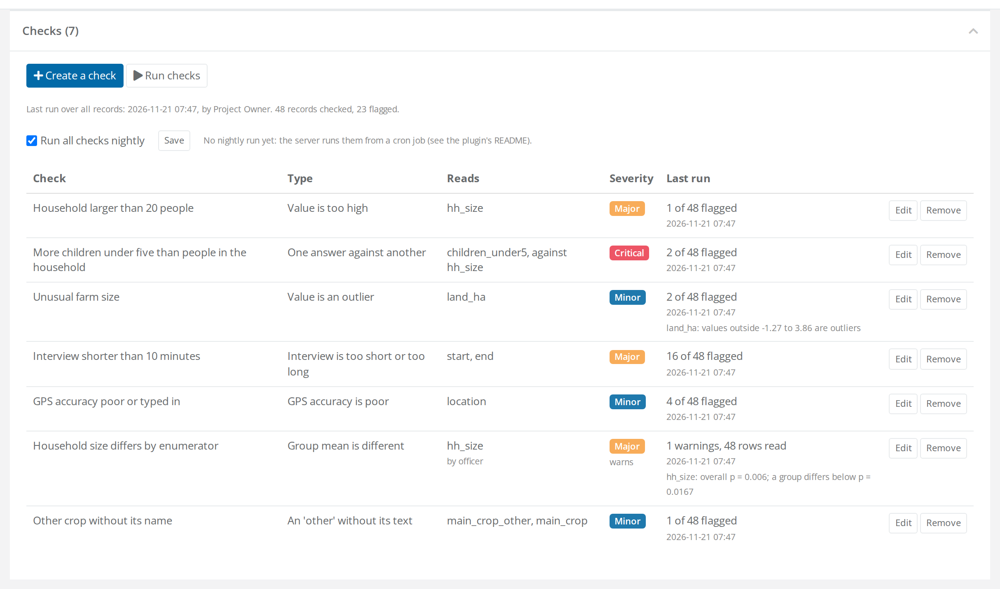

# Data quality

The **Data quality** plugin checks the records in a form's [repository](../../fundamentals/repositories/README.md) and tells you which ones look wrong. You save the checks on the form's Data quality page and FormShare runs them itself: when a submission arrives, when an answer is changed, and at night. Nobody has to run a script for a record to get its score.

These terms come up throughout this section:

| Term | Meaning |
| --- | --- |
| Check | A rule saved on the form's Data quality page: its type (for example *Value is too high*), the fields it reads, its limits, an optional condition and a severity. |
| Flag | What a check on records finds: one problem on one record. Each open flag takes points off the record's score. |
| Warning | What a check on the whole form finds, such as a mean that is too low or an officer whose answers differ from everyone else's. A warning never changes a score. |
| Data Quality Score | 100 minus the weight of each open flag of the record, never below 0. A record that no check has looked at has no score. |
| Officer | The person who sent a record, whom the Data quality page shows under **Sent by**. |

Flags and warnings are both *issues*. Each one has a number, such as DQ-57, that you can name in the reason of the change that fixes it.

Scripts can add flags too. A script in R, or in any other language, posts them through the [flags API](flags-api.md), and they count in the score beside the flags of the checks.

A low score only marks a record. It excludes nothing: exports, published lists and analysis read the record as before.

## Who uses which page

| Who | Where | What they do there |
| --- | --- | --- |
| The project's owner, administrators and editors | The form's **Data quality** page | Create, test, edit and remove checks. Run them. Read the scores, flags and warnings. Dismiss warnings. Reopen a dismissed flag or warning. Choose the supervisors. |
| [Assistants](../../fundamentals/tasks/README.md) who can clean the form | **Clean data**, in the Assistant Access portal | See a record's score and flags, and fix the answers. Recode "other, specify" answers to a choice. |
| Supervisors | **Clean data** | Dismiss a flag that is right as it is, saying why. Reopen a dismissed flag. |
| The project's owner and administrators | The form's **Manage submissions** page | Remove a flagged submission that should not be there, naming its issue in the reason. |
| The project's owner, administrators and editors | The form's **Dictionary** | Find the questions that look like personal data and mark them. Members see the report without the buttons. |
| Scripts | The flags API | Post and list flags, with the API key of an owner, administrator or editor. |

Members of the project do not see the Data quality page.

## The Data quality page

Open the form's page. The **Repository tools** box in the left column has a **Data quality** link, at the end of its tools. It appears once the form has a repository, for the project's owner, administrators and editors.

<figure><figcaption>
Data quality is among the repository tools, once the form has a repository.
</figcaption></figure>

The page holds, from top to bottom:

| Box | What it shows |
| --- | --- |
| Checks | The form's checks, each with its type, what it reads, its severity and what its last run found. **Create a check**, **Run checks** and **Run all checks nightly**, and **Edit** and **Remove** on each check. The runs going and waiting are listed here. |
| Records scored, Mean score, Records by band, Open flags | How many records have a score, their mean, how many fall in each colour band, and the open flags by severity with the points each one takes off. |
| By who sent the records | The same figures for each officer, and the open warnings about them. |
| Warnings | What the checks on the whole form found, grouped by check. It shows when the form has such a check, or warnings left from one. |
| Flags | The flags of the form, 50 to a page, the open ones unless you filter by another status or by severity, and **Find an issue** to look one up by its number. |
| Supervisors | The assistants and groups given the form, and which of them supervise it. Under the list, a warning names each supervisor who cannot open Clean data. |
| Send flags from a script | The two addresses a script needs, with an example. |

<figure><figcaption>
The top of the Data quality page.
</figcaption></figure>

## What a form needs

### A repository

A form still in testing has no Data quality page: [create its repository](../../guides/creating-your-first-task/advanced-permissions.md) first.

### Room for the score

FormShare's repositories have had a place for the score since February 2026. On a form whose repository is older, the Data quality page shows this instead of the checks:

> This form's repository was built before FormShare could store a Data Quality Score, so its records cannot be scored. Checks cannot run on it and scripts cannot send flags for it. Merging a new version of the form into the repository adds the score: use Merge new version on the form's page.

To get the score, upload a new version of the form with **Merge new version**, in the form's **Repository tools**, and merge it into the repository. The merge adds the score to the repository's tables, however little the new version changes. Until then the page offers no checks, the flags API refuses flags for the form and Clean data shows no flags. See "[Merging subversions of a form](../../fundamentals/repositories/merging-subversions-of-a-form.md)" for the steps.

### What some types read

Some types of check need more of the form, and the page offers them only when the form has it:

| Types | What the form needs |
| --- | --- |
| Interview is too short or too long, and the measure *Interview length* | A `start` and an `end` question. |
| A question or a section answered too fast, and the audit's measures | A row of type `audit`, and a repository that keeps the audit. A repository built before FormShare kept the audit gets it when a new version of the form is merged; the check page says so. |
| The interview was not where its GPS answer says | An audit row with `location-priority` in its parameters, and a geopoint question in the main table. |
| The two checks of "other, specify" answers | An "or other" pair: a text question asked only when one choice of a select is chosen. |
| The four checks of a follow-up | A [case link](../../data-management/case-management/case-links.md): the form follows up the cases of a published list. |
| Cases without a follow-up | Another form of the project that follows up the cases this form registers. |

"[Check types](check-types.md)" says what each type needs in full.

## Versions of a form

All the versions merged into one repository share its checks, flags, warnings and issue numbers. A new version runs the checks made on the version before, and nothing has to be copied. Each record is still judged on the questions its own version asked: a question that a later version added is not counted as empty in the records sent before it. See "[Records sent with different versions](check-types.md#records-sent-with-different-versions)".

Supervisors are the exception. They are set for each version, and **Keep assistants**, when you upload a new version for merging, carries them over.


**For server administrators.** The plugin has to be installed and enabled on the server; the **Data quality** link appears only where it is. After installing or upgrading the plugin, run its database migrations from the plugin's folder, `<env>/bin/alembic -c alembic.ini upgrade head`, with an `alembic.ini` copied from its `alembic.example.ini`. The checks of arriving submissions, of saved checks and of **Run checks** run on FormShare's Celery worker, so restart the worker as well as FormShare. The nightly run needs a cron job: see "[The nightly run](when-checks-run.md#the-nightly-run)".


## In this section

* "[Check types](check-types.md)": the parts of a check and every type, with its options and limits.
* "[Flags, warnings and scores](flags-and-scores.md)": statuses, issue numbers, the score and its colours, what became of each issue, and reopening a dismissed one.
* "[When checks run](when-checks-run.md)": on arrival, after a change, on save, on **Run checks** and at night, and what a run leaves out.
* "[Supervisors and assistants](supervisors-and-assistants.md)": what assistants see in Clean data, dismissing and reopening a flag, and recoding "other" answers.
* "[Finding personal data](personal-data.md)": the personal-data report on the form's dictionary.
* "[The flags API](flags-api.md)": posting and listing flags from a script or from R.
* "[Walkthrough: check a household survey](walkthrough.md)" and "[Walkthrough: review flags as a supervisor](walkthrough-supervisor.md)": the plugin used step by step on an example survey.
