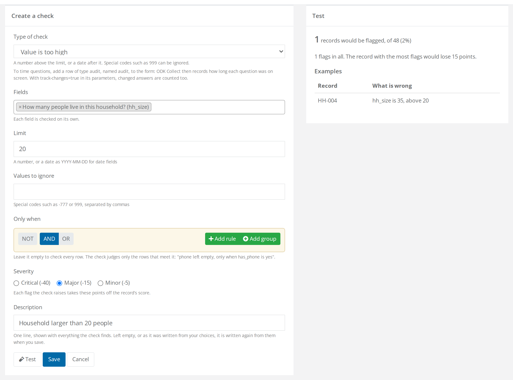

# Check types

A check is a definition you save on the form's Data quality page. The plugin's own code for its type runs it, so nothing is generated that could go stale when the form changes. This page explains the parts of a check first, then each type.

## The parts of a check

**Create a check**, in the Checks box of the Data quality page, opens the check page. **Edit**, on a check of the list, opens the same page with the check's choices.

<figure><figcaption>
Test shows what a check would find before you save it.
</figcaption></figure>

| Part | What it is |
| --- | --- |
| Type of check | What the check looks for. |
| Table | **Main table**, or a repeat. Shown for the types that can read a repeat, on forms that have one. |
| Fields | The questions the check reads, offered by what their question type is good for. |
| Options | The limits and choices of the type. A default is already in its box, where the type has one. |
| Only when | An optional condition: the check judges only the rows that meet it. |
| Severity | **Critical**, **Major** or **Minor**. |
| Description | One line, shown with everything the check finds. |

### Type of check

The list has two groups:

| Group | What its checks find |
| --- | --- |
| On each record: flags lower its score | A flag on each record that fails. |
| On the whole form: warnings, no score | Warnings about a field, a value, a group or a case. |

The list shows only the types the form can have. A type that needs a kind of question the form lacks is left out, and so are the types of the form's audit, of a follow-up's case and of "or other" answers on a form without them (see "[What a form needs](README.md#what-a-form-needs)"). A form with no question that any check can read shows *This form has no field a check can read.*

The help of each type shows below the list once you choose it.

### Table

A check on the main table judges one row per record. A check on a repeat judges every row of the repeat: its flags count against the record the row belongs to, and the message names the row, as in "members, row 3: ...". Some types read the main table only, and the page then hides the **Table** list.

A select multiple is a field of the table that holds the question, not a table of its own.

### Fields

The page offers each type only the fields it can read, from the form's dictionary, by their labels. These are never offered:

* answers marked for encryption, which the server cannot read;
* the form's primary key;
* the columns FormShare keeps for itself, such as who sent a submission and when it arrived.

A calculate is offered as a number when its answers are numbers: FormShare looks at up to 200 of them, and nine in ten must be numbers.

### Measures of the record

The types that take numbers also offer, at the end of the field list, a group called **Measures of the record**: numbers FormShare works out for each row, so that you can check them as you check answers.

| Measure | What it is | Offered on |
| --- | --- | --- |
| Interview length (minutes) | From the form's start to its end. An interview that ends before it starts has none. | The main table of a form with a start and an end. |
| Share of empty answers (%) | The table's questions left without an answer. A question skipped by its relevance is empty too, so compare records with each other rather than with a fixed share. | Any table. |
| Share of don't know and refused answers (%) | Of the questions answered, the share whose answer is one of the codes you give in **Codes for don't know and refused**, such as `dont_know, refused, -99, 999`. That box appears, and is required, when you choose this measure. | Any table. |
| Rows in *repeat* | How many rows the record has in a repeat, such as the members of a household. | The main table. |
| Time on screen (minutes) | How long the form's questions were on screen, from the [form's audit](#on-the-forms-audit). | The main table, with an audit. |
| Times the form was resumed | From the audit. | The main table, with an audit. |
| Answers changed | Answers changed after they were first given. Only when the audit row has `track-changes=true`. | The main table, with an audit. |
| Constraint errors at finalize | From the audit. | The main table, with an audit. |

The shares count only the questions a person answers: not calculates, the form's own metadata, keys, encrypted answers or FormShare's columns. A code for don't know is compared as a number with a numeric question and as text with the others, and never with a date.

A measure works as a number on the left side of **One answer against another**. "Rows in members not equal to hh_size" compares a household's roster with the household size it gave.

### Only when

Leave **Only when** empty to check every row. Build a condition in it to judge only the rows that meet it: "phone left empty, only when has_phone is yes". Each rule of the condition compares one answer with a value, and rules combine with AND and OR, and in groups.

* On a check of single answers, a row outside the condition is not judged, and counts as clean for that check.
* On an outlier, a duplicate or a check on the whole form, the condition chooses the answers compared. "income is an outlier, only among those working" works out the limits from those working alone.
* On a repeat, the condition can also read the record's main-table answers, listed under **The record's main table**, apart from the repeat's own under **This table**.
* Encrypted answers and FormShare's own columns cannot be used.

A condition reads answers as a list's filter does (see "[List filters](../../data-management/case-management/list-filters.md)"). A text matches only as written, capitals and spaces included; for a select question, the builder fills in the code for you. A comparison with a missing answer is false, except *is null* and *is not null*: "status not equal left" leaves out the rows with no status at all.

The checks list shows the condition in words, after "only when".

For the type **Answers break a rule** the same box is called **Flagged when**, and it holds the rule itself: a record that meets it is flagged.

### Severity

| Severity | Points off the record's score, by default |
| --- | --- |
| Critical | 40 |
| Major | 15 |
| Minor | 5 |

The page shows the points in use beside each choice, and a new check starts as **Major**. On a check of the whole form the severity says how serious its warnings are, and they still never lower a score. See "[Flags, warnings and scores](flags-and-scores.md#the-score)".

### Description

One line of up to 255 characters, shown in the checks list, with each flag and warning the check raises, and as the **Found by** of its flags. Leave it empty and FormShare writes one from your choices, such as "Interview under 10 minutes". A description FormShare wrote is written again from your new choices when you change them; one you typed stays as you typed it.

### Test

**Test** runs the check on the current records without saving anything, and shows the result in the **Test** box beside the form.

| Check | What Test shows |
| --- | --- |
| On each record | How many records it would flag, of how many; how many flags in all; the points the record with the most flags would lose; notes; up to 10 examples, each with its record and message. |
| On the whole form | How many warnings, and the first 50 of them; how many rows it read; notes; its table of answers or groups, with the lines that fail marked. |

With a condition, Test also says how many rows the condition keeps, of how many. The notes say what the check could not judge: a field whose answers are not numbers, a field with too few answers for an outlier, a group too small to test.

### Saving and removing

**Save** keeps the check and runs it on all the records in the background. The Data quality page then says whether the run started or is waiting for its turn (see "[When checks run](when-checks-run.md)"). Saving a check again runs it again, and what it no longer finds is marked as no longer found.

**Remove**, in the checks list, asks once more: **Remove it and its flags**. Removing a check deletes its flags and warnings, whatever their status, and scores its records again without them. Their issue numbers are not given to anything else.

## On each record

A check on records raises a flag on each record that fails it, and the flag takes points off the record's score. These checks run when a submission arrives, when an answer is changed, when the check is saved, on **Run checks** and at night.

### Values

| Type | Fields offered | Options |
| --- | --- | --- |
| Value is too low | Numbers (integer, decimal and range questions, and calculates whose answers are numbers) or dates (date, datetime, start and end), in any table; the measures of the record | **Limit** (required): a number, or a date as YYYY-MM-DD for date fields. **Values to ignore**: special codes such as -777, for numbers only. |
| Value is too high | The same | The same, with codes such as 999. |
| Value is an outlier | Numbers, in any table; the measures of the record | **Method**: *Interquartile range (as SurveyCTO)*, with **Times the interquartile range** (1.5); or *Standard deviations, as answered and on a logarithmic scale (as IMPACT's cleaningtools)*, with **Standard deviations from the mean** (3, at least 1). **Values to ignore**. |
| Answer is empty | Any question, in any table | None. |
| Date is in the future | Date, datetime, start and end, in any table | **Days of margin** (1). |
| GPS accuracy is poor | Geopoint questions, in any table | **Worse than (metres)** (50). **Flag an accuracy of 0**, ticked for a new check. |
| Value is a duplicate | Text, barcode, integer, date, select one and calculate questions; up to five, judged together | **Values to ignore**: placeholders such as 0000000000 or none. |

Value is too low and Value is too high take numbers or dates in one check, not both. An answer that is not a number is skipped, and Test notes how many.

Value is an outlier is judged against every answer to the field, so an arriving submission is compared with all the others.

* It needs 10 answers or more, 5 of them different. With fewer, the field is noted and nothing is flagged.
* By the interquartile range, a number is an outlier when it lies below the first quartile, or above the third, by more than the multiplier times the range.
* When half the answers or more are one or two values, such as a count most people answer 0, the interquartile range cannot tell an outlier. The field is noted, with a suggestion: add the most common answer to the values to ignore, or use standard deviations.
* By standard deviations, a number is an outlier when it lies beyond that many deviations from the mean, as answered or on a logarithmic scale (the log of the answer plus 1), which suits amounts that run high, such as income. A field with an answer below 0 is judged as answered only.

Answer is empty also flags a question that its relevance skipped. Say when the question should be answered under **Only when**.

Date is in the future compares a date with the day the submission arrived, not with today, so a date that was in the future when it was sent stays wrong. The margin covers the difference between the server's clock, in UTC, and the device's local date: without it, a form filled just after midnight, local time, could look a day ahead of the day it arrived.

GPS accuracy is poor reads the accuracy that ODK writes with each location. ODK Collect writes 0 for a location from a fake GPS app and for a point placed by hand on a map. An external GPS receiver gives 0 too, unless the question sets `allow-mock-accuracy`.

Value is a duplicate flags rows with the same value, or the same combination of values, as another row of the table: a phone number, or a name together with a birth year. Text is compared without case or extra spaces, and numbers as numbers. A row with one of the fields empty, or holding a value to ignore, is not compared. Every row of a duplicate group is flagged, and the message names up to three of the others. A new duplicate also flags the record it repeats.

### The interview as a whole

| Type | Fields offered | Options |
| --- | --- | --- |
| Interview is too short or too long | The form's start and end, found by their type and shown under **Measured** | **Shorter than (minutes)** and **Longer than (minutes)**: at least one, and the shorter less than the longer. |
| Near-duplicates (count empty answers) | Every question of the main table, except those you choose under **Questions left out** | **Answers that may differ (% of the questions compared)** (6). **Only among the same officer's records** (ticked). |
| Near-duplicates (not count empty answers) | The same | The same. |

An interview that ends before it starts is flagged as such.

A near-duplicate is a record whose answers differ from another's in only a few questions: an interview copied and then changed a little.

* A pair is near when the answers that differ are no more than the percentage of the questions compared, rounded. 6% is 7 of 120 questions, or 2 of 28.
* The questions compared are text, number, select one, select multiple, barcode and acknowledge questions. Never the form's start and end, the device, dates and times, notes, calculates, locations or media.
* Leave out what each interview asks anew, such as a name or a phone number. Otherwise a copy's new name and phone count as differences.
* The first type counts two empty answers as the same, as IMPACT's cleaningtools does, and leaves out a question that nobody in the group answered. The second judges a pair only on the questions either record answered, ten at least, so two records alike only in what they skipped are not near-duplicates.
* A check must compare 10 questions or more, so the page refuses to leave out more than that allows. It compares the questions the form has when the check is saved: save it again after a new version adds questions.
* By default an officer's records are compared with that officer's own, since someone who copies an interview copies one of theirs. Untick **Only among the same officer's records** to compare every record with every other. A group of more than 5,000 records is noted and not judged.
* Each record gets one flag, naming the nearest record first and up to two more: "Only 2 of 28 answers differ from KE-0000098; also near KE-0000097 (3 differ)".
* An arriving submission is compared with every record of its group, and the records it is near are flagged again, naming it.

### Rules between answers

| Type | Fields offered | Options |
| --- | --- | --- |
| Answers break a rule | The answers the rule reads | The rule, built under **Flagged when**: what it describes is flagged. |
| One answer against another | One to ten numbers, added up, or one date; the measures of the record among the numbers | **Flagged when it is**: less than, or before; at most, or on or before; equal to, or on the same day; not equal to, or on another day; at least, or on or after; more than, or after (the default). **The other answer** (required). |
| Answers are all the same | Three to twenty numbers or select one questions, judged together | None. |

A rule describes the failure. "distance_to_market is less_30 and access_to_market is no" flags a household less than 30 minutes from a market it cannot reach. On a repeat the rule can read the record's main-table answers too. Left without a description, the check takes the rule in words as its description, and each flag adds the answers it read.

One answer against another says what a rule cannot, because a rule compares an answer with a value you type: food spending more than all spending, the children of each age adding up to more than the household, an end date before its start.

* The other answer is a field of the same kind, numbers or dates, on the same row or, for a repeat, on its record's main table.
* An empty part of a sum counts as 0, and a side left empty is not judged.
* Numbers a rounding apart are equal, and dates are compared by day.
* A row whose answer is not a number is skipped, with a note.

Answers are all the same flags a record that gives every field it answered the same answer, with three answers at least: the eight food groups of a food consumption score all 7. Empty answers are left out. 7 and 7.0 are the same answer, and so are "Yes" and "yes".

### "Other, specify" answers

| Type | Fields offered | Options |
| --- | --- | --- |
| An 'other' text answered without its 'other' | The texts of the form's "or other" pairs | None. |
| An 'other' without its text | The same | None. |

An "or other" pair is a select with one choice that means "other", and a text question asked only when that choice is chosen. pyxform's `or_other` writes one, and so does any text question whose relevance is a single test of that kind, such as `${crops} = '96'` or `selected(${crops}, '96')`. Both questions must be in the same repeat, or both outside repeats. FormShare finds the pairs in the form itself.

* The first type flags a text that is answered while the select does not hold the choice that asks for it, which a recode or an edit can leave behind.
* The second flags a select that holds the choice while its text is empty.
* A record whose version did not ask one of the two questions is not judged.
* An encrypted text counts as answered when it holds a sealed answer, which a flag never shows.

Assistants can recode these texts to one of the select's choices on a page of their own: see "[Recode 'other' answers](supervisors-and-assistants.md#recode-other-answers)".

### On the form's audit

A form with a row of type `audit` makes ODK Collect record each screen it shows, when it appeared and when it was left, and send that with the submission. FormShare keeps it with the repository. These checks read the times of the audit, never its answers.

| Type | Fields offered | Options |
| --- | --- | --- |
| A question was answered too fast | One question with a screen of its own, notes included | **Faster than (seconds)** (required). |
| A section was answered too fast | The first and the last question of the section, in either order | **Faster than (seconds)** (required). |
| The interview was not where its GPS answer says | Geopoint questions of the main table | **Farther than (metres)** (500). |

The audit's four measures, under **Measures of the record**, are in "[Measures of the record](#measures-of-the-record)" above.

On a form without an audit row, the check page explains how to add one: a row of type `audit`, named `audit`. With `track-changes=true` in its parameters, Collect also records changed answers.

The time these checks read is screen time: the time each screen was shown, every screen counted once.

* A question with a screen of its own counts its screen, and a screen of several questions (a field-list group) counts whole.
* A break with the form closed, between leaving the form and resuming it, does not count, and neither do the jump, end and "add repeat" screens.
* Time with the form open on a question counts, even with the phone idle or in another app, because Collect closes a question only when its screen is left.

A question that shares its screen with others cannot be timed alone and is not offered to the first type: time its screen as a section instead.

A section is every question from the first to the last, in the form's order. A screen of several questions counts whole when one of its questions is in the section. Both ends must be in the same repeat, or both outside repeats.

In a repeat, each row is judged and the message names the rows that failed: "mem_name to mem_age on screen under 6 seconds in members 2 (2 s)".

The GPS type needs `location-priority` in the audit row's parameters, so that Collect records where the device was. It compares the answer with the device's latest location while the GPS question was on screen or, without one, with the middle (the median) of the interview's locations. Both accuracies are taken off the distance, in the record's favour.

What these checks do not judge:

* a record without an audit, such as a submission made in Enketo or one sent before the form had its audit row;
* a section that was never shown;
* for the GPS type, a record whose audit holds no location.

A check whose question a new version moved onto a shared screen, or out of its repeat, is not run, and its line in the checks list says why. An audit that arrives in a later part of a submission sent in parts comes after the record was checked: the nightly run or **Run checks** catches it.

### Across forms

These types run on a follow-up: a form that picks its case from a [published list](../../data-management/case-management/published-lists.md) through its [case link](../../data-management/case-management/case-links.md). They read the case's own answers, in the row of the list's source table that the follow-up chose. The check page names the list and the form that registers its cases.

| Type | Flags a follow-up when | Options |
| --- | --- | --- |
| Follow-up is dated before its case | Its date is before the case's, or before the date of an earlier visit of the case with this form | Fields: date questions of the follow-up, or **When it arrived**. **The case's date** (required): a date question of the case, or **When it was registered**. **Also against the earlier visits of the case with this form** (ticked). **Days of margin** (1). |
| Answer disagrees with the case | One answer differs from the case's, or from the previous visit's | Field: one answer. **Compared with**: *An answer of the case*, chosen under **The case's answer**, or *The previous visit with this form that answered it*. **Flagged when it**: differs; differs by more than an amount; differs by more than a percentage; is lower; is higher. **By more than**, for an amount or a percentage. |
| Follow-up by another officer | Whoever sent it is not whom the case was assigned to when it arrived | **Leave out the form's supervisors** (ticked). |
| Follow-up without the form it should follow | The case had no submission of another form before this one | **The form it should follow** (required). |

The follow-up is flagged, never the registration: which of the two is wrong cannot be told, so the message gives the case's answer and label.

Earlier visits are the case's other submissions of the same form that arrived before this one. A visit sent late, after a later one, is compared in the order they arrived. For a form whose submissions are separate events in any order, such as one support after another, untick **Also against the earlier visits of the case with this form**.

Answer disagrees with the case compares dates by day, numbers as numbers and text without case.

* An amount, a percentage, *is lower* and *is higher* need numbers on both sides; the page refuses them otherwise.
* An answer missing on either side is not judged: that is the job of **Answer is empty**.
* A percentage of 0 cannot be taken, and Test notes such answers.

Follow-up by another officer reads whom the case was assigned to at the moment the follow-up arrived, from the changes recorded on the case, so a case reassigned later is judged by its assignee then. A supervisor of the follow-up form may follow up any case, which is why supervisors are left out by default. The type means most where a list serves each assistant their own cases, and it is offered only when the case's repository records whom each case is assigned to.

The form it should follow is another form of this project that follows up the same cases, such as an income survey that should come after support was received. What a list's filter already requires, the form refuses when the submission arrives, so no check is needed for that.

A check across forms never reads encrypted answers, nor the case's [properties](../../data-management/case-management/properties.md): properties are set by the forms' actions, and the follow-up being checked may have changed them itself.

When the list belongs to another project, a check reads only what the list serves, which that project's devices see already. When the case was registered, and whom it is assigned to, can be read only when the list serves them from a main table. A type that needs what the list does not serve is not offered, and a saved check that reads a column the list stopped serving is not run, with a note.

When a case changes in Clean data, or through the cleaning API, the follow-ups of that case are checked again in the background.

## On the whole form

A check on the whole form judges the answers together and raises warnings, which never lower a score. These checks run when you save them, on **Run checks** and at night, never when a single submission arrives.

| Type | Fields offered | Options |
| --- | --- | --- |
| Value is too frequent | Select one, select multiple (each choice counted on its own) and integer questions | **Percentage of the answers** (required). |
| Value is too infrequent | The same | **Percentage of the answers** (required). |
| Mean is too low | Numbers; the measures of the record | **Limit** (required). **Values to ignore**. |
| Mean is too high | The same | The same. |
| Group mean is different | Numbers; the measures of the record | **Group by**: *Officer (who sent it)*, or a select one question. **p-value** (0.05). **Values to ignore**. |
| Group distribution is different | A select one question | **Group by**. **p-value** (0.05). |
| Cases without a follow-up | None: it reads the cases | **The follow-up form** (required). **Days without one** (30). |

Value is too frequent warns about each answer given in more than the percentage of the answers to the field. Value is too infrequent warns about each one given in less, among the answers that appear. Answers show with their labels: "'2' (Secondary)".

The group types compare groups of records: officers, or the answers to a select one of the table (on a repeat, also of its main table).

* The overall test comes first: ANOVA for means, chi-squared for distributions. Then each group is compared with the rest of the answers, by Welch's t-test or a chi-squared.
* A group differs when its p is below the p-value divided by the number of groups, so that with many officers none differs by chance alone.
* A group found different is set aside before the others are compared again, so one officer far off does not make every other officer look different.
* A group with fewer than 5 answers is noted, not tested.

Warnings about officers are also counted for each officer in the **By who sent the records** box.

Cases without a follow-up is a check on the form that registers the cases, and the follow-up form is one of this project's forms that follows them up. It warns once for each case the follow-up's list serves (active, and within the list's filter) with no submission of the follow-up form in the last days you give, counted from the case's registration when it has none. One warning per case lets you dismiss a case on its own, such as one that moved away. A warning is marked as no longer found when its case gets its follow-up or leaves the list.

## Records sent with different versions

Every version merged into a repository runs the repository's checks, and a question one version asks and another does not is empty in the other's records. So each record is judged on what its own version asked:

* Answer is empty leaves out a question the record's version did not ask.
* A check whose **Only when**, or rule, reads such a question leaves the record out, and the record counts as clean for that check.
* The shares of empty answers and of don't know answers count the questions of the record's version, and a version without a repeat has no count of its rows.
* Near-duplicates compare a pair on the questions both versions asked.
