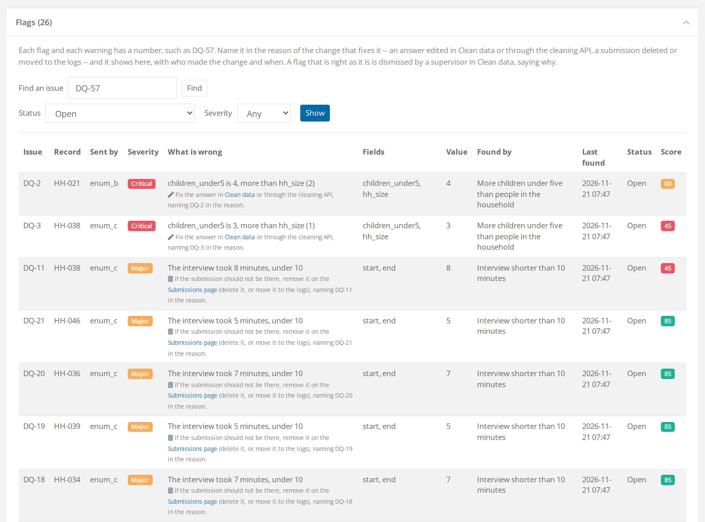

# Flags, warnings and scores

A check on records raises flags, one for each problem it finds on a record, and the open flags make the record's score. A check on the whole form raises warnings, which stay out of every score. Both are issues with a number, and both keep a history of what became of them.

## Flags

A flag is one problem on one record, found by a check or posted by a script through the [flags API](flags-api.md). The **Flags** box of the Data quality page lists them, the most severe first and then the most recently found, 50 to a page.

| Column | What it shows |
| --- | --- |
| Issue | The flag's number, such as DQ-57. |
| Record | The record's label: the value of the form's primary key. |
| Sent by | The officer who sent the submission. |
| Severity | Critical, Major or Minor. |
| What is wrong | The message, such as "hh_size is 35, above 20". For an open flag, it also says where to fix it. |
| Fields | The fields it is about, or the measure of the record, in words. |
| Value | The answer it judged. |
| Found by | The check's description, or the name of the script that posted it. |
| Last found | When its check or script last found it. |
| Status | What became of it (see "[What became of an issue](#what-became-of-an-issue)"). |
| Score | The record's score now. |

<figure><figcaption>
The open flags of the household survey.
</figcaption></figure>

The list shows the open flags until you choose another **Status** (or *All*) or a **Severity**, then **Show**. **Find an issue** takes a number, `DQ-57` or `57`, and shows that flag or warning whatever the filters; **Show all** returns to the list.

A flag on a row of a repeat counts against the record the row belongs to, and its message names the row.

### Statuses

| Status | Meaning |
| --- | --- |
| Open | The problem is there, and the flag takes points off the score. |
| Dismissed by a supervisor | A supervisor decided it does not count, and said why. |
| No longer found by its source | The check or script that raised it no longer finds it: the answer was fixed, the check was changed, or the record no longer meets the check's condition. |
| Removed with their submission | Its submission was deleted or moved to the logs. |

### The same flag from run to run

A flag stays the same flag while the same source finds the same problem: the same check on the same fields and, in a repeat, on the same row.

* Found again, an open flag keeps its number and when it was first found, and takes the new message and value.
* No longer found, an open flag is marked as no longer found.
* Found again after that, it opens again, with its number.
* Found again after a supervisor dismissed it, it stays dismissed.

## The score

A record's Data Quality Score is 100 minus the weight of each of its open flags, from every check and script, and never less than 0. A record that no check has looked at has no score, and the pages show *Not scored* rather than 100. Once a check on records has run over all the records, every record has a score: 100 for a record with no open flag.

| Severity | Weight, by default |
| --- | --- |
| Critical | 40 |
| Major | 15 |
| Minor | 5 |

A record with one major flag and two minor ones therefore scores 75.

A score reads in one of three colours:

| Band | Score |
| --- | --- |
| Green | 80 or more |
| Amber | 50 to 79 |
| Red | below 50 |

The Data quality page shows the scores in the boxes **Records scored**, **Mean score**, **Records by band** and **Open flags**, for each officer in **By who sent the records**, and for each flag in the **Score** column. Assistants see them in Clean data.

No one can type a score. Clean data and the cleaning API treat the score as read-only, since a score typed in would hide what lowered it. The score is kept on the record's main row and copied to its repeat rows.

Each change of a score is recorded in the form's [audit log](../../data-management/cleaning/in-a-repository/audit-log.md), like an edit: as the person who ran the checks or made the change, as `dq:checks` for the checks of an arriving submission, and as `dq:nightly` for the nightly run.

A low score only marks a record. It excludes nothing from exports, published lists or analysis.


**For server administrators.** The weights are `dq.weight.critical`, `dq.weight.major` and `dq.weight.minor` in FormShare's .ini file, each a whole number from 0 to 100. The Data quality page and the check page show the weights in use. Scores already written change when their records are next scored, for example by a run over all records.


## Warnings

A warning is what a check on the whole form finds. It can be about a field ("The mean of income_30d is 120.5, below 500 (300 answers)"), about one of its answers ("'none' is 72% of the answers to education (216 of 300), more than 60%"), about a group such as an officer, or about a case nobody followed up. A warning never takes points off a score.

The **Warnings** box groups the warnings under their check, with how many each check has, 50 to a page. It shows when the form has a check on the whole form, or warnings left from one.

| Column | What it shows |
| --- | --- |
| Issue | Its number, from the same sequence as the flags. |
| Severity | The severity of its check. |
| What it found | The message. |
| Last found | When a run last found it. |
| Status | Open; Dismissed by whom and when, with the reason; or No longer found. |

The box shows the open warnings until you choose another **Status** (Dismissed, No longer found or All) and, on a form with more than one check on the whole form, a **Check**.

A warning lives as a flag does. Found again, it is updated; no longer found, it is marked so; dismissed, it stays dismissed.

The project's owner, administrators and editors dismiss warnings on the Data quality page. **Dismiss** opens a box, *Why it does not count*, and **Dismiss it** sends it. The reason is required, up to 1,000 characters, and only an open warning can be dismissed. The page then returns to the warnings as they were shown, on the same page.

## Issue numbers

Every flag and every warning has a number in its repository, such as DQ-57, taken from one sequence for both. All the versions of a form share the repository, and so share its numbers. A number is never given again, even after its check is removed, so the sequence can have gaps.

## Fixing an issue

An open flag says where it is fixed:

| The flag is about | Where it is fixed |
| --- | --- |
| An answer that can be changed | In Clean data, by an assistant who can clean the form, or through the [cleaning API](../../data-management/cleaning/in-a-repository/api.md). |
| The submission as a whole | On the form's **Manage submissions** page, which the flag calls the Submissions page: delete the submission, or move it to the logs, when it should not be there. Only the project's owner and administrators can, and an editor is told so. |

The flags about a submission as a whole are those of Interview is too short or too long, the two near-duplicate types, the two too-fast types, Follow-up by another officer and Follow-up without the form it should follow, and any flag that names only a measure of the record or when the submission arrived. A script's flag points to an answer when it names one that can be changed.

Either kind of flag can also be right as it is. A supervisor then [dismisses it](#dismissing-a-flag).

### Naming the issue in the reason

The change that fixes an issue can name it in its reason:

| Where the change is made | The reason |
| --- | --- |
| Clean data, editing an answer or a select multiple | **Reason for the change** |
| The cleaning API | The `_reason` field |
| Manage submissions, deleting a submission | **Reason for deleting it** |
| Manage submissions, moving a submission to the logs | **Reason for moving it** |
| Recode 'other' answers | **Reason (optional)** |

Write the number as `DQ-57`, in any case. One reason can name up to 20 issues, and a number that is no issue of the repository is ignored. A reason can also name another record's issue: the reason for deleting the copy of a duplicate can name the original's flag.

The issue then shows the change, with who made it, when and why.

FormShare offers a reason only where the repository's audit records it, and the Data quality page suggests naming the issue only there.


**For server administrators.** In a repository whose audit triggers are older than change reasons, a table does not keep the reason, so FormShare does not offer the box there. `regenerate_audit_triggers --all-tables <ini>` writes again the triggers of every table that does not record reasons yet.


### What became of an issue

The **Status** column, of the flags and of the warnings, says what became of each issue:

| The status reads | Meaning |
| --- | --- |
| Open | Still found. |
| Changed by *someone*, *when*: *reason*; still found | An answer the flag names was edited since it was found, and the check still finds the problem. |
| Fixed by *someone*, *when* | No longer found. The last edit of its answers before then is shown, with its reason. |
| Fixed in a change by *someone*, *when* | No longer found, after a change whose reason named it. |
| Fixed when a submission was deleted by *someone*, or moved to the logs by *someone* | No longer found, after a removal whose reason named it, such as the copy of a duplicate. |
| No longer found, *when* | No longer found, with no change to show for it. |
| Dismissed by *someone*, *when* | A supervisor, or for a warning an owner, administrator or editor, dismissed it. The reason is below. |
| Its submission was deleted by *someone*, or moved to the logs by *someone* | The submission left the repository. The reason given then is below, and so is the earlier dismissal, if the flag had one. |
| Its submission is no longer in the repository | The submission went without FormShare saying who removed it, as after **Delete all submissions**. |
| Named in a change by *someone* | A change whose reason named the issue, other than the one that fixed it. |
| Named when a submission was deleted by *someone*, or moved to the logs by *someone* | A removal whose reason named the issue. |

Up to three changes show for each issue, then "and N more".

## Dismissing a flag

Only a supervisor of the form dismisses a flag, in Clean data, when the value is genuine or there is nothing to act on. "[Supervisors and assistants](supervisors-and-assistants.md#dismissing-a-flag)" covers who supervisors are and where the button is.

* The reason is required, up to 1,000 characters.
* Only an open flag can be dismissed.
* The record is scored again at once, without the flag.
* A dismissed flag stays dismissed while its check or script keeps finding it.
* The pages have no way to undo a dismissal.

## When a submission is removed

A submission deleted, or moved to the logs, on the Manage submissions page keeps its flags. They are marked as removed, with who removed the submission, when, why and how, and with the record's label. If the submission comes back from the logs as the same record and its check finds a flag again, the flag is as it was before: open, or dismissed.

**Delete all submissions** empties the repository at once, without telling the plugin of each submission. The next run over all records marks the flags of the records gone as removed, without who or why, and so does opening the Data quality page of the empty repository.

## When a check is removed

Removing a check deletes its flags and warnings, whatever their status, and scores its records again without them. Their numbers are not given to anything else.
