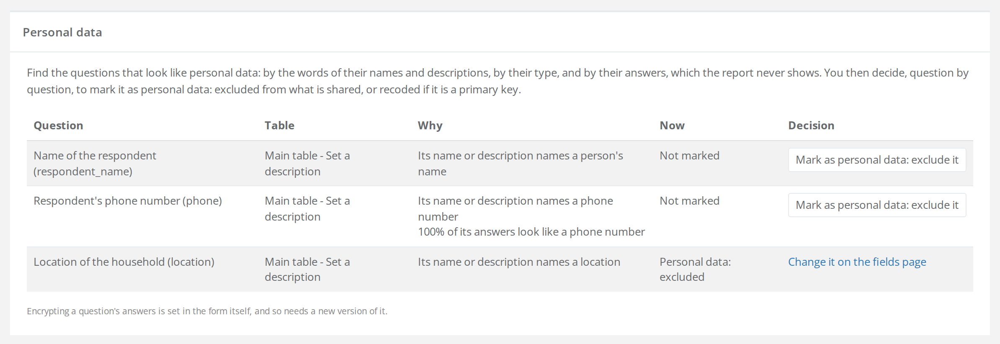

# Finding personal data

The Data quality plugin adds a **Personal data** box to the tables page of the form's [data dictionary](../../data-management/data-dictionary/README.md): **Dictionary**, in the form's **Repository tools**. Its **Find personal data** button reports the questions that look like personal data. You then decide, question by question, whether to mark each one. Nothing is marked unless you choose it.

<figure><figcaption>
The report gives the reasons, never the answers.
</figcaption></figure>

## What it looks at

| Clue | What counts |
| --- | --- |
| The words of the question's name and description | Words for a person's name, a phone number, an email address, an address, an identity number, a birth date or a location, in English, French, Spanish and Portuguese, accents ignored. "national id" and "id number" count as an identity number. A name of a place, a group or a thing, such as "village name" or "name of the school", is not a person's name. |
| The question's type | Geopoint, geotrace and geoshape questions hold a location. Image, audio and video questions hold a photo, a recording or a video. |
| The answers | Of up to 200 different answers to a text question, the share that look like email addresses or phone numbers. It counts when half the answers or more look so, two of them at least. |

The report never shows the answers themselves, and the answers of an encrypted question are not read. It looks at the form's main table and its repeats, not at lookup tables or at the columns FormShare keeps for itself.

## The report

| Column | What it shows |
| --- | --- |
| Question | Its label and name, and *primary key* for the form's key. |
| Table | The table that holds it. |
| Why | Each clue found: "Its name or description names a phone number", "Its type holds a location", "100% of its answers look like a phone number". |
| Now | *Personal data: excluded*, *Personal data: recoded*, *Encrypted*, or *Not marked*. |
| Decision | For a question not marked, a button to mark it. For one already marked, a link: **Change it on the fields page**. |

A form with nothing to report says *No question looks like personal data.*

## Marking a question

The button marks the question as personal data with the protection that suits it:

| The question is | Button | What the mark does |
| --- | --- | --- |
| The form's primary key | **Mark as personal data: recode it** | Its values are replaced by codes in what is shared, so records can still be told apart. |
| Any other question | **Mark as personal data: exclude it** | It is left out of what is shared. |

This is the same mark the fields page of the dictionary gives. See "[Marking fields as sensitive](../../data-management/data-dictionary/marking-sensitive-fields.md)" for what each protection does to public data products, and to change a protection afterwards.

The project's owner, administrators and editors see the buttons. Members see the report without them.

Encrypting a question's answers is set in the form itself, so it needs a new version of the form; the report only says when a question is encrypted already. See "[Merging subversions of a form](../../fundamentals/repositories/merging-subversions-of-a-form.md)".

If the report cannot be made, the box says *The report could not be made. The technical team can read why in the log.*
