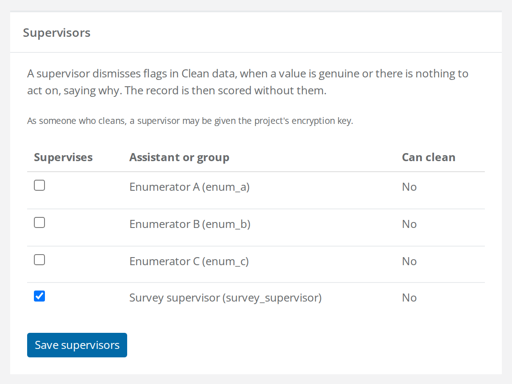
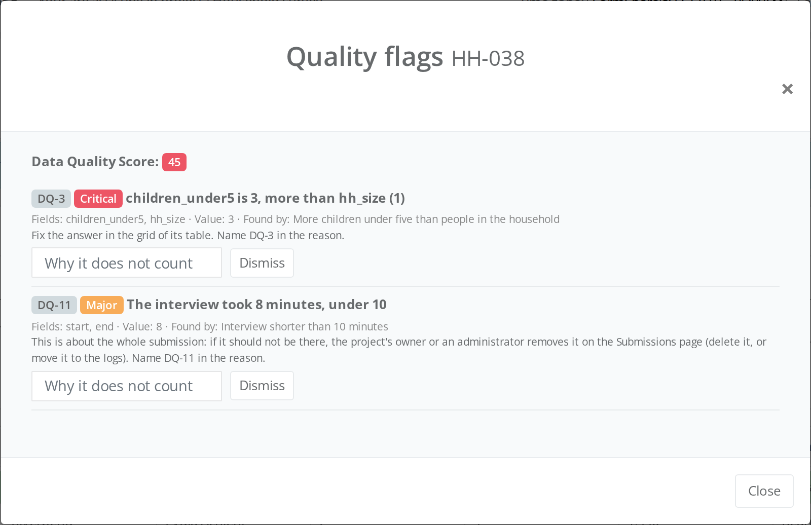
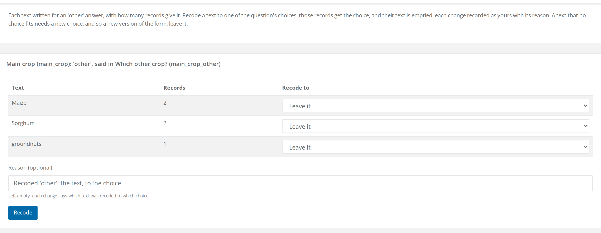

# Supervisors and assistants

Assistants meet the data quality checks in **Clean data**, in the Assistant Access portal (see "[The web interface](../../data-management/cleaning/in-a-repository/web-interface.md)"). An assistant who can clean a form sees each record's score and flags there, and fixes the answers. A supervisor can also dismiss a flag that is right as it is.

## Supervisors

A supervisor is an assistant, or an assistant group, marked as supervising a form. The project's owner, administrators and editors choose them in the **Supervisors** box of the Data quality page.

<figure><figcaption>
Tick who supervises the form's flags.
</figcaption></figure>

The box lists the assistants and the groups given the form, with a **Can clean** column. Tick **Supervises** for those who supervise, and press **Save supervisors**. A form with no assistant or group yet says *Assign assistants or groups to this form first.* (see "[Assistants](../../fundamentals/tasks/README.md)" and "[Assistant groups](../../fundamentals/tasks/assistant-groups.md)").

* An inactive assistant or group is marked *inactive*. A group supervises only while it is active, and its members supervise through it.
* Supervisors dismiss flags in Clean data, and Clean data opens only for an assistant who can clean the form. Give a supervisor **Can clean** too; the box shows who has it.
* Supervisors are set for each version of the form. When you upload a new version for merging, **Keep assistants** carries the assistants and groups over with their supervisor mark.
* In a project that encrypts answers, a supervisor counts among the people who may be given the project's key, as someone who cleans does. Taking the mark away takes that right away too, unless the person can still clean the form.
* The check **Follow-up by another officer** leaves the form's supervisors out by default, since a supervisor may follow up a colleague's case.

## What an assistant sees in Clean data

### Quality flags

On a form that has checks or flags, the grid of the main table has a **Quality flags** button in its pager, at the bottom of the grid. It opens the flags of the record selected in the grid; with none selected, it says *Select a record in the grid first.*

<figure><figcaption>
A supervisor sees the reason box and Dismiss under each open flag.
</figcaption></figure>

The dialog shows:

* the record's label and its **Data Quality Score**, as a coloured badge, or *not scored yet*;
* its open flags, then its dismissed ones, the most severe first, each with its number, its severity, what is wrong, its fields, its value and what found it;
* for an open flag, where to fix it: *Fix the answer in the grid of its table.*, or, for a flag about the submission as a whole, that the project's owner or an administrator removes it on the Submissions page;
* where the repository keeps reasons, *Name DQ-57 in the reason.*, with the flag's own number;
* any edit of the flag's answers that did not fix it, as *Changed by ...; still found*, and the changes whose reason named it;
* for a dismissed flag, who dismissed it and why.

A record without flags shows *This record has no flags.* Flags of a repeat's rows show in the dialog of their record, and their message names the row.

A form whose repository has no place for a score shows no **Quality flags** button.

### The score column

The grid's **Data Quality Score** column shows each record's score as a coloured badge: green from 80, amber from 50, red below. The column is read-only. If you choose which fields the grid shows, include Data Quality Score to see it. In the grid of a repeat, the same column holds the score of the row's record, as a number.

### Fixing a flagged answer

Edit the answer in the grid as you edit any other. The checks on records run again on the record as soon as the change is stored: a flag the edit fixed is marked as no longer found, and the score changes when the grid reloads. The flag then shows who fixed it and when.

Write why in **Reason for the change**, and name the issue there, for example DQ-57. The reason then shows with the fix. A reason that names the issue also links your change to it when the answer you changed is not one the flag names.

For a flag on a repeat's row, load the repeat's table to edit the answer.

An edit that does not fix the problem leaves the flag open, and the flag shows the edit as *Changed by ...; still found*.

## Dismissing a flag

A supervisor sees, under each open flag of the dialog, a box, *Why it does not count*, and a **Dismiss** button. Dismiss a flag when the value is genuine, or when there is nothing to act on; fix the answer otherwise.

* The reason is required, up to 1,000 characters. The dialog does not send a dismissal without it, and says *Say why it does not count*.
* Dismissing scores the record again at once, without the flag, and reloads the grid.
* A dismissed flag stays dismissed while its check keeps finding it, and the pages have no way to undo a dismissal.

Warnings are dismissed on the Data quality page, by the project's owner, administrators and editors (see "[Warnings](flags-and-scores.md#warnings)").

## Recode 'other' answers

On a form with "or other" pairs (see "[Other, specify answers](check-types.md#other-specify-answers)"), Clean data says *This form asks for 'other, specify' answers.* above the grid, with a link: **Recode them to a choice**. It opens the **Recode 'other' answers** page, for assistants who can clean the form. The project's owner and collaborators have no such page: the changes are made, and audited, as the assistant who makes them.

<figure><figcaption>
Texts written for Other, with how many records give each.
</figcaption></figure>

For each pair the page has a box, headed with the select question, the choice that means "other" and the text question that says which. The box lists each text written there, with how many records give it. Texts that differ only in case or spaces are one text, shown as it was written most often.

For each text, choose one of the select's choices under **Recode to**, or keep **Leave it**, and press **Recode**. Every record with that text then gets the choice, and its text is emptied:

* in a select one, the choice becomes the answer; in a select multiple, it takes the place of the "other" choice;
* each change is made as you, as an edit in Clean data is, and recorded in the [audit log](../../data-management/cleaning/in-a-repository/audit-log.md);
* the checks on records run again on each record changed;
* the select is changed first, so a record whose select is refused keeps its text, and the page lists what was not recoded and why;
* the page then says how many records were recoded.

**Reason (optional)** shows where the repository keeps reasons. Left empty, each change says which text was recoded to which choice, as in "Recoded 'other': 'maize' to Maize (1)".

A text that no choice fits needs a new choice, and so a new version of the form: leave it as it is.

The page leaves out a pair whose questions are encrypted, and a pair whose select has no other choice to recode to. A form left with no pair to recode shows *This form has no 'other' answers to recode*.

Once its texts are recoded, a record passes the check **An 'other' text answered without its 'other'**, which flags a text left behind after its select stopped being "other".
