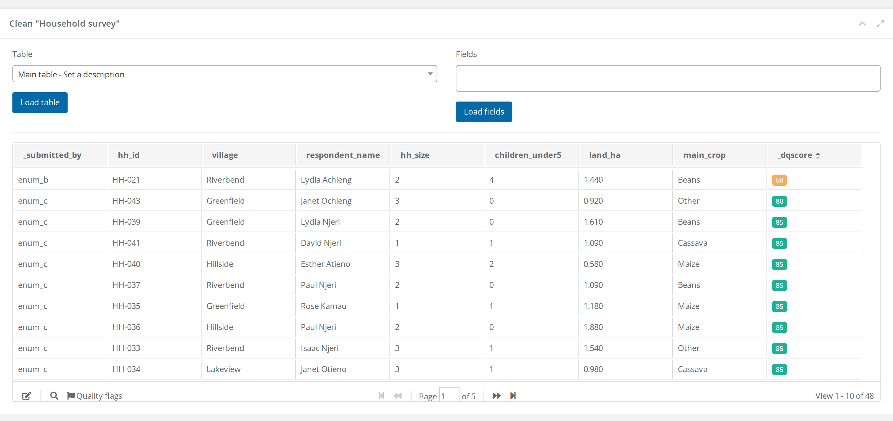
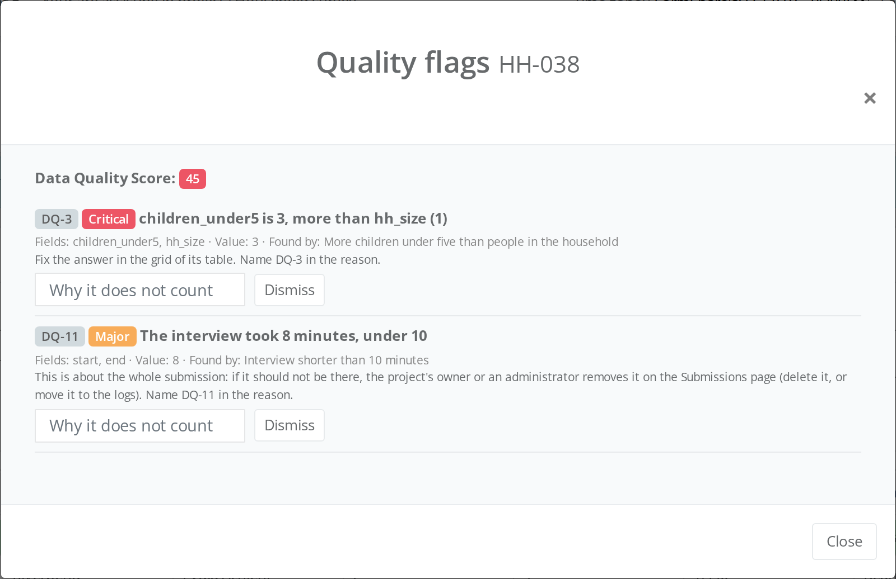
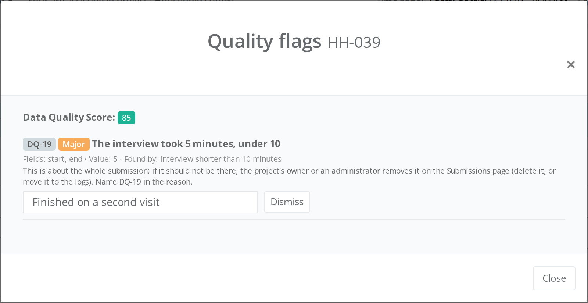
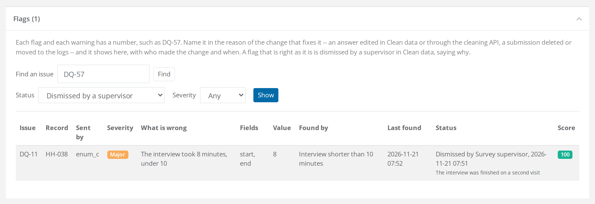
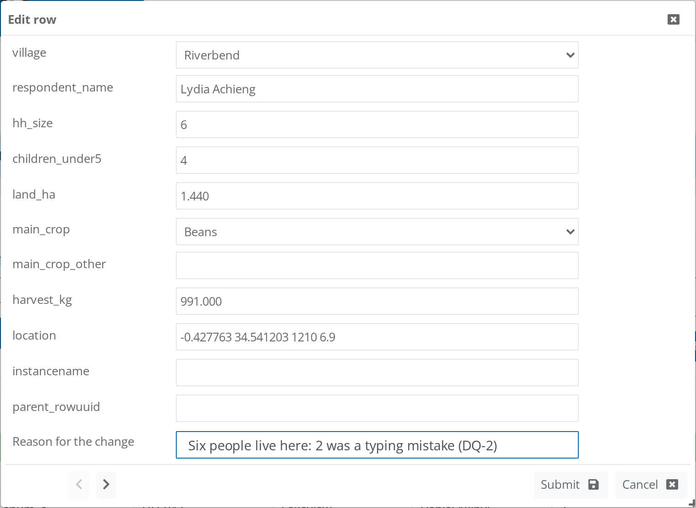
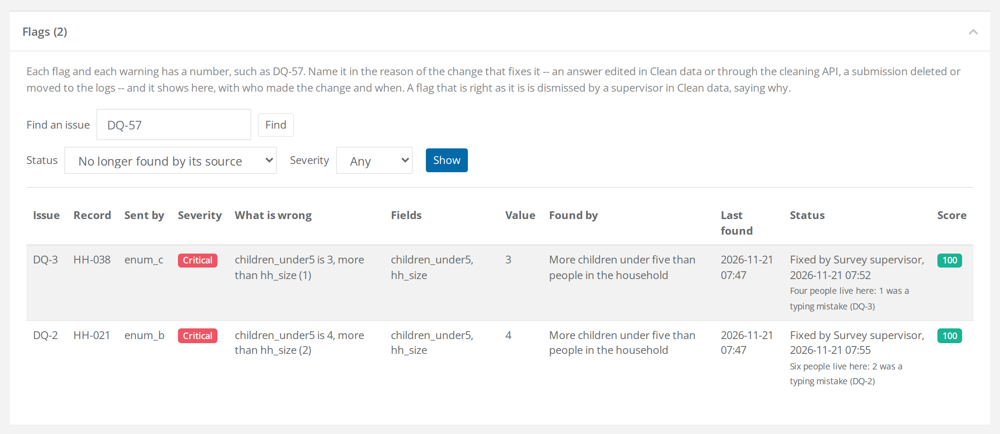
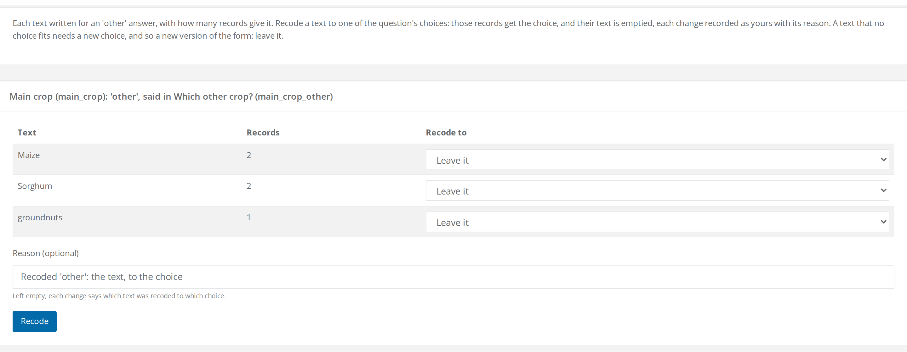

# Walkthrough: review flags as a supervisor

This walkthrough follows "[Check a household survey](walkthrough.md)". The checks have flagged 26 problems in 48 households, and the project's owner has made you a supervisor of the form, with the right to clean its data. You work in Clean data, as an assistant.



## Open Clean data and sort by score

Sign in as an assistant, open **Clean data** for the household survey, choose the main table and click **Load table**. The grid has a column with each record's score, in the band's colour: green from 80, amber from 50 to 79, red below 50. Click its header to put the lowest scores first.

<figure><figcaption>
Some columns are hidden here so the score shows. <strong>Quality flags</strong>, at the bottom left of the grid, opens the flags of the selected record.
</figcaption></figure>



## Read a record's flags

Click a record, then **Quality flags**. The window lists each open flag with its number, its severity, what is wrong, the fields and the value it is about, the check that found it, and where it is fixed.

<figure><figcaption>
A flag about an answer is fixed in the grid. A flag about the whole submission, such as a five-minute interview, is for the owner to settle on the Submissions page, if the submission should not be there.
</figcaption></figure>

Each flag either points at something to fix, or is right as it is. The next two steps do one of each.



## Dismiss a flag that is right as it is

The enumerator explains that a short interview was finished on a second visit: the data are fine. Type why in the flag's **Why it does not count** box and click **Dismiss**.

<figure><figcaption>
A reason is required: a dismissal without one is refused.
</figcaption></figure>

The record is scored again without the flag, here from 85 to 100. The flag stays on the owner's Data quality page, as dismissed by you, with your reason.

<figure><figcaption>
The owner's page, with <strong>Status</strong> set to <em>Dismissed by a supervisor</em>.
</figcaption></figure>

A dismissed flag stays dismissed while its check keeps finding the same thing.



## Fix a wrong answer, naming its issue

HH-021 has 4 children under five in a household of 2. The enumerator's notes say six people live there. Close the window, select HH-021, and click the pencil at the bottom left of the grid to edit the row. Change `hh_size` to `6`, and in **Reason for the change** write what you did and the issue number:

<figure><figcaption>
The reason is kept with the change in the form's audit, whatever the issue.
</figcaption></figure>

Click **Submit**. The record is checked again at once: the flag is gone and the score is back to 100. On the owner's page, the flag closes as fixed by you, with your reason.

<figure><figcaption>
A change to the flagged answer shows as the fix on its own. Naming the issue in the reason is what ties any other change to the flag: a fix to another answer, or the removal of the submission.
</figcaption></figure>



## Recode "other" answers to a choice

Above the grid, a note says the form asks for "other, specify" answers. Click **Recode them to a choice**. The page lists each text written for an "other", with how many records give it.

<figure><figcaption>
Two enumerators chose <em>Other</em> and wrote <em>Maize</em>, which is one of the choices.
</figcaption></figure>

For *Maize*, choose **Maize (maize)** under **Recode to**, leave the others as **Leave it**, and click **Recode**. Those records get the choice, and their text is emptied. Each change is recorded as yours, with the reason you typed, or, left empty, with which text was recoded to which choice.

*Sorghum* and *groundnuts* fit no choice. They need a new choice, which means a new version of the form: leave them.



## What's next

* Read "[Flags, warnings and scores](flags-and-scores.md)" for how flags open and close, and what a dismissal does.
* Read "[Supervisors and assistants](supervisors-and-assistants.md)" for who may dismiss a flag.
* Read "[Cleaning data](../../data-management/cleaning/README.md)" for the rest of Clean data.
