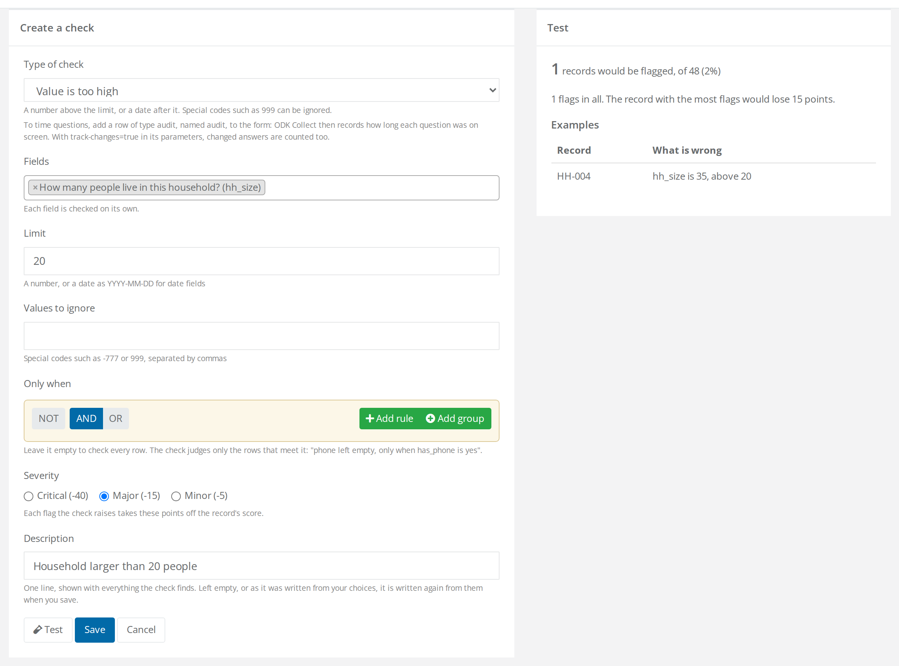
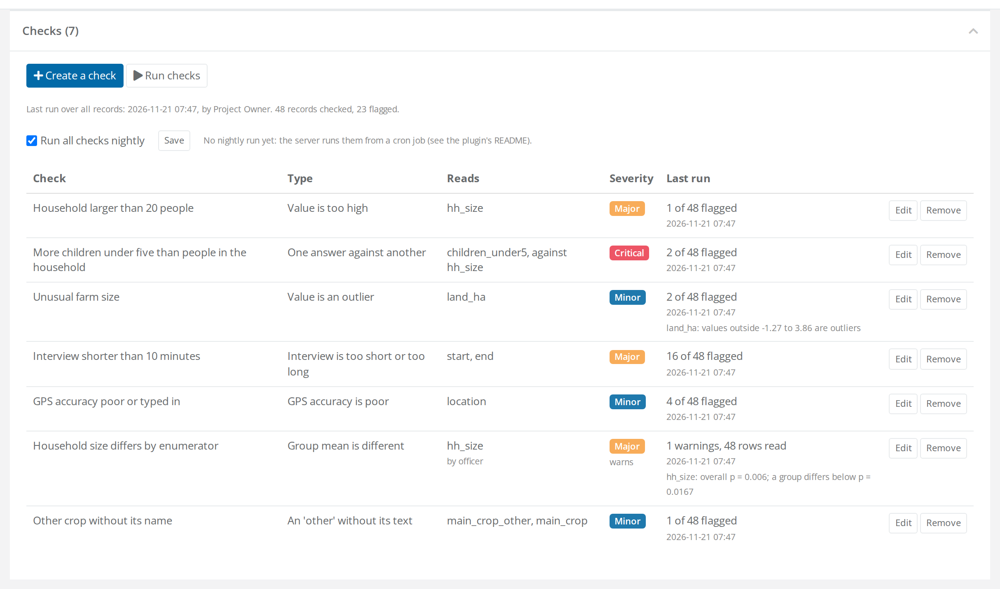
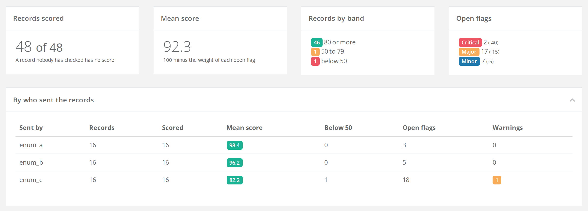
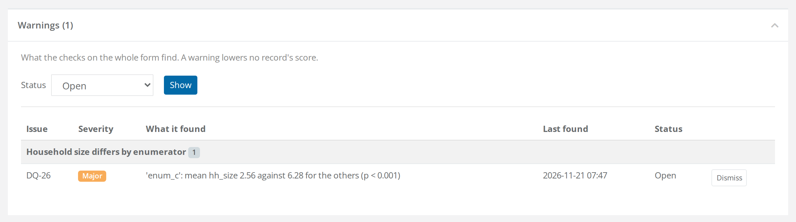
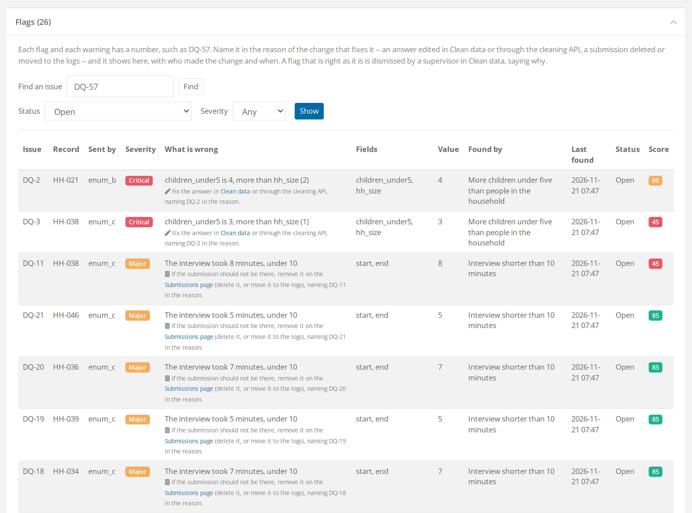
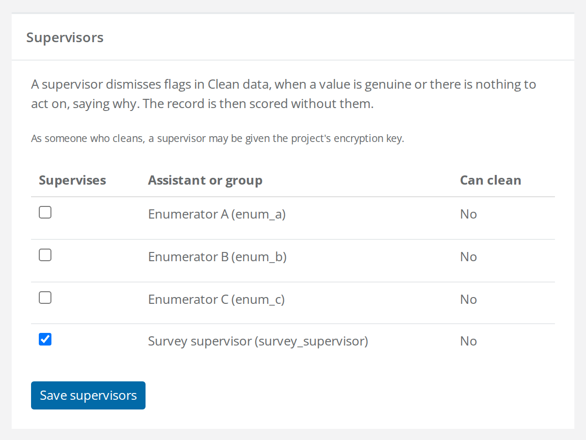
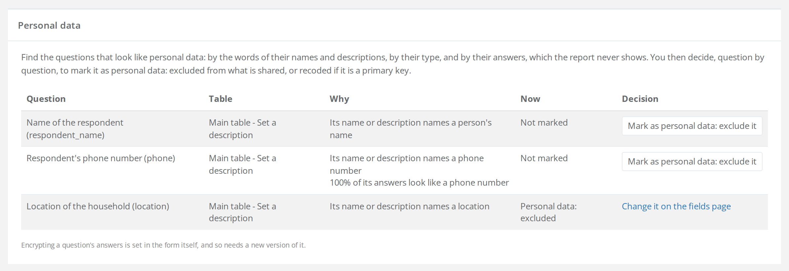

# Walkthrough: check a household survey

This walkthrough sets up checks on a household survey and reads what they find. The example has 48 households sent by three enumerators, with the mistakes a real survey has: interviews that took five minutes, a household of 35 people, more children under five than people in the household, farms of 120 hectares, GPS positions typed by hand, and "other" crops that are not other at all.

A second walkthrough, "[Review flags as a supervisor](walkthrough-supervisor.md)", picks up where this one ends: the supervisor fixes or dismisses what the checks found.

## Download the example


The household survey: one household per submission, primary key `hh_id`. Upload it to a project, give it to your enumerators, create its repository and collect a few households.


Data quality works on forms with a repository. A form in testing has nothing to check yet.



## Open the form's Data quality page

Open the form's page and click **Data quality**. A form without checks shows **Create a check**, and the summary panels say that no record is scored yet.

The page is for the project's owner and the people who manage the project. Enumerators never see it.



## Create a check and test it

Click **Create a check** and fill it in:

| Field | Value |
| --- | --- |
| Type of check | Value is too high |
| Fields | How many people live in this household? (`hh_size`) |
| Limit | `20` |
| Values to ignore | *(leave empty)* |
| Only when | *(leave empty)* |
| Severity | Major (-15) |
| Description | `Household larger than 20 people` |

Before saving, click **Test**. The panel beside the form says how many records the check would flag, how many points the worst record would lose, and shows examples.

<figure><figcaption>
One household out of 48: HH-004, with 35 people. Most likely 3 or 5 typed with an extra digit.
</figcaption></figure>

A test that flags half the records usually means a limit set wrong, not a bad survey. Adjust it and test again, then click **Save**. The check runs on every record as it is saved, and on each submission as it arrives from then on.



## Add the other checks

Add these the same way. **Only when** stays empty in all of them.

| Type of check | Fields and options | Severity | Description |
| --- | --- | --- | --- |
| One answer against another | `children_under5`, flagged when it is greater than `hh_size` | Critical | More children under five than people in the household |
| Value is an outlier | `land_ha`, method interquartile range, 3 times | Minor | Unusual farm size |
| Interview is too short or too long | shorter than 10 minutes | Major | Interview shorter than 10 minutes |
| GPS accuracy is poor | `location`, worse than 50 metres, flag an accuracy of 0 | Minor | GPS accuracy poor or typed in |
| An 'other' without its text | `main_crop_other` | Minor | Other crop without its name |
| Group mean is different | `hh_size`, grouped by officer | Major | Household size differs by enumerator |

The last one looks at the whole form, not at a record: it compares each enumerator's households with everyone else's. Such checks raise warnings, with the severity you give them, and a warning lowers no record's score. See "[Check types](check-types.md)" for every type and its options.

<figure><figcaption>
<strong>Last run</strong> says what each check found, and what an outlier check worked out as normal: here, farms between -1.27 and 3.86 hectares.
</figcaption></figure>

Click **Run checks** to check every record again with all the checks at once, as you will after changing several checks.



## Read the scores

Under the checks, four panels sum the records up, and the table under them splits them by who sent them.

<figure><figcaption>
Each record starts at 100 and loses the weight of each open flag: 40 for a critical one, 15 for a major one, 5 for a minor one.
</figcaption></figure>

The bands are 80 or more, 50 to 79, and below 50. Here one enumerator stands out: `enum_c` has 18 open flags out of the 26, and the only warning. Their interviews were all under ten minutes.



## Read the warnings

The **Warnings** panel lists what the checks on the whole form found.

<figure><figcaption>
A household size half the others' is a pattern no single record shows. It may be a real difference between areas, or households cut short to shorten the interview.
</figcaption></figure>

A warning is dismissed on this page, with the reason, once someone has looked into it.



## Read the flags

The **Flags** panel lists every flag, with its issue number, the record, who sent it, what is wrong, and where to fix it.

<figure><figcaption>
A wrong answer is fixed in Clean data. An interview that should not be there at all is deleted, or moved to the logs, on the Submissions page.
</figcaption></figure>

Each flag and each warning has a number, such as DQ-3. Whoever fixes the problem names it in the reason of the change, and the flag then shows who fixed it, when and why. Use **Find an issue** to go to one, and **Status** and **Severity** to narrow the list.



## Choose who reviews the flags

At the bottom of the page, under **Supervisors**, tick the assistants or groups who review this form's flags, and click **Save supervisors**. A supervisor dismisses flags in Clean data, when a value is genuine or there is nothing to act on, saying why.

<figure><figcaption>
A supervisor opens the flags from Clean data, so give them the right to clean the form's data as well, on the form's assistants.
</figcaption></figure>



## Find the personal data in the form (optional)

The survey asks for the respondent's name and phone number. On the form's page, open **Dictionary**. Under **Personal data**, click **Find personal data**: the report lists the questions that look like personal data, by their names and descriptions, by their type, and by their answers, which it never shows.

<figure><figcaption>
The decision is yours, question by question. A question marked as personal data is left out of what is shared, or recoded if it is a primary key.
</figcaption></figure>

Click **Mark as personal data: exclude it** on `respondent_name` and `phone`. See "[Finding personal data](personal-data.md)" for what the report looks at.



## Run the checks every night (optional)

Under the checks, **Run all checks nightly** runs every check over every record once a night, besides the runs on arrival and on save. It is ticked for a new form. To stop the nightly run of this form, untick it and click **Save**.


**For server administrators:** the nightly run is started by a cron job on the server. See "[When checks run](when-checks-run.md#the-nightly-run)".




## What's next

* Follow "[Review flags as a supervisor](walkthrough-supervisor.md)" to fix and dismiss these flags in Clean data.
* Read "[Check types](check-types.md)" for every check, and "[Flags, warnings and scores](flags-and-scores.md)" for how a record is scored.
