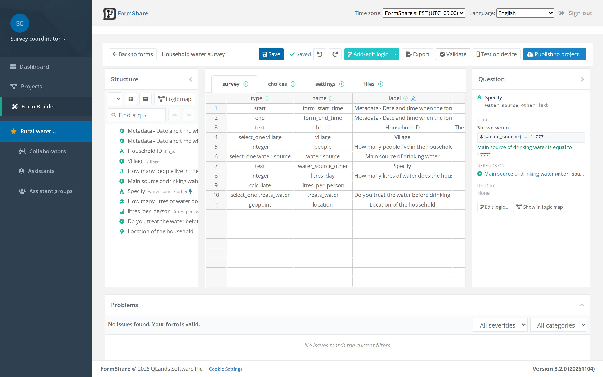
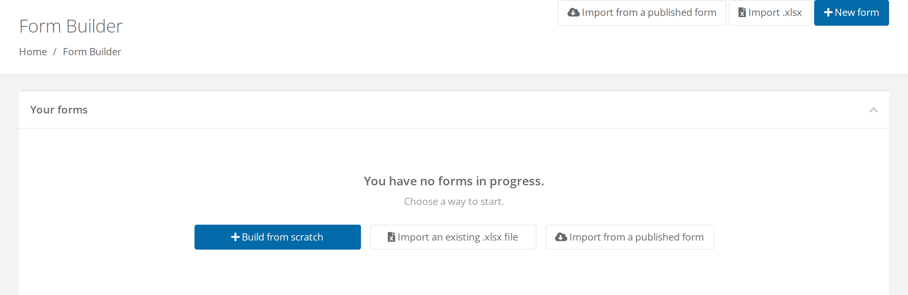

# Form Builder

Form Builder is an editor for ODK forms inside FormShare. A form is built in the browser as a draft: the same survey, choices and settings sheets as an XLSForm in Excel, laid out in a grid, plus a tab for the files the form reads. Questions come from a library of cards that ask only for what each kind of question needs, and logic is written in a dialog that completes question names and can test an expression with sample answers.

The editor checks the draft as you work, with the same tools FormShare uses when it receives a form, so the problems show up before you publish. When the draft is ready, you try it on a phone with a QR code and publish it to a project, as a new form or as a new version of a form that already has data.

<figure><figcaption>
A draft in the editor: questions on the left, the sheet in the middle, the selected question's logic on the right.
</figcaption></figure>

| Page | What it covers |
| --- | --- |
| [Walkthrough: build a household survey and publish it](walkthrough.md) | A new form from scratch: questions from the library, a choice list with Other, a calculation, a limit on an answer, a test on a phone and publishing, step by step. |
| [Walkthrough: add a question to a form that has data](walkthrough-new-version.md) | A new version of a form with a repository: Save as, publishing for merging and the merge in FormShare, step by step. |
| [Your forms](your-forms.md) | The Form Builder page: your drafts, New form, Import .xlsx, Save as, and where each draft is published. |
| [The editor](the-editor.md) | The sheets, groups and repeats, languages and columns, the Structure, Question and Problems panels, and saving. |
| [The question library](question-library.md) | The cards, what each asks, and the names a question can have. |
| [Adding logic](logic.md) | Required, relevance, constraints and calculations; the code editor; Build… and Generate; Test; the logic map. |
| [Checking a form](checking-a-form.md) | The three checks, the Problems panel and what its messages mean. |
| [Form files](form-files.md) | The CSV, XML and GeoJSON files that select-from-file questions read. |
| [Testing on a device](testing-on-a-device.md) | The draft in FormShare Collect from a QR code, before it is published. |
| [Publishing to a project](publishing.md) | New forms, replacements, new versions of forms with data, the primary key and the precheck. |

## Who uses it

| You are | You can |
| --- | --- |
| Any FormShare user who can sign in | Build, check, try on a phone and export drafts. Drafts are yours: other users don't see them, unless you give them a [Test on device](testing-on-a-device.md) link. |
| The owner or an administrator of a project, with an account that may upload forms | Publish a draft to that project. |

A draft is not a FormShare form. It stays in Form Builder until you publish it, and changing it afterwards does not change the published form: publishing again does.

## Where to find it

**Form Builder** is in FormShare's navigation, on the left. It opens the page of your drafts, where you start a new form or import an `.xlsx`.

<figure><figcaption>
The page before the first draft.
</figcaption></figure>


**For server administrators:** Form Builder is a QLands plugin, not part of FormShare's open source code. Its checks need Java on the server: pyxform runs ODK Validate, and the third check runs ODK's form engine (KotlinRosa), whose jar is set in `formbuilder.kotlinrosa.jar_path`. If the engine cannot start, the third check is skipped with a note in the Problems panel, and drafts still publish once the other two checks pass. **Generate**, the AI help in the logic dialog, needs its own settings; "[Adding logic](logic.md)" lists them.


## What's next

* Follow "[Walkthrough: build a household survey and publish it](walkthrough.md)" to build your first form.
* Read "[Publishing to a project](publishing.md)" before you publish to a project that already has data.
