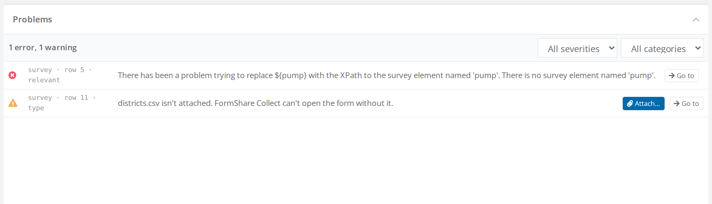

# Checking a form

Form Builder checks your draft while you edit it. Three checks look at it in turn, and each catches a different kind of mistake. The **Problems** panel at the bottom of the editor lists what they find. The grid marks the cells involved, so you see each mistake where you made it.

None of the checks adds rules of FormShare's own. FormShare accepts any form that pyxform, the XLSForm converter it uses, can compile. Form Builder runs that same converter, and its warnings point at what FormShare Collect would trip on in the field.

<figure><figcaption>
Errors come first. A missing file adds Attach… beside Go to.
</figcaption></figure>

## The three checks

| Check | Its category in the panel | What it looks at |
| --- | --- | --- |
| The form's structure | Structure | The rows of the sheets as you typed them, before anything is compiled |
| pyxform and ODK Validate | XLSForm | The XForm that pyxform builds from the draft, the way FormShare builds it when you publish |
| The form engine, KotlinRosa | Runtime | The compiled form, loaded into a form engine the way a phone loads it |

### The form's structure

The first check reads the rows of the survey, choices and settings sheets. It is quick, and it explains the common mistakes on the exact cell:

* A row of the survey sheet with something in it but no type.
* A question or group without a name. A note can go without one, since pyxform names it.
* Two questions or groups with the same name inside the same group or repeat. The same name in two different groups is allowed.
* A group or repeat that is never closed, or an end row with no group to close. You meet these in a form imported from an .xlsx file: the groups you make in Form Builder close by themselves.
* A choice with a list but no name, or a choice with no `list_name`. The second one is a warning: pyxform skips the choice, so no question can use it.
* A repeat inside a group shown on a single page (`field-list` or `table-list`). pyxform accepts it, but FormShare Collect can't display it, so it is a warning.

The others are errors. Empty rows are left out: they are the grid's padding.

The warnings about form files are in this category too: a file that a select-from-file question reads is missing, can't be read, or lacks the column the question reads. See "[Form files](form-files.md#the-checks)".

### pyxform and ODK Validate

The second check compiles the draft into an XForm with pyxform, the converter FormShare uses when you publish, and runs ODK Validate on the result. Whatever either tool refuses is an error, and the draft can't be published until you fix it. Typical catches:

* An unknown question type, such as `txet`.
* A select whose choice list isn't on the choices sheet.
* A `${name}` that refers to no question.
* A name with a space, or another character names can't have.
* Two choices with the same name in one list.
* An expression in `relevant`, `constraint`, `calculation` or another logic column that ODK Validate can't read, and logic that goes round in a circle.

pyxform's own warnings show as warnings, such as a group without a label, or two names that differ only in capitals.

When pyxform stops at a row the first check has already flagged with an error, the panel shows only the first check's message, which names the cell. Anything else wrong on that row shows once you fix it.

### The form engine: KotlinRosa

The third check loads the compiled form into KotlinRosa, a Kotlin port of JavaRosa, the form engine inside FormShare Collect. It reports a form the engine can't load, and it reads every expression in the survey's `relevant`, `constraint`, `calculation`, `choice_filter`, `required` and `read_only` cells, reporting one it can't parse on its cell.

It runs only once the second check has compiled the form. It also works out which questions depend on which, from their logic: the Question panel's **Depends on** and **Used by**, the related questions in the Structure outline, and the logic map all come from it. While an error stops the second check, the third doesn't run, and those links stay empty until you fix the error.

### Internal

A problem in the **Internal** category means that one of the checks failed to run, not that the form is wrong. Its message starts with *Internal error in*. It counts as an error. If it doesn't go away when you change the form, tell your server administrator.

## When the checks run

The checks run by themselves:

* a moment after each change to the form, made in the grid or in a dialog: a cell edited, rows added, deleted or moved, an undo or a redo;
* as soon as a form file is attached or deleted;
* when the editor opens.

**Validate**, in the toolbar, runs them at once.

They check the form as the editor holds it, with the changes you haven't saved yet. Each result replaces the one before. Until the first result comes back, the panel reads *Checking your form…*.

If more than 30 checks are asked for within a minute, the editor shows *Validating too quickly; retrying in a moment.* and checks again shortly afterwards.


**For server administrators:** the limit is `formbuilder.validate.rate_limit_per_minute`, 30 by default, per user. The second and third checks need Java on the server. ODK Validate comes with pyxform and needs Java 8 or later on the path: without it, every form shows the error *Form validation failed because Java (8+ required) could not be found* in the XLSForm category, and no draft can be published. KotlinRosa needs its jar named in `formbuilder.kotlinrosa.jar_path`: while its engine isn't running, every form shows the information *ODK's form engine (KotlinRosa) isn't running on the server, so the runtime check was skipped. pyxform and ODK Validate still checked the form.* Drafts still publish then, without the third check and without the links between questions it works out.


## The Problems panel

The panel's first line sums up the last result: *No issues found. Your form is valid.*, or a count such as *2 errors, 1 warning*. Each problem under it has:

* an icon for its severity;
* where it is: the sheet, the row and the column, such as *survey · row 12 · relevant*. Row numbers are the ones the grid shows;
* the message, in which a link, such as one of pyxform's *Learn more* pages, opens in a new tab;
* **Go to**, when the problem belongs to a row;
* **Attach…**, when the problem is a form file the form uses but doesn't have. See "[Form files](form-files.md#files-the-form-names-but-lacks)".

Errors come first, then warnings, then information. Within each, the survey sheet's problems come before the choices sheet's and the settings sheet's, in row order.

The panel folds down out of the way: see "[The editor](the-editor.md)".

### Severities

| Severity | Icon | What it means | Publishing |
| --- | --- | --- | --- |
| Error | A red cross | A mistake that pyxform, ODK Validate or the form engine refuses | Waits until it is fixed |
| Warning | An orange triangle | The form compiles, but something is likely a mistake, or will trip FormShare Collect | Goes ahead |
| Info | A blue *i* | Something to know, such as a form that has no questions yet | Goes ahead |

### Filters

Two lists above the problems narrow them down:

| List | Choices |
| --- | --- |
| Severity | All severities, Errors, Warnings, Info |
| Category | All categories, Structure, XLSForm, Runtime, Internal |

The first line still counts every problem. The filters stay as you set them while the editor is open. When nothing matches them, the list reads *No issues match the current filters.*

## From a problem to its cell

**Go to** takes you to the cell the problem names. It switches to the problem's sheet, opens the group or the choice list that holds the row, selects the cell, scrolls to it and outlines it in green for a moment. When the problem names no column, it selects the row's first cell.

A problem about the form as a whole, such as a pyxform message that names no row, has no **Go to**.

## Marked cells

The grid marks the cell of each problem:

| Severity | How the cell looks |
| --- | --- |
| Error | Pale red, with a red border |
| Warning | Pale orange, with an orange border |
| Info | A blue line under it |

Point at a marked cell to read its messages. A cell with several problems lists them all, and takes the colour of the most serious one.

When the problem names no column, or a column the grid doesn't show, the row number is marked instead. A problem inside a closed group marks the group's row number, and its message starts with *Inside this group:*. On the choices sheet, a problem in a closed list marks the list's row, with *In this list:*.

A problem in a part of the survey you haven't opened, such as another group or the level above the one you are in, isn't marked: find it in the panel and use **Go to**.

The Structure outline and the Question panel show the problems too. The outline puts a badge on a question with an error or a warning, and its **With errors** and **With warnings** filters list only those questions. The Question panel lists the problems of the question you select. See "[The editor](the-editor.md)".

## What a clean result means for publishing

Once the panel shows no errors, the checks no longer stand in the way of publishing. **Run precheck**, in the publish dialog, saves the draft and runs the same three checks on it, adds the form file warnings, and looks for logic that goes round in a circle. **Publish** waits until the precheck finds no error and no circle. Warnings and information don't hold it back: the precheck gives their count, as in *No errors (2 warning(s)).*

FormShare checks the form again when it receives it. If it refuses the form, its message shows in the publish dialog. See "[Publishing to a project](publishing.md)".

A clean result says that the form compiles and loads. It doesn't say that its logic does what you meant. Try the logic with answers on the [logic map](logic.md), with **Try answers**, and fill the form in on a phone: see "[Testing on a device](testing-on-a-device.md)".

## Typical messages

| Message | Category and severity | What it means |
| --- | --- | --- |
| *This row has no type.* | Structure, error | The row has something in it, but its `type` cell is empty. Choose a type, or clear the row. |
| *The name 'age' is already used in row 4. Names must be unique within the same group or repeat.* | Structure, error | Two questions in the same group, or both outside any group, share a name. Rename one of them. |
| *This choice has no list_name, so no question can use it.* | Structure, warning | A choice outside any list. Give it a list, or delete it. |
| *FormShare Collect can't display a repeat inside a group shown on a single page (field-list, row 8). Move the repeat out of that group or take field-list off it.* | Structure, warning | Found in imported forms: Form Builder refuses to make one. |
| *villages.csv isn't attached. FormShare Collect can't open the form without it.* | Structure, warning | A question reads a file the draft doesn't have. See "[Form files](form-files.md)". |
| *Unknown question type 'txet'.* | XLSForm, error | A typing mistake in the type. The [question library](question-library.md) writes types for you. |
| *List name not in choices sheet: yes_no* | XLSForm, error | The type reads `select_one yes_no`, but the choices sheet has no `yes_no` list. Add the list, or correct its name in the type. |
| *There has been a problem trying to replace ${agee} with the XPath to the survey element named 'agee'. There is no survey element named 'agee'.* | XLSForm, error | An expression refers to a question that doesn't exist, here a misspelt `${age}`. **Go to** opens the cell with the reference. |
| *Invalid question name 'first name'. Names must begin with a letter, colon, or underscore. Other characters can include numbers, dashes, and periods.* | XLSForm, error | The name has a space. Use `first_name`. |
| *The 'name' value is invalid. Choice names must be unique for each choice list.* | XLSForm, error | Two choices of one list share a name. Each duplicate gets its own line in the panel, on its row. |
| *Group has no label: {'name': 'household', 'type': 'begin_group'}* | XLSForm, warning | FormShare Collect shows the group without a title. Give it a label, unless that is what you want. |
| *The 'name' value 'Age' is problematic. The name is a case-insensitive match to another name.* (and more) | XLSForm, warning | Two names differ only in capitals. Some data tools don't tell capitals apart, so rename one. |
| *Cycle detected in form's relevant and calculation logic!*, or *Two or more questions reference each other in their calculate / relevant / constraint expressions.* | XLSForm or Runtime, error | Questions whose logic refers to each other in a circle, such as two calculations that each use the other. Remove one of the references. |
| *Your form has no questions yet. Add at least one row to the Survey sheet to preview and publish it.* | XLSForm, info | A new, empty form. |

## What's next

* Attach the files that select-from-file questions read in "[Form files](form-files.md)".
* Fill the form in on a phone with "[Testing on a device](testing-on-a-device.md)".
* See what the precheck adds, and what FormShare checks, in "[Publishing to a project](publishing.md)".
