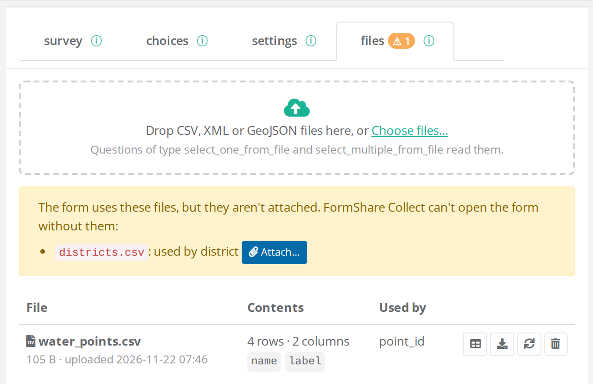

# Form files

A question of type `select_one_from_file` or `select_multiple_from_file` takes its choices from a file instead of the choices sheet: `select_one_from_file villages.csv` offers the rows of `villages.csv`. Files suit long lists, and lists kept outside the form, such as villages, health facilities or products. A draft keeps them in its **files** tab.

Form Builder reads each file once, when you attach it. The tab then shows what the file holds, and the Problems panel warns about any question whose file is missing, can't be read, or lacks a column the question reads.


The files stay in Form Builder. **Test on device** doesn't send them to the phone, and publishing doesn't upload them to FormShare: after you publish, add them to the form in FormShare. See "[On a test phone](#on-a-test-phone)" and "[When you publish](#when-you-publish)".


## What a file holds

| Kind | Its shape | The value a choice saves | The label a choice shows |
| --- | --- | --- | --- |
| CSV | A header row naming the columns, then one choice per row | The `name` column | The `label` column |
| XML | A `<root>` element with one `<item>` element per choice; each item's child elements are its columns | The `name` element | The `label` element |
| GeoJSON | A FeatureCollection: each feature is a choice, with its place | The feature's `id`, or else its `id` property | The `title` property |

To read other columns, name them in the question's `parameters` cell, as in `value=code label=village`. A column named there must start with an unaccented letter or `_`, and hold only unaccented letters, digits, `-`, `_` and `.`: pyxform refuses any other.

A question with the `map` appearance shows its choices on a map. A GeoJSON file carries the places itself; a CSV or XML file needs a `geometry` column.

The [question library](question-library.md)'s **Select one from a file**, **Select multiple from a file** and **Select a place on a map** cards add such a question, and their File step can upload the file.

## The files tab

The **files** tab is the fourth tab of the grid, after **survey**, **choices** and **settings**. Its badge shows how many files the draft has, or a warning sign and a count when the form uses files that aren't attached. Point at it to read, for example, *Files the form uses that aren't attached: 2*.

<figure><figcaption>
One file attached, one the form names but lacks.
</figcaption></figure>

### Attaching files

Drop CSV, XML or GeoJSON files on the area at the top of the tab, *Drop CSV, XML or GeoJSON files here, or Choose files…*, or click it to choose them from your computer. You can attach several at once.

* Each file is attached under its own name. If a form can't use that name, Form Builder asks for another one, *Rename the file*, and offers a fixed name: `Villages (1).CSV` becomes `Villages_1.csv`. **Attach** takes the name in the box. See "[File names](#file-names)".
* A file of another kind is refused: *report.xlsx isn't a CSV, XML or GeoJSON file.*
* When the draft already has a file with that name, Form Builder asks first: *Replace villages.csv?*
* A progress bar follows the upload. Then *Reading the file…* shows while the server reads it, which takes a while for a big file, and *villages.csv attached.* once it's done.

The Problems panel checks the form again as soon as a file is attached, replaced or deleted.

### Files the form names but lacks

When a question's type names a file the draft doesn't have, a yellow box at the top of the tab lists it: *The form uses these files, but they aren't attached. FormShare Collect can't open the form without them:*, then each file, the questions that use it, and an **Attach…** button.

**Attach…** asks for one file and attaches it under the name the form uses, whatever the file is called on your computer. It has to be the same kind of file: a `.csv` name takes a CSV file (*villages.csv needs a CSV file.*). The Problems panel's warning about the missing file has the same **Attach…** button.

### The list of files

| Column | What it shows |
| --- | --- |
| File | The name, the size, and when the file was uploaded, in the time zone FormShare shows its own times in |
| Contents | How many rows, items or features, and how many columns; the first six column names; notes on what FormShare Collect would trip on, or why the file can't be read (see "[The checks](#the-checks)") |
| Used by | The questions whose type names the file, or *No question uses it* |

Each file has four buttons:

| Button | What it does |
| --- | --- |
| Preview | Opens the file's first rows under it, and closes them again |
| Download | Downloads the file as it was attached |
| Replace | Asks for a file of the same kind and puts it in place of this one, under the same name, without asking again |
| Delete | Asks first, and names the questions that use the file: *The question village uses it: it will warn that the file is missing.* |

There is no button to rename a file. To give a file another name, change the name in the question's type: the tab then lists the new name as missing, and its **Attach…** attaches the file under that name. Then delete the old file.

## What Form Builder reads from a file

Form Builder reads each file as it is attached or replaced, and keeps what it found. It reads the file as a stream, so the file's size doesn't matter.

| Kind | What it keeps |
| --- | --- |
| CSV | The columns of the header row, the number of rows with something in them, the file's encoding and its separator |
| XML | The names of the root and item elements, the number of items, and the columns: the child elements found in the first 1,000 items |
| GeoJSON | The number of features, the columns (`id`, then the properties found in the first 1,000 features), and each kind of geometry with its count |

**Preview** shows the first 20 rows as a table, with *The first 20 of 1,204.* under it. Values longer than 200 characters are cut short. It also gives the root and item names of an XML file, and the geometries of a GeoJSON file, such as *Point 1,204*.

## The checks

### Notes in the tab

A note doesn't stop anything. It marks what FormShare Collect would trip on:

| Note | Why it matters |
| --- | --- |
| *Not UTF-8 text (it looks like cp1252): FormShare Collect reads UTF-8.* | Accented letters and other scripts show garbled on the phone. Save the file as CSV UTF-8. |
| *Separated by ";": FormShare Collect expects commas.* | The phone reads each line as a single column, so it finds no `name` or `label` column. Save the file with commas. |
| *Its elements are `<data>` and `<row>`: FormShare Collect reads `<root>` with `<item>` elements.* | The phone doesn't find the choices. Rename the elements. |
| *The file is gone from the server: attach it again.* | The draft still lists the file, but the server no longer has it. |

### Files that can't be read

A file Form Builder can't read stays attached, shown in red with the reason, such as *Can't be read: it isn't valid XML.*, and any detail in brackets after it. Each question that uses the file gets a warning.

| Reason | Usual cause |
| --- | --- |
| *the file is empty* | The file has nothing in it. |
| *it isn't a text file* | A spreadsheet or another binary file renamed `.csv`, or a CSV saved as UTF-16 (Excel's Unicode Text). Save it as CSV UTF-8. |
| *it isn't a valid CSV file* | A value longer than 131,072 characters, most often because a quote left open swallows the rest of the file. |
| *it isn't valid XML* | A tag that isn't closed, or another mistake the reason in brackets names. |
| *it isn't valid JSON* | A GeoJSON file with a syntax error, or one that isn't in UTF-8. |
| *it isn't a GeoJSON FeatureCollection* | The file holds a single feature or a geometry, not a FeatureCollection with a `features` list. |

### Warnings in the Problems panel

| Warning | When |
| --- | --- |
| *villages.csv isn't attached. FormShare Collect can't open the form without it.* | A question's type names a file the draft doesn't have. The warning has an **Attach…** button. |
| *villages.xml can't be read: it isn't valid XML (mismatched tag: line 4, column 2).* | The file is attached, but Form Builder couldn't read it. |
| *villages.csv has no column "code", the value this question saves. FormShare Collect can't show its choices.* | The file lacks the column the question saves: the one named by `value=`, or else `name`, or a GeoJSON feature's `id`. |
| *villages.csv has no column "village", the text each choice shows. FormShare Collect can't show its choices.* | The same for the label: the column named by `label=`, or else `label`, or a GeoJSON feature's `title`. |
| *villages.csv has no column "geometry", where each choice is on the map.* | A CSV or XML file read by a question with the `map` appearance has no `geometry` column. |

A GeoJSON file counts as having an `id` when at least one of its features has one.

Each warning sits on the question that uses the file, one per question, so **Go to** reaches each of them. They are in the **Structure** category. Being warnings, they don't stop you from publishing: FormShare accepts the form, but FormShare Collect needs the files in place to show the choices. See "[Checking a form](checking-a-form.md)" for the panel.

### What isn't checked

Form Builder checks the files of `select_one_from_file` and `select_multiple_from_file` questions only. A file the form reads in another way, such as a CSV for `pulldata()` or `search()`, or the images and audio of its labels, isn't listed as used and isn't checked. The files tab takes CSV, XML and GeoJSON files only: add any other file to the form in FormShare once it is published.

The values in a file aren't checked either. A `select_multiple_from_file` question needs values without spaces, since it saves its answers separated by spaces.

## File names

Form Builder takes a name that:

* starts with a letter or `_`;
* then holds only letters, digits, `_` and `-`;
* ends in a single extension, in lower case: `.csv`, `.xml` or `.geojson`;
* has 120 characters at most.

| Name | Can a form use it? |
| --- | --- |
| `villages.csv`, `Health_facilities-2025.geojson` | Yes |
| `villages.CSV` | No: offered as `villages.csv` |
| `2025_villages.csv` | No: offered as `file_2025_villages.csv` |
| `villages.v2.csv` | No: offered as `villages_v2.csv` |
| `village list.csv` | No: offered as `village_list.csv` |

The type names the file exactly as it is attached, capitals included: `select_one_from_file Villages.csv` doesn't find `villages.csv`. pyxform refuses a type whose file name lacks one of the three extensions, with an error that starts *File name for 'select_one_from_file villages' should end with one of the supported file extensions*.

The name without its extension is how the form's expressions refer to the file: the choices of `villages.csv` are `instance('villages')`.

## Size

Form Builder sets no limit on the size of a form file. The upload shows its progress, and reading a big file afterwards takes a little longer. On the phone, though, a question that reads a file with many thousands of rows can be slow to open.


**For server administrators:** a draft's files are kept in FormShare's repository directory, in `<repository.path>/formbuilder/drafts/<draft id>/files/`, under the names the form uses. `formbuilder.files.path` puts them elsewhere, in place of `<repository.path>/formbuilder`. An upload waits in the `tmp` folder beside `drafts` until the draft takes it, and is removed after a day if it doesn't. A proxy in front of FormShare can still limit the size of an upload.


## Copies, exports and deleted drafts

* **Save as** gives the copy the draft's files. From then on each draft has its own: replacing a file in one leaves the other alone.
* **Export** downloads the .xlsx file only, without the form files, and a form imported from an .xlsx file starts with none.
* Deleting a draft deletes its files.

## On a test phone

**Test on device** sends FormShare Collect the form only, not its files. On the phone, a question that selects from a file can't show its choices. To try those questions on a phone, publish the form to a project, add the files there, and test it with the project's QR code while the form is in its testing stage: see "[Test your form](../../guides/creating-your-first-task/test-your-form.md)" and "[Testing on a device](testing-on-a-device.md#form-files-on-the-phone)".

## When you publish

Publishing uploads the form's .xlsx file only. The files stay in Form Builder. The publish dialog's precheck lists the same warnings as the Problems panel, but uploads nothing.

Once the form is published, open it in FormShare and add each file on its **Form files** tab, under the same name: see "[Form files](../../fundamentals/forms/form-files.md)" in FormShare's documentation. Use **Download** in the files tab when you don't have a file at hand. Until all the files are there, FormShare lists the missing ones, can't check the form completely, and doesn't offer to create its repository.

A new version uploaded for merging has **Keep form files** in the publish dialog: it gives the new version the files of the form it merges into. Add any file that changed on the new version's **Form files** tab. See "[Publishing to a project](publishing.md)".

## What's next

* See how the Problems panel lists these warnings in "[Checking a form](checking-a-form.md)".
* Try the draft on a phone with "[Testing on a device](testing-on-a-device.md)".
* Publish the form, then add its files, with "[Publishing to a project](publishing.md)".
