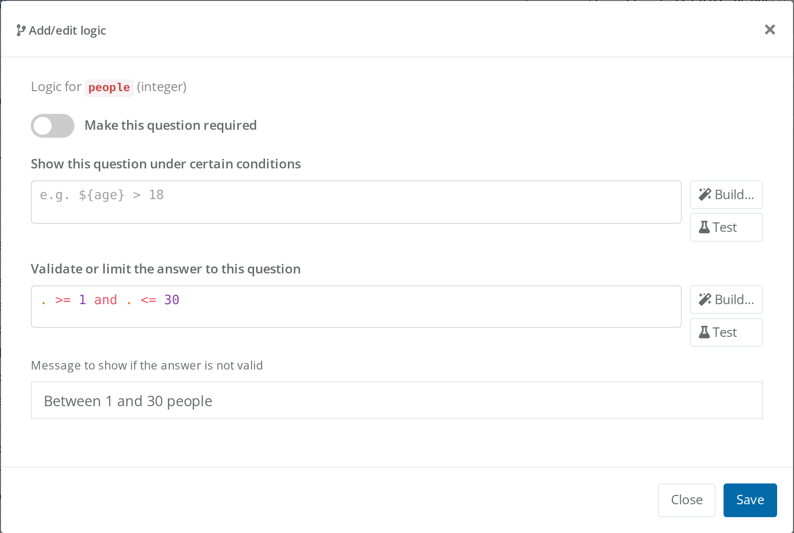
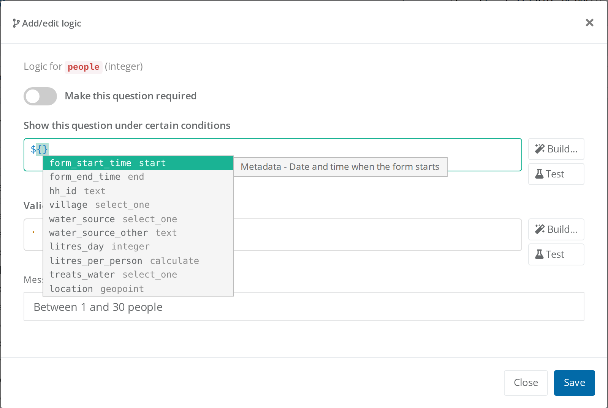
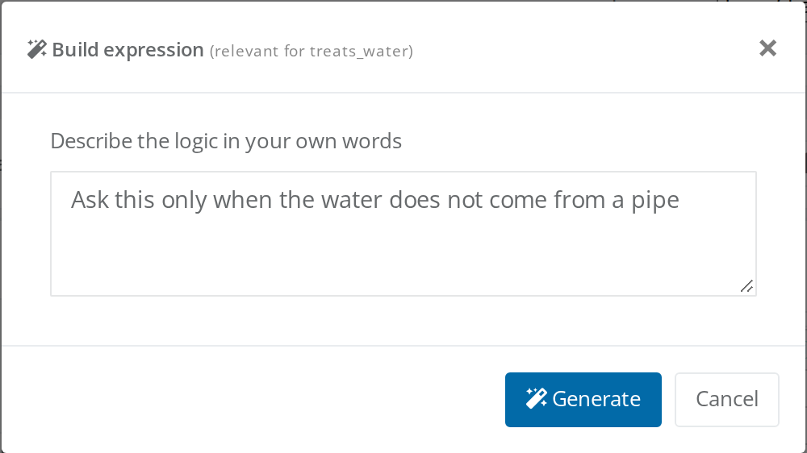
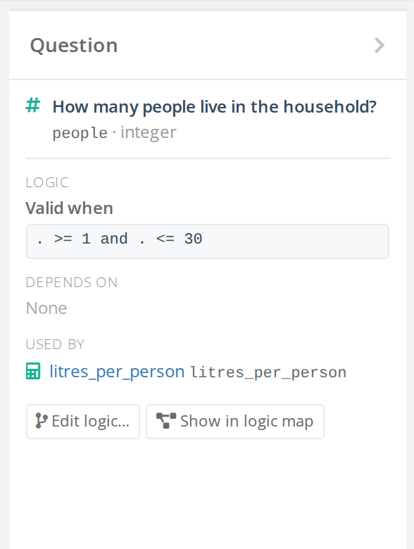
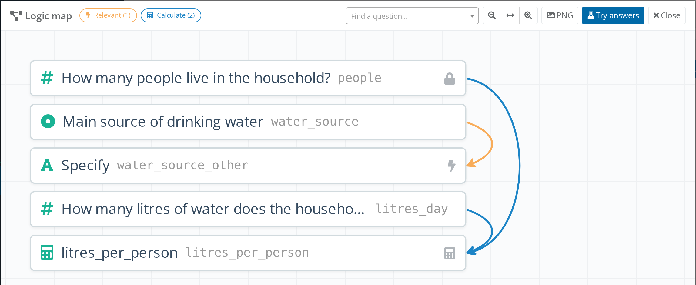
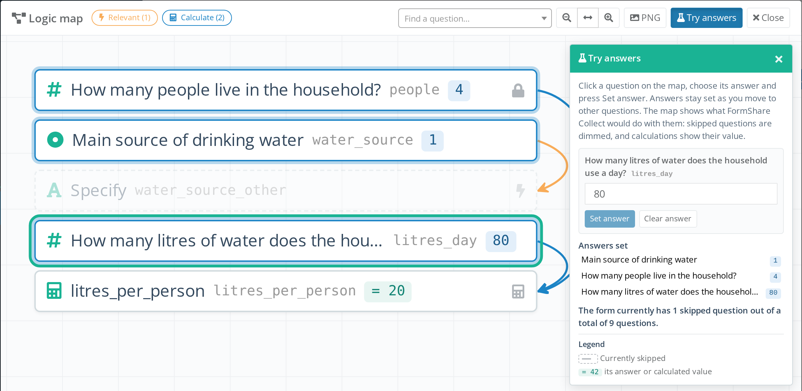

# Adding logic

A question's logic tells FormShare Collect when to show the question, which answers to accept, whether it may be left unanswered and, for a calculate, what value to work out. You write it in the logic dialog, whose code editor knows ODK's functions and your form's questions. **Build…** has the AI write an expression from your description, and **Test** tries an expression with answers you choose. The Question panel reads a question's logic back in plain English, and the logic map shows which questions the whole form's logic links.

<figure>= 1 and . <= 30, the message Between 1 and 30 people, and Build and Test beside each expression field."><figcaption>
An integer question's four fields. Close keeps nothing; Save writes them to the row.
</figcaption></figure>

## Opening the logic dialog

| From | How |
| --- | --- |
| The toolbar | Once you have clicked a row of the survey grid whose type is filled in (metadata aside), the split button reads **Add/edit logic**: click it. The arrow beside the button offers **Add/edit logic** too. |
| The Question panel | **Edit logic…**, for the row selected in the grid. |

Without such a row, **Add/edit logic** says *Click a question row first (a row whose type is filled in), then choose Add/edit logic.* A row of an expanded group is read-only where it shows, so its group opens first.

## The fields

The dialog, **Add/edit logic**, names the question and its type at the top, as in *Logic for* `age` *(integer)*. Its fields depend on the type:

| Type | Fields |
| --- | --- |
| Calculate | Calculation |
| Note, group, repeat | Relevance |
| Metadata (start, end, today…) | None: the dialog doesn't open, see "[Why metadata takes no logic](#why-metadata-takes-no-logic)" |
| Every other type | Required, relevance, constraint, and the constraint's message |

Each field writes one column of the question's row:

| Field | Column | What it does in FormShare Collect |
| --- | --- | --- |
| Make this question required | `required` | The enumerator can't go past the question without answering it. |
| Show this question under certain conditions | `relevant` | The question shows only while the expression is true; otherwise FormShare Collect skips it. On a group or repeat, everything inside is skipped with it. |
| Validate or limit the answer to this question | `constraint` | An answer is accepted only when the expression is true. A dot, `.`, stands for the question's own answer: `. >= 0 and . <= 120`. |
| Message to show if the answer is not valid | `constraint_message` | What FormShare Collect says when it doesn't accept an answer. Left empty, it shows a message of its own. |
| Calculate the value of this question | `calculation` | The value FormShare Collect works out for a calculate, from other answers. A calculate isn't shown; other questions use its value as `${name}`. |

Under each expression field are **Build…** and **Test**, and a line with the expression in plain English. **Build…** shows only when the server has Generate set up (see "[Build… and Generate](#build-and-generate)").

**Save** writes the fields to the question's row and closes the dialog. **Close**, or ×, closes it and keeps nothing: nothing reaches the grid before **Save**.


**Required is a switch.** It shows on for `yes`, `true`, `true()` or `1`, and **Save** writes `yes` or empties the cell. A value written another way, such as `TRUE`, stays as you typed it while you leave the switch on. A `required` cell that holds a condition, such as `${age} > 18`, shows under the switch as *Required only when this is true:* with the condition, and the switch can't be turned off: **Save** keeps the condition. To change it, edit the `required` column in the grid.


The dialog covers these five columns. The grid has the other logic columns, such as `choice_filter`, `default`, `repeat_count` and `read_only`: see "[The editor](the-editor.md)".

## The code editor

The relevance, constraint and calculation fields are code editors for ODK expressions; the constraint message is a plain box. The Calculate card's Calculation step has the same editor (see "[The question library](question-library.md)"). In the grid, logic cells are plain text.

### Colours

| What | Example | Colour |
| --- | --- | --- |
| Functions | `selected`, `count-selected` | Green, in bold |
| Questions | `${age}` | Blue |
| Text in quotes | `'yes'` | Dark orange |
| Numbers | `18`, `3.5` | Purple |
| Operators | `and`, `or`, `div`, `mod`, `=`, `!=`, `<=`, `+` | Red |
| Paths | `.`, `..`, `/data/age` | Ochre |
| Brackets and commas | `(`, `)`, `[`, `]`, `,` | Grey |

### Completion

The editor offers what can come next as you type:

| Where you are | It offers |
| --- | --- |
| At the start of a word | ODK's functions, and `and`, `or`, `div` and `mod`, matching loosely. Each shows its parameters, and the panel beside the list says what the function does, with an example. |
| After `${` | The form's questions in form order, under the names of their groups (*Household › Members*), each with its type and label. Groups aren't offered; repeats are, for expressions such as `count(${members})`. |
| In quotes compared with a select: `selected(${crop}, '`, `${crop} = '`, `${crop} != '`, `selected-at(${crop}, 0) = '` | The names of the select's choices, with their labels. |
| Ctrl+Space | The functions, and on an empty spot every question as well. |

<figure><figcaption>
After ${, the questions of the form, with their types.
</figcaption></figure>

Choosing a function writes the call with a placeholder for each argument it needs, the first one selected, as in `selected(list, value)`. Tab moves to the next argument, and after the last one past the closing bracket; Shift+Tab goes back. Choosing a question writes `${name}` with the cursor after it. Escape closes the list without closing the dialog.

The question you are editing isn't offered in its own relevance or calculation, since a question's logic can't depend on itself, but it is offered in its constraint. Choices are offered for select one, select multiple and rank questions whose list is on the choices sheet, not for a select from a file.

### Signature help

While the cursor is inside a function call, a hint above the call shows the function's signature, with the current argument in bold and what that argument is. In the second argument of an `if`, it reads `if(condition, then_value, else_value)` with `then_value` in bold, and *Value returned when condition is true.* The hint shows only while the field has the focus.

### Checks as you type

Half a second after you stop typing, the editor underlines in red:

| What | Message |
| --- | --- |
| The first part it can't read | *This part can't be read yet: check the brackets, quotes and operators around it.* |
| A function ODK doesn't have | *"selcted" is not an ODK function. Did you mean "selected"?* |
| A question the form doesn't have | *There is no question named "distrct". Did you mean "district"?* |

Point at the underline to read the message. *Did you mean* appears when a close name exists.

These checks help while you write, but the editor knows nothing of the answers' types or of how many arguments a function takes. The Problems panel is the real check: it runs pyxform and ODK's own engine on the whole form, see "[Checking a form](checking-a-form.md)".

### Typing

Brackets and quotes close themselves, and Backspace between an empty pair deletes both. The matching bracket is marked. Lines wrap, and a long expression scrolls. Each field has its own undo: Ctrl+Z inside it never touches the grid.

### The plain-English line

Under each field, Form Builder writes the expression in words, with the questions' labels in place of their names: `${age} > 18` reads *Age is greater than 18*, and `selected(${symptoms}, 'fever')` reads *Symptoms includes 'fever'*. In a translated form the labels are the default language's (the settings sheet's `default_language`), or the first language's when it names none. It reads the common shapes: a question compared with a value, a question between two values, an option chosen or not, a count, an `if`, and these joined by `and` or `or`. For other expressions, among them most that start with `.`, and for long ones, the line stays empty.

The line is the quickest way to see that an expression says what you meant, above all one the AI wrote.

## Build… and Generate

**Build…** is the one place Form Builder uses AI: it turns a rule written in your own words into an ODK expression for the field next to it.

Click **Build…** under a field. The logic dialog steps aside and **Build expression** opens, naming the field and the question. Under *Describe the logic in your own words*, write the rule as you would explain it to a colleague. The box suggests one for each field: *show this only if the respondent is over 18*, *the answer must be between 0 and 120*, *the total of the three amounts*. Then click **Generate**, or press Ctrl+Enter. While it works, *Generating…* shows next to the button. **Cancel** goes back to the logic dialog and leaves the field as it was, even when an answer arrives after you cancelled.

<figure><figcaption>
Generate sends the description and the form's design, never its data.
</figcaption></figure>

When an expression comes back, it replaces the text of the field, **Build expression** closes, and the logic dialog returns with the cursor in that field. Under the field are the plain-English line and how sure the AI is:

| Note | What it means |
| --- | --- |
| *AI confidence: high* | Every question, option and value in your description matched the form, with one sensible reading. |
| *AI confidence: medium*, with what it interpreted | It had to interpret a word, a threshold or an option name, or to choose between questions or options. For example: *Read "adult" as older than 18.* |
| *AI confidence: low*, with what it guessed | Several readings fit, or part of the description matched nothing in the form clearly. |

The confidence is the AI's own judgement, not a check: read the plain-English line, and try the expression with **Test**. The note shows while the field holds the expression the AI wrote, and goes when you edit it. Ctrl+Z in the field brings back the text you had before. Nothing is saved until you click **Save** in the logic dialog, or **Add** in the Calculate card's dialog.

The AI knows today's date, so a rule about the current year can come back with the year written in: *a realistic year of birth* can give `. >= 1900 and . <= 2026`. That limit stays at 2026 when the calendar moves on.

When no expression comes back, the reason shows in red next to **Generate**, and your description stays so you can reword it:

| Message | Why |
| --- | --- |
| *Describe the logic first.* | The box is empty. |
| *Type a short rule in your own words, e.g. "show this when age is over 18".* | The description has fewer than two words, or no letters. |
| *That looks like a question, not a rule for this field. Describe when the question should show, or what to compute.* | It reads as a question, such as *what is the age?*, with no rule in it. |
| *A show/validate rule needs a true/false condition…* | For relevance or a constraint, it names a value, such as a total or a count, but no condition. |
| An explanation from the AI | The rule can't be written for this form: a question it names doesn't exist, an option isn't in the list, the comparison doesn't fit the question's type, or the description isn't a rule at all. |
| *AI features are disabled.*, or *AI isn't set up on this server…* | Generate was turned off, or has no API key, since you opened the page. Reload it: **Build…** doesn't show while Generate can't answer. |
| A message from FormShare's SaaS plugin, such as *Your organization cannot use the AI features right now.* | Your organization can't use the AI at the moment, for example because it has no credits left. |
| *rate limit exceeded…*, with the time to wait | You have pressed Generate too often this hour, or today. |
| *The request failed. Please try again.* | The server couldn't be reached, or its answer couldn't be read. |

The messages about a short description, a question and a value with no condition come from Form Builder's own check of the description, which runs before any AI is called.

### What the AI is sent

Each **Generate** sends Anthropic's Claude your description, the field and the question you are editing, the form's questions (their names, types and labels) and its choice lists as they are in the editor, unsaved changes included, and your computer's date and time, so that *this year* or *not in the future* mean the present. Only the form's design is sent, never data collected with it.

### What Generate costs

Who pays for Generate depends on whether your FormShare runs FormShare's SaaS plugin, which hosts FormShare as a service for organizations:

| | Without the SaaS plugin | With the SaaS plugin |
| --- | --- | --- |
| Who pays | The server's own AI account: the Anthropic API key its administrator set up. | Your organization, in AI credits. |
| What you see | Nothing about cost. | **Build expression** says *AI requests use your organization's AI credits, and its administrators can see what you ask.* When a press costs credits, the note under the field adds them, as in *1 credit used, 479 left.* |
| What is recorded | Each AI call's tokens and cost, on the server, for its administrator. | The same, and each press is reported to the SaaS plugin with your description, which your organization's administrators can see. |
| Limits | 60 presses an hour and 200 a day for each user, unless the administrator changed them. | The same limits. The SaaS plugin can also refuse a press, for example when your organization has no credits left: then no AI is called, and the reason shows next to **Generate**. |

With the SaaS plugin, Form Builder reports how each press ended (an expression delivered, a rule the AI couldn't write for this form, or a failure) and the SaaS plugin sets the price of each. A press that cost no credits shows no cost. A press you cancel while it is generating still runs on the server, and is reported as if you had kept its expression. A description that Form Builder's own check turns down (too short, a question, a value with no condition) never reaches the AI and isn't reported, but it still counts toward the hourly and daily limits.


**For server administrators:** Generate needs `formbuilder.ai.enabled = true` and an Anthropic API key in `formbuilder.ai.api_key`, in FormShare's `.ini`. Without both, the editor shows no **Build…**, Generate answers *AI isn't set up on this server: formbuilder.ai.enabled is true but formbuilder.ai.api_key is empty.*, and Form Builder's health page, `/user/<your user>/builder/health`, reports the AI as `unconfigured`. Other settings:

* `formbuilder.ai.rate_limit.hour` and `formbuilder.ai.rate_limit.day`, 60 and 200 by default, limit each user's presses. Each server process counts on its own, so with several workers a user can go beyond them.
* `formbuilder.ai.usage_log` names a file that gets one line for each request sent to the AI, with its tokens and cost. It records the description's length, not its text.
* With the SaaS plugin, presses are reported only when its `ai_accounting` feature is on and `saas.ai.events_secret` is set. If the SaaS plugin doesn't answer, Generate goes ahead, and the report is kept on disk and sent after a later press.
* `formbuilder.ai.penalize_off_topic`, false by default, decides how a description that isn't a rule at all (small talk, a joke) is reported: when false, like any rule the AI couldn't write; when true, as not a data question, which the SaaS plugin charges at a higher rate.


## Test

**Test**, under each field, opens a panel that tries the expression with answers you choose, without saving it and without a phone. Under *Try it with these answers:* it shows an input for each question the expression uses, by the question's type:

| Question type | Input |
| --- | --- |
| Select one | Radio buttons, with *(no answer)*, or a dropdown when the list has more than 12 choices |
| Select multiple | Checkboxes |
| Integer, decimal, range | A number box |
| Date, time, date and time | The browser's date and time pickers |
| Any other | A text box |

A select whose list isn't on the choices sheet, such as a select from a file, gets a text box. When the expression uses `.` or `current()`, the question's own answer comes first, as *This question's answer*. An expression that uses no answers says *This expression uses no answers.*

**Evaluate**, or Enter in a box, gives the result:

| Field | Result |
| --- | --- |
| Relevance | *true* with *the question is shown*, or *false* with *the question is hidden* |
| Constraint | *true* with *the answer is accepted*, or *false* with *the answer is not accepted* and, when the dialog has a message, *FormShare Collect shows:* with that message |
| Calculation | *Result:* and the value, or *(empty)* |

An answer its question's type can't take, such as letters for an integer, is left empty, and the result says so: *The answer typed for ${age} doesn't fit its type, so it was left empty.* The answers you type stay while you change the expression, until the dialog opens again.

Form Builder builds a small form from the questions the expression uses, with their choice lists, and the question you are editing. ODK's form engine on the server (KotlinRosa, a Kotlin port of JavaRosa, the engine ODK Collect runs on) evaluates the expression in it, reading each answer as its question's type: a date compares as a date. Since the small form holds only those questions, a problem elsewhere in your form doesn't stop a test.

Test can't try:

* an expression that uses a group or repeat itself, such as `count(${members})`: the panel says *A group or repeat can't be tested yet.*;
* an expression that depends on where its question sits in a repeat, such as `position(..)` or `indexed-repeat()`, because in the small form every question sits at the top;
* a question the form doesn't have: it gets *There is no question named "x".* in place of an input.

To try the whole form's logic at once, use [Try answers](#try-answers) on the logic map, or try the form on a phone: see "[Testing on a device](testing-on-a-device.md)".


**For server administrators:** Test and Try answers run in KotlinRosa, which FormShare's `.ini` points to with `formbuilder.kotlinrosa.jar_path`. Without it, Test answers that KotlinRosa is not available, and Try answers can't run.


## Why metadata takes no logic

FormShare Collect fills metadata in by itself and never shows it: start, end, today, start-geopoint, deviceid, username, phonenumber, email, audit, and the older simserial and subscriberid. Such a question has nothing to show or skip, no answer to check and nothing to calculate, so Form Builder offers it no logic:

* With a metadata row selected, the toolbar button stays on **Add question**. Choosing **Add/edit logic** from its arrow says, for a row named `start`, *start is metadata: FormShare Collect fills it in, so it takes no logic.*
* The Question panel has no **Edit logic…** for it. When the row has no logic, the panel reads *Metadata: FormShare Collect fills it in, so it takes no logic.*

Logic already in a metadata row, typed in the grid or imported from an `.xlsx` file, stays, and the Question panel shows it. To change or remove it, edit the row in the grid.

## The Question panel's reading

The Question panel follows the row selected in the survey grid. Under **Logic**, it lists each kind of logic the question has, with the expression and its plain-English line:

| Heading | What it shows |
| --- | --- |
| Shown when | The relevance |
| Valid when | The constraint |
| Calculated as | The calculation |
| Choices shown when | The choice filter |
| Required | Whether, or when, an answer is required |
| Read-only | Whether, or when, the answer can't be changed (`read_only`) |
| Number of repeats | The repeat count |
| Default answer | The default |

A setting such as `yes` or `true()` shows without a plain-English line. A question with none of these reads *No logic on this question.*

**Depends on** lists the questions this one's logic uses, and **Used by** the questions whose logic uses this one. Each shows the question's label and name: click it to go to its row. *None* means there are no such links.

Below them, **Edit logic…** opens the logic dialog, and **Show in logic map** opens the map centred on the question. For a group or repeat, **Open group** or **Open repeat** opens it in the grid.

<figure>= 1 and . <= 30; Depends on None; Used by litres_per_person; and the Edit logic and Show in logic map buttons."><figcaption>
A constraint that starts with the dot has no plain-English line.
</figcaption></figure>

The links come from the form's last check, in which ODK's engine reads the compiled form. While an error stops the form from compiling, or while that engine isn't running on the server, Depends on and Used by read *None*, and the logic map is empty.

## The logic map

The logic map shows, on the whole screen, which questions the form's logic links. Open it with **Logic map** in the Structure panel, or with **Show in logic map** in the Question panel or in a question's right-click menu in the outline: the map then centres on that question. A question with no links to others isn't on the map.

<figure><figcaption>
Only the questions that logic links are on the map.
</figcaption></figure>

The questions show in form order from top to bottom, indented under the groups around them. Each question's box has its label, its name, and small icons for the logic it carries: relevance, constraint, calculation, choice filter. On the right, arcs run from a question to each question whose logic uses it, with an arrow at the end:

| Arc | Logic |
| --- | --- |
| Orange | Relevant |
| Red | Constraint |
| Blue | Calculate |
| Green | Choice filter |
| Purple | Required |
| Grey | Read-only |

Point at an arc to read its kind and expression. Point at a question to bring out its arcs and the questions at their other ends.

The bar at the top:

| Control | What it does |
| --- | --- |
| A chip for each kind of logic in the form, with its count, such as *Relevant (12)* | A click hides that kind's arcs, and another shows them again. |
| *Find a question…* | Finds a question on the map by its label or name, and centres the map on it. |
| Zoom out, Fit to width, Zoom in | Zoom by steps. Fit to width makes the map as wide as the view, up to 200%. |
| **PNG** | Downloads the map as an image, without the arcs the chips hide. |
| **Try answers** | Answers questions and shows what FormShare Collect would show or skip: see "[Try answers](#try-answers)". |
| **Close** | Closes the map. |

Scroll to move the map, Shift + scroll to move it sideways, and Ctrl + scroll to zoom around the pointer; you can also drag its background. It opens fitted to its width, at 100% at most. As you edit the form, the map redraws from the form's latest check. With no links at all, it reads *No question depends on another one yet.*

### The menu on a question

Click a question on the map for its menu, headed with its label:

| Item | What it does |
| --- | --- |
| Go to the survey | Closes the map and selects the question's row in the grid. |
| Depends on | The question its logic uses or, when there are several, a list of them, such as *Depends on (3)*, that opens to the side. |
| Used by | The same, for the questions whose logic uses it. |

Each linked question shows its label and name, with a dot in the colour of each kind of logic that links the two. Choose one to centre the map on it. Escape, or a click elsewhere, closes the menu.

### Logic that goes round in a circle

When the form's logic goes round in a circle, for example when A's relevance uses B and B's uses A, the arcs of the circle are red and dashed, and a banner says *The form's logic goes round in a circle (the red arcs): ODK can't load it. Fix the cycle to try answers.* **Try answers** stays off until the circle is broken.

### Try answers

**Try answers** opens a panel on the map. Click a question on the map and it goes into the panel, with an input for its answer like Test's. Choose the answer and click **Set answer**; **Clear answer** takes it back. Answers you set stay set as you click other questions, so you can try logic that reads several answers. They are listed under *Answers set*: click one to change it, and the map centres on it.

<figure><figcaption>
Piped water skips the Specify question, and the calculation gives 20 litres per person.
</figcaption></figure>

Each time you set or clear an answer, the map shows what FormShare Collect would do with all of them:

| On the map | Meaning |
| --- | --- |
| A dimmed question with a dashed border | Skipped: its relevance, or that of a group around it, is false. |
| An answer on a question | The answer you set. |
| A value such as *= 42* on a calculate | Its calculated value. |
| An outlined question | The one in the panel. |

Under the answers, a line counts the skipped questions, such as *The form currently has 4 skipped questions out of a total of 38 questions.* It counts all the form's questions, on the map or not, but not groups, calculations or metadata. A legend explains the marks: *Currently skipped*, and *its answer or calculated value*. With no answers set, the map shows what is skipped when the form opens.

An answer that breaks its question's constraint gets the constraint's message in red, under it in the panel and in *Answers set*; a question without a message gets *This answer doesn't meet the question's constraint:* and the expression. As on the phone, only questions you answered and that aren't skipped are checked. The map doesn't mark them.

Calculations, notes and groups take no answer: clicking one says, for example, *"Total" takes no answer here: calculations are worked out, and notes and groups take none.*

Try answers uses the form as it is in the editor, unsaved changes included. When the form can't be compiled, the panel shows why in red, in place of the count. Closing the panel with its ×, or closing the map, clears every answer.

## What's next

* Check the whole form, logic included, in "[Checking a form](checking-a-form.md)".
* Try the form in FormShare Collect with "[Testing on a device](testing-on-a-device.md)".
* Follow "[Walkthrough: build a household survey and publish it](walkthrough.md)" to add questions and logic step by step.
