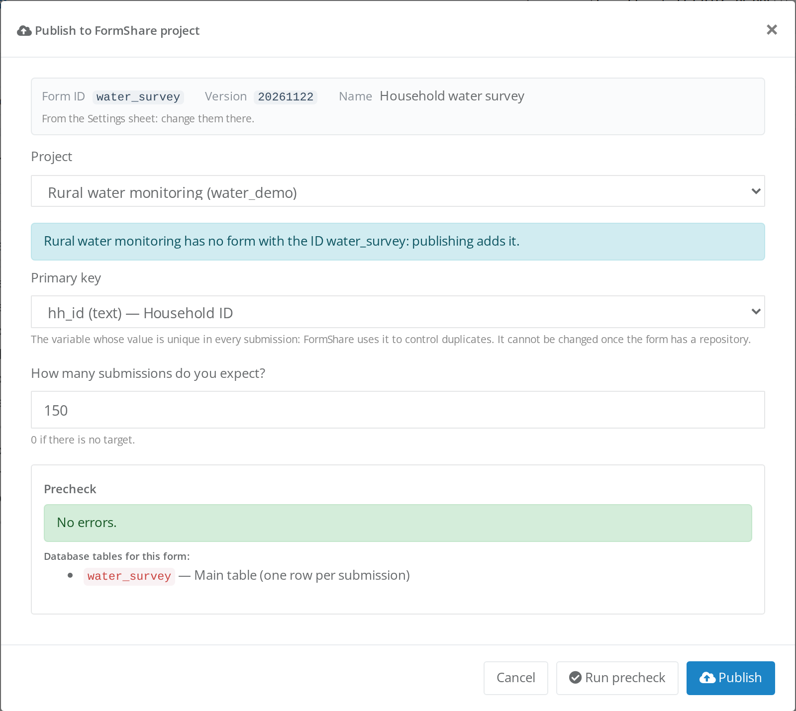
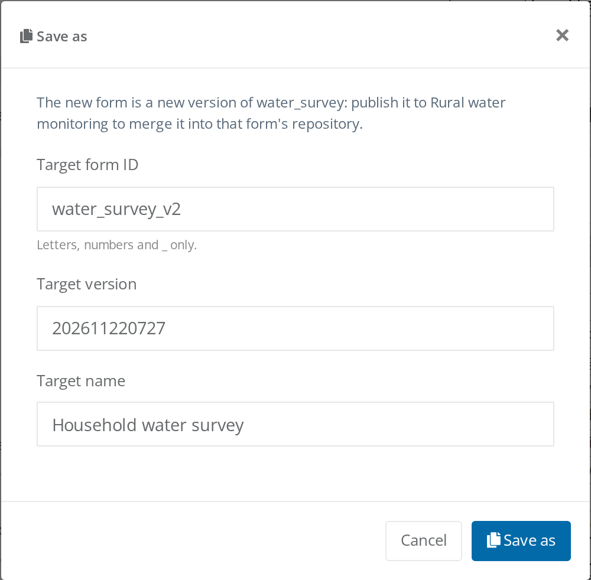
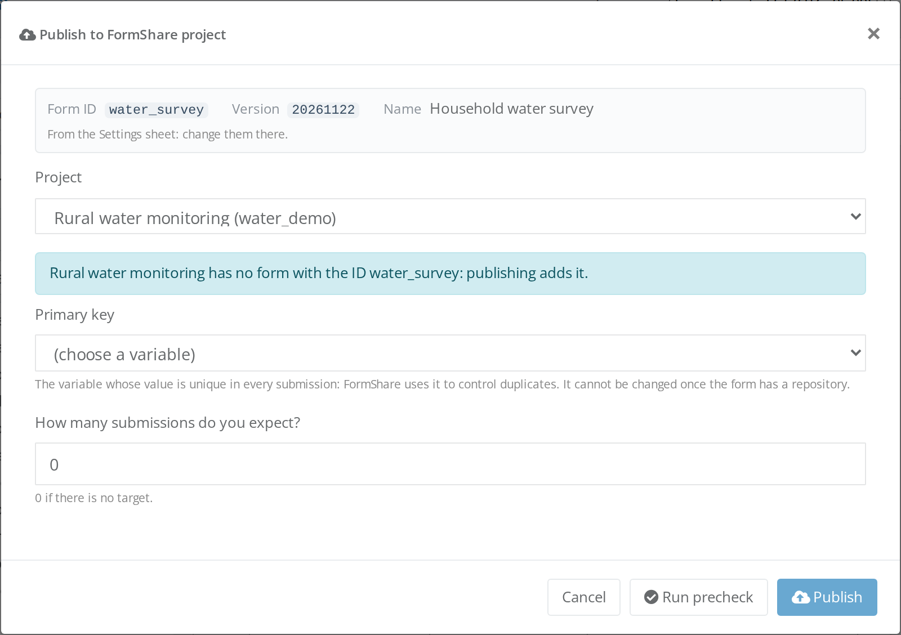
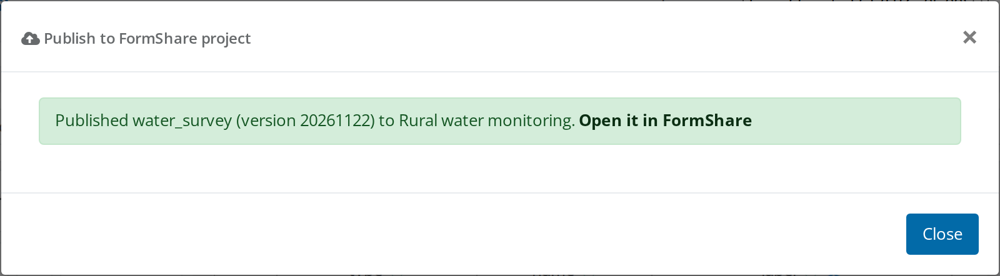

# Publishing to a project

Publishing turns a draft into a form of a FormShare project. Form Builder does it through FormShare's own pages, as if you had uploaded the `.xlsx` yourself, so FormShare checks the form as it always does and every rule of its forms applies. Open the dialog with **Publish to project...** in the editor's toolbar.

<figure><figcaption>
A new form, checked and ready to publish.
</figcaption></figure>

## Who can publish

The **Project** list offers the projects you own or administer. You need two things:

* An account that may upload forms. Without it the dialog says "Your account can't upload forms to FormShare." and lists no project.
* The owner's or an administrator's role in the project. Editors and members can build drafts but cannot publish to the project; the list then says "(no project you own or administer)".

## What the dialog takes from the draft

The **Form ID**, **Version** and **Name** at the top come from the Settings sheet (`form_id`, `version` and `form_title`). The dialog does not change them: to publish under another ID or version, change the Settings sheet, or use **Save as** on the dashboard. FormShare accepts letters, numbers and `_` in a form ID.

Publishing saves the draft first. If that save fails, the editor says why and the dialog publishes the draft as last saved, so fix what stops the save before you publish ("[When a save fails](the-editor.md#when-a-save-fails)").

## What publishing does

Once you choose a project, the dialog compares the draft's form ID with the project's forms and says which of these cases applies:

| The project has | The dialog says | What publishing does |
| --- | --- | --- |
| No form with this ID | "...has no form with the ID ...: publishing adds it." | Adds the draft as a new form, in testing. You choose its primary key and say how many submissions you expect. |
| The form, without a repository, in another version | "...already has the form ... (version ...), without a repository. Publishing replaces it..." | Replaces the form with the draft's version, and removes any test data it has. |
| The form, without a repository, in the same version | "...already has the form ... with version .... Change the version in the Settings sheet to publish a new one." | Nothing until you change the version. |
| The form, with a repository | "...'s form ... has a repository. A new version goes in under a new form ID and is merged into it..." | Nothing yet: **Save as…** makes a copy of the draft under a new form ID, and you publish that copy. |
| (A copy made that way) | "This form is a new version of ..., which has a repository in .... Publishing uploads it for merging..." | Uploads the copy as a new form, ready to be merged into the form with the repository. You merge it in FormShare. |

A form with a repository holds the project's data, so a new version never replaces it: FormShare keeps every version as a form of its own and merges the new one into the first one's repository. "[Merging subversions of a form](../../fundamentals/repositories/merging-subversions-of-a-form.md)" explains the rules of a merge, and "[Walkthrough: add a question to a form that has data](walkthrough-new-version.md)" goes through it.

### Save as a new version

**Save as…** closes the publish dialog and opens a copy of the draft with:

| Field | Suggested value |
| --- | --- |
| **Target form ID** | The form ID with `_v2` added (or `_v3`, and so on, whichever the project does not have yet). |
| **Target version** | The date and time, as `YYYYMMDDHHMM`. |
| **Target name** | The form's name. |

The copy remembers which form it is a new version of. Publish the copy to the same project and the dialog offers to upload it for merging, with two options, both ticked:

* **Keep assistants**: the new version has the same assistants as the form it merges into.
* **Keep form files**: the new version has the same files as the form it merges into.

The draft you started from does not change.

<figure><figcaption>
The copy gets a new form ID; its version and name can stay.
</figcaption></figure>

## The primary key

A new form, or a form replaced, needs a **Primary key**: the variable whose value is unique in every submission. FormShare uses it to refuse duplicate submissions, and it cannot be changed once the form has a repository.

The list offers the questions that can hold a key:

* questions of type text, integer, dateTime, barcode, calculate, select_one or select_one_from_file;
* outside every repeat, where a submission has one value.

The list starts on "(choose a variable)": nothing is chosen for you. When the form has no question that can be the key, the list says "(no variable can be the primary key)" and tells you what to add. When you replace a form, its current key is chosen already.

<figure><figcaption>
A new form, before its key is chosen.
</figcaption></figure>

A calculate with `uuid()` makes a good key when no question of the form is unique on its own.

## How many submissions you expect

A new form also asks **How many submissions do you expect?** In the project's list of forms, FormShare then shows the form's submissions as a progress bar towards this number. Leave 0 if there is no target.

## The precheck

**Run precheck** checks the draft before anything is sent. **Publish** stays off until a precheck has passed and, for a new or replaced form, a primary key is chosen.

| The precheck shows | What it means |
| --- | --- |
| "No errors." or the number of errors and warnings | The checks the editor runs (see "[Checking a form](checking-a-form.md)"). Errors stop the publish; warnings do not. |
| "The form's logic goes round in a circle: fix it before publishing." | A calculation, condition or check depends on itself through other questions. This stops the publish. |
| **Database tables for this form** | The tables FormShare will create for the form's data: one for the form, one for each repeat and one for each select multiple. |
| **Changes from** the form (version) | For a replacement or a new version: how many questions were added, changed, renamed or removed, and how many choice lists changed. |
| Compatibility with the form's submissions | For a new version: whether the changes keep the submissions already in the repository usable. Problems are listed, but do not stop the upload: FormShare checks them again when you merge. |

## After publishing

The dialog shows only what happened, with a link to the form in FormShare, and **Close**. To publish again, close it and open **Publish to project...** again.

<figure><figcaption>
The link opens the form's page in FormShare.
</figcaption></figure>

From there the form is FormShare's:

* A new or replaced form starts in testing. Test it, assign assistants, and [create its repository](../../fundamentals/forms/README.md#create-a-repository) when the form is final.
* A new version uploaded for merging appears as a form in testing marked **Sub-version**. When you are ready, **Merge repository** on its page merges it into the form with the repository.

On the Form Builder dashboard, the draft shows where it is published: the project, the form ID and the version.


Publishing sends the form, not the draft's [form files](form-files.md). If the form has a `select_one_from_file` or `select_multiple_from_file` question, attach its files on the form's **Form files** tab in FormShare (see "[Form files](../../fundamentals/forms/form-files.md)"). That tab lists the files the form needs, and FormShare does not create the form's repository until they are there. A new version published with **Keep form files** has the files of the form it merges into.


## When publishing fails

FormShare checks the form again when it receives it. If it refuses the form, the dialog shows its message after "Publishing failed:", and nothing is published. If FormShare's answer cannot be confirmed, the dialog says "FormShare didn't confirm it. Open the project in FormShare to check." The form may be there: look at the project's forms before publishing again.

## What's next

* Follow "[Walkthrough: build a household survey and publish it](walkthrough.md)" to publish a new form.
* Follow "[Walkthrough: add a question to a form that has data](walkthrough-new-version.md)" to publish a new version and merge it.
* Read "[Checking a form](checking-a-form.md)" for the errors and warnings the precheck counts.
