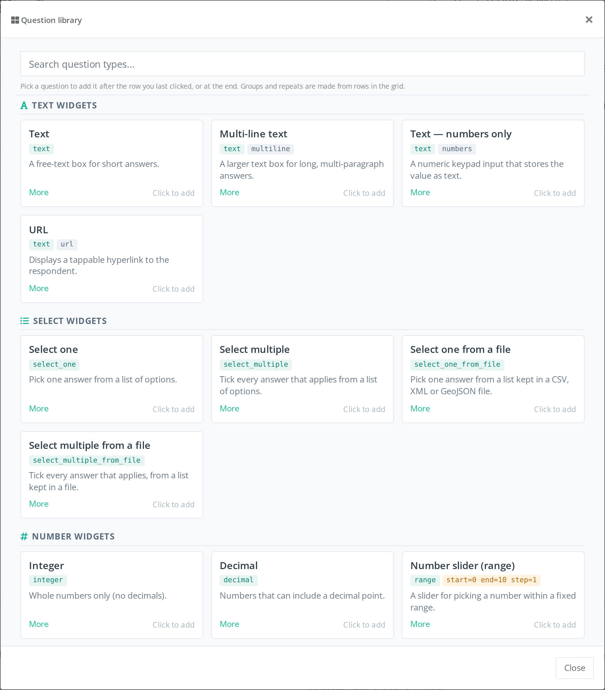
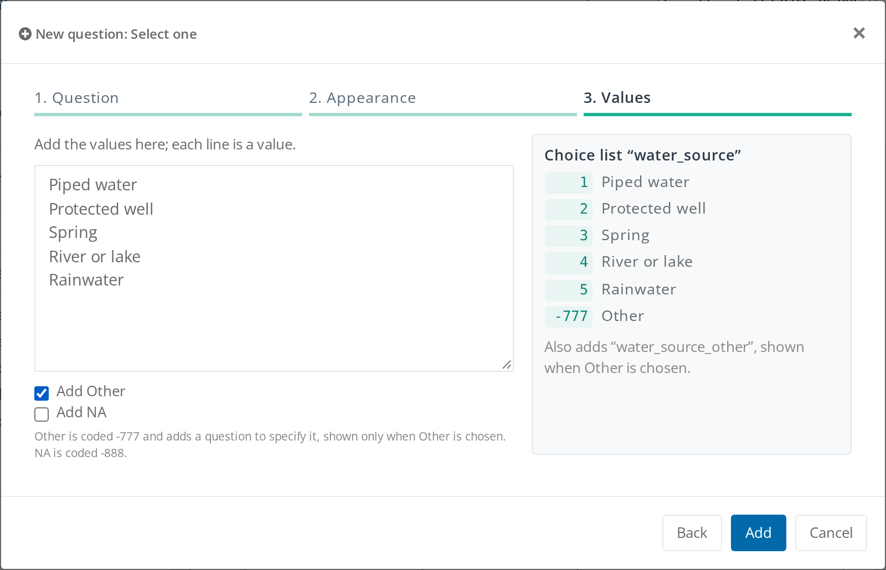
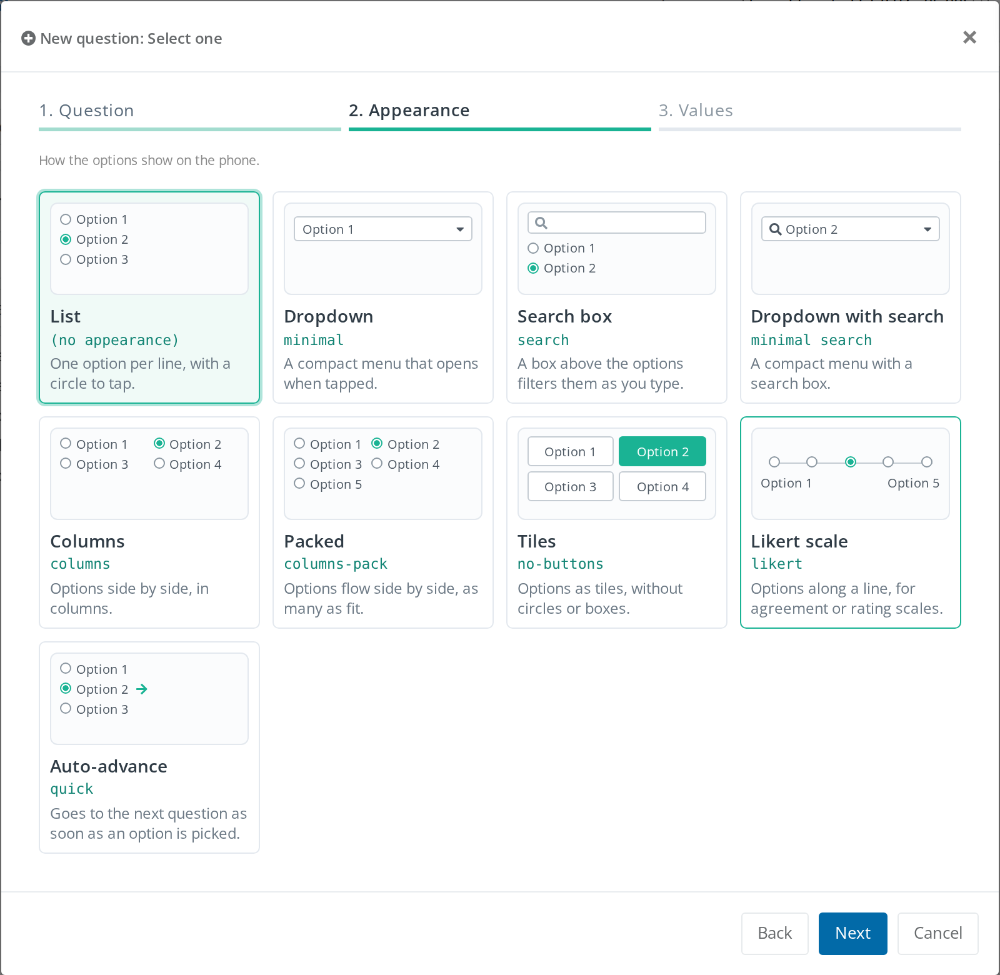

# The question library

The question library is the catalogue behind **Add question**: each kind of question Form Builder can add for you, as a card. Pick a card and a short dialog asks for what that kind of question needs, such as its name and label, a select's options, a calculate's calculation, or the file its choices come from. Then it adds the question to the survey sheet, and its choices, if it has any, to the choices sheet.

The library always adds a new question. It never rewrites a row that already holds something.

<figure><figcaption>
Scroll for the other classes, or type in the search box.
</figcaption></figure>

## Opening the library

**Add question** is the split button in the editor's toolbar. What it does depends on the row you last clicked in the survey grid:

| Row you last clicked | The button reads | A click opens |
| --- | --- | --- |
| None, an empty row, or a metadata row | **Add question** | The question library |
| A row whose type is filled in: a question, note, group or repeat | **Add/edit logic** | The logic dialog for that row, see "[Adding logic](logic.md)" |

The arrow beside the button always offers both, **Add question** and **Add/edit logic**, whatever the button reads. On the choices tab, **Add column** takes the button's place: see "[The editor](the-editor.md)".

The library's own note says where questions go: *Pick a question to add it after the row you last clicked, or at the end. Groups and repeats are made from rows in the grid.* No card makes a group or a repeat: you select rows in the grid and group them there.

## The cards

The cards come in classes, in this order:

| Class | Cards |
| --- | --- |
| Text widgets | Text, Multi-line text, Text (numbers only), URL |
| Select widgets | Select one, Select multiple, Select one from a file, Select multiple from a file |
| Number widgets | Integer, Decimal, Number slider (range), Star rating |
| Calculations | Calculate |
| Metadata | Start time, End time, Today's date, Location at start, Device ID, Username, Phone number, Email, Audit log |
| Date & time widgets | Date, Time, Date and time, Month & year |
| Geospatial widgets | Point (GPS), Point on a map, Line / path (GPS trace), Area / polygon (GPS shape), Select a place on a map |
| Image widgets | Image (photo), Annotated image, Draw / sketch, Signature, Selfie photo |
| Audio widgets | Audio, Audio (quality option) |
| Video widgets | Video, Selfie video |
| Barcode & QR widgets | Barcode / QR code |

Each card shows its title, badges with what it writes in the row (its type, plus its appearance and parameters when it sets them), and a sentence on what it is for. **More** opens a longer note and **Less** closes it. Click a card, or press Enter on it, to open its dialog.

A card's appearance and parameters go into the row as its badges show them, unless the dialog asks for them, as it does for a select's appearance. **Number slider (range)** writes `start=0 end=10 step=1` in the `parameters` column, **Star rating** writes the appearance `rating` with `start=0 end=5 step=1`, and **Audio (quality option)** writes `quality=voice-only`. To change them, edit the cells in the grid once the question is in.

## Searching

The box at the top, *Search question types...*, filters the cards as you type. It looks in each card's title, type, appearance and one-line description, whatever the case, and hides the classes left without a card: `map`, for example, leaves **Point on a map** and **Select a place on a map**. The box stays in place while the cards scroll, and it starts empty each time the library opens.

## The new-question dialog

A card opens the new-question dialog, titled *New question:* followed by the card's title. Most cards have a single step. The others list their steps at the top, numbered, with the one you are on marked:

| Cards | Steps |
| --- | --- |
| Select one, Select multiple | Question, Appearance, Values |
| Select one from a file, Select multiple from a file, Select a place on a map | Question, File, Appearance |
| Calculate | Question, Calculation |
| Every other card, metadata cards included | Question |

**Next** checks the step and goes on, and on the last step **Add** adds the question. **Back** returns to the step before, or from the first step to the library. **Cancel** closes the dialog without adding anything. Enter in a one-line box works as **Next**, or as **Add** on the last step.

When something is missing or wrong, the dialog says so at its foot and goes to the step and the box concerned. Editing that box clears the message.

<figure><figcaption>
The list shows the codes before anything is added.
</figcaption></figure>

### The Question step

| Box | What it is |
| --- | --- |
| Variable name | The question's `name`. Logic refers to the question by it, as `${name}`. Letters, numbers and `_` only, starting with a letter or `_`: see "[Names the dialog refuses](#names-the-dialog-refuses)". |
| Description | The question as the enumerator reads it, written to the `label` column. Required. |
| Hint | Optional, written to the `hint` column. FormShare Collect shows it with the question. |

A calculate is never shown on the phone, so its Question step has no hint, and its description is optional (*What it calculates (optional)*). A metadata card asks only for the variable name.

### A select's appearance and values

For **Select one** and **Select multiple**, the Appearance step shows how the options can look on the phone, each with a small picture:

<figure><figcaption>
Each tile shows the appearance it writes.
</figcaption></figure>

| Tile | Appearance written | On the phone |
| --- | --- | --- |
| List | none | One option per line, with a circle to tap (a box to tick for Select multiple). |
| Dropdown | `minimal` | A compact menu that opens when tapped. |
| Search box | `search` | A box above the options filters them as you type. |
| Dropdown with search | `minimal search` | A compact menu with a search box. |
| Columns | `columns` | Options side by side, in columns. |
| Packed | `columns-pack` | Options flow side by side, as many as fit. |
| Tiles | `no-buttons` | Options as tiles, without circles or boxes. |
| Likert scale (Select one only) | `likert` | Options along a line, for agreement or rating scales. |
| Auto-advance (Select one only) | `quick` | Goes to the next question as soon as an option is picked. |

List is chosen to start with. The grid's appearance column offers more appearances, and combinations of them: see "[The editor](the-editor.md)".

The Values step asks for the options: *Add the values here; each line is a value.* Each line becomes a choice, coded `1`, `2`, `3`… in the order you typed them, in a choice list named after the question. Blank lines don't count. Beside the box, the list shows as it will be coded.

| Option | What it adds |
| --- | --- |
| Add Other | A choice coded `-777` and labelled *Other*, and a text question named after the select with `_other` added, labelled *Specify*, shown only when Other is chosen. |
| Add NA | A choice coded `-888` and labelled *NA*. |

Other and NA come after your values. Their labels, and the *Specify* question's, are written in the language of FormShare's interface: *Otro*, *NA* and *Especifique* in Spanish.

For example, a **Select one** named `water_source`, with the values *Piped water*, *Well* and *River* and **Add Other** ticked, adds two rows to the survey sheet:

| type | name | label | relevant |
| --- | --- | --- | --- |
| `select_one water_source` | `water_source` | Where does the household get its water? | |
| `text` | `water_source_other` | Specify | `${water_source} = '-777'` |

And a list to the choices sheet:

| list_name | name | label |
| --- | --- | --- |
| `water_source` | `1` | Piped water |
| `water_source` | `2` | Well |
| `water_source` | `3` | River |
| `water_source` | `-777` | Other |

For a **Select multiple**, the specify question's relevance is `selected(${water_source}, '-777')`.

### A calculate's calculation

The Calculation step, *Calculate the value of this question*, has the same field as the logic dialog: the code editor with its completion and checks, the expression in plain English under it, **Build…** to describe the calculation and let the AI write it, and **Test** to try it with sample answers. "[Adding logic](logic.md)" explains each of them. **Add** needs a calculation: *Write the calculation.*

### A select from a file

**Select one from a file** and **Select multiple from a file** read their choices from a CSV, XML or GeoJSON file of the form. After the Question step, the File step asks for the file: *The choices are in a CSV, XML or GeoJSON file of the form. Pick one, upload one, or name the file you will attach later.*

| Choice | What it does |
| --- | --- |
| One of the form's files | Each file shows how many rows (items for XML, features for GeoJSON) and columns it has. A file that can't be read is greyed out: *Can't be read: see the files tab.* When only one file fits, it is chosen for you. |
| **Upload a file…** | Uploads a file from your computer and attaches it to the form, then chooses it if it fits the card. |
| *A file I'll attach later* | Takes the name of a file you don't have yet, such as `villages.csv`. |

A file's name starts with a letter or `_`, holds only letters, digits, `_` and `-`, and ends in `.csv`, `.xml` or `.geojson`. Until a file you named for later is attached, the Problems panel warns that it is missing. Attach it in the files tab: see "[Form files](form-files.md)".

For one of the form's files, two lists choose the columns the question reads:

| List | What it chooses | Starts on |
| --- | --- | --- |
| Value column | *What the answer saves.* | The file's default value column, else a likely one (`id`, `code`, `value`, `key` or `name`), else the first column. |
| Label column | *What each choice shows.* | The file's default label column, else `label`, `title` or `name`, else another column. |

| File | Default value column | Default label column |
| --- | --- | --- |
| CSV or XML | `name` | `label` |
| GeoJSON | `id` | `title` |

A `geometry` column is never chosen for you. A column the question can't read is listed with *(can't be used)*: a column's name must start with a letter or `_` and hold only letters, digits, `-`, `_` and `.`. When none of a GeoJSON file's features has an `id`, `id` isn't offered.

Under the lists, *Choices from* and the file's name show its first eight choices, value then label, and how many more follow. For **Select multiple from a file**, a warning appears when some values have spaces: a select multiple saves its answers separated by spaces, so choose a value column without them.

The question's type is written with the file's name, such as `select_one_from_file villages.csv`. Only the columns that aren't the file's defaults go in `parameters`, as in `value=code label=village`. A file you named for later gets no parameters: the question reads the default columns, and you can name others in the `parameters` cell.

The Appearance step then offers a select's tiles, with Likert scale and Auto-advance for Select one only. For **Select one from a file** whose file has locations, it adds two more:

| Tile | Appearance written | On the phone |
| --- | --- | --- |
| Map | `map` | The choices on a map: tap one to see it, then select it. |
| Map, quick | `map quick` | The choices on a map: tapping one selects it. |

A file has locations when it is a GeoJSON file, or a CSV or XML file with a `geometry` column. A file named for later counts as having them when its name ends in `.geojson`.

### Select a place on a map

**Select a place on a map**, under Geospatial widgets, is a Select one from a file shown on a map. Its File step offers only files with locations, and greys out the others with *No locations: a map needs a GeoJSON file, or a geometry column.* Its Appearance step offers only Map and Map, quick. On the phone, tapping a place shows its properties, and Select saves its value: by default, a GeoJSON feature's `id`.

### Metadata cards

FormShare Collect fills metadata in by itself and never shows it on the phone. A metadata card's dialog asks only for the variable name, with a note: *FormShare Collect fills it in; it isn't shown on the phone.* The card offers a name, selected: type to replace it, or press Enter to keep it. There is no description, no hint and no logic (see "[Why metadata takes no logic](logic.md#why-metadata-takes-no-logic)"), so the row gets its type and its name, plus its parameters for the audit log.

| Card | Type | Name offered | What FormShare Collect records |
| --- | --- | --- | --- |
| Start time | `start` | `start` | When the form was first opened, with its date and time. |
| End time | `end` | `end` | When the form was last saved, updated at each save. With the start time, it tells how long the form was open. |
| Today's date | `today` | `today` | The day the form was opened, without the time. |
| Location at start | `start-geopoint` | `start_geopoint` | Where the phone was when the form was first opened. FormShare Collect reads the location for 20 seconds, keeps the most accurate reading, and tells the enumerator that it tracks the location. Blank when no location could be read. |
| Device ID | `deviceid` | `deviceid` | The identifier FormShare Collect makes when it is installed, such as `collect:Y669lgoEEsQr6u54`. The same for every form on that phone, until the app is reinstalled. |
| Username | `username` | `username` | The username in FormShare Collect's settings, under Form metadata, or the one it connects to the server with when none is set there. |
| Phone number | `phonenumber` | `phonenumber` | The number typed in FormShare Collect's settings, under Form metadata. Blank when none was: Android doesn't let apps read the phone's own number. |
| Email | `email` | `email` | The email address typed in FormShare Collect's settings, under Form metadata. Blank when none was. |
| Audit log | `audit` | `audit`, which can't change | A log of how the form was filled: see the next section. |

The times and dates come from the phone's clock, which can be wrong. For how long each question took, add the audit log.

After a metadata question, the toolbar button stays on **Add question**, so you can add several in a row.

### The audit log

With an audit log, FormShare Collect sends a file, `audit.csv`, with each submission: an event for each question shown, with when it started and ended, and for the form's saves and exits. FormShare keeps the file with the submission, and its events in the form's repository. Web forms don't write it.

A form has one audit log at most, always named `audit`. Its name box can't be edited, and a second one is refused: *The form already has an audit log: a form has one at most.*

Under *The log also records*, the dialog asks what else goes in the log. Each option you tick adds to the question's `parameters` cell:

| Option | What it does | Written to parameters |
| --- | --- | --- |
| Old and new answers | When an answer changes, the log keeps the old one and the new one. | `track-changes=true` |
| Why a saved form was changed | Saving changes to a saved form asks for the reason first. | `track-changes-reasons=on-form-edit` |
| Who filled or edited the form | The form asks for the person's name before it can be filled in or edited. | `identify-user=true` |
| Where each event happened | FormShare Collect reads the location now and then, and tells the enumerator. | `location-priority`, `location-min-interval` and `location-max-age` |

With nothing ticked, the log records only the events. **Where each event happened** asks three more things:

| Setting | Choices |
| --- | --- |
| Accuracy | *High: the most accurate, uses more battery*; *Balanced: about 100 m*, the default; *Low power: about 10 km*; *No power: only when another app reads it* |
| Read every (seconds) | 60 to start with |
| Each reading valid for (seconds) | 120 to start with |

Both times are whole numbers of seconds, 0 or more (*Write a whole number of seconds: 0 or more.*), and a reading must stay valid at least as long as the time between two readings. With the defaults, the location adds `location-priority=balanced location-min-interval=60 location-max-age=120`.

## Names the dialog refuses

A variable name starts with a letter or `_` and holds only letters, numbers and `_`; anything else gets *Use letters, numbers and _ only, starting with a letter or _.* It must also be free:

| The name | The dialog says | Why |
| --- | --- | --- |
| Is empty | *Give the question a variable name.* | Every question needs a name. |
| Is already used on the survey sheet, in any group and in any case | *There is already a question named "age".* | Logic refers to questions by name. Names are compared without case because pyxform warns about two names that differ only in case, such as `Age` and `age`. |
| Is the name of a choice list, for a select | *There is already a choice list named "age".* | A select's choices go in a list named after it. |
| Is free, but `age_other` isn't, for a select with Add Other | *There is already a question named "age_other".* | Add Other adds a question with that name. |

The other messages when you move on are about what a step needs: *Give the question a description.*, *Add at least one value, one per line.*, *Write the calculation.*, *Pick the file with the choices, upload one, or name the file you'll attach later.*, and *Write the name of the file you'll attach.*

## Where the new question goes

| You last clicked | The new question goes |
| --- | --- |
| A question | Right after it. |
| A group or repeat | After the whole group or repeat, not inside it. |
| A blank row, such as one you just inserted | Into that row. |
| Nothing, an empty row below the last one, or a row the grid isn't showing now | At the end of the level the grid shows: inside the group you have open, or at the end of the survey. |

Its choices go at the end of the choices sheet. The grid then moves to the new question's label, and a message confirms it: *Added "Select one" to the survey.* The next question you add goes after this one, or after its `_other` question.

The toolbar button now reads **Add/edit logic**, for the new question, unless it was a metadata card. To add another question, use the arrow beside the button and choose **Add question**.

Adding is one change: the toolbar's undo button, or Ctrl+Z, takes back the question, its `_other` question and its choices together.

In a form whose survey labels are all in language columns, such as `label::English (en)`, the description, the hint and the choice labels go in the default language's columns (the Settings sheet's `default_language`), or in the first language's otherwise. A hint column for that language is added when the sheet hasn't one. Text in a plain `label` column there would make pyxform add a language called *default*.

## The two rows a new form starts with

A form you start from scratch with **New form** on the Form Builder dashboard (see "[Your forms](your-forms.md)") has two metadata rows from the start:

| type | name | label |
| --- | --- | --- |
| `start` | `form_start_time` | Metadata - Date and time when the form starts |
| `end` | `form_end_time` | Metadata - Date and time when the form ends |

FormShare Collect fills them in: when the form was first opened, and when it was last saved. The labels are there for you, in the spreadsheet only: pyxform leaves a metadata question's label out of the form it builds, so nobody sees them on the phone. They are ordinary rows, which you can rename, move or delete. A form imported from an `.xlsx` file keeps its own rows and doesn't get them.

## What's next

* Add relevance, constraints and calculations to your questions in "[Adding logic](logic.md)".
* Attach the files a select from a file reads in "[Form files](form-files.md)".
* Follow "[Walkthrough: build a household survey and publish it](walkthrough.md)" to build a form from the library, step by step.
