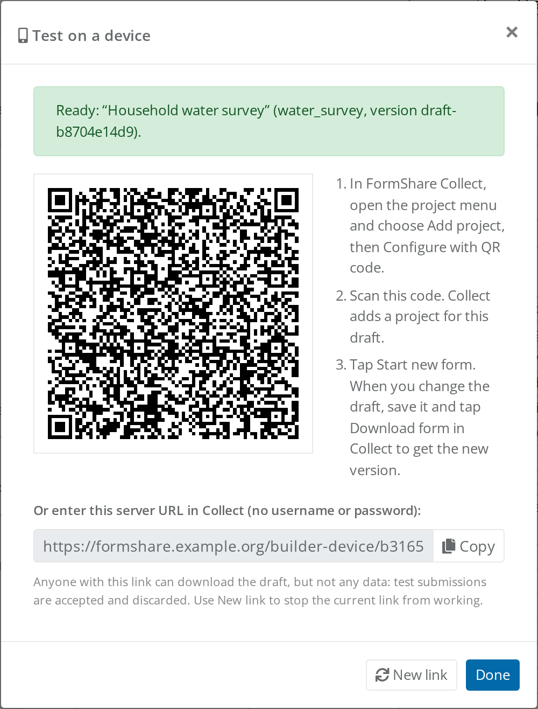

# Testing on a device

**Test on device** puts the draft you are editing on a phone, in FormShare Collect, before you publish it anywhere. The phone scans a QR code and downloads the draft straight from Form Builder, through a secret link that needs no username or password. Each change you save becomes a new version the phone can get. Test submissions are accepted and thrown away.

All you need is FormShare Collect on an Android phone: see "[Setting up FormShare Collect](../../guides/odk-collect-setup.md)" to install it. You don't need a project, an assistant or a published form.

## The dialog

**Test on device** is in the editor's toolbar. It opens the **Test on a device** dialog:

<figure><figcaption>
The version that starts with draft- changes with every saved change.
</figcaption></figure>

| Part | What it shows |
| --- | --- |
| The status line | In green, that the draft is ready, with its title, form ID and version: *Ready: "Household survey" (household, version draft-3f9a1c2b7e).* In yellow, that it has errors: see "[When the draft has errors](#when-the-draft-has-errors)". |
| The QR code | FormShare Collect's settings for a project of this draft |
| The steps beside it | How to scan the code and start the form |
| The server URL, with **Copy** | The same link as text, for a phone you set up by hand |
| The note | What the link gives access to |
| **New link** | Replaces the link: see "[New link](#new-link)" |
| **Done** | Closes the dialog |

### What is saved first

Opening the dialog saves the draft first, as the editor holds it, errors included. The phone always downloads the draft as it was last saved.

The dialog checks the draft when it opens, not while it stays open. After you change the draft, close the dialog and open it again to see whether the new version is ready.

### Whether the draft is ready

*Ready* means that pyxform and ODK Validate compile the saved draft. That is the second of the checks described in "[Checking a form](checking-a-form.md)". Warnings don't keep the draft off the phone, and neither does an error that only the form engine, the third check, reports.

The line names the form as FormShare Collect lists it:

* the title, from the Settings sheet's `form_title`, or the draft's name when the sheet has none;
* the form ID, from the Settings sheet's `form_id`;
* a version of its own, such as `draft-3f9a1c2b7e`, in place of the Settings sheet's.

Form Builder works that version out from the draft's content, so it changes with every saved change. That is how FormShare Collect knows the draft has a new version. The Settings sheet keeps its own version, the one you publish.

## The project in FormShare Collect

In FormShare Collect, the project menu's **Add project**, then **Configure with QR code**, opens the camera to scan the code in the dialog. FormShare Collect adds a project for the draft and downloads its form, which then shows in **Start new form**. If it isn't there yet, tap **Refresh** at the top of that screen.

To set up a phone without its camera, choose **Manually enter project details** instead, enter the server URL from the dialog, and leave the username and password empty.

The project the QR code sets up:

* is named after the draft, with *(draft)* after the name, and has a green icon with a *D*;
* is a project of its own on the phone, apart from any FormShare project there, so two drafts never mix;
* keeps its forms exactly as the link serves them, and checks the link for changes every 15 minutes;
* sends nothing by itself: send a test submission from **Ready to send**.


The server URL starts with the address you opened FormShare with in your browser. The phone must reach FormShare at that address: one that works only on your computer, such as `localhost`, or only on a network the phone isn't on, doesn't work there.


Opened in a browser, the server URL only says that it is a Form Builder draft link for FormShare Collect.

## What the link gives access to

The link is all it takes. Anyone who has it, or a photo of the QR code, can download the draft into FormShare Collect without signing in. They get the form: its questions, choices and logic. They don't get:

* your other drafts, or anything in FormShare;
* the draft's form files: see "[Form files on the phone](#form-files-on-the-phone)";
* any data, since Form Builder keeps none.

Test submissions are accepted and discarded. FormShare Collect reports each one as sent, and Form Builder answers *Test submission received. Form Builder does not keep test data.* Nothing is stored, so there is no test data to look at afterwards. To collect test data you can review, publish the form to a project and test it there, in its testing stage: see "[Test your form](../../guides/creating-your-first-task/test-your-form.md)".

Only you, the draft's owner, can open the dialog and see the link. Each draft has its own link, and a copy made with **Save as** gets a new one. The link doesn't expire: it works until you click **New link**, or until the draft is deleted. Publishing the draft doesn't change it either: the phone keeps getting the draft from Form Builder, not the form you published.

## New link

**New link** replaces the draft's link. The old QR code and server URL stop working at once: a phone set up with them can no longer download the draft or send to it. The dialog shows the new code, and the message *New link created. The previous QR code no longer works.*

Use it when the link has gone further than you meant, for example posted in a group chat, or to cut off the phones that have it. To go on testing on a phone, scan the new code: it adds the draft again, as a new project.

## Getting a changed draft onto the phone

The phone gets a change once the draft is saved: with **Save**, by the autosave, or by opening **Test on device** again. See "[The editor](the-editor.md)" for saving.

The draft's project in FormShare Collect keeps its forms in step with the link by itself, so it has no **Download form** button. To get a change at once, open **Start new form** and tap **Refresh**, the circular arrow at the top of the screen. Otherwise FormShare Collect picks it up at its next check, within 15 minutes.

Every saved change is a new version for FormShare Collect, which replaces the form on the phone. Forms already filled in, or started, keep the version they were started with.

## When the draft has errors

When pyxform or ODK Validate refuses the saved draft, the status line turns yellow: *The draft has errors, so Collect won't see a form yet. Fix the errors in the Problems panel, then download again.*, followed by the first error as pyxform words it.

While the draft has errors, the link offers no form. A phone that doesn't have the draft yet finds nothing in **Start new form**. A phone that has it takes it off **Start new form** at its next check, since the project keeps its forms exactly as the link serves them; forms already filled in stay. Fix the errors, open the dialog again to see *Ready*, then tap **Refresh** on the phone.

## Form files on the phone

**Test on device** doesn't send the draft's form files. FormShare Collect gets the form without the CSV, XML or GeoJSON files that its select-from-file questions read, so on the phone those questions can't show their choices. To try them on a phone, publish the form, add its files in FormShare and test it there. See "[Form files](form-files.md#on-a-test-phone)".

## What's next

* See what *Ready* depends on in "[Checking a form](checking-a-form.md)".
* Attach the files that select-from-file questions read in "[Form files](form-files.md)".
* Once the draft works on the phone, see "[Publishing to a project](publishing.md)".
