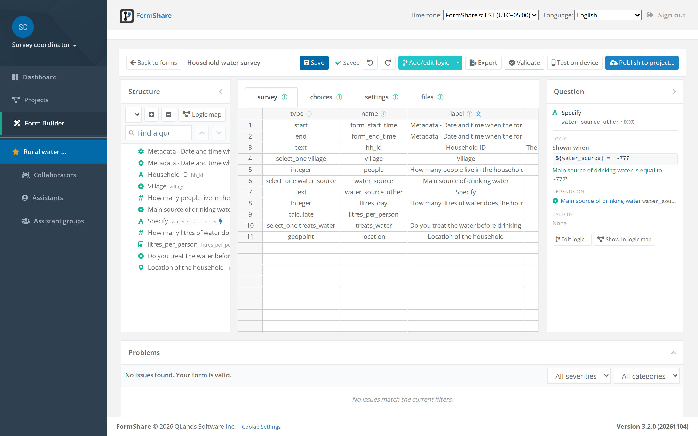
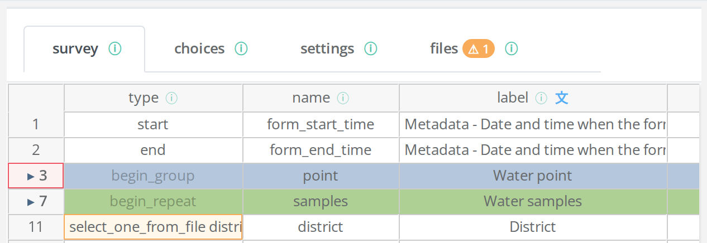
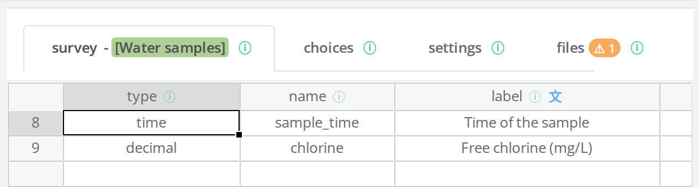
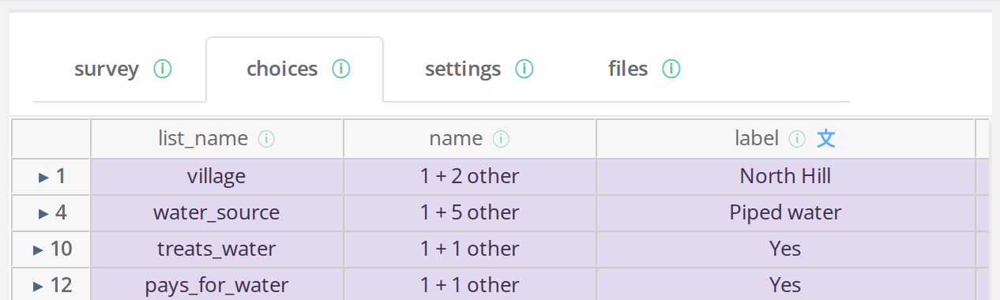
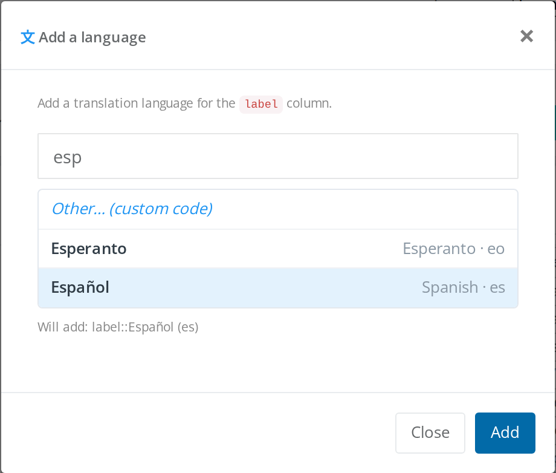
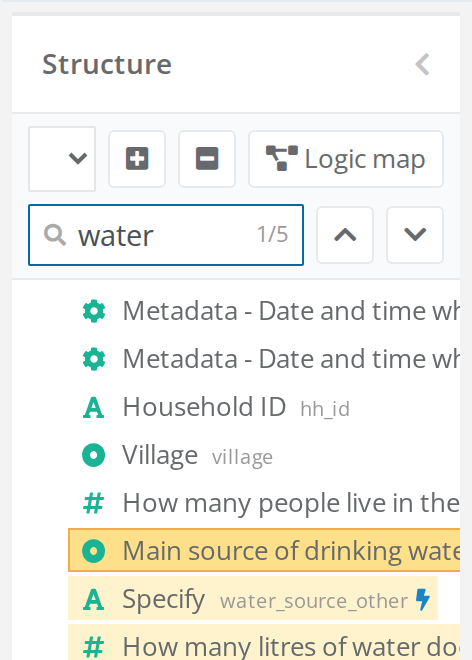
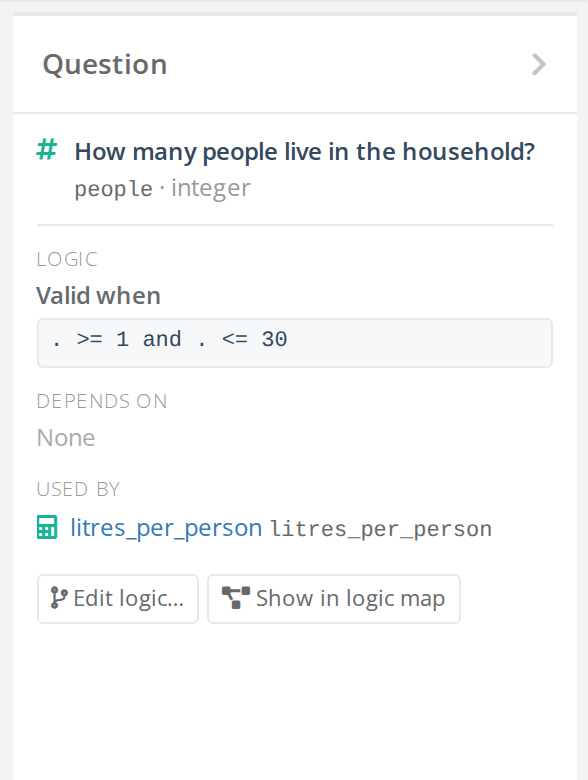

# The editor

The editor is where you work on a draft. It opens when you click **Open**, or a draft's name, in "[Your forms](your-forms.md)", and by itself after New form, Import .xlsx and Save as. It shows the draft as an XLSForm spreadsheet, with tools around it:

| Area | What it holds |
| --- | --- |
| The toolbar, at the top | Saving, undo and redo, adding questions and logic, Export, the checks, Test on device and Publish |
| The grid, in the middle | The draft's sheets, one tab each: survey, choices and settings, and the files tab |
| Structure, on the left | An outline of the survey, and the way into the logic map |
| Question, on the right | The logic of the question you select, and the questions it is linked to |
| Problems, at the bottom | What the checks found, updated as you edit |

<figure><figcaption>
The Question panel shows the row selected in the grid.
</figcaption></figure>

The first time you open the editor, a short tour points at the grid, the Question panel and the Problems panel. **End tour** closes it.

## The toolbar

**Back to forms**, at the left, goes back to your list of drafts, and the draft's name follows it. Then come the buttons:

| Button | What it does |
| --- | --- |
| Save | Saves the draft now. Ctrl+S does the same from anywhere on the page. See "[Saving](#saving)". |
| The two curved arrows | Undo and redo. See "[Undo and redo](#undo-and-redo)". |
| Add question | Opens the [question library](question-library.md), which adds a question after the row you last clicked, or at the end of the open level. Once you click a row that holds a question, the button reads **Add/edit logic** and opens the [logic dialog](logic.md) for that question. The arrow beside it offers both. |
| Add column | Takes Add question's place on the choices tab. See "[Columns of your own](#columns-of-your-own)". |
| Export | Downloads the draft as an `.xlsx` file. See "[Export](#export)". |
| Validate | Runs the [checks](checking-a-form.md) now. |
| Test on device | Shows a QR code to [try the draft in FormShare Collect](testing-on-a-device.md). |
| Publish to project... | [Publishes the draft](publishing.md) to a project you own or administer. |

A metadata row, such as `start` or `deviceid`, leaves the button on **Add question**: FormShare Collect fills metadata in, so it takes no logic.

## The grid

The grid shows the draft's sheets the way a spreadsheet program does, one tab each: **survey**, **choices** and **settings**, and **files** for the files the form reads. Type in a cell to change it, move with the arrow keys, and copy and paste cells to and from Excel or another spreadsheet program.

Each tab, and each of the grid's own column headers, has an **ⓘ**: point at it, or click it, for what the sheet or the column holds.

On the survey and choices sheets:

* a row keeps its number in the sheet wherever it shows. The rows inside a group don't start again at 1, and the numbers match the ones in the Problems panel;
* there are always empty rows below the last one: type in the first of them to add a row;
* right-click a row for **Insert row above**, **Insert row below** and **Delete row**, and on the survey sheet for the group actions described below;
* drag a row by its number to move it. A group or a list moves with everything in it;
* select rows by clicking their numbers and press Delete to delete them. A group or a list asks first, since its contents go too.

Columns don't sort, and the grid's own columns can't be inserted, renamed or deleted.

The type cell is plain text. Type any XLSForm type, such as `integer` or `select_one yes_no`, or let the [question library](question-library.md) write it.

The appearance cell lists the appearances of its row's type when you open it, each with what it does. A click adds one or takes it out, since a cell can hold several, such as `minimal search`. Typing filters the list, and the arrow keys with Enter pick from it. The grid refuses a word that isn't an appearance of the row's type, and any appearance on a row with no type. Patterns such as `columns-3`, `ex:` followed by an app, and `search('…')` are accepted, as you write them, on the types that take them. Appearances already in a form, imported or typed before the type changed, are checked only when you edit the cell.

## Groups and repeats

On the survey sheet, groups and repeats work as objects. A group is one blue row and a repeat one green row, and their end rows are never shown. What is inside appears when you open the group.

<figure><figcaption>
The row numbers jump from 3 to 7 to 11: the rows inside keep their numbers.
</figcaption></figure>

### Opening a group

Double-click a group's row number or its type, or right-click it and choose **Open group** (**Open repeat** for a repeat). The grid then shows only what is inside, and the survey tab shows the path to it, each group by its label:

`survey - [Household] - [Members]`

Each part of the path opens its level: **[Household]** goes back to the household's rows, and **survey** to the top. **Back to the level above**, on the right-click menu, goes up one level. Long labels are cut short in the path; deeper than two levels, the middle parts fold into **…**, and pointing at a part shows it in full.

Rows you add while a group is open go into it. **Open group** in the Question panel, and a double-click on a group in the Structure outline, open it too.

<figure><figcaption>
Click survey in the tab to go back to the top.
</figcaption></figure>

### Expanding a group in place

The ▸ on a group's row number shows its rows under it, indented, without leaving the level; ▾ hides them again. The right-click menu has **Expand group** and **Collapse group**, and **Expand all groups** and **Collapse all groups** for every group at once.

An expanded group's rows are read-only: you edit them inside their group, and typing in one says so. Double-click one, or choose **Edit in its group** on the right-click menu, and its group opens with that cell selected.

### Making and removing groups

Select rows, right-click and choose:

| Menu item | Makes |
| --- | --- |
| Group rows | A group around the rows |
| Group rows as a single page | A group with the appearance `field-list`, which FormShare Collect shows on one screen |
| Group rows as a repeat | A repeat around the rows |

The new group is named `group_1`, `group_2` and so on (`repeat_1` for a repeat): give it a name and a label of your own. Typing `begin_group` or `begin_repeat` in a row's type cell also makes one, with its end row, and names it the same way when the row has no name.

A group's type cell can't be edited: typing, Delete or a paste there points you to **Ungroup**, which turns the group back into plain rows. When the group has settings of its own, such as a relevance or an appearance, Ungroup asks first, since they are lost. A group can't become a repeat in the grid: ungroup it, then group its rows as a repeat. The rest of a group's row, its name, label, relevance and so on, is edited like any row.

**Delete group…** asks first, with the number of rows inside: they go with it. **Delete rows**, on a selection of several rows, asks the same way when the selection holds a group. Ctrl+Z brings them back.

### Moving rows into and out of groups

Dragging a row by its number moves it within its level. To move rows into or out of a group, drag them in the [Structure outline](#the-structure-panel), or cut and paste them:

* Ctrl+X, or **Cut rows** on the right-click menu, marks the rows of the selected cells: they fade, and a group goes with everything in it. While you are typing in a cell, Ctrl+X cuts text as usual.
* Open the level they should go to, select a row and press Ctrl+V, or choose **Paste rows above**: the rows move above it. Pasted on the empty rows below the last row, they go to the end of the level.
* Nothing moves until you paste. Esc forgets the cut.

### What the survey sheet refuses

| You try | What happens |
| --- | --- |
| Type an `end_group` or `end_repeat` row | Refused: groups and repeats close by themselves. |
| Put a repeat inside a group shown on one screen (`field-list` or `table-list`), by grouping, typing, pasting or dragging | Refused: FormShare Collect can't display it. |
| Paste copied rows that include a group's begin or end row | Refused: paste the questions, then select them and use **Group rows**. |
| Paste a group into itself | Refused: *A group can't go inside itself.* |
| Paste cut rows that changed after the cut, for example by being deleted | Refused: *The cut rows have changed. Cut them again.* |
| Edit or move an expanded group's rows, or paste onto them | Refused: edit them inside their group. |

### Problems inside a closed group

A problem on a row hidden inside a closed group marks the group's row number, and its tooltip begins *Inside this group:*. **Go to**, in the Problems panel, opens the group.

### When begin and end rows don't match

If a group's begin and end rows don't pair up, as can happen in an imported file, the grid can't show groups as objects. It shows every row, end rows included, with a notice naming the first row that breaks the pairing. Fix the rows there: once they match, groups open as objects again.

## Choice lists

The choices sheet groups its choices by list, the way the survey groups its rows. At the top, each list is one purple row: its `list_name`, its first choice with how many others (`1 + 4 other`), and the first choice's label. These rows are read-only.

<figure><figcaption>
Each list is one row until you open it.
</figcaption></figure>

| To | Do this |
| --- | --- |
| Open a list | Double-click its row, or right-click it and choose **Open list**. The grid shows its choices, and the tab reads `choices - [water_source]`. |
| Go back to the lists | Click **choices** in the tab, or choose **Back to all lists** on the right-click menu. |
| See a list's choices without opening it | Click the ▸ on its number. **Expand all lists** and **Collapse all lists** are on the right-click menu. The choices show read-only. |
| Add a choice to a list | Open the list and type in the empty row below its choices. |
| Move a list | Drag its number: its choices move with it. |
| Delete a list | Right-click it and choose **Delete list…**, or select its number and press Delete. It asks first, with how many choices go and which questions use the list. |

Inside a list, its choices keep its `list_name`: the column is read-only there, and editing it says *Choices in this list keep its list_name, "water_source". To add a choice to another list, go back to "choices" and open that list.* A list's name can't be changed in the grid.

A choice with no `list_name` shows on its own, after the lists. Give it one and it moves to the end of that list or, when no list has that name, starts a new list. That is how you make a list by hand; a select usually brings its own list from the [question library](question-library.md).

A problem on a choice inside a closed list marks the list's number, its tooltip beginning *In this list:*, and **Go to** opens the list.


A choice needs its `list_name` and its `name` before the draft can be saved. While one lacks either, every save fails with a message that ends with the place, such as `($.choices[3].name)`: the choice numbered 4 has no name. That includes an empty row you insert in a list: fill it in or delete it.


## The settings sheet

The settings sheet holds the form's settings in a single row:

| Column | What it holds |
| --- | --- |
| `form_id` | The form's ID. Publishing looks the form up by it in the project you choose. |
| `form_title` | The form's title, shown in FormShare Collect's list of forms |
| `version` | The form's version. Publishing over a form that a project already has needs a new one. |
| `default_language` | The language a translated form shows first, written like a language column, such as `English (en)`. See "[Languages](#languages)". |
| `style` | The look of the form in a web browser, such as `pages` or `theme-grid` |
| `instance_name` | An expression that names each filled-in form so they can be told apart, such as `concat(${first}, ' ', ${last})` |
| `public_key` | The public key that encrypts the form's submissions |

XLSForm reads only the first row of the settings sheet, so the grid has exactly one. No row is inserted, deleted or dragged there, and the right-click menu says *The Settings sheet has a single row.* Pasting several rows keeps the first. A form that comes with several filled rows, from an imported file or an older draft, keeps the first one: the editor says how many rows the sheet had and saves it with one. Blank rows go without a word.

New form fills in `form_id`, `form_title` and `version`, and Save as writes its target values into the copy's.

## The files tab

The files tab holds the CSV, XML and GeoJSON files that the form's `select_one_from_file` and `select_multiple_from_file` questions read. Its badge counts the files attached, or shows a warning sign and how many files the form uses that aren't attached. See "[Form files](form-files.md)".

## Columns and languages

The grid's own columns are the XLSForm columns of each sheet:

| Sheet | Columns |
| --- | --- |
| survey | `type`, `name`, `label`, `hint`, `required`, `relevant`, `constraint`, `constraint_message`, `calculation`, `appearance`, `default`, `choice_filter`, `repeat_count`, `read_only`, `image`, `audio`, `video`, `parameters` |
| choices | `list_name`, `name`, `label`, `image`, `audio`, `video` |
| settings | `form_id`, `form_title`, `version`, `default_language`, `style`, `instance_name`, `public_key` |

A language column shows right after the column it translates. Columns of your own come after the grid's own.

### Columns of your own

On the choices tab, **Add column** opens **Add a column to the choices**. The column goes to every choice, after the other columns: the `district` a `choice_filter` reads, for example. Its name has letters and `_` only, and can't be one of the sheet's standard columns or a column it already has, whatever the case.

The survey and settings sheets have no Add column. A column an imported file brought that isn't an XLSForm column, such as a column of notes, shows after the grid's own columns on any sheet.

To remove a column of your own, right-click it and choose **Remove this column**, followed by its name. When it has values, it asks first, since they are deleted with it. Undo doesn't bring a removed column back.

### Languages

A form in several languages has a column per language for each text it translates: `label::English (en)`, `label::Español (es)`, `hint::Español (es)` and so on. The **文** button, next to the ⓘ of a column that can be translated, adds one:

| Sheet | Columns with 文 |
| --- | --- |
| survey | `label`, `hint`, `constraint_message`, `image`, `audio`, `video` |
| choices | `label` |

文 opens **Add a language** for that column. Search the list by a language's name or code, click the language, and **Add** puts its column right after the one it translates. The line above the buttons shows the column it will add, such as *Will add: label::Español (es)*. For a language the list doesn't have, choose **Other… (custom code)** and type its two-letter code and its name. A column the sheet already has is refused.

<figure><figcaption>
The language's code goes into the column's name.
</figcaption></figure>

Each column takes its languages separately. Adding Español to the survey's `label` adds neither `hint::Español (es)` nor the choices' `label::Español (es)`: add the language on every column you translate.

Text in a plain column, such as `label` or `hint`, belongs to the form's default language: the one `default_language` names on the settings sheet or, when it names none, a language called `default`. For every language to show under its own name, either leave the plain columns empty and write only in language columns, or set `default_language` to the language the plain columns are written in. Once every label of the survey is in language columns the grid shows, the [question library](question-library.md) writes the questions it adds in the default language's columns.

A language column you added and never filled in stays in the file that Export downloads, but isn't sent when you publish, where it would become an empty language. To remove a language column, right-click it and choose **Remove this language column**; it asks first when the column has values.

How FormShare stores the labels of a form in several languages is in "[Forms with multiple languages](../../fundamentals/repositories/forms-with-multiple-languages.md)".


A form imported from an `.xlsx` file keeps its language columns (`label::English (en)`, `hint::Español (es)` and the like) and the XLSForm columns the grid has no place for, such as `guidance_hint`, `required_message`, or `submission_url` on the settings sheet. They stay in the draft and go out again with Export and Publish, but the grid doesn't show them, so you can't edit them here. To change them, export the draft, edit them in the file and import it as a new draft.


## The Structure panel

The Structure panel, on the left, outlines the survey sheet: every question, inside the groups and repeats that hold it.

<figure><figcaption>
The lightning bolt after Specify marks its relevance.
</figcaption></figure>

Each line shows the question's icon, its label and its name; point at a long label to read it whole. A group's icon shows how FormShare Collect displays it: a folder for a plain group, a scroll for a group on one screen (`field-list`), a grid for a table (`table-list`). A repeat's icon is a table. Small marks follow:

| Mark | Means |
| --- | --- |
| A lightning bolt | The question has a `relevant` |
| A padlock | It has a `constraint` |
| A calculator | It has a `calculation` |
| A magnifying glass | It has a `choice_filter` |
| A red circle with an exclamation mark | It has an error: point at it for the message |
| An orange triangle | It has a warning |

At the top of the panel:

| Control | What it does |
| --- | --- |
| The list | Shows **All questions**, or only those **With logic**, **With errors** or **With warnings**, or the **Repeats**. The groups around them stay. |
| Expand all groups and Collapse all groups (the plus and minus buttons) | Open or close every group in the outline. |
| Logic map | Opens the [logic map](logic.md#the-logic-map). |
| Find a question… | Finds the questions whose label or name holds what you type, whatever its case and accents. The count beside it says which match you are on, such as `2/5`. |
| The up and down arrows | Go to the previous or the next match. Enter and Shift+Enter do the same, and Escape clears the search. |

Find opens the groups around each match and scrolls the outline to it. The grid stays where it is until you click the match.

Click a line to go to its row in the grid, which opens its group, and the Question panel shows it. Double-click a group to open it in the grid. The right-click menu has **Go to row**, **Show in logic map**, and **Highlight related questions**, which outlines the question and shades the questions it depends on and the ones whose logic uses it.

Drag a line to move its rows: drop it among the questions of another group or repeat, or at the top. A group moves with everything in it. Dragging works only while the list shows **All questions**, and a repeat can't go into a group shown on one screen.

## The Question panel

The Question panel, on the right, follows the row you select on the survey sheet. It shows:

| Part | What it shows |
| --- | --- |
| The head | The question's icon, label, name and type |
| Problems | What the checks found on this row |
| Logic | Each kind of logic the row has, as its expression and in plain English. "[Adding logic](logic.md#the-question-panels-reading)" explains each heading. |
| Depends on | The questions this one's logic reads. Click one to go to it. |
| Used by | The questions whose logic reads this one |

<figure>= 1 and . <= 30, Depends on None, Used by litres_per_person, and the Edit logic and Show in logic map buttons."><figcaption>
The calculation litres_per_person divides by this answer, so it is listed under Used by.
</figcaption></figure>

Below them, **Edit logic…** opens the [logic dialog](logic.md), **Show in logic map** opens the map centred on the question, and a group's row adds **Open group** (or **Open repeat**). For a metadata row the panel has no **Edit logic…**, and says why: metadata takes no logic.

Depends on and Used by come from the form's last check. While an error stops the form from compiling, they read *None*.

A row of an expanded group shows a note that it is read-only there, with **Edit in its group**. On the choices and settings tabs, the panel only asks you to select a question on the survey sheet.

## The Problems panel

The Problems panel, at the bottom, lists what the form's checks found. They check what the grid holds, saved or not, a moment after each change, and **Validate** runs them at once.

Each problem shows where it is (the sheet, the row and the column), its message and **Go to**, which opens the right tab and group and selects the cell. Errors come first, and the two lists at the top filter the problems by severity and by the check that found them. The grid marks the same cells, with a red frame for an error and an orange one for a warning: point at a cell for its messages.

"[Checking a form](checking-a-form.md)" explains each check and its messages.

## Folding and resizing the panels

| Panel | Folds | Remembered |
| --- | --- | --- |
| Structure | Sideways, into a narrow rail with its title written down its side | Yes, in this browser |
| Question | Sideways, the same way | No: it opens each time the editor loads |
| Problems | Down, to its title bar | Yes, in this browser |

The chevron in a panel's title bar folds it. A folded side panel opens again with a click anywhere on its rail, and the Problems panel with its chevron. Drag the edges between the panels to resize them; this browser remembers the sizes too.

## Saving

The editor saves the draft to the server:

| When | How |
| --- | --- |
| When you ask | **Save**, or Ctrl+S |
| By itself | Once you have made no change for 30 seconds |
| Before a test or a publish | **Test on device** and **Publish to project...** save first. If that save fails, they use the draft as last saved. |

**Export** doesn't save first: it downloads the draft as last saved.

If you leave the page with unsaved changes, your browser asks before it goes.

### The copy in your browser

Between saves, the editor keeps a copy of the draft in your browser, written a moment after each change and cleared by each save. When the page closes before its changes are saved, the next time you open the draft in that browser the editor offers them back. Accept, and they return and are saved 30 seconds later; decline, and the copy is deleted. The copy lives in that browser only: another browser, or another computer, doesn't have it.

### Undo and redo

| Action | Keys | Button |
| --- | --- | --- |
| Undo | Ctrl+Z | The first curved arrow |
| Redo | Ctrl+Y, or Ctrl+Shift+Z | The second curved arrow |

Undo steps back through up to 49 changes across the whole draft, on any tab: cell edits, rows added, deleted, grouped or moved, and each question the library adds. It doesn't take back columns or languages added or removed, nor changes to the form files, and the history ends when the page reloads. In a dialog's fields, and in the outline's find box, Ctrl+Z is that box's own undo.

### The same draft in two tabs

When the draft is also open in another tab of the same browser, the editor warns: **Form open in another tab**, *This form is open in another tab. Saves may conflict.* Each save replaces the whole draft on the server, so the tab that saves last overwrites the other's changes: keep the draft open in one tab only. The warning stays until you close it.

### When a save fails

| The message | Why, and what to do |
| --- | --- |
| *We couldn't save your form because of a structural issue.*, ending with a place such as `($.choices[3].name)` | A choice has no `name` or no `list_name`, here the choice numbered 4. Fill it in or delete the row. See "[Choice lists](#choice-lists)". |
| *This form is larger than the configured size limit.* | The draft is over the server's limit for one draft, 5 MB unless your administrator changed it. |
| *Save failed. Please try again.* | The server couldn't be reached. Your changes stay in the browser's copy. |


**For server administrators:** the wait before saving by itself is `formbuilder.autosave_debounce_seconds`, 30 by default, and the size limit of one draft `formbuilder.max_session_json_bytes`, in bytes, 5242880 (5 MB) by default.


## Export

**Export** downloads the draft as an XLSForm file named after the draft, such as `Household water survey.xlsx`. The file holds the draft as last saved:

* the survey, choices and settings sheets;
* every column the grid showed at that save, in the same order, even empty ones;
* after them, any column the draft holds that the grid doesn't show.

It doesn't hold the form files: download those from the [files tab](form-files.md). Save before you export to include your latest changes.

The file opens in Excel or any spreadsheet program, and [Import .xlsx](your-forms.md#import-an-xlsform) turns it back into a draft, always a new one: the editor itself has no import. Publishing sends FormShare a leaner copy of the draft, without the empty XLSForm and language columns.

## What's next

* Add questions with their choices and appearances from "[The question library](question-library.md)".
* Write and test relevance, constraints and calculations in "[Adding logic](logic.md)".
* Read what each check looks for in "[Checking a form](checking-a-form.md)".
* Build a form from start to finish in "[Walkthrough: build a household survey and publish it](walkthrough.md)".
