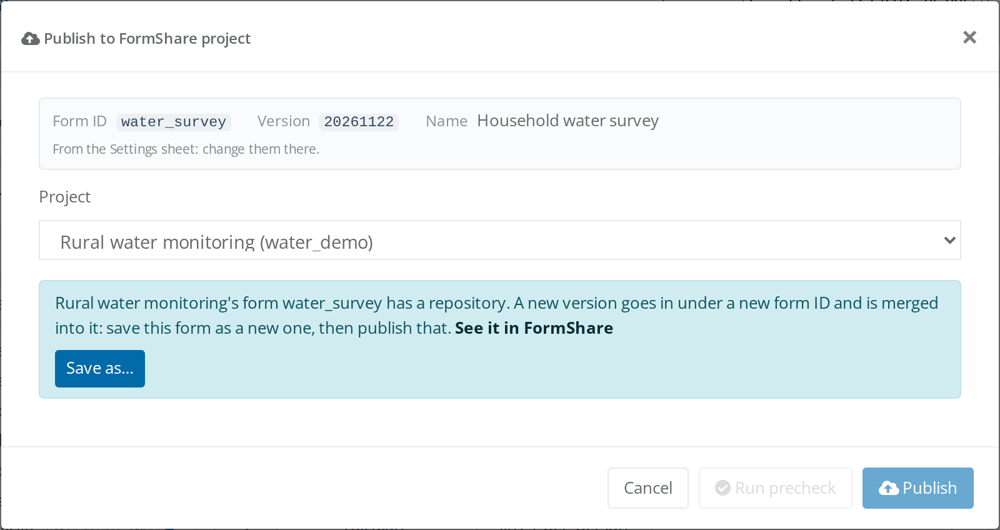
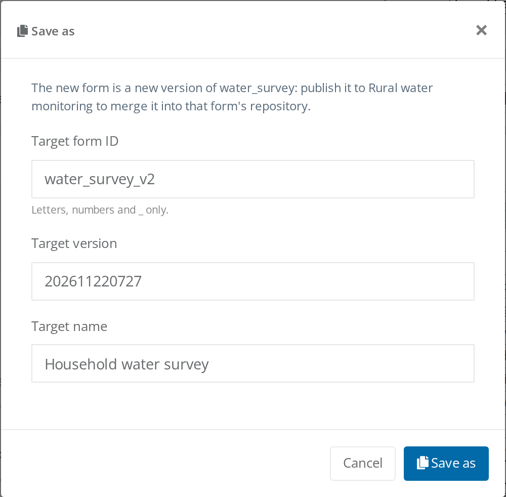
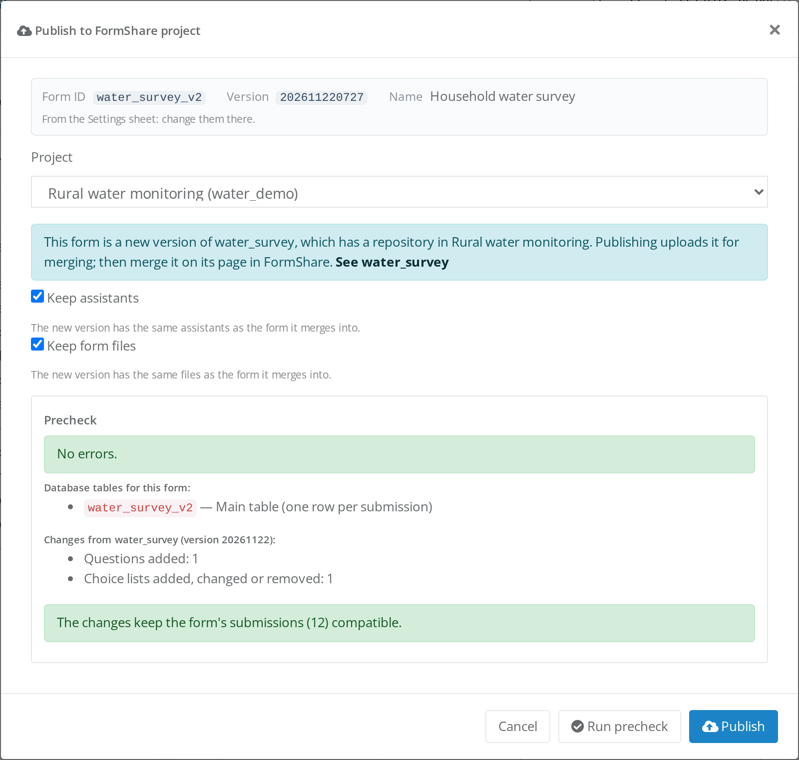
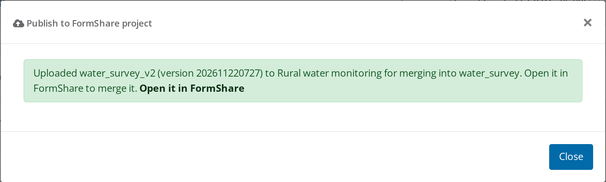
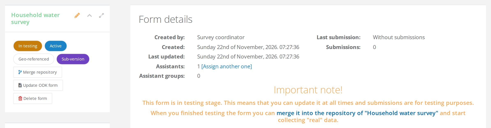

# Walkthrough: add a question to a form that has data

The household water survey of "[Walkthrough: build a household survey and publish it](walkthrough.md)" is collecting data: its repository holds the first 12 households. The team now wants to ask whether a household pays for its water.

A form with a repository is never replaced: FormShare keeps every version as a form of its own and merges each new version into the first one's repository, so the data stays in one place. In Form Builder that means saving the draft under a new form ID and publishing it for merging. This walkthrough goes through it.



## Open the draft

Open **Form Builder** and click **Open** on "Household water survey". Its row says where it is published: Rural water monitoring, `water_survey`, version 20261122.

If you no longer have the draft, click **Download ODK form** on the form's page in FormShare, then **Import .xlsx** on the Form Builder page: the imported draft has the same form ID and version.



## Add the question

Click the `treats_water` row in the grid, so the new question goes after it. Click the arrow next to the toolbar's main button, choose **Add question**, and click the **Select one** card:

| Field | Value |
| --- | --- |
| **Variable name** | `pays_for_water` |
| **Description** | Does the household pay for its water? |
| **Values** | Yes, No |

Click **Add**.



## Save it as a new version

Click **Publish to project...** and choose "Rural water monitoring". The dialog explains that the project's form has a repository, so the new version goes in under a new form ID.

<figure><figcaption>
Publish stays off: this draft cannot replace the form.
</figcaption></figure>

Click **Save as…**. Form Builder saves the draft and suggests the new form's ID, version and name:

| Field | Value |
| --- | --- |
| **Target form ID** | `water_survey_v2` |
| **Target version** | The date and time, as suggested |
| **Target name** | Household water survey |

<figure><figcaption>
The form ID must be new in the project; the name can stay.
</figcaption></figure>

Click **Save as**. The copy opens in the editor, with the new ID and version in its settings sheet. The draft you started from stays as it was.



## Publish it for merging

In the copy, click **Publish to project...** and choose "Rural water monitoring" again. This time the dialog recognises a new version of `water_survey` and offers to upload it for merging. Keep **Keep assistants** and **Keep form files** ticked: the new version gets the assistants and files of the form it merges into, and Enumerator A can send it without being added again.

Click **Run precheck**. Besides the usual checks, it compares the copy with `water_survey`: one question added, one choice list added, and the changes keep the form's 12 submissions compatible.

<figure><figcaption>
Problems with existing submissions would be listed here; FormShare checks them again when you merge.
</figcaption></figure>

Click **Publish**. The dialog says it uploaded `water_survey_v2` for merging into `water_survey`.

<figure><figcaption>
Nothing is merged yet: that happens in FormShare.
</figcaption></figure>

Click **Close**.



## Merge it in FormShare

Follow **Open it in FormShare** from the dialog, or open the project's forms. The new version is a form in testing, marked **Sub-version**, with a **Merge repository** button.

<figure><figcaption>
Until it is merged, the new version is a form in testing like any other.
</figcaption></figure>

Test it if you like, then click **Merge repository**. FormShare's merge page lists the changes that cannot be merged and asks whether to keep the submissions sent while the new version was in testing (**Discard all testing data** is off). Click **Merge new version**: FormShare checks the new version against the repository once more and merges it. "[Merging subversions of a form](../../fundamentals/repositories/merging-subversions-of-a-form.md)" describes this step and its rules.



Next time the form changes, start from the `water_survey_v2` draft. Its form now has the repository, so publishing it asks for **Save as…** again, and suggests `water_survey_v3`.

## What's next

* Read "[Publishing to a project](publishing.md)" for every case the publish dialog handles.
* Read "[Merging subversions of a form](../../fundamentals/repositories/merging-subversions-of-a-form.md)" for what a merge can and cannot change.
