# Walkthrough: build a household survey and publish it

A small team checks drinking water in three villages. Their project in FormShare, "Rural water monitoring", has no form yet. In this walkthrough you build the household survey in Form Builder: eight questions, one with an "Other" option, a calculation and a limit on one answer. Then you try it on a phone and publish it to the project.

You need a FormShare account that may upload forms, and a project you own or administer. "[Creating your first project](../../guides/creating-your-first-project.md)" shows how to make one.



## Start a new form

Open **Form Builder** in FormShare's navigation and click **New form**. Fill in the dialog:

| Field | Value |
| --- | --- |
| **Form ID** | `water_survey` |
| **Form name** | Household water survey |
| **Version** | Leave today's date |

<figure>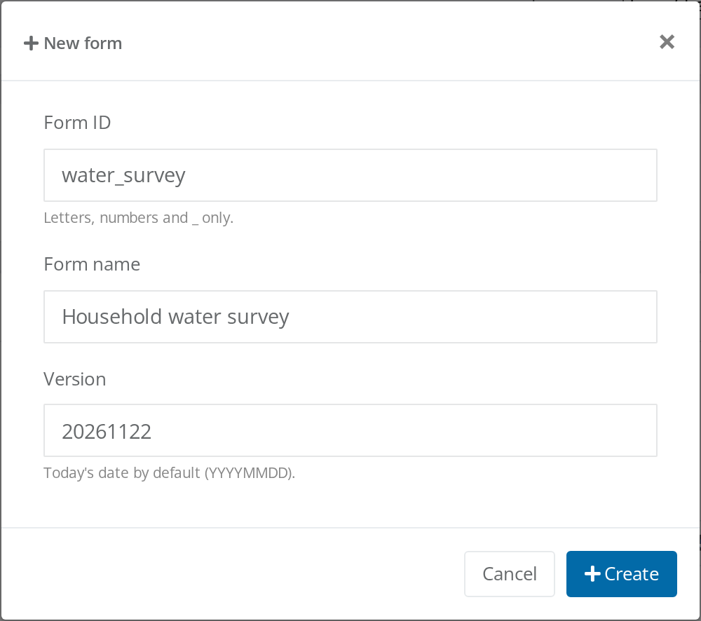<figcaption><p>The form ID cannot have spaces: letters, numbers and _ only.</p></figcaption></figure>

Click **Create**. The editor opens on the survey sheet, which already has two rows: `form_start_time` and `form_end_time`, the times FormShare Collect records when the form is opened and finished. The form ID, name and version are in the settings sheet.



## Add the household ID

Click **Add question**. The question library opens, with a card for each kind of question.

<figure>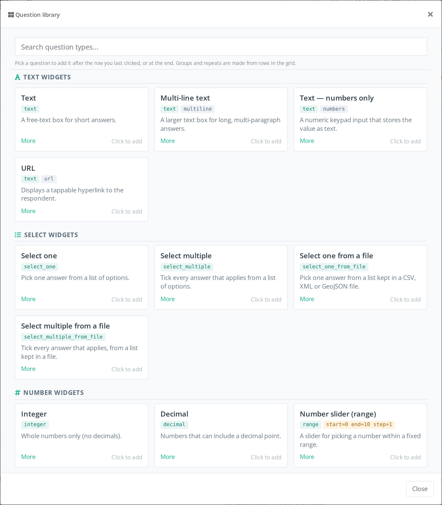<figcaption><p>Each card says what the question is for. More shows an example.</p></figcaption></figure>

Click the **Text** card and fill in:

| Field | Value |
| --- | --- |
| **Variable name** | `hh_id` |
| **Description** | Household ID |
| **Hint (optional)** | The number painted on the door |

<figure>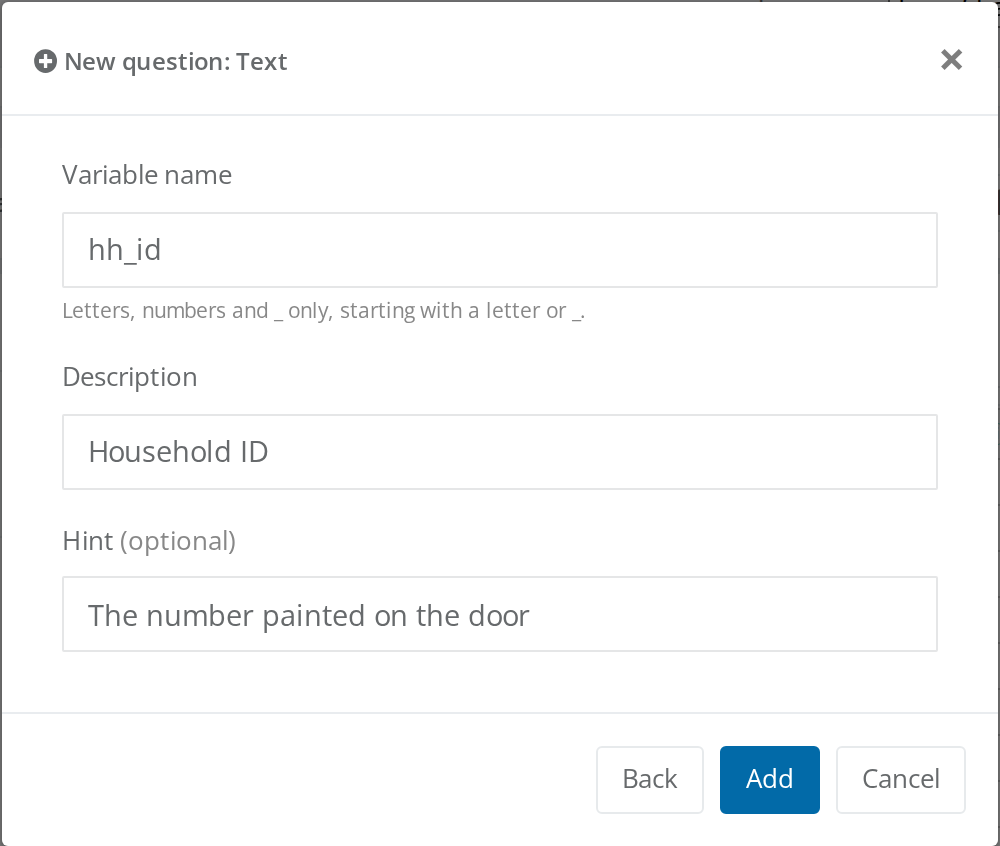<figcaption><p>The description is the question FormShare Collect shows; the hint appears under it.</p></figcaption></figure>

Click **Add**. The question goes in after `form_end_time`, and the button in the toolbar now reads **Add/edit logic**: it offers logic for the question you just added. To add the next question, click the arrow next to it and choose **Add question**. Each new question goes after the row you last clicked or added.



## Add the village, a question with choices

Open the library again and click **Select one**. The dialog has three steps:

1. **Question**: the **Variable name** `village` and the **Description** Village. Click **Next**.
2. **Appearance**: how the options show on the phone. Keep **List** and click **Next**.
3. **Values**: one per line, North Hill, River Bend and Old Market.

Click **Add**. Form Builder codes the values 1, 2 and 3 in a choice list named `village`, on the choices sheet.



## Add the other questions

Add the rest of the questions in this order, each from the library card named in the first column:

| Card | Variable name | Description | Values |
| --- | --- | --- | --- |
| **Integer** | `people` | How many people live in the household? | |
| **Select one** | `water_source` | Main source of drinking water | Piped water, Protected well, Spring, River or lake, Rainwater; tick **Add Other** |
| **Integer** | `litres_day` | How many litres of water does the household use a day? | |
| **Calculate** | `litres_per_person` | (leave it empty) | |
| **Select one** | `treats_water` | Do you treat the water before drinking it? | Yes, No |
| **Point (GPS)** | `location` | Location of the household | |

**Add Other** adds a choice "Other", coded -777, and a text question `water_source_other` ("Specify") that FormShare Collect shows only when Other is chosen. The **Values** step shows the list it will create before you add it.

<figure>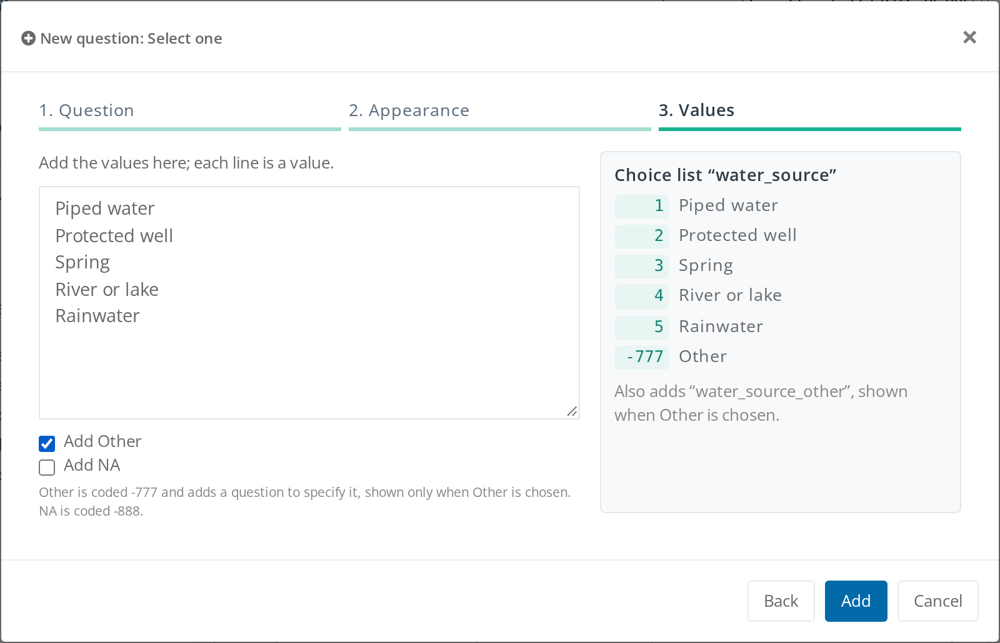<figcaption><p>The list is created only when you click Add.</p></figcaption></figure>

A **Calculate** has no hint, and its description is optional because FormShare Collect does not show it. Its second step asks for the calculation: type `${litres_day} div ${people}`. As soon as you type `${`, the editor lists the form's questions to pick from.

<figure>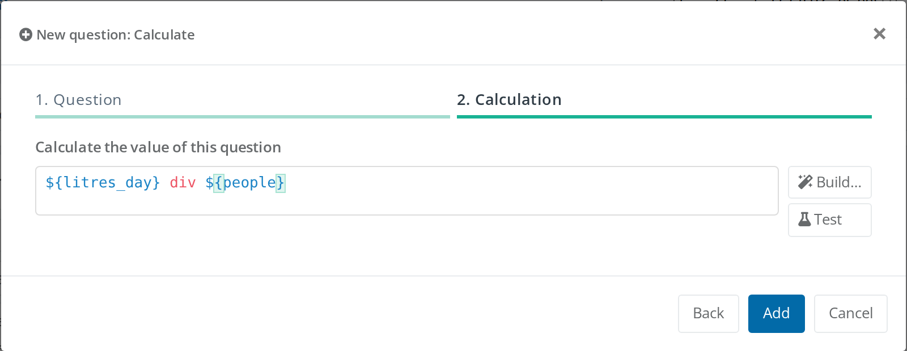<figcaption><p>The litres each person has a day. "div" is how ODK divides.</p></figcaption></figure>



## Limit the number of people

A household of 0 or 200 people is a typing mistake. Click the `people` row in the grid: the toolbar's button reads **Add/edit logic**. Click it. In **Validate or limit the answer to this question**, type:

```
. >= 1 and . <= 30
```

The dot is the answer to the question. In **Message to show if the answer is not valid**, type "Between 1 and 30 people", then click **Save**.

<figure>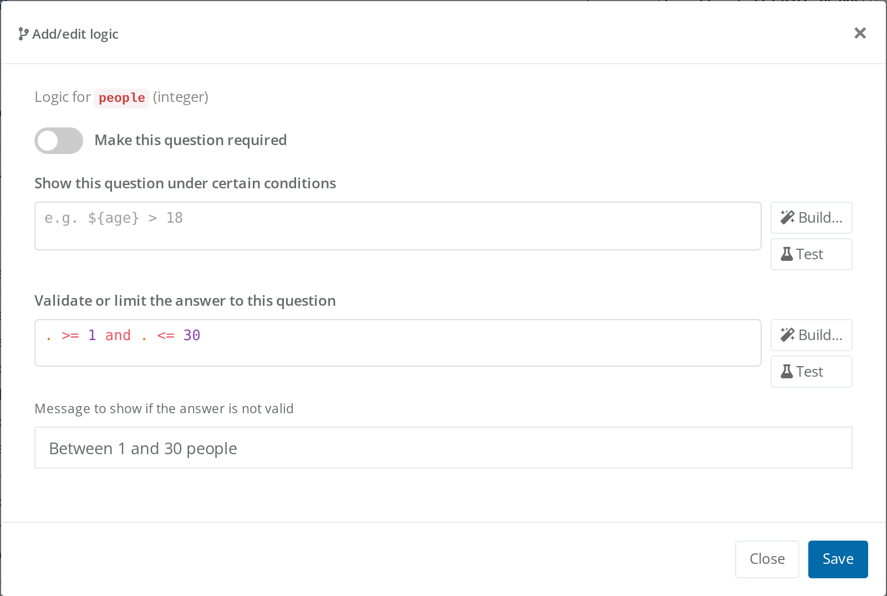= 1 and . <= 30, and the message Between 1 and 30 people."><figcaption><p>FormShare Collect refuses an answer outside the range and shows the message.</p></figcaption></figure>

"[Adding logic](logic.md)" explains the other fields: when a question is shown, whether it is required, and how **Build…** and **Test** help you write an expression.



## Check the form

The editor checks the form as you work. The **Problems** panel at the bottom says "No issues found. Your form is valid." Click **Validate** to run every check again.

Click the `water_source_other` row. The **Question** panel on the right shows its logic in plain words: it is shown when the main source of drinking water is the Other choice, -777. The **Structure** panel on the left lists the questions in order.

<figure>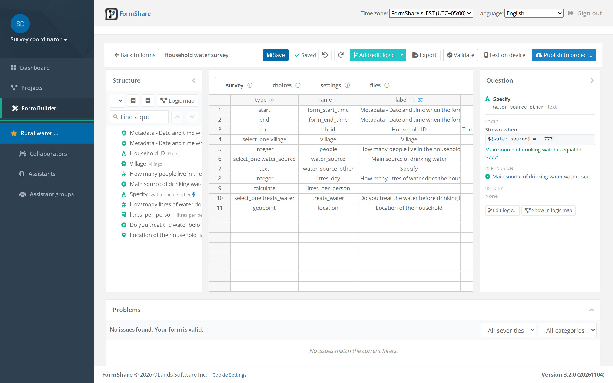<figcaption><p>The survey sheet holds the eight questions, the Specify question that Add Other created, and the two times.</p></figcaption></figure>



## Try it on a phone

Click **Test on device**. Form Builder saves the draft and shows a QR code. In FormShare Collect, open the project menu, choose **Add project**, then **Configure with QR code**, and scan it. Collect adds a project for the draft: tap **Start new form** and fill in a household.

<figure>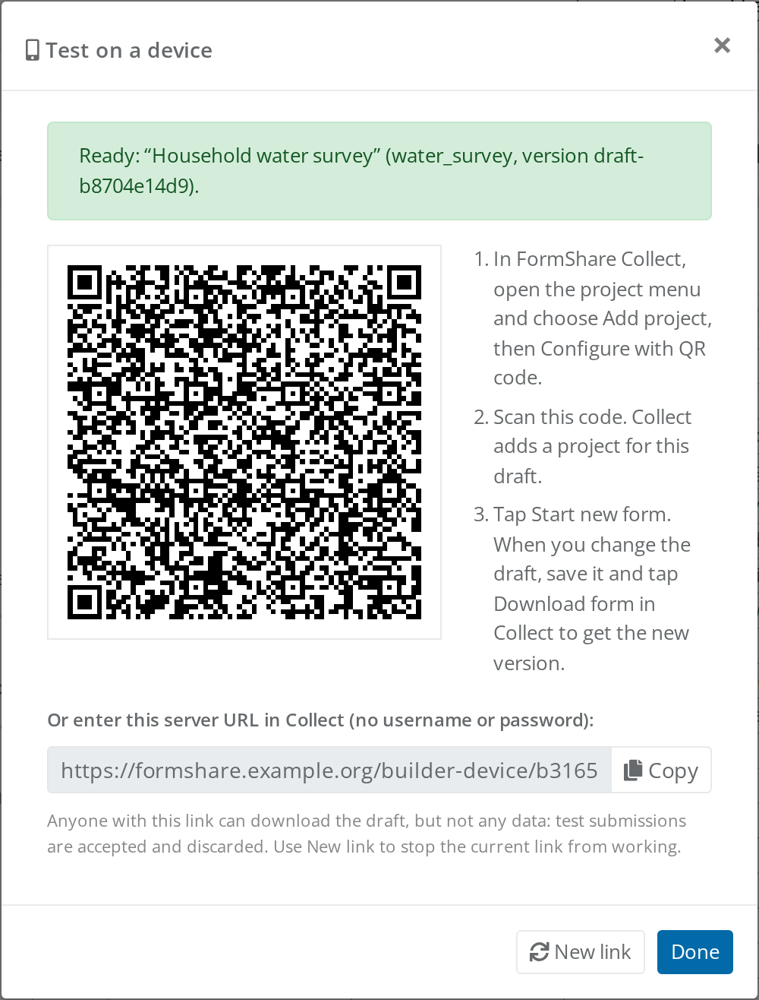<figcaption><p>The submissions you send from here are accepted and thrown away.</p></figcaption></figure>

Anyone with this link can download the draft, but no data. "[Testing on a device](testing-on-a-device.md)" explains the link and how to get a changed draft onto the phone. Click **Done**.



## Publish it

Click **Publish to project...** and choose the project. Because "Rural water monitoring has no form with the ID water_survey", publishing adds the form. Then:

| Field | Value |
| --- | --- |
| **Primary key** | `hh_id (text)`, the household ID |
| **How many submissions do you expect?** | 150 |

The primary key is the answer that is different in every submission; FormShare uses it to refuse duplicates, and it cannot be changed once the form has a repository. Click **Run precheck**.

<figure>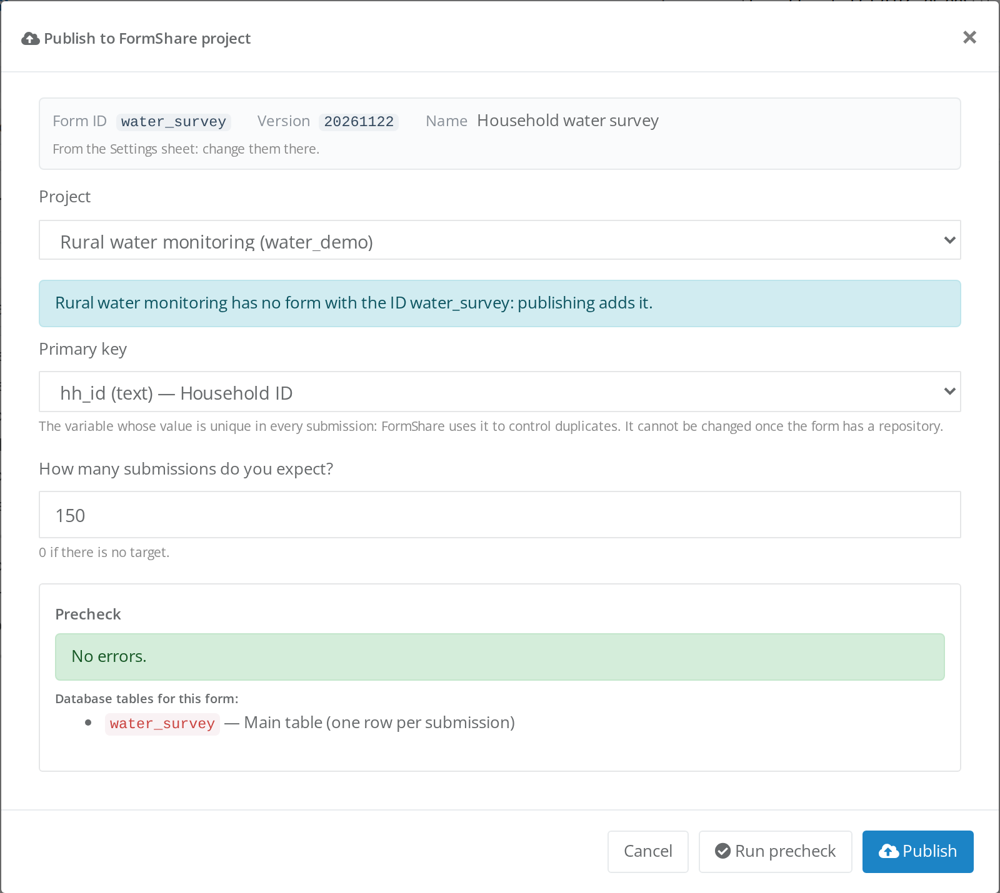<figcaption><p>Publish is off until a precheck passes and a primary key is chosen.</p></figcaption></figure>

Click **Publish**. The dialog then shows only the result, with a link to the form.

<figure>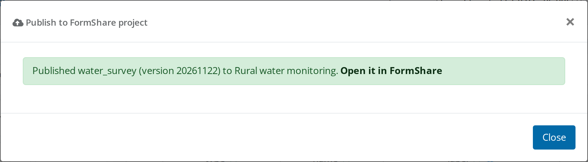<figcaption><p>Open it in FormShare goes to the form's page.</p></figcaption></figure>

Click **Close**.



## See where the draft is published

Go back to **Form Builder**. The draft is still yours to change, and its row says where it is published: the project, the form ID and the version.

<figure>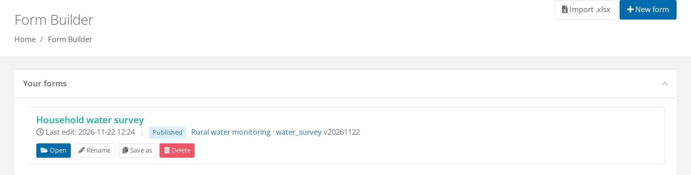<figcaption><p>The draft and the published form are separate: changing one does not change the other.</p></figcaption></figure>

In FormShare the form starts in testing. Assign assistants to it, and [create its repository](../../fundamentals/forms/README.md#create-a-repository) when the form is final.



## What's next

* Follow "[Walkthrough: add a question to a form that has data](walkthrough-new-version.md)" to change this form once it has a repository.
* Read "[Publishing to a project](publishing.md)" for every case the publish dialog handles.
* Read "[The question library](question-library.md)" for the other cards and what each asks.
