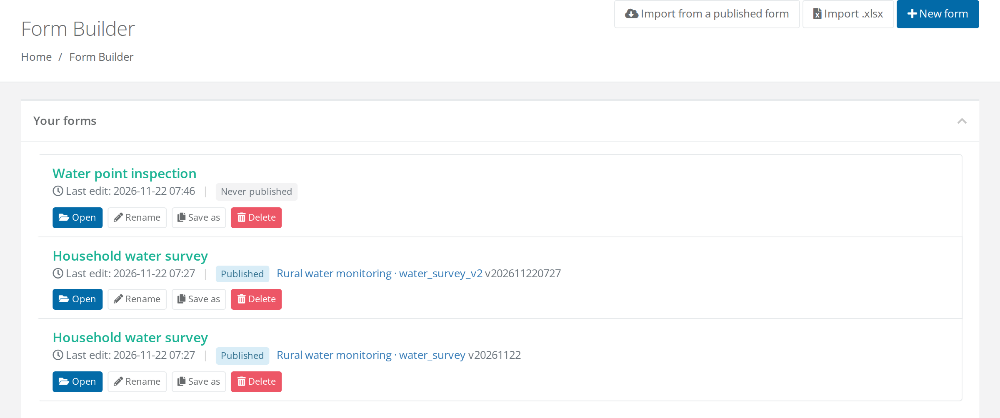
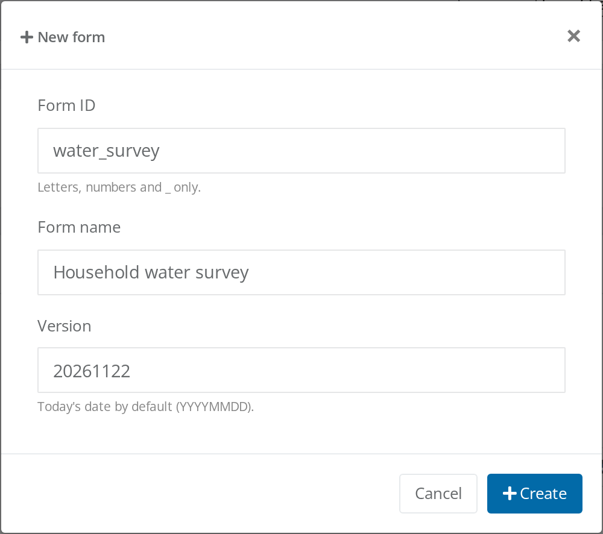
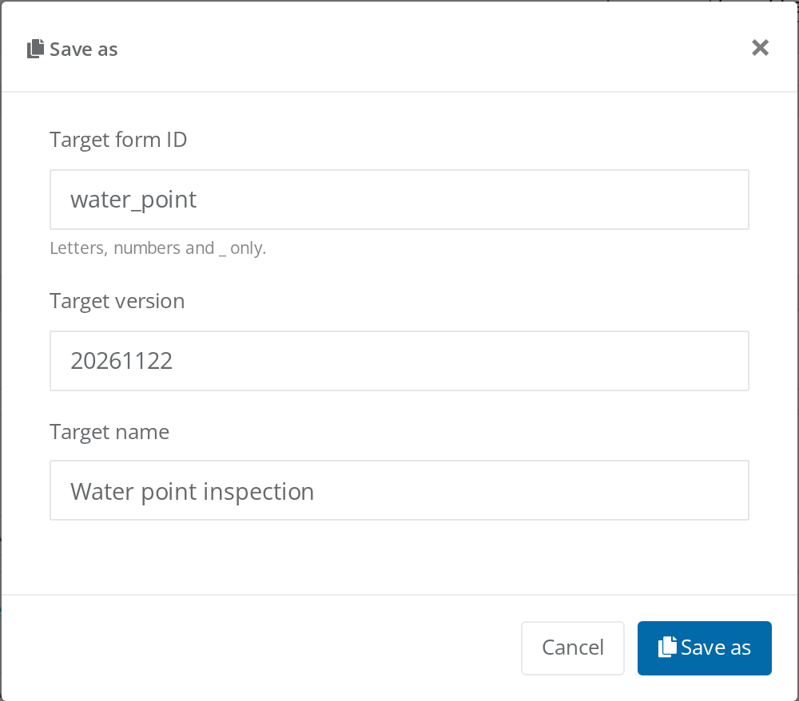

# Your forms

Form Builder keeps each form you build as a **draft**. Its first page lists your drafts under **Your forms**, says where each one is published, and starts new ones.

<figure><figcaption>
The draft saved last is at the top. Each row says where the draft is published.
</figcaption></figure>

## Drafts and forms

A draft is an XLSForm kept on the FormShare server, in your account: its survey, choices and settings sheets, and the CSV, XML and GeoJSON files its questions read. It belongs to no project. Nobody else can open it, and FormShare Collect sees it only when you [test it on a device](testing-on-a-device.md).

A draft becomes a form of a project when you [publish it](publishing.md). It stays in your list afterwards, and what you change in it changes the draft only, until you publish again. One draft can be published to several projects.

Anyone who can sign in to FormShare can build drafts. Publishing needs a project you own or administer: see "[Publishing to a project](publishing.md)".


A draft is yours alone: colleagues can't open it, even in a project you share. To hand one over, [export](the-editor.md#export) it and let them import the file, which becomes a draft of their own.


## The page

Click **Form Builder** in FormShare's left-hand menu. The page lists your drafts, the one saved or renamed last at the top. Each row shows:

| Part | What it shows |
| --- | --- |
| The name | The draft's name. Click it, or **Open**, to work on the draft in the [editor](the-editor.md). |
| Last edit | When the draft was last saved or renamed, in the time zone FormShare shows its own times in. |
| Publication | Where the draft is published. See below. |
| Buttons | **Open**, **Rename**, **Save as** and **Delete**. |

At the top of the page are **Import from a published form**, **Import .xlsx** and **New form**. When you have no drafts, the page offers **Build from scratch**, **Import an existing .xlsx file** and **Import from a published form** in place of the list.

### Where a draft is published

| The row shows | Meaning |
| --- | --- |
| **Never published** | The draft hasn't been published from Form Builder. |
| **Published**, then the project, the form ID and the version | The draft was published once. The project and form ID link to the form in FormShare. |
| **Published** with a number | The draft was published as that many forms. Click it for the list. |

The list is titled with the draft's name. For each publication it gives the project (its name and code), the form ID (a link to the form in FormShare), the version, and the date and time it was published, in the same time zone as **Last edit**.

A draft keeps one publication per project and form ID: publishing it again over the same form in the same project updates that line. The list is what Form Builder recorded when it published, and it isn't checked against the projects later. A form deleted in FormShare stays listed, and a form uploaded to FormShare directly never appears.

## Start a draft

| Way | Where | You get |
| --- | --- | --- |
| New form | **New form**, at the top right, or **Build from scratch** when you have no drafts | A draft with the form ID, name and version you enter |
| Import | **Import .xlsx**, at the top right, or **Import an existing .xlsx file** when you have no drafts | A draft holding the file's sheets |
| Save as | **Save as** on a draft's row | A copy of that draft under a new form ID, version and name |

The new draft opens in the editor.

### New form

**New form** asks for the form's ID, name and version:

| Field | What to enter |
| --- | --- |
| Form ID | Letters, numbers and `_` only, up to 120 characters. Publishing looks the form up by this ID in the project you choose. |
| Form name | The form's title, which FormShare Collect shows in its list of forms. It also names the draft. Up to 120 characters. |
| Version | Today's date to start with, as `YYYYMMDD`. Any text is accepted. Publishing over a form that a project already has needs a new version. |

<figure><figcaption>
The version starts as today's date; change it if you number versions another way.
</figcaption></figure>

**Create** checks that the three are filled in and that the form ID has only the characters allowed, and says what to fix: *Enter the form's ID.*, *The form ID can only have letters, numbers and _.*, *Enter the form's name.* or *Enter the form's version.* Nothing checks the form ID against your other drafts or your projects at this point: the publish dialog does.

The three go into the draft's [settings sheet](the-editor.md#the-settings-sheet), as `form_id`, `form_title` and `version`, where you can change them later. The survey sheet starts with two metadata rows, `form_start_time` and `form_end_time`, the times FormShare Collect records when the form is opened and finished. They are ordinary rows: see "[The question library](question-library.md#the-two-rows-a-new-form-starts-with)".

### Import an XLSForm

**Import .xlsx** opens your computer's file picker. Choose an XLSForm saved as `.xlsx`; an `.xls` file must first be saved as `.xlsx` in Excel. The draft opens once the file is read.

The import takes:

* the `survey` sheet, which the file must have, and its `choices` and `settings` sheets. Any other sheet, such as `entities`, is left out;
* every column of those sheets, including columns the grid has no place for. "[Columns and languages](the-editor.md#columns-and-languages)" says which ones the grid shows;
* its name from the settings sheet's `form_title`, or else from the file's name.

It doesn't check the form: its problems show in the Problems panel once the draft opens (see "[Checking a form](checking-a-form.md)"). An `.xlsx` file holds no CSV, XML or GeoJSON files, so a form that reads some starts without them: attach them in the draft's [files tab](form-files.md). A settings sheet with several filled rows keeps only the first, the one XLSForm reads, and the editor says so when the draft opens.

When the page refuses a file, it says why:

| The page says | Because |
| --- | --- |
| *Choose an .xlsx file. Convert .xls files in Excel first.* | The file's name doesn't end in `.xlsx`. |
| *The file is larger than the configured limit.* | The file is over the server's limit, 10 MB unless your administrator changed it. |
| *Could not read workbook:* and the reason | The file isn't a workbook the server can read. |
| *Missing required sheet 'survey'.* and the sheets found | The file has no `survey` sheet. |
| *The file parsed but did not match the spreadsheet schema. The first problem is below.* and a place such as `($.choices[3].name: name is required)` | A choice has no `name`, or no `list_name`. The place counts the choices from 0: `[3]` is the fourth. |

The grid shows an imported file's language columns, such as `label::English (en)`, and the XLSForm columns it has no place of its own for, and you edit them there. See "[Languages](the-editor.md#languages)".


**For server administrators:** the size limit is `formbuilder.max_import_bytes`, in bytes, 10485760 (10 MB) by default.


### From a form already in a project

A form that is already in a project comes into Form Builder as its XLSForm. Click **Import from a published form**, choose the **Project**, then the **Form** (each project lists its forms, the newest first, with their versions), and click **Import**. The new draft opens in the editor, named after the form's ID with *(imported)*. Any project you are a member of will do, even one where you can't publish.

You can also do it by hand: on the form's page in FormShare, **Download ODK form** downloads the XLSForm, and **Import .xlsx** makes a draft from it. Either way, the form's CSV, XML or GeoJSON files don't come with it: download them from the form's **Form files** tab and attach them in the draft's [files tab](form-files.md).

The draft keeps the form's ID and version. "[Publishing to a project](publishing.md)" explains what happens when you publish it back, and "[Walkthrough: add a question to a form that has data](walkthrough-new-version.md)" goes through a new version of a form with a repository.

### Save as

**Save as**, on a draft's row, opens three fields filled in from the draft's settings sheet:

| Field | Starts as | Rules |
| --- | --- | --- |
| Target form ID | The draft's `form_id` | Letters, numbers and `_` only, up to 120 characters |
| Target version | Its `version` | Required |
| Target name | Its `form_title`, or the draft's name when that is empty | Required, up to 120 characters |

<figure><figcaption>
The three fields start with the draft's own form ID, version and name.
</figcaption></figure>

**Save as** then makes a new draft from the draft as last saved. The copy has the three values in its settings sheet (`form_id`, `version` and `form_title`), takes the target name as its name, and gets the draft's form files. It opens in the editor and starts as **Never published**. The draft you copied doesn't change.

Use it for a variant of a form, or to start a new version of one. The publish dialog offers the same **Save as…** when the project's form already has a repository: the copy then becomes the new version to merge into that form. See "[Publishing to a project](publishing.md#save-as-a-new-version)".

## Rename

**Rename** turns the draft's name into a text box: **Save** or Enter keeps the new name, **Cancel** or Escape the old one. A name has 1 to 120 characters.

Renaming changes the draft's name in this list, and the name of the file that [Export](the-editor.md#export) downloads. The form's title, `form_title` in the settings sheet, doesn't change: edit it in the [settings sheet](the-editor.md#the-settings-sheet).

## Delete

**Delete** asks first, naming the draft: *Delete this form draft?* **Yes, delete it** removes the draft and its form files for good. Forms already published from it stay in their projects.

## How many drafts you can have

An account can hold 50 drafts, unless your administrator set another limit. At the limit, a banner reads *You have reached the maximum number of in-flight forms (50). Delete old drafts before creating new ones.*, and New form, Import .xlsx and Save as are refused until you delete a draft.


**For server administrators:** the limit is `formbuilder.max_sessions_per_user`, 50 by default; 0 sets no limit.


## What's next

* Learn the parts of the editor in "[The editor](the-editor.md)".
* Build a form and publish it step by step in "[Walkthrough: build a household survey and publish it](walkthrough.md)".
* See how a draft reaches a project in "[Publishing to a project](publishing.md)".
* Change a form that already has data in "[Walkthrough: add a question to a form that has data](walkthrough-new-version.md)".
