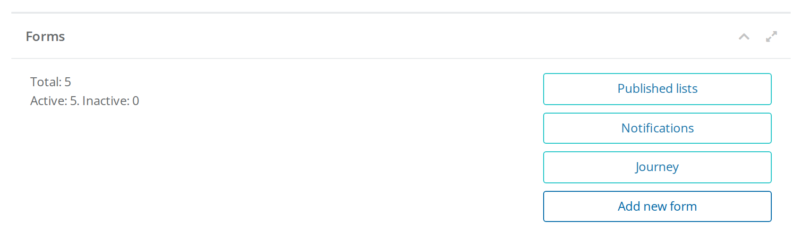

# Journeys

A **journey** decides which of a project's forms each person is offered, and when. You name the stages people go through, say which forms each stage offers, and say which forms move a person to another stage when they send them. FormShare then gives each FormShare Collect device the forms of the stage its person has reached.

A pantry study shows the idea. A new participant sees only the Registration. Once they send it, the Registration leaves their list, and Pantry Review, Social Services Review and Exit appear. Once they send an Exit, only Re-entry is offered, and sending a Re-entry brings the review forms back. "[Stages and rules](stages-and-rules.md#an-example)" sets this journey out in full.

Forms you leave out of the journey are offered as usual, and a project without a journey is not affected at all.

## Travellers

Whoever a journey follows is a *traveller*:

| Project | A traveller is |
| --- | --- |
| A project with assistants | Each assistant, by default. You can choose each device, or each assistant on each device, instead. |
| A crowdsourcing project | Each device, because no one signs in. |

"[Whom a journey follows](whom-a-journey-follows.md)" compares the choices. Every traveller is in one stage at a time, and someone who has sent nothing yet is in the first stage.

In a project with assistants, the journey works on each assistant's own forms: it only removes forms from their list, and never offers a form they have no access to. In a crowdsourcing project, where **Requires authentication to accept data** is off (see "[Projects](../../fundamentals/projects.md)"), it works on the project's forms for each device.

## FormShare stores no stage

FormShare never records where a traveller is. Each time a device asks for its forms, FormShare reads what the traveller has sent of the journey's forms and works their stage out again, under the journey as it is at that moment. This means that:

* the submissions already in the repositories when you apply a journey count, and so do those sent while it was a draft;
* a change to the journey reaches every traveller at once, over everything they have sent;
* deleting a submission, or moving it to the logs, can change the stage of whoever sent it.

"[Stages and rules](stages-and-rules.md#changes-apply-to-the-whole-history)" explains what this means when you change a journey that is in use.

## What a journey needs

| What | Why |
| --- | --- |
| The Journeys plugin on your FormShare server | It adds the **Journey** button and its pages. |
| Forms with a repository | A journey reads the submissions stored in the forms' [repositories](../../fundamentals/repositories/README.md). A form in testing can join once its repository is created. |
| FormShare Collect on the devices | It names its device each time it asks for its forms. That is what lets FormShare give it the forms of a stage. |


Server administrators: install the plugin in FormShare's environment, create its tables with its own Alembic migrations, add `journey` to `formshare.plugins` in the .ini file, and restart FormShare. The plugin's README gives the commands. It needs no Celery worker.


## Only FormShare Collect follows a journey

FormShare Collect names its device on every request. A client that names no device, such as ODK Collect or Enketo, gets every form it would get without a journey, whomever the journey follows.

What such a client sends still counts when the journey follows assistants. FormShare knows the assistant from the sign-in, so a submission from ODK Collect counts toward the assistant's stage and limits exactly as one from FormShare Collect does. When the journey follows devices, the same submission belongs to no device, and it counts toward no one's stage.

## The Journey pages

Open a project and click **Journey** in its Forms panel, in the column of buttons beside the form count. The button is there for the project's owner and for collaborators with the Administrator or Editor role, once one of the project's forms has a repository. Members do not see it.

<figure><figcaption>
The Journey button appears once a form of the project has a repository.
</figcaption></figure>

Each aspect of the journey has a tab of its own. A badge at the right of the tabs says **Applied** or **Draft**.

| Tab | What it is for | Explained in |
| --- | --- | --- |
| Overview | Starting the journey, applying it or making it a draft again, whom it follows, what to mend, what is worth a look, and the diagram | This page, and "[Checking a journey](checking-a-journey.md)" |
| Stages | The stages, which one is the first, an end, a lapse | "[Stages and rules](stages-and-rules.md#stages)" |
| Forms | The forms of the journey, each with three tabs: where it is offered, what sending it does, and its limits | "[Stages and rules](stages-and-rules.md#the-forms-of-a-journey)" |
| Try it | Steps you type, and the stage after each one | "[Checking a journey](checking-a-journey.md#try-it)" |
| Assistants, Devices, or Assistants on devices | Where each traveller is now, and each traveller's own page. The tab is named after whom the journey follows. | "[Where travellers are](travellers.md)" |
| Notifications | Added by the Notifications plugin, when it is installed | "[Notifications in a journey](../notifications/in-a-journey.md)" |

## Starting a journey

Until a project has a journey, its Overview explains what a journey does and asks one question: **Where does the journey start?** The name you type becomes the journey's first stage (the box suggests *New*). **Start a journey** creates the journey as a draft, with that one stage, and opens the **Stages** tab.

## Draft and applied

| State | What happens |
| --- | --- |
| Draft | Nothing changes for anyone: every client gets its forms as before. You can set the journey up, run it on the **Try it** tab, and see on the last tab where each traveller would be once it is applied. |
| Applied | Each FormShare Collect device gets the forms of its traveller's stage, from its next form list refresh. |

**Apply the journey**, on the Overview, is refused until the journey has at least one form and nothing is listed under **To mend before it can be applied** (see "[Checking a journey](checking-a-journey.md)"). **Make it a draft again** turns the journey off for everyone and keeps its stages and rules.

A change to an applied journey takes effect at once: each device follows the new rules from its next form list refresh.


A form that leaves a device's list leaves the device only when the project's QR tells FormShare Collect to match the server's forms exactly and to download updates automatically. Otherwise the form stays on the device until someone removes it by hand, and what is sent from it lands outside the journey. The Overview warns about this under **Worth a look**.

The settings are behind **Edit QR data**, under the project's QR code: **Update mode for blank forms** set to **Match exactly**, and **Automatically download updated forms** turned on. A device keeps the settings of the QR it scanned, so after a change it must scan the QR again (see "[Collect settings the QR controls](../../guides/odk-collect-setup.md#collect-settings-the-qr-controls)").


## What a journey does not do

* It refuses no submission. A form kept on a device from an earlier list can still be filled in and sent, and FormShare accepts it. If the form is not offered to its traveller when the submission arrives, the journey counts it as *outside the journey*, which moves no one. A journey decides what is offered, not what may be sent.
* It writes nothing. No stage is stored, and no submission is changed.
* It follows assistants or devices, not households or cases. When each household moves through stages of its own, use [case management](../../data-management/case-management/README.md), which follows each case.

## When something goes wrong

A journey never costs anyone their forms. If FormShare cannot work out a traveller's stage, for any reason, the device gets every form it would get without a journey.

When the submissions of one form of the journey cannot be read, FormShare leaves that form out of everyone's stage: its submissions move no one and count toward no limit. This happens when the journey follows devices and the form's repository does not keep the device (see "[Whom a journey follows](whom-a-journey-follows.md#forms-whose-repository-does-not-keep-the-device)"), or when a move's condition can no longer run against the repository.


Server administrators: FormShare's log records both cases, on lines that start with `Journey:`. One says that a project's form list was served unfiltered, the other which repository could not be read.


## What's next

* "[Stages and rules](stages-and-rules.md)" explains each setting, and how a traveller moves from stage to stage.
* "[Whom a journey follows](whom-a-journey-follows.md)" covers shared and replaced tablets.
* The [walkthrough](walkthrough.md) sets up a journey step by step.
