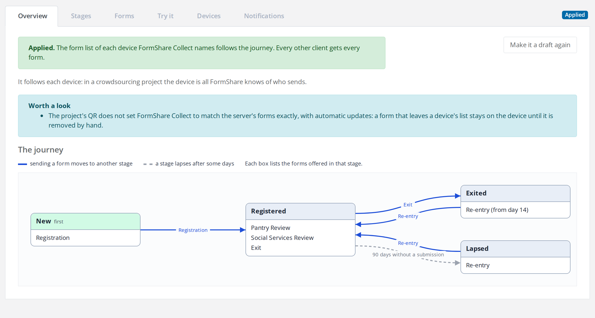
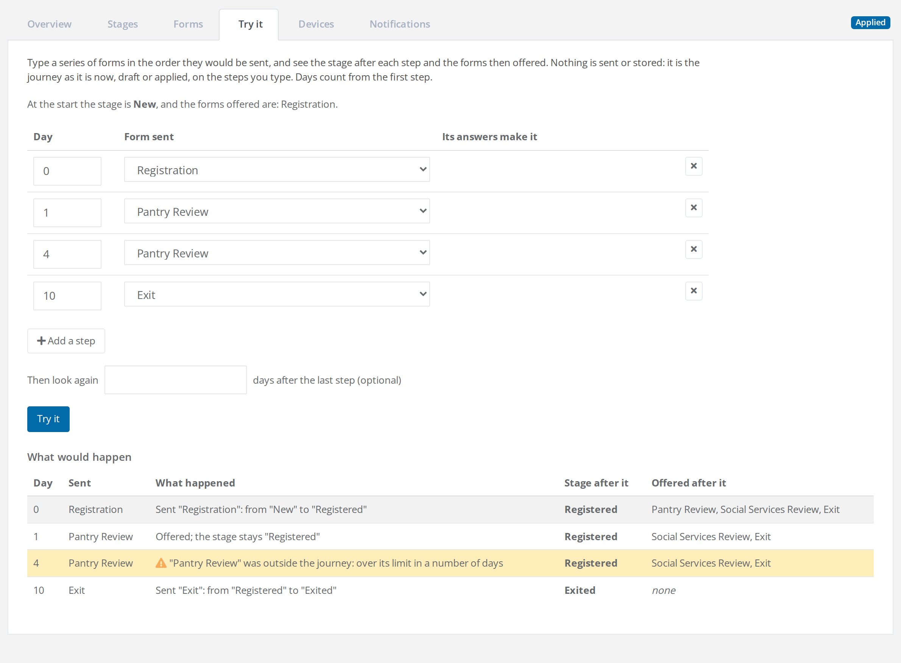

# Checking a journey

The Overview checks the journey each time you open it, and draws it. The **Try it** tab runs it on steps you type. Neither changes anything for the devices.

## To mend before it can be applied

A red box, **To mend before it can be applied**, lists what makes the journey impossible to apply. **Apply the journey** is refused while anything is listed there, and its message names the first item. The stage and form pages already refuse each of these when you save, so the box is a last check:

| The box says | Where to mend it |
| --- | --- |
| The journey has no first stage, where it starts. | A stage's page: tick **The first stage: the journey starts here**. |
| The first stage, "*stage*", cannot lapse: at the start there is no day to count from. | The stage's page: untick **This stage lapses**. |
| "*stage*" lapses to a stage that no longer exists. | The stage's page: choose the stage it lapses to. |
| "*stage*" lapses into itself. | The stage's page: choose another stage. |
| "*stage*" lapses after less than a day. | The stage's page: 1 day or more. |
| "*form*" is offered in the first stage from or until a day, but at the start there is no day to count from. | The form's **Where it is offered** tab: clear those days. |
| "*form*" is offered in "*stage*" until a day that is not after its first day. | The form's **Where it is offered** tab. |
| "*form*" has a limit of 0. | The form's **Limits** tab. |
| "*form*" has a limit in a number of days without the number of forms, or the other way round. | The form's **Limits** tab: fill in both numbers, or neither. |
| "*form*" moves to a stage that no longer exists. | The form's **What sending it does** tab. |

A journey without any form cannot be applied either: **Apply the journey** asks you to add one first.

## Worth a look

A blue box, **Worth a look**, lists what is likely a mistake. These notes do not stop you from applying the journey, and each one stays until it is mended.

| The box says | What it means |
| --- | --- |
| No form moves to "*stage*", and no stage lapses to it: it cannot be reached. | No traveller can get there. Add a move or a lapse that leads to it, or delete it. |
| "*stage*" offers no form and does not lapse. Mark it as an end if the journey is meant to stop there. | Travellers who reach it get none of the journey's forms and cannot leave it. |
| The first stage, "*stage*", offers no form: at the start, none of the journey's forms would be offered. | A new traveller would get none of the journey's forms, and could not move on. |
| "*form*" is not offered in any stage. | No traveller gets the form. Tick a stage on its **Where it is offered** tab. |
| "*form*" has a move without a condition before other moves: those never apply. | Put the move without a condition last, on the form's **What sending it does** tab. |
| These forms' repositories do not keep the device yet, so a journey that follows devices cannot read them until a new version of each is merged, followed by the forms' names. | Shown while the journey follows devices. See "[Whom a journey follows](whom-a-journey-follows.md#forms-whose-repository-does-not-keep-the-device)". |
| The project's QR does not set FormShare Collect to match the server's forms exactly, with automatic updates: a form that leaves a device's list stays on the device until it is removed by hand. | See the hint under "[Draft and applied](README.md#draft-and-applied)" for the QR settings that remove such a form. |

Below the boxes, the Overview names the project's forms in testing, which can join the journey once their repository is created.

## The diagram

Under **The journey**, once the journey has a form, the Overview draws its stages and the ways between them.

<figure><figcaption>
Solid lines are forms that move a traveller to another stage. The dashed line is a lapse.
</figcaption></figure>

* Each box is a stage, listing the forms it offers with their days, such as *Re-entry (from day 14)*, or *no form offered*.
* The first stage is tagged *first*, and a stage marked as an end is tagged *end*.
* A stage that no move or lapse leads to is dashed, tagged *no way in*, and placed in the last column.
* A solid arrow is a move. Its label names each form that makes it, followed by *when* and the condition, if the move has one.
* A dashed arrow is a lapse, labelled with its days, such as *90 days without a submission*.
* An arrow that leaves a box and comes back to it is a move into the same stage.
* A form offered in every stage has its moves drawn from every stage.
* The stages are set in columns by how many moves or lapses separate them from the first stage.

The diagram only shows the journey. To change the journey, use the **Stages** and **Forms** tabs.

## Try it

**Try it** runs the journey on a series of submissions you type, as one traveller would send them, and shows the stage after each one. Nothing is sent or stored. It uses the journey as it is saved now, draft or applied, so you can check a journey before you apply it.

<figure><figcaption>
Nothing is sent or stored.
</figcaption></figure>

The page first says in which stage a traveller starts, and which forms of the journey they are offered there. Each row below is a step:

| Column | What to enter |
| --- | --- |
| Day | The day the form is sent, as a number, such as 0, 3 or 14. The first row starts at day 0. Only the days between steps matter. |
| Form sent | A form of the journey. |
| Its answers make it | Only for a form whose moves have conditions: what its answers would do. The first choice, selected unless you pick another, is what happens when no condition holds: the move without a condition, or *stays* when every move has one. The others are the moves with a condition. |

**Add a step** adds a row on the same day as the last one, and the cross at the end of a row removes it. Steps on the same day are read in the order of the rows. Type the steps in the order they would be sent, with days that never go back.

**Then look again *N* days after the last step (optional)** also shows where the traveller would be that many days after the last step, with any lapse on the way.

The **Try it** button shows **What would happen**:

| Column | What it shows |
| --- | --- |
| Day, Sent | The step. |
| What happened | The move the step made, such as *Sent "Registration": from "New" to "Registered"*; *Offered; the stage stays "Registered"* when it moved no one; or, marked with a warning sign, why the form was outside the journey. |
| Stage after it | The traveller's stage after the step. |
| Offered after it | The forms of the journey offered after the step. |

A lapse between two steps has no row of its own: the next step starts from the stage the lapse led to, and its **What happened** names that stage.

## What's next

* "[Stages and rules](stages-and-rules.md#how-a-traveller-moves-on)" gives the rules **Try it** applies.
* "[Where travellers are](travellers.md)" shows the same rules applied to what the travellers have sent.
