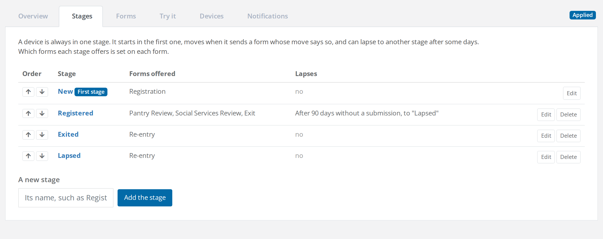
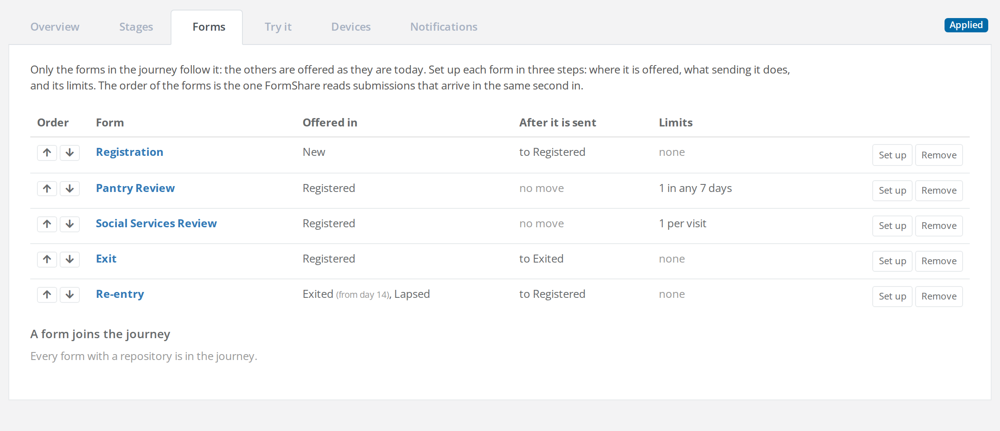
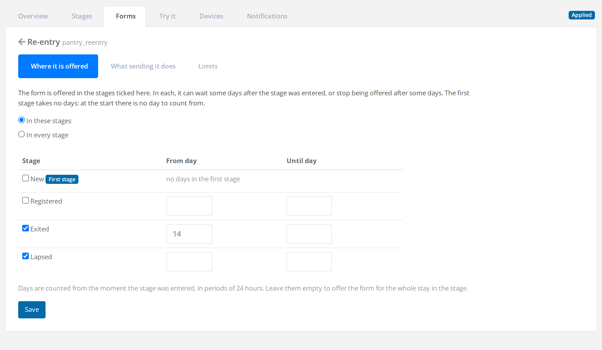

# Stages and rules

A journey is made of its stages, on the **Stages** tab, and the rules of its forms, on the **Forms** tab. This page explains each setting and how FormShare applies them.

## An example

The pantry journey has four stages, *New* (the first), *Registered*, *Exited* and *Lapsed*, and five forms:

| Form | Offered in | After it is sent, moves to | Limits |
| --- | --- | --- | --- |
| Registration | New | Registered | |
| Pantry Review | Registered | stays | 1 in any 7 days |
| Social Services Review | Registered | stays | 1 per visit |
| Exit | Registered | Exited | |
| Re-entry | Exited, from day 14; Lapsed | Registered | |

*Registered* lapses to *Lapsed* after 90 days without a submission. Someone who stops coming is offered Re-entry as soon as the lapse happens, while someone who sent an Exit waits 14 days for it.

## Stages

The **Stages** tab lists the stages, with the forms each one offers and its lapse. The arrows in the **Order** column change the order in which the pages list the stages, and nothing else. **Add the stage**, under **A new stage**, adds a stage and opens its page; **Edit**, or the stage's name, opens the page of an existing one.

<figure><figcaption>
The stages of the pantry journey.
</figcaption></figure>

A stage's page holds its settings:

| Setting | What it does |
| --- | --- |
| Name | Up to 120 characters, and different from every other stage of the journey. FormShare Collect may show it to the person using the device. |
| The first stage: the journey starts here | Makes this stage the one everyone starts in. A journey has exactly one first stage, so the mark leaves the stage that had it. |
| An end: the journey stops here, and the stage may offer no form | Says the journey is meant to stop there. The Overview then stops noting that the stage offers no form and does not lapse, and the diagram tags it *end*. It changes nothing for travellers. |
| This stage lapses | After a number of days, travellers move on to another stage by themselves. See [Lapses](#lapses). |

### The first stage

A traveller starts in the first stage without having entered it, so there is no day to count from there. The first stage therefore cannot lapse, and a form offered in it takes no days.

The first stage's own page shows a **First stage** badge in place of the box. To make another stage the first, tick the box on that stage's page, once its lapse is unticked and the forms offered in it have no days: the page refuses otherwise.

### Lapses

A lapse reads: After *N* days *without a submission* (or *in this stage*) it lapses to *a stage*.

| Option | The days count from |
| --- | --- |
| without a submission | The later of two moments: entering the stage, and the traveller's last submission of a form of the journey during this stay. Each such submission starts the count again, even one outside the journey. |
| in this stage | Entering the stage, whatever the traveller sends. |

When the days run out, the traveller moves to the lapse's stage. The moment of the lapse counts as their entry into that stage, for its days and for its own lapse, so lapses can follow one another. A lapse takes 1 day or more, and a stage cannot lapse into itself.

### Deleting a stage

**Delete** asks again, with **Delete it** and **Keep it**. It is not offered for the first stage. It is refused while a form moves to the stage or another stage lapses to it, and the message names them. Every form offered in the deleted stage stops being offered there.

## The forms of a journey

Only the forms in the journey follow it. The project's other forms are offered as usual.

The **Forms** tab lists the journey's forms with where each one is offered (*nowhere yet* until you say), what it moves to **After it is sent**, and its **Limits**. **Set up**, or the form's name, opens the form's three tabs: **Where it is offered**, **What sending it does** and **Limits**.

<figure><figcaption>
The forms of the pantry journey.
</figcaption></figure>

### Adding and removing forms

Under **A form joins the journey**, the list holds the project's forms that have a repository and are not in the journey yet: one entry per repository, named after its newest version. **Add it to the journey** puts the form last and opens its **Where it is offered** tab. Every version merged into the repository follows the journey with it. A form in testing has no repository yet, and the page lists it as joining once its repository is created.

**Remove** asks again, with **Remove it** and **Keep it**. A removed form is offered as before to everyone who has access to it, and where it was offered, its moves and its limits are deleted. Its submissions stop counting, so every traveller is worked out again as if the form had never been in the journey. Deleting a form from the project also removes it from the journey.

### The order of the forms

The arrows in the **Order** column set the order in which FormShare reads submissions that arrive in the same second. A device that was offline sends its queue at once, and several submissions can reach the server within one second. FormShare then takes them in the order of this list, choosing at each step the first one whose form is offered at that point.

The order matters when several forms of such a queue are offered at once. In the pantry journey, a Pantry Review and an Exit that arrive in the same second are both offered in *Registered*. With Pantry Review above Exit, the review counts and then the Exit moves the traveller to *Exited*. The other way round, the Exit moves them first, and the review lands outside the journey. Put the forms in the order in which a traveller goes through them.

## Where it is offered

A form is offered **In these stages**, the ones you tick, or **In every stage**.

<figure><figcaption>
Re-entry comes back 14 days after a household leaves, and at once for one that lapsed.
</figcaption></figure>

Each stage you tick, other than the first, takes two optional days, which set when during a stay there the form is offered:

| Field | The form is offered |
| --- | --- |
| From day | Once that many days have passed since the traveller entered the stage. Empty, or 0, offers it from the moment they enter. |
| Until day | Until that many days have passed. After that it is held back for the rest of the stay. Empty offers it for the whole stay. |

Days are periods of 24 hours from the moment the traveller entered the stage, not calendar days. Both are whole numbers: **From day** 0 or more, **Until day** 1 or more and after **From day**. A form offered **In every stage** takes no days, but its limits still apply.

The days count again on every stay. A traveller who leaves a stage and comes back, or who is moved into the stage they are already in, enters it again.

## What sending it does

A form's moves say which stage a traveller goes to when they send it. The **What sending it does** tab lists them in order, each with **When** (its condition, or *always*) and **Moves to**. **Add a move** and **Edit** open a move's page:

| Field | What it means |
| --- | --- |
| Sending this form moves to | The stage the traveller goes to. |
| Only when its answers say so | A condition on the form's answers. Leave it without conditions for a move that always holds. |

When a submission of the form arrives, FormShare tries the moves in order and takes the first whose condition holds. A move without a condition always holds, so the moves listed after it never apply; the tab and the Overview both warn about it, and the fix is to put that move last. With no move, or none that holds, the traveller stays where they are.

The arrows in the **Order** column change the order of the moves. **Delete** asks again, with **Delete it** and **Keep it**.

A submission moves its traveller only when its form was offered to them at the moment it arrived. A submission outside the journey moves no one.

Moves belong to the form, not to a stage: wherever the form is offered, sending it takes the same moves. A move may lead to the stage the traveller is already in. That starts a new stay there, so the stage's days and the per-visit limits count from zero again.

### Conditions

A condition is a set of rules on the form's own answers, which you build on the move's page by choosing a question, an operator and a value for each rule, and combining the rules with AND or OR:

* It reads the questions of the form's main table, which are the questions outside repeats. When a form has so many questions that its repository splits the main table into several, only the questions kept in the main table itself are offered.
* Questions appear by name, and a select offers its choices in a list.
* Text is compared exactly, so capitals and spaces count.
* An unanswered question meets no comparison, *not equal* included. The *is null* operator tests for it.
* An encrypted answer cannot be used, and the page refuses a condition that reads one.
* A form without any answer a condition can read says so in place of the builder.

The condition reads the answers as they are now. Correcting an answer in the [data editor](../../data-management/cleaning/in-a-repository/web-interface.md) can change where its submission moved the traveller.

## Limits

The **Limits** tab says how many of the form one traveller may send. Leave a field empty for no limit. A limit is a whole number, 1 or more.

| Field | What it counts |
| --- | --- |
| At most *N* per visit to a stage | The traveller's submissions of the form during their current stay in a stage. A new stay starts with each move or lapse, even into the same stage. |
| At most *N* in any *D* days | The traveller's submissions of the form in the *D* days (*D* times 24 hours) before the moment. It needs both numbers. |
| At most *N* in total | Every submission of the form the traveller has sent. |

Every submission counts toward its form's limits, whether it was offered or not. Limits count per traveller: per assistant, per device, or per assistant on each device, depending on [whom the journey follows](whom-a-journey-follows.md).

Once a limit is reached, the form leaves the traveller's list until the limit frees up: at their next stay in a stage, once enough of their submissions are *D* days old, or never for a limit in total.

## What holds a form back

A form that the traveller's stage offers can still be held back by its days or by a limit. FormShare checks the rules in this order: the stage, **From day**, **Until day**, then the limits per visit, in a number of days, and in total. A traveller's page names the first rule that holds the form back, in these words:

| Held back because | Offered again |
| --- | --- |
| its first day in "*stage*" has not come | On its first day |
| its last day in "*stage*" has passed | Not during this stay |
| sent as many times as one visit to a stage allows | At the next stay in a stage |
| sent as many times as *D* days allow | Once enough of those submissions are *D* days old |
| sent as many times as it may be | Never |

When the traveller would get the form back by staying in their stage and sending nothing, their page also gives the date from which it is offered. It gives none when the stage lapses first. See "[Where travellers are](travellers.md#a-travellers-page)".

## How a traveller moves on

FormShare applies these rules to a traveller's submissions of the journey's forms:

1. Someone who has sent nothing is in the first stage.
2. Submissions are read in the order in which they reached the server. Time counts from a submission's arrival, not from when the form was filled in.
3. A submission is *offered* when, at its arrival, the traveller's stage offers its form, the form's days hold, and the form is under each of its limits.
4. An offered submission whose move holds moves the traveller to that stage. Their stay there starts at the submission's arrival.
5. A submission that was not offered is *outside the journey*. It is kept, as every submission is, and moves no one. It still counts toward its form's limits, and it starts the count of a lapse *without a submission* again.
6. Lapses happen when they fall due: before each submission, and again at the moment FormShare works the stage out.
7. Submissions that arrive in the same second are read in [the order of the forms](#the-order-of-the-forms).

Only the submissions stored in the repositories count. A submission refused into the [error log](../../data-management/cleaning/submissions-with-errors.md) never counted, and one that is deleted or moved to the logs stops counting.

## Changes apply to the whole history

FormShare stores no stage. It works every stage out again, each time, under the journey as it is at that moment:

* A traveller who sent forms before the journey was applied, or while it was a draft, starts wherever those forms lead.
* Deleting a submission, or moving it to the logs, can change the stage of whoever sent it.
* Correcting an answer that a move's condition reads can change where the traveller went.


A change to an applied journey reaches every traveller at once, over everything they have sent. Adding a limit can put submissions sent long ago outside the journey, and deleting a move takes back every stage change it made. Removing a form from the journey, or unticking a stage it is offered in, does the same to the moves it made.

To see the effect of a change before it reaches the devices, make the journey a draft, change it, and look at the last tab and at **Try it** before applying it again. While the journey is a draft, every client gets its forms as if there were no journey.


## What's next

* "[Checking a journey](checking-a-journey.md)" covers the Overview's checks, the diagram and **Try it**.
* "[Where travellers are](travellers.md)" shows each traveller's stage and how it came about.
