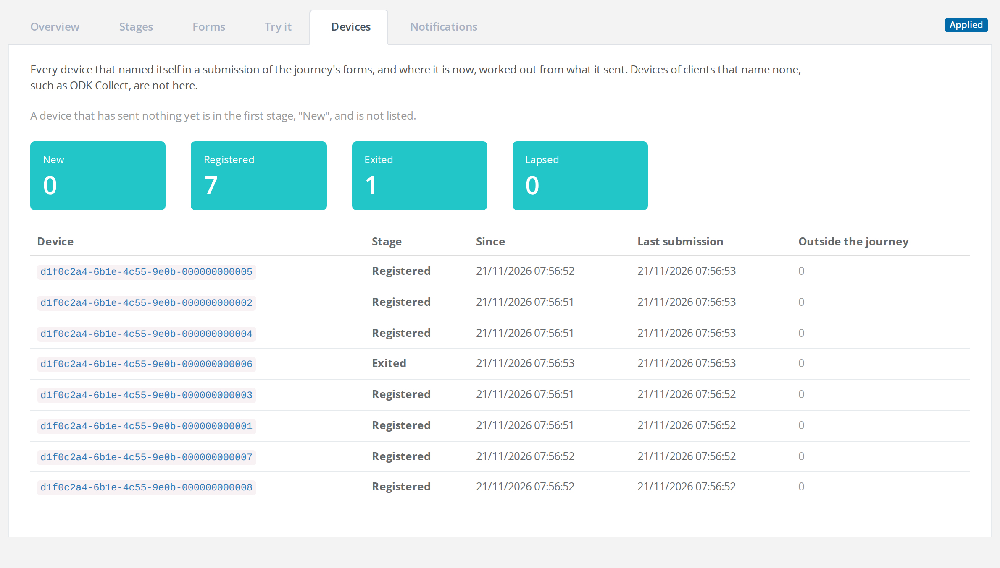
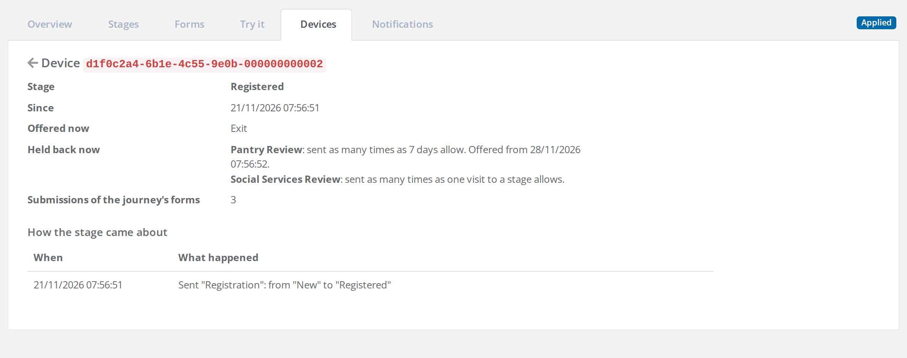

# Where travellers are

The last of the journey's own tabs is named after whom the journey follows: **Assistants**, **Devices** or **Assistants on devices**. It shows where each traveller is now, worked out from what they have sent.

While the journey is a draft, the tab shows where each traveller would be once it is applied. Until then, everyone gets their forms as if there were no journey.

## The list

A tile for each stage shows how many travellers are in it. Click a tile to list only that stage's travellers, and **Show every stage** to list them all again.

<figure><figcaption>
In a crowdsourcing project the tab is called Devices.
</figcaption></figure>

| Column | What it shows |
| --- | --- |
| Assistant | The assistant's name and ID, when the journey follows assistants. |
| Device | The device's ID, as FormShare Collect names it, when the journey follows devices. |
| Stage | Where the traveller is now. |
| Since | When they entered that stage. *The start* means they are in the first stage and nothing has moved them. |
| Last submission | Their most recent submission of a form of the journey. |
| Outside the journey | How many of their submissions were outside the journey. |

The list holds everyone who has sent at least one submission of a form of the journey, most recent first, up to the 500 who sent last. The tiles count everyone. Someone who has sent nothing yet is in the first stage and is not listed, as the page says.

When the journey follows devices, the list leaves out what was sent from clients that name no device, such as ODK Collect: those submissions belong to no device.

## A traveller's page

Click an assistant's name or a device's ID to open that traveller's page.

<figure><figcaption>
A device of the pantry journey.
</figcaption></figure>

| Item | What it shows |
| --- | --- |
| Stage, Since | Where they are, and since when. |
| Offered now | The forms of the journey they get now. Forms outside the journey are not listed: they are offered as usual. |
| Held back now | The forms their stage offers that a day or a limit holds back, each with the reason. When the form comes back by itself, the line also says from when it is offered. See "[What holds a form back](stages-and-rules.md#what-holds-a-form-back)". |
| Submissions of the journey's forms | How many they have sent. |
| Sent from | When the journey follows each assistant: the devices the assistant sent from, with how many submissions each. *No device named* counts the submissions that carry no device, such as those from ODK Collect, and those of a repository that does not keep the device. |
| Sent by | When the journey follows each device, in a project with assistants: the assistants who sent from the device, with how many submissions each. |

Dates are shown in your time zone.

## How the stage came about

Under **How the stage came about**, the page lists everything that shaped the stage, oldest first:

| Entry | Example |
| --- | --- |
| A move | Sent "Exit": from "Registered" to "Exited" |
| A lapse | "Registered" lapsed to "Lapsed" |
| A submission outside the journey | "Pantry Review" was outside the journey: not offered in "New" |

A submission outside the journey is marked with a warning sign, and its entry names the rule it broke:

| Rule broken | Meaning |
| --- | --- |
| not offered in "*stage*" | The traveller's stage did not offer the form. |
| before its first day in "*stage*" | It arrived before the form's **From day**. |
| after its last day in "*stage*" | It arrived after the form's **Until day**. |
| over its limit per visit to a stage | The traveller had already sent as many as one stay allows. |
| over its limit in a number of days | The traveller had already sent as many as the form allows in that many days. |
| over its limit in total | The traveller had already sent as many as the form allows. |

Such submissions are kept like any other, and they still count toward the form's limits. They usually come from a form left on a device from an earlier list, from a client that names no device and so gets every form, from a time when the journey was a draft, or from a change to the journey after they were sent.

When there is nothing to list, the page says that nothing moved the traveller and that they are in the first stage.

## What's next

* "[Stages and rules](stages-and-rules.md#how-a-traveller-moves-on)" gives the rules behind each entry.
* "[Whom a journey follows](whom-a-journey-follows.md)" explains why an assistant's page lists devices and a device's page lists assistants.
