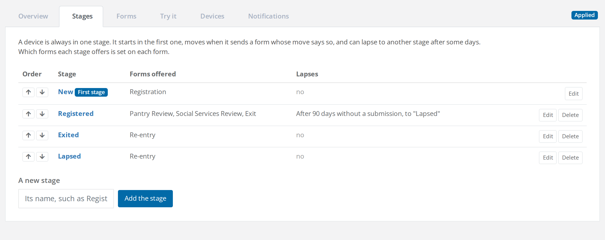
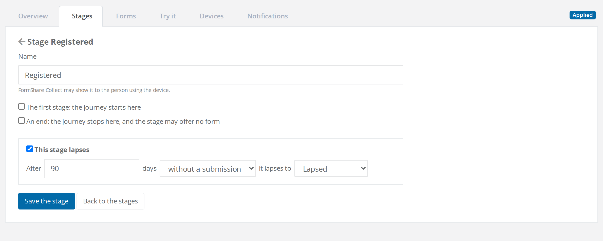
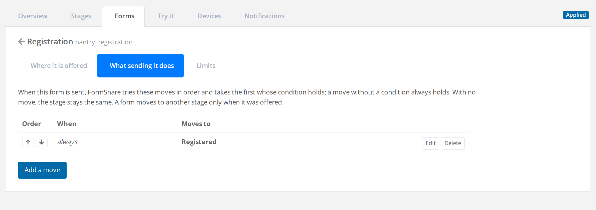
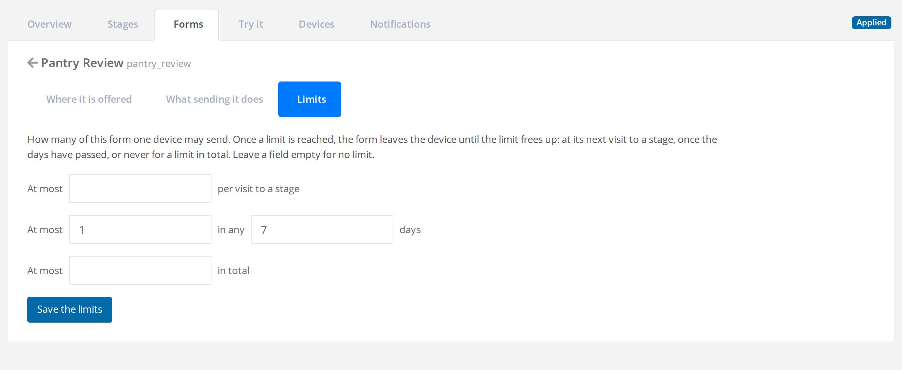
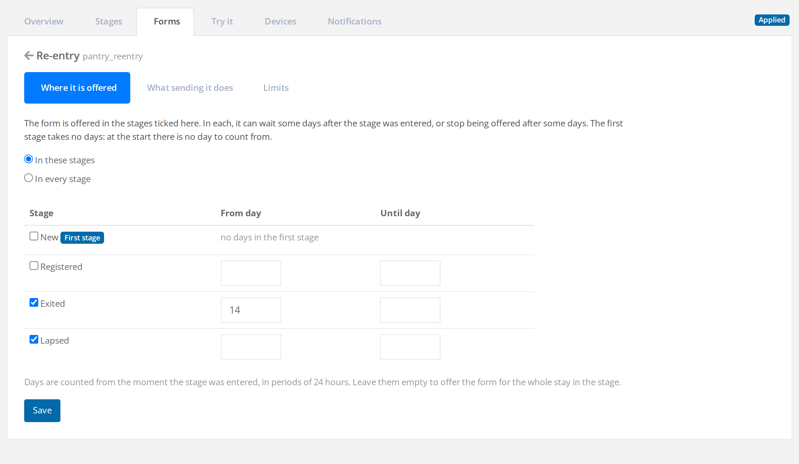
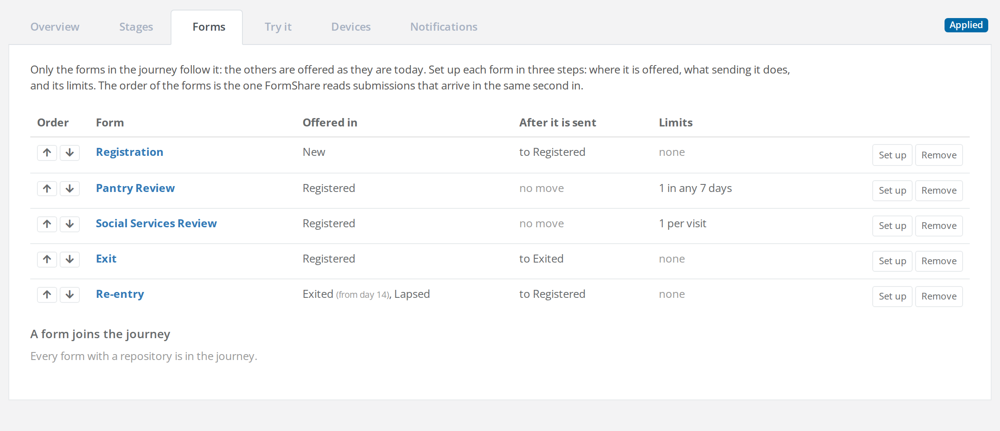
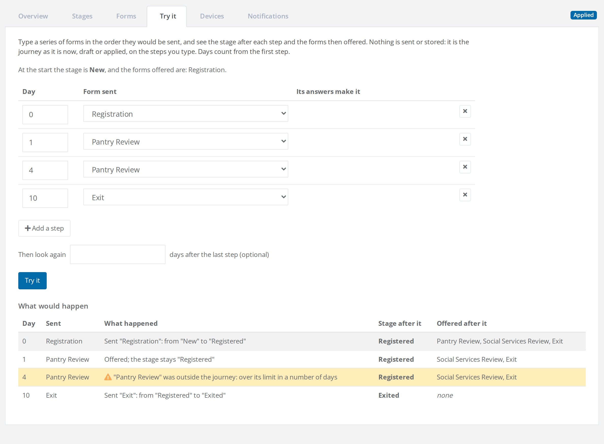
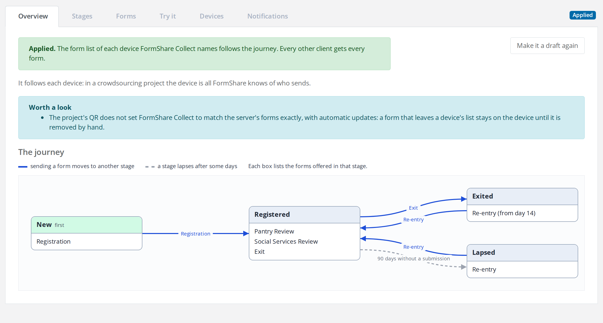
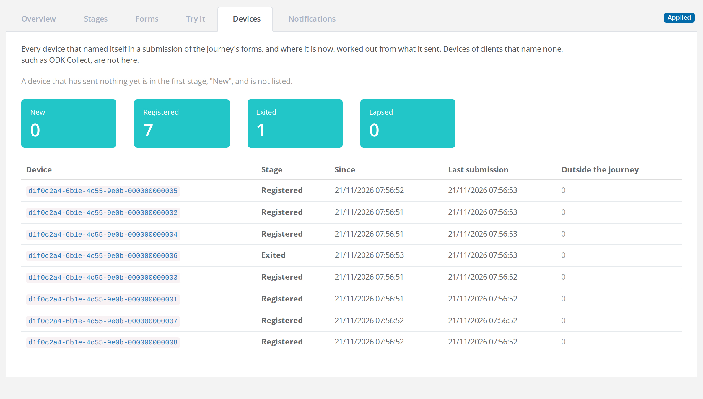
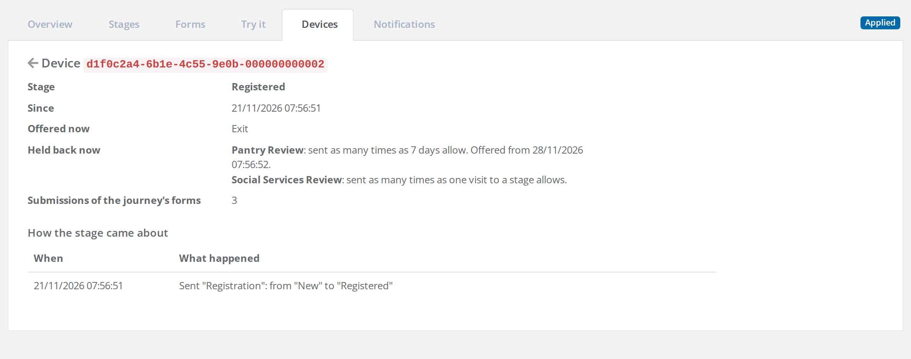

# Walkthrough: a community pantry

A community pantry gives out food parcels to registered households, who report on their visits from their own phones with FormShare Collect. Nobody signs in: it is a crowdsourcing project. You want each phone to show only the forms that make sense for it at the time:

| Stage | Forms offered | How a phone gets there |
| --- | --- | --- |
| New | Registration | where every phone starts |
| Registered | Pantry review, Social services review, Exit | sending *Registration*, or *Re-entry* |
| Exited | Re-entry, from 14 days after leaving | sending *Exit* |
| Lapsed | Re-entry | 90 days in *Registered* without sending anything |

A pantry review is offered at most once in any seven days, and a social services review once per stay in *Registered*.

You need a project with five forms, each with its repository: *Registration*, *Pantry review*, *Social services review*, *Exit* and *Re-entry*. Any forms do: the journey looks only at which form a phone sends and when.



## Start the journey

On the project's page, click **Journey**. The button appears once a form of the project has a repository.

Under **Where does the journey start?**, type `New`, the name of the first stage, and click **Start a journey**. The journey is a draft: nothing changes for the phones until you apply it.



## Add the stages

The **Stages** tab opens. Under **A new stage**, type `Registered` and click **Add the stage**. Do the same for `Exited` and `Lapsed`.

<figure><figcaption>
The finished stages. <strong>Forms offered</strong> fills in as you set the forms up.
</figcaption></figure>



## Let Registered lapse

Click **Edit** on *Registered*. Tick **This stage lapses**, and set it to lapse after `90` days **without a submission**, to *Lapsed*. Click **Save the stage**.

<figure><figcaption>
FormShare Collect may show the stage's name to the person using the phone, so give stages names people understand.
</figcaption></figure>

A household that sends nothing for 90 days is then in *Lapsed*, where it is offered *Re-entry* only.



## Put the registration in the journey

Open the **Forms** tab. Under **A form joins the journey**, choose *Registration* and click **Add it to the journey**. Its page opens on **Where it is offered**: choose **In these stages**, tick *New*, and click **Save**.

Then open **What sending it does** and click **Add a move**. Leave the condition empty, so that the move always applies, choose to move to *Registered*, and click **Save the move**.

<figure><figcaption>
A form can have several moves, each with a condition on its answers. FormShare takes the first whose condition holds.
</figcaption></figure>



## Limit the reviews

Add *Pantry review* to the journey, offered in *Registered*. On its **Limits** tab, set **At most** `1` **in any** `7` **days**, and click **Save the limits**.

<figure><figcaption>
Once a limit is reached, the form leaves the phone until the limit frees up.
</figcaption></figure>

Add *Social services review* the same way, offered in *Registered*, with **At most** `1` **per visit to a stage**: once per stay in *Registered*.



## Add leaving and coming back

Add *Exit*, offered in *Registered*, with a move to *Exited*.

Add *Re-entry* with a move to *Registered*. On **Where it is offered**, tick *Exited* with `14` under **From day**, and *Lapsed* with nothing.

<figure><figcaption>
Days count from the moment the phone entered the stage. Empty, the form is offered for the whole stay.
</figcaption></figure>

The **Forms** tab now sums the journey up.

<figure><figcaption>
The order of the forms only matters for submissions that arrive in the same second.
</figcaption></figure>



## Try it before applying it

Open **Try it**. Type the forms a phone would send and when, and FormShare works out the stage after each one, and what the phone would be offered. Try a household that registers, reviews on day 1 and again on day 4, and leaves on day 10:

<figure><figcaption>
Nothing is sent or stored. The review on day 4 comes too soon after the one on day 1.
</figcaption></figure>

The last row offers nothing: *Re-entry* only comes back 14 days after leaving. Type `14` under **Then look again** and run it again to see it come back.



## Apply the journey

Open **Overview**. It draws the journey, and lists anything that has to be mended before it can be applied, and anything worth a look. Click **Apply the journey**.

<figure><figcaption>
In a crowdsourcing project the journey follows each device: nobody signs in, so the device is all FormShare knows of who sends.
</figcaption></figure>

From now on, each phone running FormShare Collect gets the forms of its stage the next time it updates its form list. Other apps, such as ODK Collect, get every form, as before. **Make it a draft again** takes the journey off the phones: they get every form until you apply it again.

Read **Worth a look** before you hand the project out. See "[Checking a journey](checking-a-journey.md)" for what each warning means.



## Watch where each phone is

The last tab, **Devices** in a crowdsourcing project, counts the phones in each stage and lists them, with when they entered their stage and when they last sent something.

<figure><figcaption>
Click a stage to list its phones only. A phone that has sent nothing is in the first stage, and is not listed.
</figcaption></figure>

Click a device to see its stage, what it is offered now, what is held back and until when, and how its stage came about.

<figure><figcaption>
A form sent while it was not offered, from an app that does not follow the journey, is counted as outside the journey and changes nothing.
</figcaption></figure>



## What's next

* Read "[Stages and rules](stages-and-rules.md)" for conditions on moves, the other limits, and what holds a form back.
* Read "[Whom a journey follows](whom-a-journey-follows.md)" for projects whose assistants sign in, and tablets shared between them.
* To greet a household when it registers, or remind it when its review is due, follow "[Walkthrough: notifications in a journey](../notifications/walkthrough-journey.md)".
