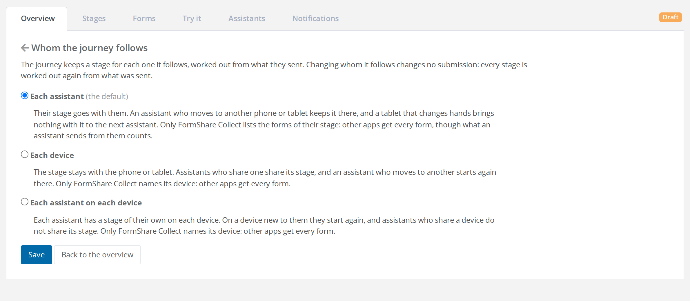
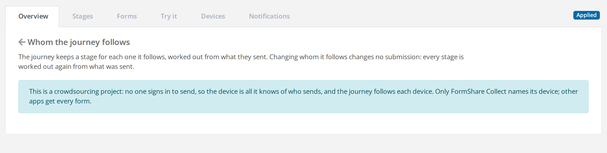

# Whom a journey follows

Whom a journey follows decides whose submissions make up each stage, and so what happens when people share or change tablets. The Overview says whom the journey follows. Its link, **Change whom it follows**, opens the page where you choose, **Whom the journey follows**.

<figure><figcaption>
The choice is offered only in a project whose assistants sign in.
</figcaption></figure>

## The three choices

In a project with assistants you choose one of these:

| Choice | A stage is worked out from | Limits count |
| --- | --- | --- |
| Each assistant (the default) | What the assistant sent, from any phone, tablet or app | Per assistant |
| Each device | What was sent from the device with FormShare Collect, by any assistant | Per device |
| Each assistant on each device | What the assistant sent from that one device | Per assistant on each device |

Whichever you choose, only FormShare Collect gets the forms of a stage. Other apps get every form, as "[Journeys](README.md#only-formshare-collect-follows-a-journey)" explains.

Following each assistant suits stages that belong to the assistant, such as training before collecting, or a weekly report. An assistant usually sends for many people, and their stage moves with everything they send. When each household or person goes through the stages, that is a case, and [case management](../../data-management/case-management/README.md) follows each one.

## When tablets change hands

Ana collects on tablet T1. T1 breaks, and she goes on with T2. Later Ben, an assistant who has sent nothing yet, takes T1.

| Choice | Ana on T2 | Ben on T1 | What Ana sends from ODK Collect |
| --- | --- | --- | --- |
| Each assistant | Keeps her stage | Starts in the first stage | Counts toward her stage |
| Each device | Starts again in the first stage | Gets T1's stage, which Ana's submissions made | Counts toward no device |
| Each assistant on each device | Starts again in the first stage | Starts in the first stage | Counts toward no one |

Following each assistant, a stage goes with the person: a new tablet keeps it, and a tablet that changes hands brings nothing to the next assistant. Following each device, the stage stays with the tablet, and assistants who share one share its stage. Following each assistant on each device, every assistant has a stage of their own on every device, and starts again on a device new to them.

## Crowdsourcing projects

In a crowdsourcing project, where **Requires authentication to accept data** is off, no one signs in, so the device is all FormShare knows of who sends. The journey follows each device, whatever was chosen, and the page explains this instead of offering a choice. If the project later requires authentication again, the earlier choice applies again.

<figure><figcaption>
The same page in a crowdsourcing project.
</figcaption></figure>

## Devices

A device is one installation of FormShare Collect. Reinstalling the app, or clearing its data, makes a new device, which starts in the first stage. The old device stays on the journey's last tab with the history it had.

A journey that follows each assistant is not affected by a reinstall: the assistant signs in again and keeps their stage.


A device's ID is random and names no one, but it links one person's submissions over time, which is what a journey needs. In a crowdsourcing project, say in the consent text that the project follows each device's submissions.


## Assistants with the same ID

A journey that follows assistants knows each one by their assistant ID, which FormShare records with everything they send. Two assistants with the same ID are one assistant to the journey: they share one stage and one set of limits.

FormShare refuses an assistant ID that another assistant of your account already has, but it does not count the assistants of an archived project. If you add an assistant with the ID of an archived project's assistant, both have that ID once the project is unarchived, and what each one sends counts toward the same stage.

The Overview names such assistants under **Worth a look**, each with their project. It names them when they have sent the journey's forms or are assigned to submit them, directly or through a group, as long as one of them is still assigned. This happens only when the journey follows each assistant, or each assistant on each device: a journey that follows each device does not use the ID.

An assistant ID cannot be changed, and what was sent keeps the ID it was sent with. To give a person a stage of their own, add an assistant with a new ID for them, assign it to the journey's forms, and remove their old assistant from those forms. The new assistant starts in the first stage. The Overview stops naming the ID once no assistant with that ID is assigned to the journey's forms.

## Changing whom it follows

Changing whom the journey follows moves nobody and changes no submission. Every stage is worked out again from what was sent, under the new choice. On an applied journey, each form list follows the new choice from its next refresh. The journey's last tab takes the choice's name: **Assistants**, **Devices** or **Assistants on devices**.

## Forms whose repository does not keep the device

A repository built by an older version of FormShare does not keep the device of its submissions until a new version of the form is merged into it (see "[Merging subversions of a form](../../fundamentals/repositories/merging-subversions-of-a-form.md)"). A journey that follows each device, or each assistant on each device, cannot read such a form. The form is still offered as its stages say, but what is sent of it moves no one and counts toward no limit.

In a project with assistants, the **Whom the journey follows** page names these forms. The Overview names them under **Worth a look** while the journey follows devices, which a crowdsourcing project's journey always does. Adding such a form to a journey that follows devices says so too. A journey that follows each assistant reads them all. In a crowdsourcing project, only merging a new version makes them readable.

## What's next

* "[Stages and rules](stages-and-rules.md#limits)" explains the limits that count per traveller.
* "[Where travellers are](travellers.md)" lists the assistants, devices, or assistants on devices the journey follows.
