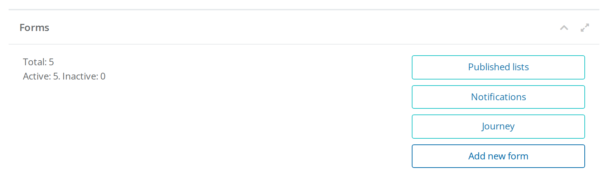
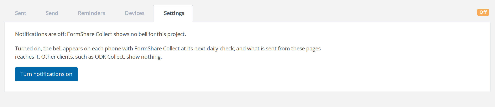
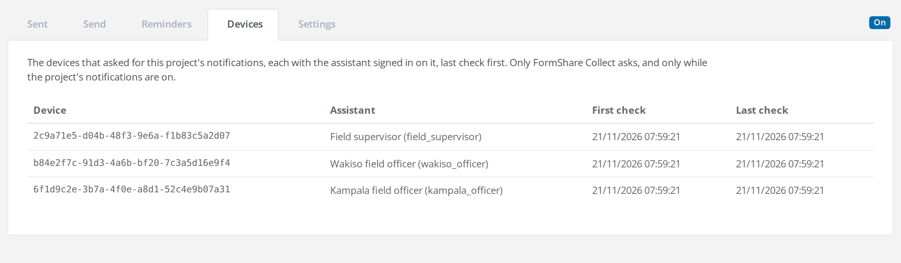

# Notifications

Notifications are messages from a project to the phones and tablets that collect its data with FormShare Collect. Each one appears under the bell FormShare Collect shows for the project, and as the phone's own notification. The project's owners and editors send them from the project's pages, set reminders, and see who has read what.

Each project is separate. A phone asks the project's own server for the project's notifications, signed in with the same assistant login it uses for the form list. Nothing goes through Google or Apple, so a notification reaches a phone at its next check rather than at once.

| Page | What it covers |
| --- | --- |
| [Sending notifications](sending-notifications.md) | A message, or the news of a new version of a form, sent by hand. Changing or withdrawing it afterwards, and seeing who read it. |
| [Calendar reminders](reminders.md) | A message the phone shows at set times: every day, on some days of the week, or on a day of every month. |
| [Notifications in a journey](in-a-journey.md) | With the Journeys plugin: a message to whoever enters a stage, and a reminder when a form is offered again. |

The [walkthrough](walkthrough.md) sets up a project's notifications step by step.

## Where to find it

Open a project and click **Notifications** in its Forms panel, in the column of buttons beside the form count. The same button is on the dashboard when the project is your active project.

The button is there for the project's owner and for collaborators with the Administrator or Editor role, once the project has at least one form. Members do not see it.

<figure><figcaption>
The Notifications button appears once the project has a form.
</figcaption></figure>

The pages have five tabs:

| Tab | What it shows |
| --- | --- |
| Sent | The notifications sent by hand, newest first, with whom each one went to and how many have read it. |
| Send | The form to send a new notification. |
| Reminders | The project's calendar reminders. |
| Devices | The phones and tablets that have asked for the project's notifications. |
| Settings | Notifications on or off for the project. |

A badge at the right of the tabs says **On** or **Off**. While notifications are off, every tab but Settings carries a warning with a link to turn them on.

## Turning notifications on and off

A project's notifications are off until someone turns them on: open the **Settings** tab and click **Turn notifications on**. Anyone who sees the Notifications pages can do it, and **Turn notifications off** reverses it.

<figure><figcaption>
A project starts with notifications off.
</figcaption></figure>

| The project's notifications | What FormShare Collect does |
| --- | --- |
| Never turned on | Shows no bell for the project, and asks again once a day. |
| Turned on | Shows the bell at the phone's next daily check, so allow up to a day. A phone that adds the project after you turn them on shows the bell at its first check. |
| Turned off again | Takes the bell away at the phone's next check, and goes back to asking once a day. |

Turning notifications off deletes nothing. What was sent stays on the Sent tab, and when you turn them on again, what is still current (not withdrawn, and not past its last day) comes back to the phones.

While notifications are off:

* the Send tab refuses to send;
* phones get no calendar reminders and no journey notifications;
* no new device appears on the Devices tab, because phones only report themselves while notifications are on.

You can still change or withdraw what was sent, and set up a journey's notifications for later.

## Who a notification can go to

A notification and a calendar reminder both have a **To** box. It offers **Everyone in the project** or **Only some**. With **Only some**, you pick from four lists, as many entries as you need in each. The notification reaches anyone who matches any of your picks.

| Choice | Who gets it |
| --- | --- |
| Everyone in the project | Every active assistant who signs in to the project from FormShare Collect, on every device they use. That includes assistants of other projects who were given one of this project's forms. In a crowdsourcing project, every device that asks. |
| Assistants | Those assistants, on any device they sign in from. An assistant of another project shows that project's code after their name. |
| Groups | Whoever is in the group when their phone checks. See below. |
| Devices | Those phones or tablets, whoever is signed in on them. The list has only devices that have asked for the project's notifications. |
| An assistant on a device | That assistant, on that device only. The list has only the pairs that have asked. |

Someone who joins the project later still gets what was sent to everyone, if it is still current, at their first check.

### Groups are read at each check

FormShare reads a group's members each time a phone checks, not when you send. So:

* someone added to a group gets the group's current notifications at their next check, as new ones;
* someone removed from a group loses them: they leave that person's phones at the next check, unless the notification also reaches them another way, for example because it was sent to them by name as well;
* an inactive group counts as having no members, so its notifications leave its members' phones, and come back when you make the group active again.

The Groups list marks an inactive group *(inactive)*. Calendar reminders sent to a group follow the same rules. To manage the groups themselves, see "[Assistant groups](../../fundamentals/tasks/assistant-groups.md)".

### Crowdsourcing projects

In a crowdsourcing project, one whose **Requires authentication to accept data** is unchecked, nobody signs in, so the phone is all FormShare knows of who is asking. The To box then offers only **Everyone in the project** and **Devices**, and read state is kept for each device. Picks of assistants or groups made before the project became a crowdsourcing one match no one there.

When an assistant or a group you picked is deleted, the notification no longer reaches anyone through that pick. It never turns into a notification to everyone.

## What the phone shows

FormShare Collect shows a blue bell beside the project's icon on its main menu, with a red count of the project's unread notifications ("9+" above nine). The bell stays when nothing is unread. A red dot on the project's icon means another project on the phone has unread ones.

* Each new notification is shown once as the phone's own notification, grouped by project, with its title and text. Tapping it opens the project's list with that notification open.
* The bell opens the list, newest first. Unread notifications are in bold with a dot. Tapping one shows all its text.
* A notification about a form has a button. A new version of a form has **Download**, which opens the phone's download screen with that form ticked. A message about a form has **Fill out** when the form is on the phone, and **Download** when it is not.
* Swiping a notification away deletes it from that phone only. The list's menu has **Mark all as read**, and pulling the list down checks at once.
* The list works offline, from what the phone has already received.

When another assistant signs in to the project on a shared phone, the previous assistant's notifications and reminders leave the phone at once, and the new assistant's arrive at the next check.


Phones may show notifications on their lock screen, depending on each phone's settings. Write nothing personal or sensitive in a title or a text.


## When a phone checks

FormShare Collect asks for notifications on its own; nobody has to do anything on the phone.

| When | How often at most |
| --- | --- |
| The main menu or the notifications list is on screen | Once every 5 minutes for each project |
| After the form list is fetched, and after a submission is sent | Once every 5 minutes |
| The notifications list is pulled down | Every time |
| In the background, while the phone is online | About once an hour, as Android or iOS allow |
| The project's notifications are off, or were never on | Once a day |

So a notification reaches a phone in use within minutes, and the others within an hour or so. A phone that is offline gets it when it next connects. A phone that checks for the first time, or for a newly signed-in assistant, gets the newest 100 notifications that are still current.

## Who has read a notification

A phone reports a notification as read when its user opens it, uses its button, taps it among the phone's notifications, marks everything as read, or deletes it unread. FormShare keeps who read it, on which device, and when. Each notification's **Read by** tab lists them (see "[Who read it](sending-notifications.md#who-read-it)").

Read state belongs to the assistant, not to the phone. A notification read on one device shows as read on the assistant's other devices at their next check, and is not announced there again. In a crowdsourcing project read state belongs to each device.

Reminders send nothing back, so FormShare cannot tell whether a reminder was seen.

## The Devices tab

The Devices tab lists the phones and tablets that have asked for this project's notifications, the most recent check first. Only FormShare Collect asks, and only while the project's notifications are on.

| Column | Meaning |
| --- | --- |
| Device | The ID FormShare Collect made when it was installed on the device. |
| Assistant | Who was signed in. A device used by two assistants has a row for each. A crowdsourcing project has no such column. |
| First check | When the device first asked, with that assistant. |
| Last check | When it last asked. FormShare updates it at most every ten minutes. |
| App | How the app that asked describes itself. |

<figure><figcaption>
Only FormShare Collect asks for notifications, and only while they are on.
</figcaption></figure>

These are the devices you can pick in the **Devices** and **An assistant on a device** lists. The ID belongs to the installation, not to the phone: if FormShare Collect is installed again on a phone, the phone asks with a new ID and appears as a new device.

## ODK Collect and other apps

Only FormShare Collect has the bell. ODK Collect, Enketo and other clients never ask for notifications, so they show nothing, and turning a project's notifications on changes nothing for them.

You can still pick an assistant who uses ODK Collect. What you send waits for them: if they later open the project in FormShare Collect, they get it at their first check, as long as it is still current.

## When a notification does not arrive

| What you see | Why |
| --- | --- |
| No bell for the project | The project's notifications are off, or were turned on less than a day ago and the phone has not asked since. Or the phone uses another app than FormShare Collect. |
| The bell, but not the notification | The phone has not checked since you sent it: pulling the list down checks at once. Or the notification was not for this person on this device: check its **To** on the Sent tab. |
| The device is missing from the Devices tab | It has not asked since notifications were turned on, or it uses another app. |
| A phone stopped getting anything | The assistant's password changed on the server, or the assistant was made inactive. The phone is refused quietly in the background, and FormShare Collect asks the person to sign in the next time they fetch forms. |


**For server administrators.** These pages come from the notifications plugin. Install it in FormShare's environment, add `notifications` to `formshare.plugins` in the ini file, and create its tables with its own migrations: copy its `alembic.example.ini` to `alembic.ini`, point it at FormShare's database, and run `alembic upgrade head` in the plugin's folder. The journey's Notifications tab also needs the Journeys plugin. FormShare Collect asks for notifications only from servers it recognises as FormShare (formshare.app, formshare.org, or a server whose `/health` address answers as FormShare does), so keep `/health` reachable through any proxy.


## What's next

* Write and send a notification, and follow who read it, in "[Sending notifications](sending-notifications.md)".
* Set messages that come at fixed times in "[Calendar reminders](reminders.md)".
* Let a journey greet and remind its travellers in "[Notifications in a journey](in-a-journey.md)".
