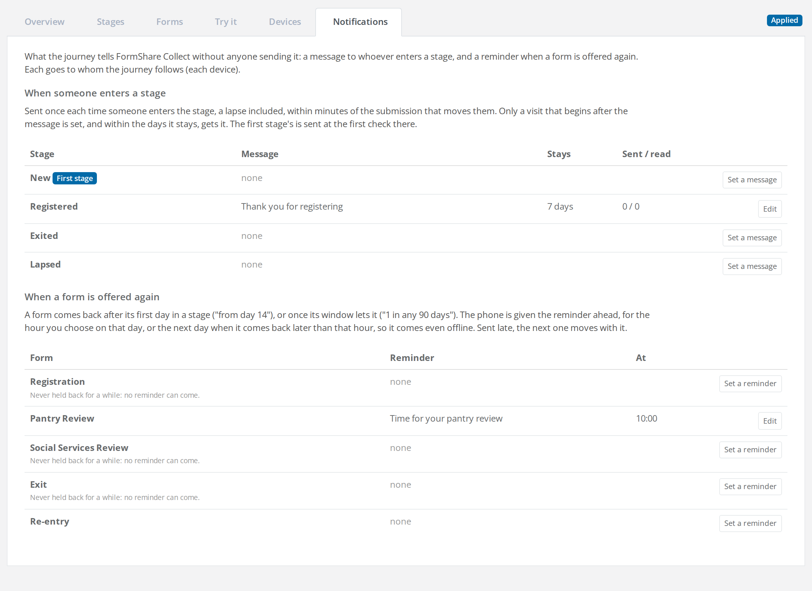
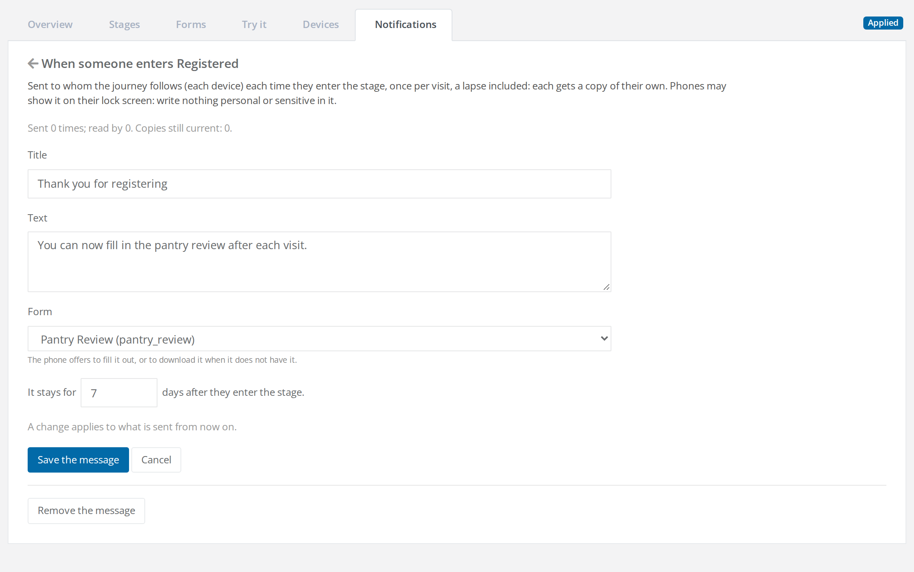
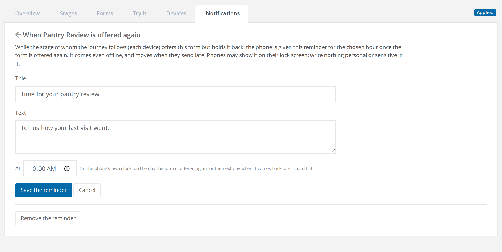

# Notifications in a journey

A [journey](../journeys/README.md) offers each traveller the forms of the stage they are in. A traveller is whoever the journey follows: an assistant, a device, or an assistant on a device. When the notifications plugin is installed beside the Journeys plugin, the journey gets a **Notifications** tab. There you set what the journey tells FormShare Collect without anyone sending it:

* a message to whoever enters a stage, such as "Thank you for registering. You can now fill out the feedback forms";
* a reminder when a form is offered again, such as a quarterly follow-up that comes back 90 days after the last one.

Nobody sends these by hand, and they are not on the project's Sent tab. On the phone they look like any other notification or reminder (see "[What the phone shows](README.md#what-the-phone-shows)").

## Where to find it

Open the project, click **Journey**, then the **Notifications** tab, the last of the journey's tabs. The tab is there once the journey is started, and it is for the same people as the rest of the journey's pages: the project's owner, administrators and editors.

<figure><figcaption>
The pantry journey's notifications.
</figcaption></figure>

The tab warns *The project's notifications are off: phones get none of these until they are turned on.* while the project's notifications are off. You can set everything up before turning them on.

## Who gets them

Each message and reminder goes to whom the journey follows, which the tab's first line names:

| The journey follows | A message or a reminder goes to |
| --- | --- |
| Each assistant | That assistant, on any device they sign in from. |
| Each device | That device, whoever signs in on it. |
| Each assistant on each device | That assistant, on that device only. |

A journey in a crowdsourcing project always follows each device.

A journey's notifications reach a traveller only when all of these hold:

* the journey is applied, not a draft;
* the project's notifications are on;
* the traveller uses FormShare Collect, the only app that follows a journey.

FormShare works them out each time the phone checks, from the same stage the form list gives that traveller, so the two never disagree.

## A message when someone enters a stage

The table under **When someone enters a stage** has a row for each stage of the journey:

| Column | What it shows |
| --- | --- |
| Stage | The stage. The first one carries a *First stage* badge. |
| Message | The message's title, or *none*. |
| Stays | How many days the message stays on the phones. |
| Sent / read | How many messages it has made, and how many travellers have read one. |

**Set a message**, or **Edit** once there is one, opens the stage's message:

| Field | What it does |
| --- | --- |
| Title | Required, 80 characters at most. The box suggests *Thank you for registering*. |
| Text | Optional, 1,000 characters at most. |
| Form | **None**, or one of the project's forms. The message then has a **Fill out** button on the phone, or **Download** when the form is not on it. |
| It stays for ... days after they enter the stage | From 1 to 365, and 7 unless you change it. After that, the phones stop listing the message. |

Click **Save the message**. The page goes back to the tab and says *The message was saved: whoever enters the stage from now on gets it.*

<figure><figcaption>
The message for whoever enters Registered.
</figcaption></figure>


Phones may show the message on their lock screen. Write nothing personal or sensitive in it.


### When the message is sent

* Once for each visit to the stage. Someone who leaves the stage and comes back later gets another. Entering a stage through a lapse counts too.
* At the traveller's first check after the submission that moves them. FormShare Collect checks after it sends a submission, so the message usually arrives within minutes.
* Only for a visit that begins after you set the message, and fewer days ago than it stays. Setting a message does not greet everyone who entered the stage months ago.
* The first stage has no moment of entry for someone who has not moved yet. They get its message at their first check there, once, even if they were there before you set it.

The days it stays count from the moment the visit began, or, in the first stage, from the check that made the message.

### What it already sent

Each traveller who enters the stage gets a copy of the message, a notification of their own. The line above the fields says how many copies were sent, how many travellers have read one, and how many are still current: not withdrawn, and not past their days. A journey's messages do not count toward the project's 50 notifications a day.

### Changing it

A change applies to what is sent from now on. While copies are still current, the page also offers **Also change the copies still current**. Tick it before you click **Save the message**: the phones that have a copy replace its title and text at their next check, without announcing it again, and the page says so when it goes back to the tab. Each copy keeps the form it was sent with and its own last day. Leave the box unticked and the copies already sent keep their words.

### Withdrawing the copies sent

While copies are still current, the page has **Withdraw the copies sent**, which asks again in the page: **Withdraw them from every phone** confirms, and **Keep them** cancels. The copies leave every phone at its next check, read or not, as a withdrawn notification does. The page says *The copies were withdrawn: phones take them off at their next check.*

Withdrawing does not stop the message: whoever enters the stage from now on still gets it. A traveller whose copy you withdrew gets no other for the same visit, only when they enter the stage again.

### Removing it

**Remove the message** asks again: **Remove it** confirms and **Keep it** cancels. No more copies are made from it, and those it already sent stay on the phones until their days are over. To take them off too, withdraw them before you remove the message.

## A reminder when a form is offered again

A journey can hold a form back for a while. A stage may offer it only from a certain day (**From day** on the form's **Where it is offered** tab), or a limit may let a traveller send it only so often (**At most** ... **in any** ... **days** on its **Limits** tab). A reminder of the form comes once the journey offers it again. "[What holds a form back](../journeys/stages-and-rules.md#what-holds-a-form-back)" has every rule that can hold a form back.

A quarterly follow-up limited to "at most 1 in any 90 days" brings its reminder 90 days after the last follow-up arrived, at the hour you choose.

The table under **When a form is offered again** has a row for each form of the journey:

| Column | What it shows |
| --- | --- |
| Form | The form. *Never held back for a while: no reminder can come.* marks a form that has no first day and no such limit. |
| Reminder | The reminder's title, or *none*. |
| At | The hour it comes. |

**Set a reminder**, or **Edit** once there is one, opens the form's reminder:

| Field | What it does |
| --- | --- |
| Title | Required, 80 characters at most. The box suggests *It is time to fill out the follow-up*. |
| Text | Optional, 1,000 characters at most. |
| At | The hour, on the phone's own clock, 09:00 unless you change it. |

Click **Save the reminder**. The page goes back to the tab and says *The reminder was saved: phones take it at their next check.*

The reminder has no Form box: it is about the form itself, and its **Fill out** or **Download** button opens the newest version of the form that takes submissions.

<figure><figcaption>
The reminder for when Pantry Review is offered again.
</figcaption></figure>

### When the reminder comes

* On the day the journey offers the form again, at the hour you chose, or on the next day when the form comes back later in the day than that hour. So the reminder never says a form is due while it is still held back.
* The phone holds the time ahead, so the reminder comes even offline. It holds one time at a time.
* It follows the traveller. When they send the form late, the next reminder moves with the new submission. When they move to a stage that does not hold the form back, the reminder is gone from their phone at the next check. When the stage would lapse before the form comes back, no reminder comes.

A traveller's page, on the journey's **Assistants**, **Devices** or **Assistants on devices** tab, lists under **Held back now** each form held back and when it is offered again (see "[Where travellers are](../journeys/travellers.md#a-travellers-page)").

A form held back only by a limit per visit, a limit in total, or a last day in the stage (**Until day**) is held for good while the traveller stays in the stage, so no reminder can come for it. The form's reminder page says so above its fields.


The hour is on the phone's clock, worked out on the time zone FormShare has for the assistant signed in on the phone, or on the project's time zone in a crowdsourcing project. If that time zone is not where the phone is, the reminder can come a little before the form is offered again, or a day later than it could.


### Changing or removing it

A change to the title, the text or the hour reaches each phone at its next check. FormShare keeps no copy of a journey's reminder: each check works it out again, so the phone sets the new time in place of the one it had.

**Remove the reminder** asks again: **Remove it** confirms and **Keep it** cancels. The reminder leaves the phones at their next check.

FormShare cannot take back a reminder that has already come on a phone. There is nothing else to withdraw: a change or a removal already reaches every phone at its next check. The form's reminder page says so above its fields.

## A stage or a form no longer in the journey

A message of a stage you deleted, or a reminder of a form you took out of the journey, is listed at the bottom of the tab, under **Of a stage or a form no longer in the journey**. It makes nothing any more. **Remove** takes it off the list, after **Remove it** confirms.

The stage's page is gone with the stage, so a message whose copies are still current says how many under its title, and offers **Withdraw the copies sent** there. It works as on the stage's page.

## What's next

* Follow "[Walkthrough: notifications in a journey](walkthrough-journey.md)" to thank households when they register and remind them when a review is due.
* Design the stages and forms these notifications follow in "[Journeys](../journeys/README.md)".
* Set reminders that follow the calendar instead in "[Calendar reminders](reminders.md)".
