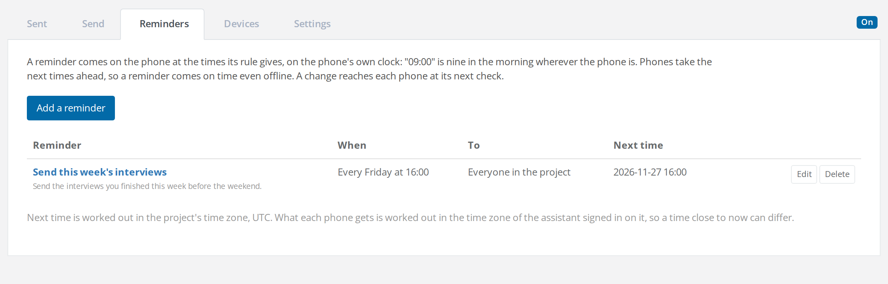
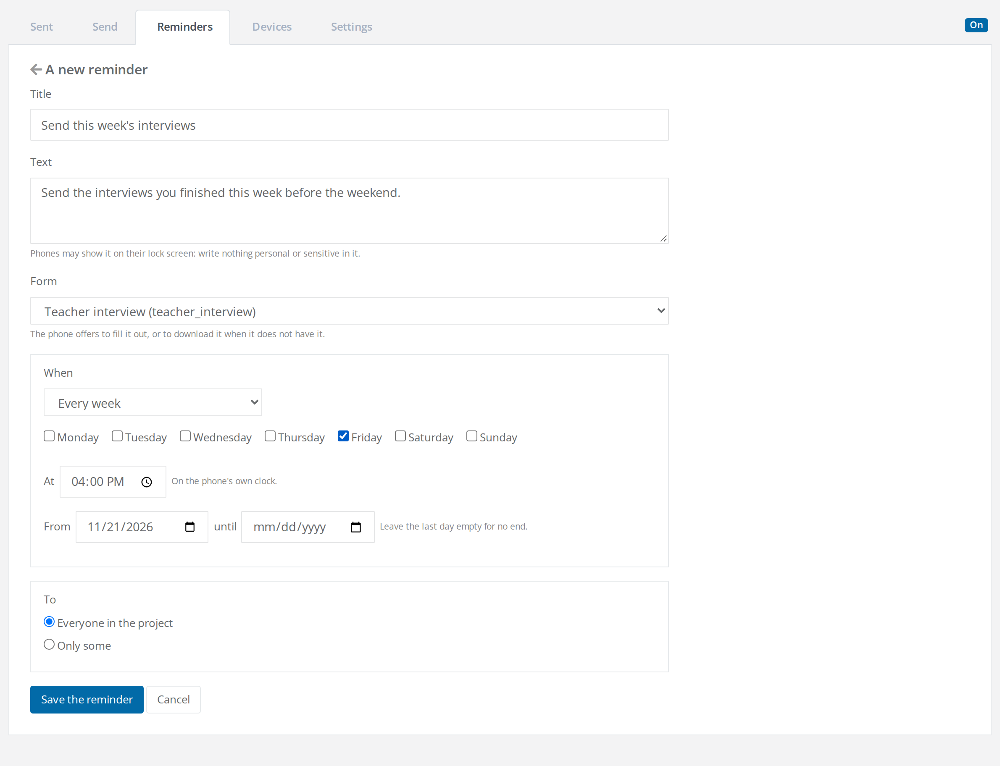

# Calendar reminders

A calendar reminder is a message FormShare Collect shows at times you set: "every Monday at 08:00", "on the last day of every month at 17:00". FormShare gives each phone the coming times ahead, and the phone sets them on its own clock like alarms, so a reminder comes on time even when the phone is offline.

Open the project's **Notifications** and click the **Reminders** tab.

You can add reminders whether or not the project's notifications are on. Phones get them once notifications are on (see "[Turning notifications on and off](README.md#turning-notifications-on-and-off)").

## The Reminders tab

**Add a reminder** opens a new one. Below it, the tab lists the project's reminders in the order they were made.

| Column | What it shows |
| --- | --- |
| Reminder | The title, which opens the reminder's page, and the start of its text. |
| When | Its schedule in words, for example *Every Monday, Thursday at 08:00*, with its first and last days when they matter. |
| To | Whom it is for. |
| Next time | The next time it comes, worked out in the project's time zone, or *Ended* when it will not come again. |

Below the table, the tab names the project's time zone and says that what each phone gets is worked out in the time zone of the assistant signed in on it, so a time close to now can differ (see "[How a reminder reaches the phone](#how-a-reminder-reaches-the-phone)"). A crowdsourcing project has no such note: there, the phones' times are worked out in the project's time zone too.

Each row has **Edit** and **Delete**. **Delete** asks again in the row: **Delete it** confirms, and **Keep it** cancels. A deleted reminder leaves the phones at their next check.

<figure><figcaption>
A weekly reminder.
</figcaption></figure>

## The fields

| Field | What it does |
| --- | --- |
| Title | Required, 80 characters at most. What the phone shows when the reminder comes. |
| Text | Optional. Plain text, 1,000 characters at most. |
| Form | **None**, or one of the project's forms. The reminder then has a **Fill out** button on the phone, or **Download** when the form is not on it. |
| When | How often it comes, at what time, from which day and until which day. See below. |
| To | **Everyone in the project**, or **Only some**, as for a notification (see "[Who a notification can go to](README.md#who-a-notification-can-go-to)"). |

Click **Save the reminder**. The page goes back to the Reminders tab and says *The reminder was saved: phones take it at their next check.* While the project's notifications are off, it says *The reminder was saved. Phones take it at their next check once the project's notifications are on.*

A saved reminder's page lists its next five times above the form, under *Its next times*, with the same note on time zones as the Reminders tab.

<figure><figcaption>
The time is on each phone's own clock.
</figcaption></figure>


Phones may show a reminder on their lock screen. Write nothing personal or sensitive in its title or text.


## The schedule

The **When** box says how often the reminder comes, at what time, and between which days.

| Repeat | What you fill in | When it comes |
| --- | --- | --- |
| Every day | **At** | Every day at that time. |
| Every week | The days it comes on, Monday to Sunday, and **At** | On each day ticked, at that time. Tick at least one. |
| Every month | **On day**, from 1 to 31, and **At** | On that day of every month. A month without that day uses its last day, so day 30 comes on the last day of February, and 31 is the last day of every month. |

A new reminder starts as **Every week** at 09:00, from today.

**At** is a time on the phone's own clock: 09:00 is nine in the morning wherever the phone is, the way a calendar keeps an appointment.

**From** is the first day the reminder may come. **until** is the last; leave it empty and the reminder never ends. The last day cannot come before the first, nor be a day already past. A reminder whose last day has passed stays on the tab, marked *Ended*, until you delete it.

The When column reads the schedule back, for example *On day 30 of every month, or on its last day when it is shorter, at 10:00, from 2026-12-01 until 2027-06-30*.

## How a reminder reaches the phone

At every check, FormShare gives each phone the full set of reminders meant for that phone and whoever is signed in on it, each with its next eight times. The phone sets those times on its own clock. Because every check carries the full set, a reminder you change or delete is changed or gone on each phone at its next check: the phone takes down the times it had set and sets the new ones.

* The phone sets at most 16 times for a project, the nearest first. As times pass, later checks bring the next ones. A phone that stays offline longer than those times cover gets no more reminders until it checks again.
* When a time comes, the phone shows the reminder as its own notification, and lists it under the bell, unread.
* A time that comes while the phone is switched off is listed under the bell when FormShare Collect next runs.
* Reminders send nothing back, so there is no Read by for a reminder.
* Reminders do not count toward the project's 50 notifications a day.

A reminder is for whoever its **To** names at the moment of each check. A reminder to a group therefore reaches whoever is in the group then, and leaves the phones of someone removed from it.


**Which times are still to come** is decided on the time zone FormShare has for the assistant signed in on the phone (the **Time zone** on the assistant's page, on servers that offer time zones), or on the project's time zone in a crowdsourcing project. If that time zone is not the phone's, a time that falls within the hours between the two can be missed, or come late. Keep each assistant's time zone where they work. The **Next time** column and *Its next times* are worked out in the project's time zone, and both pages say so under the times they show.


## When the page refuses

The page says why above the tabs, and keeps what you typed:

| The page says | Why |
| --- | --- |
| Give the reminder a title. | The title is empty. |
| Choose the days of the week it comes on. | **Every week** is chosen with no day ticked. |
| Choose the day of the month it comes on: 1 to 31. | **On day** is empty or out of range. |
| Give the time it comes at, as HH:MM. | **At** is empty, or not a time. |
| Give the first day as a date. | **From** is empty. |
| The last day comes before the first. | **until** is earlier than **From**. |
| The last day has already passed. | **until** is in the past. |
| Choose whom to send it to. | **Only some** is chosen, with nothing picked. |

## What's next

* For a reminder that follows a person's progress rather than the calendar, see "[Notifications in a journey](in-a-journey.md)".
* Send a one-off message with "[Sending notifications](sending-notifications.md)".
