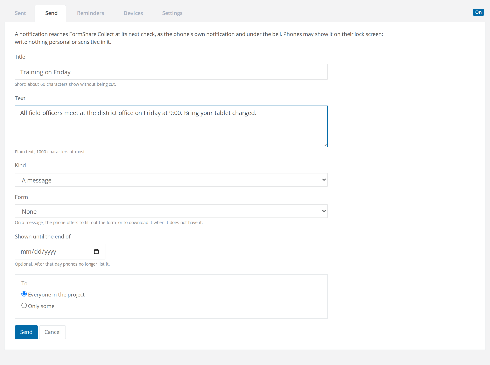
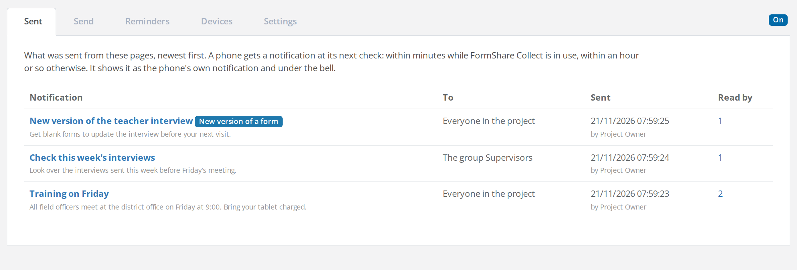
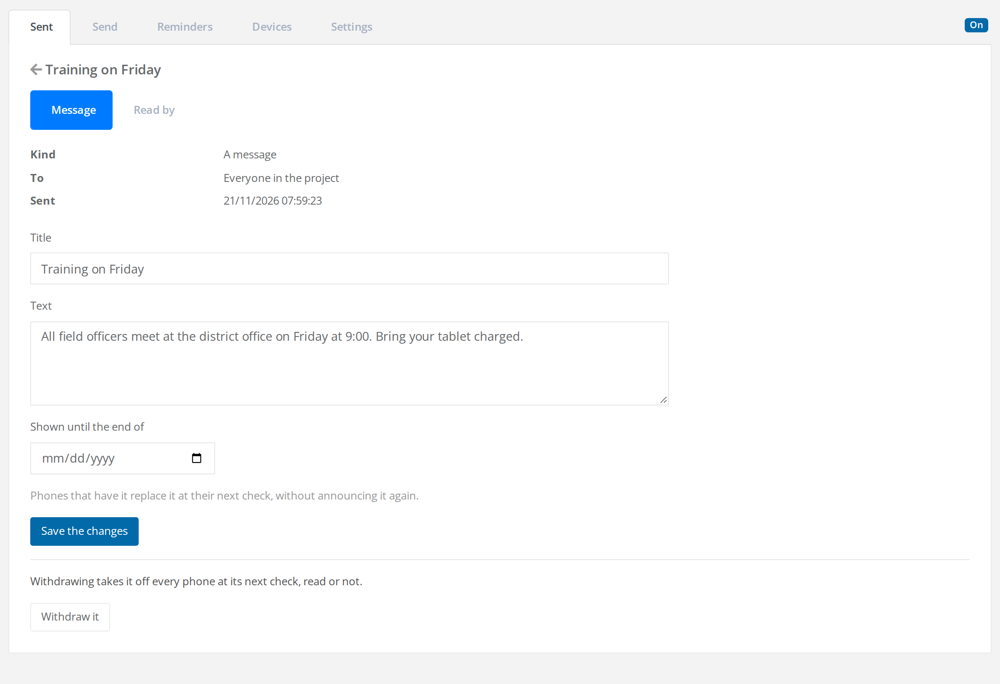
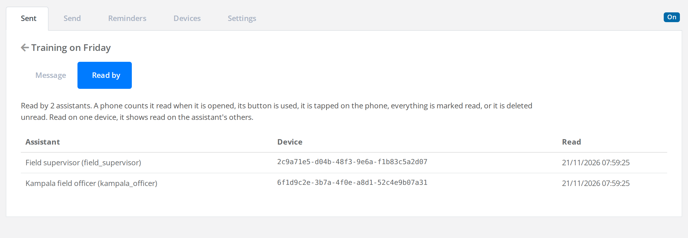

# Sending notifications

Open the project's **Notifications** and click the **Send** tab. What you send reaches FormShare Collect at each phone's next check, as the phone's own notification and under the project's bell.

<figure><figcaption>
A message to the whole project.
</figcaption></figure>

## The fields

| Field | What it does |
| --- | --- |
| Title | Required, 80 characters at most. The notification's title on the phone. About 60 characters show without being cut. |
| Text | Optional. Plain text, 1,000 characters at most. The phone's list shows its first three lines, and all of it when the notification is opened. |
| Kind | **A message**, or **A new version of a form: the phone offers to download it**. |
| Form | **None**, or one of the project's forms. It gives the notification a button on the phone. A new version of a form needs one. |
| Shown until the end of | Optional. The last day the phones list the notification. |
| To | **Everyone in the project**, or **Only some**: assistants, groups, devices, or an assistant on a device. |


Phones may show a notification on their lock screen. Write nothing personal or sensitive in its title or text.


### Kind and form

The kind and the form decide which button the notification has on the phone.

| Kind | Form | On the phone |
| --- | --- | --- |
| A message | None | A message, with no button. |
| A message | A form | **Fill out** when the form is on the phone, **Download** when it is not. |
| A new version of a form | A form, required | **Download**, which opens the phone's download screen with that form ticked. The Sent tab marks it *New version of a form*. |

Choose **A new version of a form** after you upload a new version, so that the field team downloads it before they go out. The **Form** list names each form of the project with its form ID in brackets, and the phone finds the form by that ID, so pick the version the team should have. After a [merge](../../fundamentals/repositories/merging-subversions-of-a-form.md), that is the new version.

### Shown until the end of

The notification stays on the phones until midnight at the end of that day, on the clock FormShare shows you dates in: the **Time zone** chosen at the top of the page when your server offers that choice, and the server's clock when it does not. From that moment the phones stop listing it, even offline, and a phone that checks for the first time does not get it.

The day cannot be one that has already passed. Leave the box empty and the notification stays until you withdraw it, or until the person deletes it from their phone.

### To

**Everyone in the project** is the default. **Only some** opens four lists, each with a search box:

| List | Who gets it |
| --- | --- |
| Assistants | Those assistants, on any device they sign in from. |
| Groups | Whoever is in the group when their phone checks: someone added later gets it too. |
| Devices | Those devices, whoever signs in on them. Only devices that asked for the project's notifications are listed. |
| An assistant on a device | That assistant, on that device only. |

You can pick in several lists at once. The notification reaches anyone who matches any of the picks. A crowdsourcing project offers only **Devices**. "[Who a notification can go to](README.md#who-a-notification-can-go-to)" has the rules in full, groups and crowdsourcing projects included.

## Sending it

Click **Send**. The page goes back to the Sent tab and says *The notification was sent: phones get it at their next check.*

When the page refuses, it says why above the tabs and keeps what you typed:

| The page says | Why |
| --- | --- |
| Give the notification a title. | The title is empty. |
| Choose the form that has a new version. | The kind is a new version of a form, and no form is chosen. |
| The last day has already passed. | The day in **Shown until the end of** is in the past. |
| Choose whom to send it to. | **Only some** is chosen, with nothing picked. |
| Notifications are off for this project: turn them on in Settings before sending. | See "[Turning notifications on and off](README.md#turning-notifications-on-and-off)". |
| This project has sent 50 notifications in the last 24 hours, the most it may send: try again later. | The limit below. |

A project can send at most 50 notifications by hand in any 24 hours. Those a journey makes do not count.

## What was sent

The **Sent** tab is the first page of the project's Notifications. It lists what was sent from these pages, newest first.

| Column | What it shows |
| --- | --- |
| Notification | The title, which opens the notification's page, and the start of its text. A badge marks a new version of a form, a notification withdrawn (*Withdrawn*), or one past its last day (*Expired*). |
| To | Whom it went to, in words: *Everyone in the project*, an assistant's name and login, *The group ...*, *The device ...*, or an assistant *on the device ...*. An assistant who has left the project shows as *an assistant no longer in the project*. |
| Sent | When, and by whom. |
| Read by | How many assistants have read it, on any device. In a crowdsourcing project, how many devices. The number opens the Read by tab. |

<figure><figcaption>
Newest first.
</figcaption></figure>

Only notifications sent by hand are here. A journey's notifications are counted in the journey's own Notifications tab (see "[Notifications in a journey](in-a-journey.md)").

## Changing a notification

Click a notification's title to open its page. Its **Message** tab lists its kind, its form, whom it went to, when it was sent and last changed, and whether it was withdrawn or is past its last day.

Below that, you can change its **Title**, its **Text** and its **Shown until the end of**, then click **Save the changes**. Phones that have it replace it at their next check, without announcing it again.

The kind, the form and whom it goes to cannot change. To send something else, or to other people, withdraw it and send a new one.

<figure><figcaption>
A notification's page.
</figcaption></figure>


To take a notification off the phones before its last day, withdraw it. Changing the last day to a day already past does not reach the phones that have it.


## Withdrawing a notification

At the bottom of the Message tab, **Withdraw it** asks again in the page: **Withdraw it from every phone** confirms, and **Keep it** cancels.

A withdrawn notification leaves every phone at its next check, read or not. It stays on the Sent tab with a *Withdrawn* badge, and its page shows when it was withdrawn. It cannot be changed any more, and a withdrawal cannot be undone: to bring it back, send it again.

## Who read it

The **Read by** tab of a notification lists each read, the latest first. The line above the table says how many assistants have read it, whatever the device (how many devices, in a crowdsourcing project).

| Column | Meaning |
| --- | --- |
| Assistant | Who read it. A crowdsourcing project has no such column. |
| Device | The device it was read on, by the ID FormShare Collect gave it (see "[The Devices tab](README.md#the-devices-tab)"). |
| Read | When FormShare received the phone's report. A phone that was offline reports when it is back online. |

<figure><figcaption>
Who read it, on which device, and when.
</figcaption></figure>

An assistant who reads it on two devices has a line for each. A phone counts a notification read when it is opened, its button is used, it is tapped among the phone's notifications, everything is marked read, or it is deleted unread. So a read can also mean that the person dismissed it.

The tab says *Nobody has read it yet.* until the first report comes in.

## What's next

* Send messages at fixed times with "[Calendar reminders](reminders.md)".
* See what the phones do with a notification in "[What the phone shows](README.md#what-the-phone-shows)".
