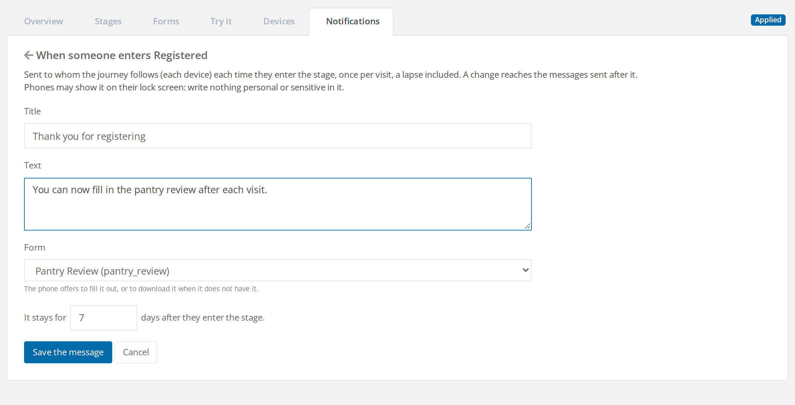
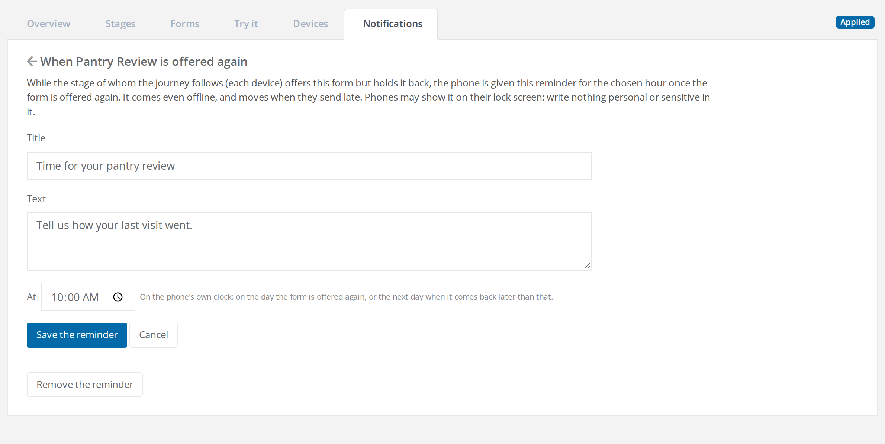
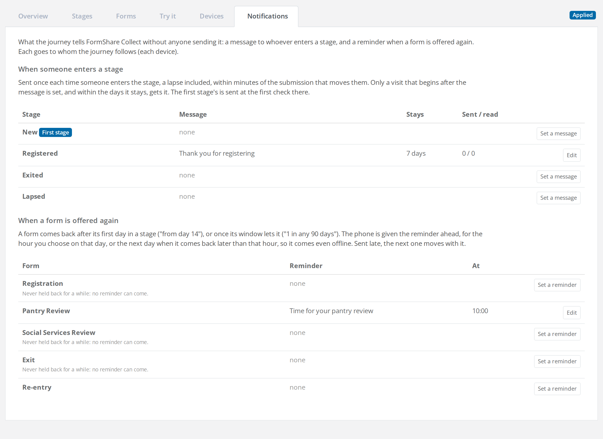

# Walkthrough: notifications in a journey

This walkthrough adds two automatic notifications to the journey built in "[Walkthrough: a community pantry](../journeys/walkthrough.md)":

* a thank-you to every household that registers, which points it to the pantry review;
* a reminder when the pantry review, offered at most once in any seven days, is due again.

Nobody sends these. The journey sends each one to the phone it concerns, when that phone's submissions call for it.



## Turn the project's notifications on

On the project's page, click **Notifications**, open **Settings**, and click **Turn notifications on**. A journey's notifications reach no phone while the project's notifications are off.



## Open the journey's Notifications tab

On the project's page, click **Journey**, then the last tab, **Notifications**. It lists the stages, each with the message sent to whoever enters it, and the forms, each with the reminder for when it is offered again.



## Thank households when they register

Click **Set a message** on the stage *Registered* and fill it in:

| Field | Value |
| --- | --- |
| Title | `Thank you for registering` |
| Text | `You can now fill in the pantry review after each visit.` |
| Form | Pantry Review |
| It stays for | `7` days after they enter the stage |

<figure><figcaption>
With a form, the phone offers to fill it out from the message, or to download it if the phone does not have it.
</figcaption></figure>

Click **Save the message**. From now on, a household gets it each time it enters *Registered*, by registering or by coming back with *Re-entry*, within minutes of the submission that moved it. A stay that began before you saved the message does not get it.



## Remind households when their review is due

Back on the tab, click **Set a reminder** on *Pantry Review*:

| Field | Value |
| --- | --- |
| Title | `Time for your pantry review` |
| Text | `Tell us how your last visit went.` |
| At | 10:00 |

<figure><figcaption>
The time is on the phone's own clock, on the day the form is offered again.
</figcaption></figure>

Click **Save the reminder**. A household that sends a review then has it held back for seven days, and its phone is given this reminder for 10:00 on the day the review is offered again. The phone keeps it, so it comes even offline. If the household sends late, the next reminder moves with it.



## Check what the journey sends

The **Notifications** tab now shows both, with how many households were sent the message and how many read it.

<figure><figcaption>
A form that is never held back, such as <em>Registration</em> here, is never offered "again", so a reminder for it could never come. The tab says so under its name.
</figcaption></figure>



## What's next

* Read "[Notifications in a journey](in-a-journey.md)" for who gets each notification, and what happens when a stage or form leaves the journey.
* Follow "[Notify a field team](walkthrough.md)" to send notifications by hand.
