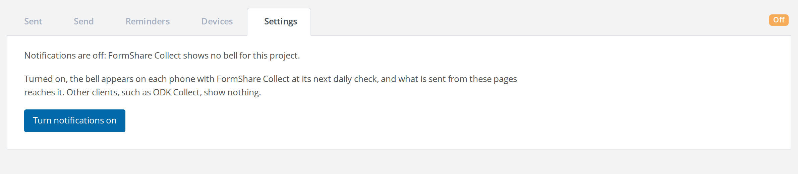
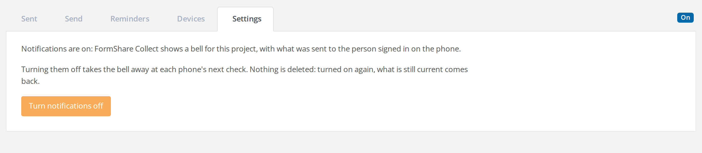
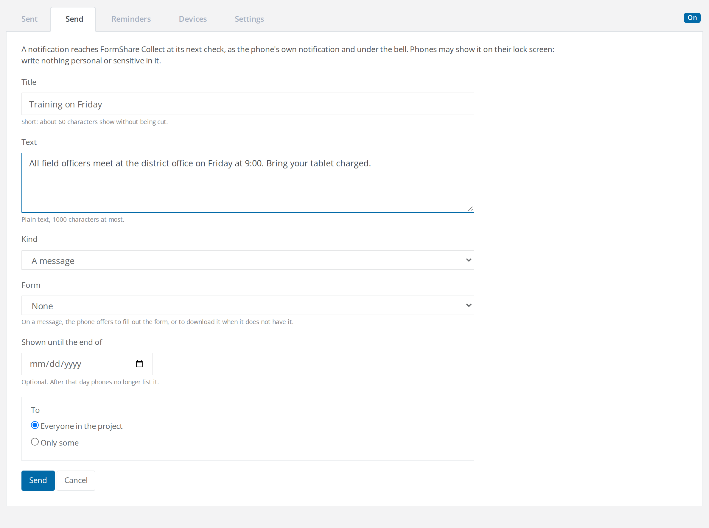
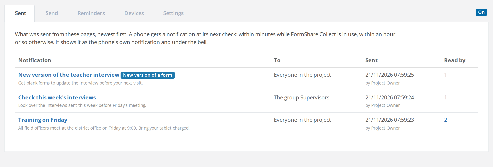
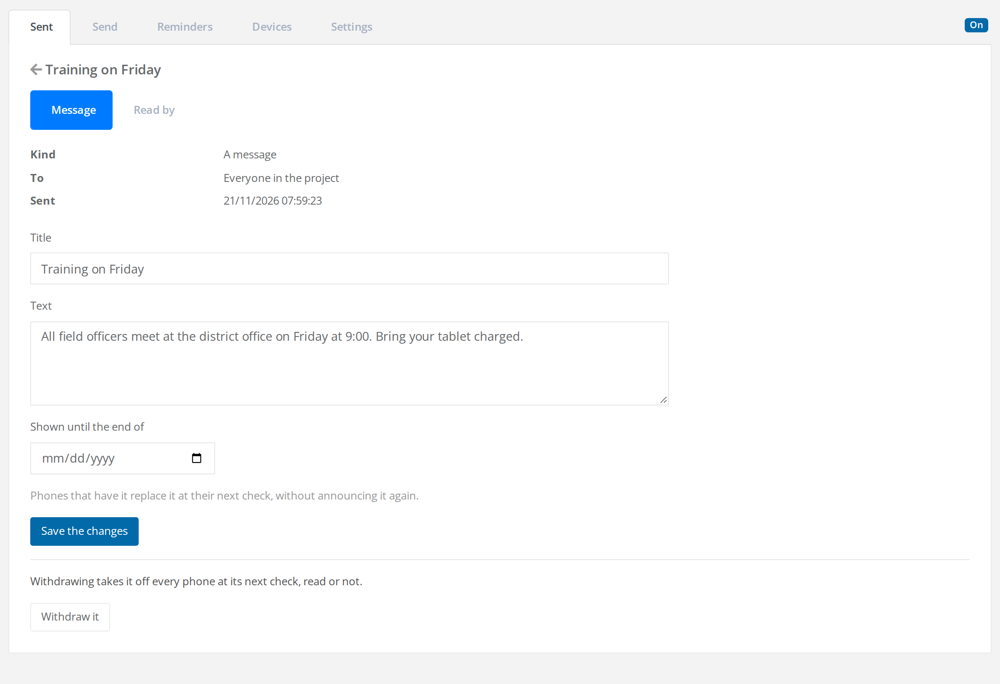
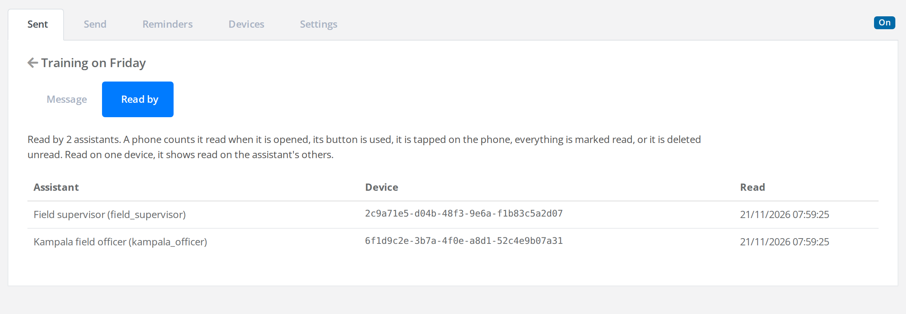
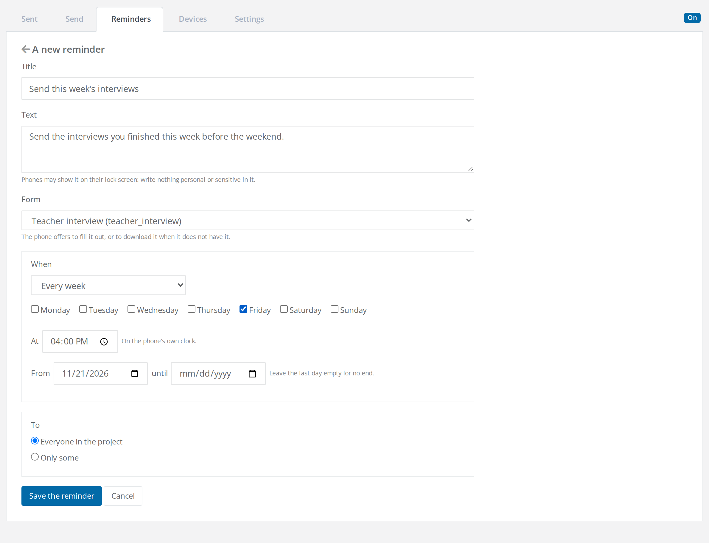
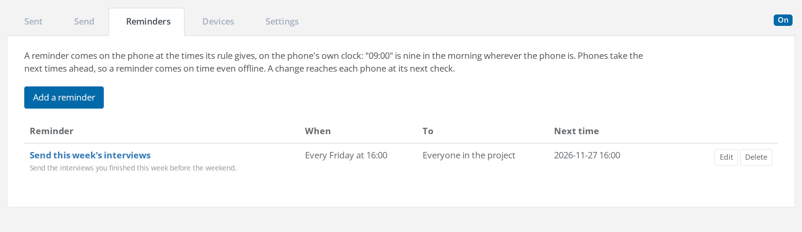
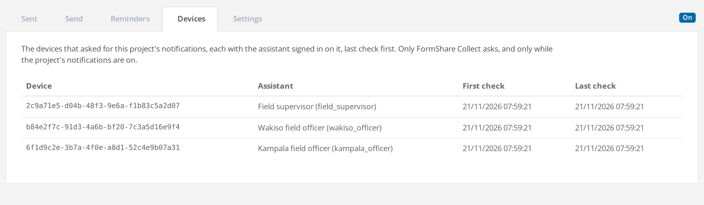

# Walkthrough: notify a field team

The example project, *Early childhood teachers*, has two field officers and a supervisor, all with FormShare Collect on their tablets. The supervisor is in the assistant group *Supervisors*. In this walkthrough you send them three notifications and set a weekly reminder.

To send notifications when someone reaches a stage of a journey, follow "[Notifications in a journey](walkthrough-journey.md)" instead.



## Turn the project's notifications on

On the project's page, click **Notifications**, beside the forms. The button appears once the project has a form. Open the **Settings** tab.

<figure><figcaption>
A project starts with notifications off.
</figcaption></figure>

Click **Turn notifications on**. The badge at the right of the tabs turns from **Off** to **On**.

<figure><figcaption>
Turning them off later deletes nothing. Turned on again, what is still current comes back.
</figcaption></figure>

The bell appears on each phone with FormShare Collect at its next check, which can take up to a day. Turn notifications on before the day you need them.



## Tell everyone about the training

Open the **Send** tab and fill it in:

| Field | Value |
| --- | --- |
| Title | `Training on Friday` |
| Text | `All field officers meet at the district office on Friday at 9:00. Bring your tablet charged.` |
| Kind | A message |
| Form | None |
| Shown until the end of | *(leave empty)* |
| To | Everyone in the project |

<figure><figcaption>
Phones may show a notification on their lock screen. Write nothing personal or sensitive in it.
</figcaption></figure>

Click **Send**. Each phone gets it at its next check: within minutes while FormShare Collect is in use, and later otherwise. It shows as the phone's own notification and under the bell.



## Tell the supervisors what to check

Open **Send** again. Title it `Check this week's interviews`, write `Look over the interviews sent this week before Friday's meeting.`, and under **To** choose **Only some**, then the group *Supervisors*.

FormShare reads who is in the group each time a phone checks. Someone who joins *Supervisors* next week still gets this notification, and someone who leaves the group loses it.



## Announce a new version of a form

When you publish a new version of the teacher interview, tell the officers to get it. Open **Send**, title it `New version of the teacher interview`, write `Get blank forms to update the interview before your next visit.`, choose the kind **A new version of a form** and the form *Teacher interview*, and send it to everyone.

On the phone, the notification has a **Download** button, which opens the download screen with the interview ticked.



## See who has read it

The **Sent** tab lists what was sent, newest first, to whom, and how many have read it.

<figure><figcaption>
The number under <strong>Read by</strong> counts assistants, whatever the device. In a crowdsourcing project it counts devices.
</figcaption></figure>

Click a title to open the notification. Its **Message** tab changes the title, the text or the last day: phones that have it replace it at their next check, without announcing it again. **Withdraw it**, at the bottom, takes it off every phone at its next check, read or not.

<figure><figcaption>
A notification's page.
</figcaption></figure>

Its **Read by** tab says who read it, on which device, and when.

<figure><figcaption>
A phone counts a notification read when it is opened, its button is used, it is tapped, everything is marked read, or it is deleted unread.
</figcaption></figure>



## Remind everyone every Friday

Open **Reminders** and click **Add a reminder**:

| Field | Value |
| --- | --- |
| Title | `Send this week's interviews` |
| Text | `Send the interviews you finished this week before the weekend.` |
| Form | Teacher interview |
| When | Every week, on Friday |
| At | 16:00 |
| From | today, with no last day |
| To | Everyone in the project |

<figure><figcaption>
The time is on each phone's own clock: 16:00 is four in the afternoon wherever the phone is.
</figcaption></figure>

Click **Save the reminder**. The **Reminders** tab shows when it comes next.

<figure><figcaption>
Phones take the next few times ahead, so a reminder comes on time even offline.
</figcaption></figure>



## Check which phones are listening

The **Devices** tab lists every phone that has asked for this project's notifications, with the assistant signed in on it and when it first and last checked.

<figure><figcaption>
Only FormShare Collect asks, and only while the project's notifications are on.
</figcaption></figure>

A field officer missing from this list does not get notifications. Their phone may run another app, such as ODK Collect, which shows nothing, or it may not have checked since you turned notifications on. See "[When a notification does not arrive](README.md#when-a-notification-does-not-arrive)".



## What's next

* Read "[Sending notifications](sending-notifications.md)" for every field and the limits on what you can send.
* Read "[Calendar reminders](reminders.md)" for the other schedules.
