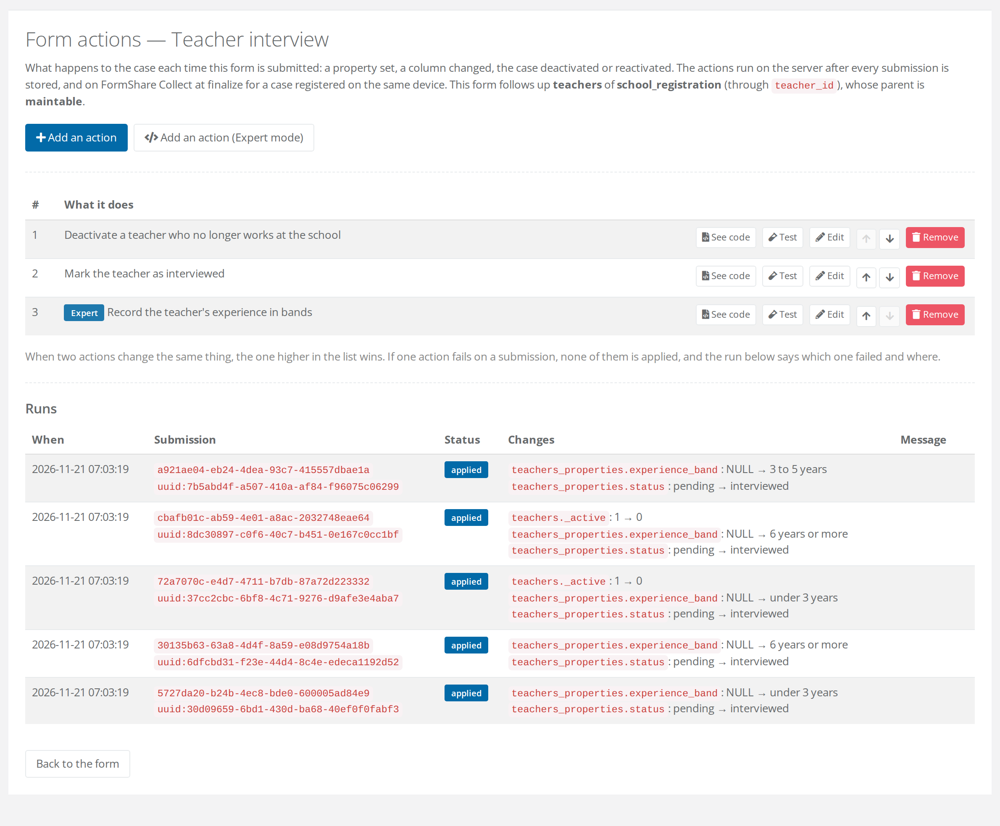
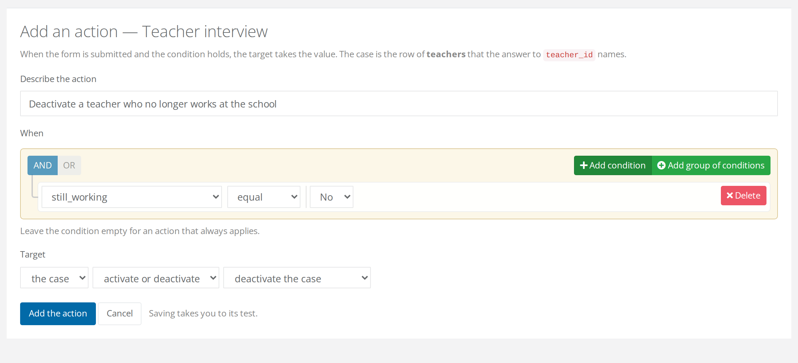
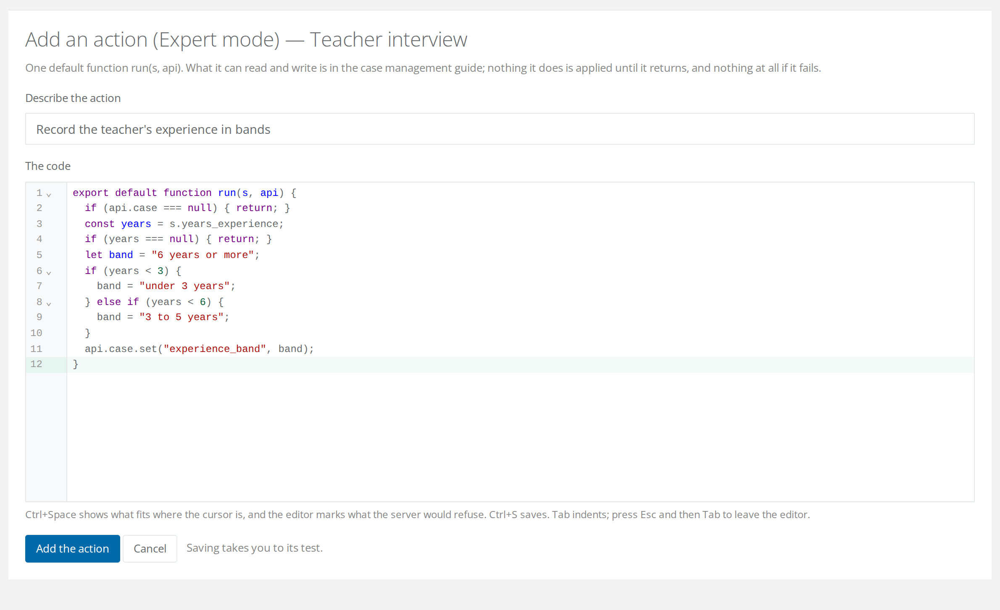
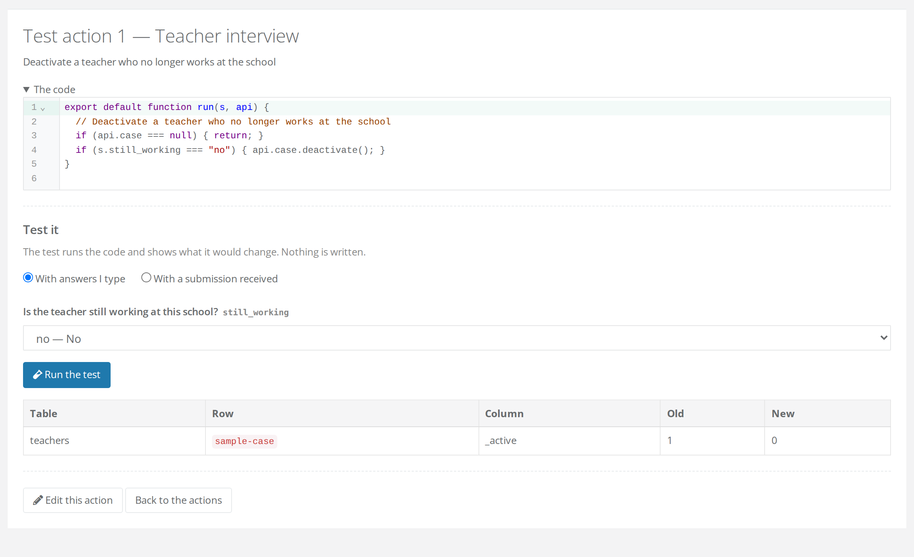

# Form actions

An **action** says what happens to a case when a form is submitted. An interview that answers *No* to "Is the teacher still working at this school?" can deactivate the teacher, so the teacher leaves the list and the next interview about them is refused. Another action can set the teacher's `status` [property](properties.md) to `interviewed`, which the teacher list then serves to every device.

A form's actions are a list. Each one is a **rule**, built from a condition, a target and a value, or **code**, a short JavaScript function for what a rule cannot say. FormShare composes them into one program and runs it every time a submission of the form is stored.

## The Form actions page

Open the form's page and click **Form actions**. The button appears to owners, administrators and editors on every form of a project that publishes lists.

<figure><figcaption><p>Three actions on the Teacher interview: two rules and one in code. Each run below names its submission twice, by FormShare's id and by the instanceID the device gave it, and lists what it changed.</p></figcaption></figure>

The text at the top says which case the actions act on. Below it, the actions are listed in their order, each with its number and its description, and an **Expert** tag on code:

| Button | What it does |
| --- | --- |
| See code | Shows the action as JavaScript, with a **Copy** button. For a rule, it is the code FormShare writes from it. |
| Test | Opens the action's [test page](#test-an-action). |
| Edit | Opens the action on the page it was made with. |
| The arrows | Move the action up or down. The order decides [which action wins](#which-action-wins). |
| Remove | Removes the action, after a confirmation. It stops running on the submissions that arrive from then on, and what it already changed stays. |

Removing or moving an action puts the form's actions together again, as adding one does. When the others cannot be put together, because one of them is broken (it names a question or a property the form no longer has), nothing changes and the page says which action is broken: fix or remove that one first. The action that runs is always the one the list shows.

**Add an action** adds a rule, and **Add an action (Expert mode)** adds code. Saving either one takes you to its test. Under the list, the [Runs](#runs) table records what the actions did to each submission.

## The case an action acts on

An action acts on the case the form follows up: the row its [case link](case-links.md) points at, through the answer to the case link's selector. The page says which. For the teacher interview it says that the form follows up `teachers` of `school_registration` through `teacher_id`, whose parent is `maintable`.

When the case is a row of a repeat, the row it belongs to is the case's **parent**: the school a teacher belongs to. An action can change the parent too.

A form without a case link acts on its own rows: the case is each submission itself. That is how a registration form keeps a property of its own rows up to date. The page says so, and tells you to set the case link in **Links to lists** first if the form should act on another form's cases.


**Actions need the form's repository.** Until it is built, the page of a rule has no questions to decide by and a test cannot run. The server runs actions only on submissions stored in a repository. Write a form's actions once its case link is set and its repository built.


## Describe the action

Both kinds of action ask you to **Describe the action** in one line of at most 255 characters, and refuse to save without it. FormShare shows the description in the list, on the test page, and in **See code**, where it is the comment above the action. Line breaks are folded into spaces.

## Rules

**Add an action** opens the page of a rule. A rule reads as a sentence: when the form is submitted and the condition holds, the target takes the value.

<figure><figcaption><p>A rule that deactivates the teacher when the interview says the teacher no longer works at the school. A target that activates or deactivates the case takes no value.</p></figcaption></figure>

| Part | What it holds |
| --- | --- |
| Describe the action | One line, in your words, of what the action does. |
| When | The condition. Leave it empty for an action that always applies. |
| Target | What the action changes. |
| Value | What the target takes. |

**Add the action**, or **Save the action** when you edit one, stores it and opens its test. A rule FormShare cannot turn into code is refused with the reason, and nothing is stored.

### When

The condition is a set of conditions joined by AND or OR, with groups inside it: **Add condition** and **Add group of conditions**. Each condition picks a field, an operator that suits the field's type, and a value. A select offers its choices in a drop-down, a number a number box, a date a date box.

| Group of fields | What it offers |
| --- | --- |
| This submission | The questions of the form outside repeats. |
| This submission, computed | The average, sum, count, minimum or maximum of a numeric question of a repeat. |
| This submission, days since | The days from each date of the submission to today. |
| The case | The case's properties, then its columns. |
| The case, days since | The days from each date of the case to today. |
| The case's parent | The parent's properties, when the case is a row of a repeat. |
| The case's parent, days since | The days from each date among the parent's properties to today. |

Three things hold for every condition:

* A condition about an unanswered question or an empty value is false, whatever the operator, except *is null* and *is not null*, which test for the value itself. A condition that `still_working` is *not equal* to `no` does not hold for an interview that left the question unanswered.
* Texts are compared exactly as written, capitals and spaces included.
* A multi-select is tested for the options it includes: *in* holds when it includes any of the values, *not in* when it includes none of them, *is empty* when nothing was chosen.

*Days since* counts calendar days from a date to today, whatever the hour: yesterday at 23:00 was 1 day ago. Today is the date where the action runs, the server's on the server and the phone's own in FormShare Collect, so near midnight a phone in another time zone can count one day more or less than the server.

### Target

The target is three choices in a row:

| Choice | Options |
| --- | --- |
| Whose | *the case*, or *the case's parent*. The parent is offered whenever the case is a row of a repeat. Without properties of its own, the parent can still be deactivated or reactivated; *set property* and *set column* are then greyed out. |
| What | *set property*, *set column*, or *activate or deactivate*. |
| Which | A property or a column of that row, each shown with its type, or *deactivate the case* or *reactivate the case*. |

A rule sets the parent's properties, or deactivates or reactivates the parent. Code can also set the parent's columns.

Setting a column rewrites what was collected, an answer of the registration. Keep that for corrections, and use a [property](properties.md) for anything that changes over the life of a case.

### Value

| Value | What the target takes |
| --- | --- |
| a constant | What you type. For a property, it is checked as the property's default is, so `AAA` is refused for an integer. Leave it empty to clear the target. |
| the answer to a question | The answer to a question of the submission, outside repeats. |
| now | The date and time of the run. |
| a computed value | The average, sum, count, minimum or maximum of a numeric column of one of the form's repeats. The count counts the rows where the column is answered. |

A number of days is a condition only. To set a property to a number of days, write the action in code.

## Code

**Add an action (Expert mode)** opens a code editor holding the start of one function:

```js
export default function run(s, api) {
  // What happens to the case when this form is submitted.
}
```

`run` receives the submission as `s` and reaches the case through `api`. It changes the case only through `api`, and nothing it asks for is applied until it returns. Then all of it is applied, or none of it if the code failed.

<figure><figcaption><p>An action in code that a rule could not express: it sorts the years of experience into bands and stores the band in a property of the teacher.</p></figcaption></figure>

The editor offers what fits where the cursor is when you press Ctrl+Space, from the form's questions, repeats and lookup lists and the case's properties and columns. It marks what the server would refuse, such as a question the form does not have or a function a run cannot use. The line under the editor lists its keys: Ctrl+S saves, and Esc then Tab leaves the editor.

Saving code the editor marks with an error asks first, with **Save it anyway** and **Keep editing**. The server would refuse such code, or it would fail on every submission, and while one action fails none of the form's actions is applied.

A rule's code is a good place to start: copy it from **See code** into a new action in code, and change it there. Code never turns back into a rule.

### What code can read

| In code | What it is |
| --- | --- |
| `s.question` | The answer to a question outside repeats: a number for an integer or a decimal, text otherwise, `null` when unanswered. A date is text such as `2026-03-05`, a date and time `2026-03-05 08:30:00`. Write `s["name"]` for a name that is not a plain word. |
| `s.repeat("name")` | The rows of a repeat in the order they were filled, each with its answers and its own `repeat()` for a repeat inside it. `[]` when there are none. |
| `s.selected("question", "code")` | Whether a multi-select answer includes the code. |
| `s.selections("question")` | The codes of a multi-select answer, in the order they were chosen. |
| `s.rowuuid` | The identity of the submission's main row. |
| `s.submittedBy`, `s.submittedDate` | Who sent the submission, and when. |
| `api.case` | The case, or `null` when there is none. Its `rowuuid` and `table` say which row it is. |
| `api.case.value("column")` | A column of the case's row. |
| `api.case.property("name")` | A property of the case. |
| `api.case.active` | Whether the case is active. |
| `api.case.parent` | The row the case belongs to, for a case that is a row of a repeat, with the same `value()`, `property()` and `active`. `null` for a case of a main table. |
| `api.lookup("list", code)` | The row of a choice list by its code, with its label and its other columns, or `null`. |
| `api.now` | The date and time of the run, as `YYYY-MM-DD HH:MM:SS`, by the clock of the server or of the phone that runs it. |
| `api.user` | The login of the assistant who sent the submission. On the test page, yours. |
| `api.avg(rows, "column")`, `api.sum`, `api.count`, `api.min`, `api.max` | The average, sum, count, minimum and maximum of a column over rows such as `s.repeat("meals")`, skipping empty values. `api.count` counts the rows where the column has a value. |
| `api.days(a, b)` | Whole days from date `a` to date `b`, both written as `YYYY-MM-DD`. |
| `api.log("text")` | A line kept with the run. It shows in the Runs table and on the test page, never on the device. |

`api.case.value()` and `api.case.property()` fail the run for a name the case does not have. For `api.lookup`, keep the second parameter of `run` named `api` and write the list's name in quotes, as the form declares it: the server finds the lists to load by reading those calls in the code.

### What code can change

| In code | What it does |
| --- | --- |
| `api.case.set("name", value)` | Sets a property of the case, or a column of its row. FormShare tells which by the name. `null` clears it. |
| `api.case.deactivate()`, `api.case.activate()` | Deactivates or reactivates the case. |
| `api.case.parent.set(...)`, `.deactivate()`, `.activate()` | The same, on the parent. |

The changes are collected while `run` works and applied together after it returns. Within one action, the last change to a name is the one kept.

### What a run cannot use

A run must give the same answer on the server and on every phone, so nothing that would differ between them is available:

* the clock and chance: `Date.now()`, `new Date()` without arguments and `Math.random()` are refused, and `api.now` gives the time instead;
* `eval`, `new Function`, timers, imports, files and the network. A run is synchronous, and nothing after an `await` runs;
* the locale functions, such as `toLocaleString()`. Format values yourself.

`new Date("2026-03-05 08:30:00")` reads the date in the time zone of wherever the code runs, which differs between the server and a phone. Compare dates as their `YYYY-MM-DD` text and count days with `api.days`, as the code FormShare writes for a rule does.

The form's actions together hold at most 64 KB of code, and a run has a quarter of a second and 16 MB of memory.

## Which action wins

When two actions change the same thing, the one higher in the list wins.

Each action reads the case as it was before the submission: it does not see what another action of the same form changes. FormShare collects every change the actions ask for, and for each target it keeps the change of the highest action. So the order decides only whose change is kept: put the specific action above the general one. An action that sets `status` to `left` when the teacher no longer works there goes above one that sets it to `interviewed` for every interview.

## All or nothing

If one action fails on a submission, none of them is applied. The submission itself is stored either way.

An action fails when its code throws an error, when it writes a value the target cannot hold (text in an integer, a date that does not exist), when it names something that is neither a property nor a column of the case, or when it runs over its limits. The run says which action failed and where, as in *(action 3, line 4)*.

Saving an action composes the program again, with every action of the form. When it cannot be composed, nothing is saved, and the page says which action stops it.

## Test an action

The test page runs one action, alone, and shows what it would change. Nothing is written and no run is recorded.

<figure><figcaption><p>The test of the rule that deactivates a teacher, run before any interview arrived. The page asks only for the answer the rule reads, and the change lands on the stand-in case.</p></figcaption></figure>

| Choice | What the action runs over |
| --- | --- |
| With answers I type | Answers you type on the page, so you can test an action before any submission arrives. |
| With a submission received | One of the 50 latest submissions in the form's repository, listed by its primary key, who sent it and when. It shows *(none yet)* until one arrives. |

**Run the test** shows each change with its table, the row's identity, the column, the old value and the new one. Otherwise it says *The run would change nothing*, or shows the failure in red; for code, the line the failure names is marked in the code above. The lines the code wrote with `api.log` follow.

A test needs the form's repository. Without one, the page answers *The form has no repository yet: its actions cannot run*.

### Answers you type

The page asks only for what the action reads:

* for a rule, the questions in its condition and its value, and the repeats its computed values read;
* for code, the questions it reads as `s.name` or `s["name"]`, or through `s.selected`, `s.selections` and `s.repeat`. A question the code reads another way is not asked, so it stays unanswered in the test.

Each question is asked as its type asks: a drop-down of its choices for a select, a box for each option of a multi-select, a date picker for a date. A repeat the action reads gets a table of rows, with **Add a row**. Whatever you leave empty is unanswered, as in a real submission.

The case is a stand-in, `sample-case` in the results. Its columns are empty, its properties are at their defaults, and it is active, or inactive when the case link's list serves inactive cases. Its parent, `sample-parent`, is an active stand-in made the same way. The page never asks which case: a real submission always names a case its list serves, because the database refuses any other.

For a form without a case link, the case is the submission itself: the answers you type are its row, and its properties start at their defaults.

### A submission received

The action runs over that submission and its case as the case is now. A submission whose actions already ran may therefore show no change.

## When actions run

On the server, right after each submission of the form is stored in its repository, before the device gets its answer. A list a device pulls afterwards already shows the change.

They do not run:

* for a submission that goes to the [error log](../cleaning/submissions-with-errors.md) instead of the repository, such as a duplicate or a follow-up of an inactive case. When someone fixes it and pushes it from the error log, its actions run then;
* over submissions stored before the action was saved. An action applies to what arrives after it;
* for the testing submissions FormShare imports into a repository when it builds it.

In FormShare Collect, the form's actions also run at finalize when the case was registered on the same device and has not been sent yet, so the enumerator sees the effect at once. For a case the device got from a list, only the server runs them, and the device sees the effect at its next update. See "[Offline in FormShare Collect](offline-in-formshare-collect.md)".

## Runs

The **Runs** table lists the latest 50 runs of the form's actions on the server, newest first. A red label beside the heading counts the failed ones.

| Column | What it shows |
| --- | --- |
| When | When the run happened, or was last retried. |
| Submission | FormShare's id for the submission and, below it, the instanceID the device gave it, which is how you find a phone's submission. |
| Status | *applied*, *failed* or *taken back*. |
| Changes | Each value the run stored, as `table.column: old → new`, or a dash when it changed nothing. |
| Message | Why the run failed, and the lines the code wrote with `api.log`. |

A change shows the value as stored, so a decimal property shows it rounded to its three places. A change that leaves a value as it was is neither applied nor listed.

A failed run has a **Retry** button. It runs the form's actions as they are now over the submission, and the run becomes *applied* when it succeeds, so mend the action first.

Each change is recorded in the [audit log](../cleaning/in-a-repository/audit-log.md) of the repository that holds the case, under the assistant who sent the submission, or under whoever pressed **Retry**.

## Deleting a submission takes back its changes

When a submission is deleted, or moved to the error log, FormShare puts back what its actions wrote: a teacher it deactivated is active again, and a status it set goes back to what it was. A value that another submission or a person has changed since stays as it is. The run is marked *taken back*. **Delete all submissions** does the same for every submission of the form.

A second submission with the same primary key, such as an edited copy of one already sent, goes to the error log as a duplicate, and its actions do not run. To keep the edit instead, delete the first submission or move it to the error log, which takes its changes back, then push the edit from the error log. Its actions then run over the case as it was before the first, so the visit counts once.

## What an action cannot change

* Anything but the case and its parent: another case, another form's rows, or the submission itself, unless the form has no case link and the submission is the case.
* The columns the repository keeps for itself: the row identities, who sent the submission and when, and who the case is assigned to, which only the [Case Explorer](../../additional-functionality/case-explorer/reassigning-cases.md) plugin changes. The active flag changes only through *activate* and *deactivate*.
* The columns MySQL derives, such as the geometry kept beside a trace or a shape.
* An encrypted answer. An action reads only its sealed value, and cannot write one in clear.
* A value the target cannot hold: a whole number for an integer, at most 7 digits before the point and 3 after for a decimal property, a real date as `YYYY-MM-DD`, a date and time as `YYYY-MM-DD HH:MM:SS`, at most 255 characters for a string property. Such a change fails the run.


**A new version takes the actions with it.** When a new version is merged into the repository, it gets a copy of the actions of the version it replaces, as they are at the time of the merge, beside the case link it keeps. While it is in testing, its **Form actions** page is empty. From the merge on, each version's actions are its own: a change to one does not reach the other.



**For server administrators.** The server runs actions with RSTools' `runactions` when it is installed, and otherwise with an interim engine that reads JavaScript up to ES2020.


## What's next

* Follow "[Walkthrough: update cases with actions](walkthrough-actions.md)" to build three actions step by step.
* Add the columns your actions write in "[Properties](properties.md)".
* See how actions behave without a connection in "[Offline in FormShare Collect](offline-in-formshare-collect.md)".
* Read "[Rules and safeguards](rules-and-safeguards.md)" for what happens to a follow-up of a case an action deactivated.
* See what each follow-up's actions changed on a case, case by case, in the "[Case Explorer](../../additional-functionality/case-explorer/case-history.md)" plugin.
