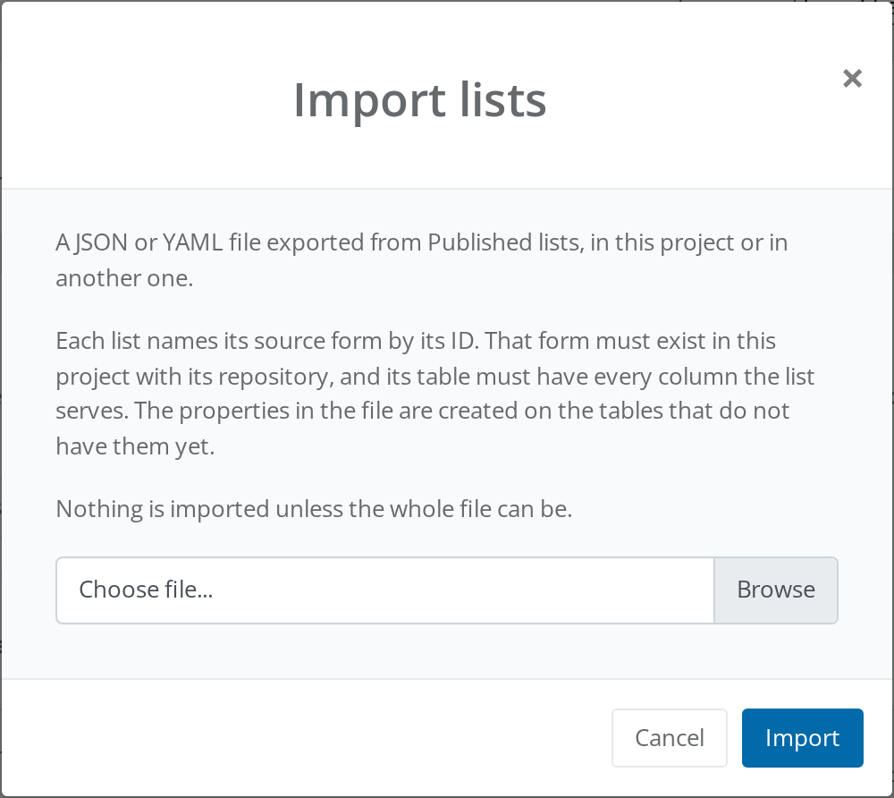

# Exporting and importing lists

A project's lists, with their columns, filters and properties, can be written to a file and read back into another project. A workflow set up once, in a training project or for one country, is then set up again elsewhere without typing each list into the wizard.

## Export

On the [Published lists](published-lists.md) page, each list has an **Export** menu, and **Export all** exports every list of the project. Both offer JSON or YAML.

| Export | File |
| --- | --- |
| **Export** on one list | Named after the list's code, such as `schools.json` or `schools.yaml`. |
| **Export all** | Named after the project's code, such as `<project code>_lists.json`. |

The file describes the lists. It holds no case, no row of data, and nothing of the lists' editions. For each list it carries:

| Entry | What it holds |
| --- | --- |
| code, file name | As on the Published lists page. |
| form ID, table | The source form, by its form ID, and the source table. |
| label column, key | The label, and the column of a value list, if any. |
| rows | Active or inactive. |
| columns | Each served column or property, with its **Served as** name. |
| filter | The list's own [filter](list-filters.md). |
| format, location | For a [GeoJSON list](geojson-lists.md). |
| receivers | The choice of [who receives which cases](who-receives-which-cases.md), written only when it is not every assistant. |
| receiver filters | The filters given to assistants, with their names and conditions, but not whom they are given to. |

For each source table, the file also carries every [property](properties.md) the table has, with its type, default and description, whether a list serves it or not: an action of a follow-up may set a property that no list serves.

A form's actions are not part of the file.

## Import

**Import lists** opens a dialog for the file: a JSON or YAML file exported from Published lists, in this project or in another one.

<figure><figcaption>
The dialog states the rules of an import before you choose the file.
</figcaption></figure>

Each list names its source form by its form ID, so the import looks for the form with that ID in the project you import into, and draws the list from that form's own repository. An import requires that:

* each source form exists in this project, has its repository, and is not being deleted;
* each source table is a table of that form, with the label column, the key and every column the list serves;
* no list code or file name in the file is in use in the project already, or twice in the file;
* each property a list serves exists on the table, or the file defines it;
* each property the file defines belongs to a table that a list draws from, in the file or in the project;
* a property the table already has is given the same type in the file, and the table then keeps it as it is;
* a GeoJSON list's location is a geopoint, geotrace or geoshape of the table;
* no list's label, key or filters read an encrypted column;
* a list that serves each assistant their own cases cannot go into a crowdsourcing project, and a list that serves the cases assigned to them needs a repository that records assignments.

Every filter is checked again against the table it will read in this project.

Importing the same file twice into one project is refused the second time, because its codes and file names are in use.

## All or nothing

The import checks the whole file before it writes anything. If anything is wrong, nothing is imported, and the page lists the reasons, numbered: the first ten, then how many more.

When the file passes, the import creates the properties the tables lack first, then the lists with their columns and filters. If a write fails then, which the check should have made impossible, the import stops there, and the message names what it created before it stopped.

After an import, the page says which lists it imported, which properties it created, and which ones it kept because the tables had them already. Two notes can follow:

* entries of the file it does not know are not imported, and the note names them;
* receiver filters arrive given to nobody. Give them to assistants and groups on each list's **Case accessibility** tab.


**What the file must be.** UTF-8 text in JSON or YAML, at most 1 MB, exported by FormShare as version 1 of its list export. Any other file is refused with the reason.


## What's next

* Check each imported list on its own page in "[Published lists](published-lists.md)".
* Give the imported filters to assistants in "[Who receives which cases](who-receives-which-cases.md)".
