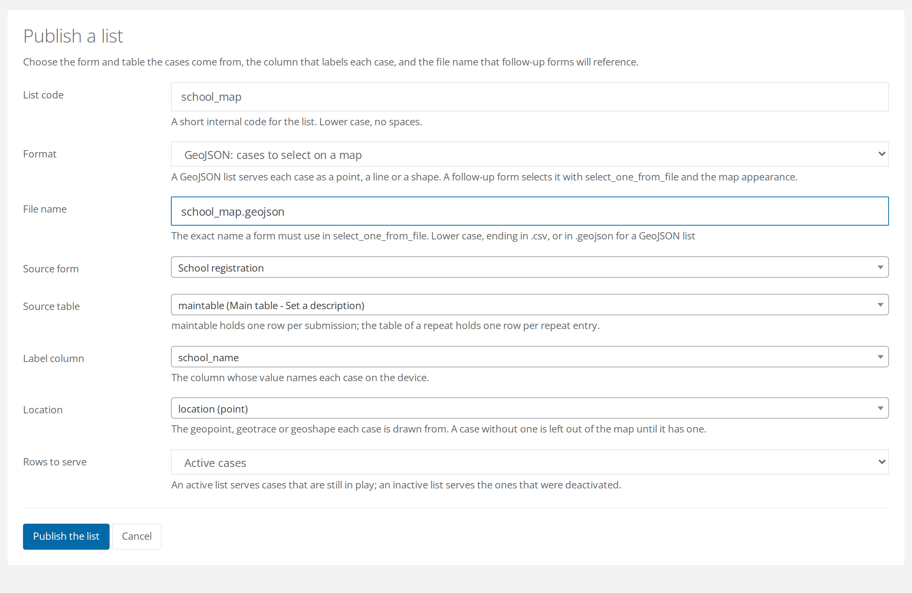
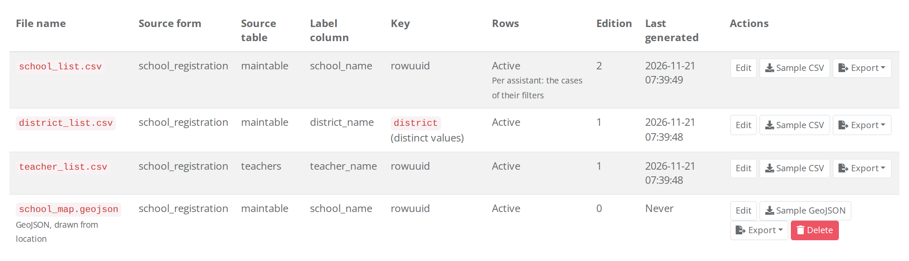

# GeoJSON lists

A **GeoJSON list** serves each case as a feature on a map: a school or a homestead as a point, the route walked as a line, a plot's boundary as a shape. A follow-up form picks its case by tapping it on the map, and stores the case's identity exactly as it would from a CSV list.

## Publish a GeoJSON list

In the **Publish a list** wizard, set **Format** to *GeoJSON: cases to select on a map*. Two fields change:

| Field | For a GeoJSON list |
| --- | --- |
| File name | Ends in `.geojson`, as in `school_map.geojson`. |
| Location | Takes the place of **Key**: the geopoint, geotrace or geoshape question of the source table each case is drawn from. The drop-down names each one with its kind, such as *location (point)*. |

<figure><figcaption><p>A map of the registered schools, drawn from the geopoint each registration recorded.</p></figcaption></figure>

A GeoJSON list is always a list of cases, never a list of values, so it has no key. Everything else works as for a CSV list: served columns and properties, rows to serve, the [filter](list-filters.md), [who receives which cases](who-receives-which-cases.md), and the case link of a follow-up.

On the list's page, the **Definition** tab shows **Location** where a CSV list shows **Key**. **Change the location** draws the list from another question at any time, even while forms with a repository use it.

## What the file holds

| In the file | What it carries |
| --- | --- |
| One feature per case | A point, a line or a polygon, made from the location question. A shape's ring is closed. |
| `id` | The case's identity, its [rowuuid](how-cases-are-identified.md). This is what the follow-up stores. |
| `title` and `label` | The value of the label column, twice. ODK shows the title. |
| Properties | Every served column, as text. A missing value is an empty text. |

`fs_location` is taken: FormShare carries the location under that name while it writes the file, so no served column of a GeoJSON list can use it.

## Cases without a location

A case with no location, or with one that cannot be drawn as the list's kind of geometry, is left out of the file until it has one. The Published lists page says how many the last generation left out, beside the question the list is drawn from, and so does the list's **Definition** tab.

<figure><figcaption><p>The GeoJSON list sits beside the CSV lists. Its note names the question it is drawn from, and would add how many cases the last generation left out for having no location.</p></figcaption></figure>

## In the follow-up form

The follow-up selects from the file and asks for a map in the appearance column:

| type | name | label | appearance |
| --- | --- | --- | --- |
| select\_one\_from\_file school\_map.geojson | school\_id | School | map |

* ODK Collect shows the cases on a map: points since version 2022.2, lines and shapes since version 2023.1. Tapping a case shows its served columns, and the enumerator confirms it.
* Enketo has no map for a select, and offers the same cases as a list.
* ODK takes the `map` appearance on a single select only.

Attach the list's **Sample GeoJSON** as the placeholder when you upload the form. Devices receive the generated list in its place.

A column the list serves, such as `district`, is read for the chosen case as in a CSV list, with `id` in place of `name`:

```
instance('school_map')/root/item[id=current()/../school_id]/district
```

A GeoJSON list of cases can be the [case link](case-links.md) of a follow-up, and **Links to lists** shows it like any other list of cases.


**For server administrators.** Building the repository of a follow-up that selects from a GeoJSON list needs RSTools from 7 October 2026 or later. With an older one, the build stops with a message that the RSTools installed on the server cannot build such a form yet.


## What's next

* See the settings every list shares in "[Published lists](published-lists.md)".
* Choose which cases each assistant sees on the map in "[Who receives which cases](who-receives-which-cases.md)".
