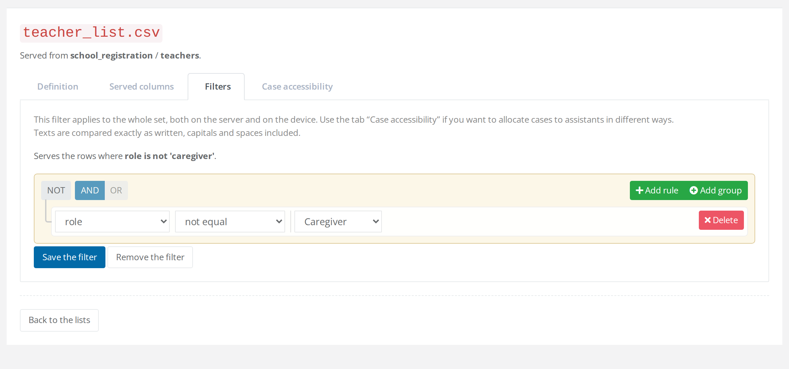

# List filters

A list serves every active case of its table, or every inactive one. Its **filter** narrows that down to the cases you mean: the teachers who are not caregivers, the schools of one district, the patients whose `risk_level` property is high. The filter is the same for every assistant and every device.

To give different assistants different cases, use the list's **Case accessibility** tab instead: see "[Who receives which cases](who-receives-which-cases.md)". The two work together: an assistant receives the cases that tab gives them, among those the list's filter lets through.

## The Filters tab

Open the list's page with **Edit** on the [Published lists](published-lists.md) page, and click **Filters**.

<figure><figcaption>
The teacher list leaves caregivers out. The drop-down shows the choice's label, Caregiver, and the filter compares its code, <code>caregiver</code>.
</figcaption></figure>

The tab says in words what the list serves: *Serves the rows where role is not 'caregiver'*, or *No filter: every row is served*.

Below it, the filter is built from conditions, each a field, an operator and a value, added with **Add rule**. Conditions are joined by AND or OR. **Add group** adds a group of conditions with its own AND or OR, and **NOT** turns a group around. **Save the filter** keeps the filter, and **Remove the filter** serves every row again.

FormShare runs the filter on the list's table before it keeps it, so a filter the database cannot run is refused at once, with the reason, rather than at the next download.

## What a filter can read

The fields come in two groups: **Columns**, the columns of the list's table, and **Properties**, the table's [properties](properties.md). Columns whose names start with an underscore are left out, and so are a few the server keeps for its own bookkeeping. `_active` is among them: whether a list serves active or inactive cases is its **Rows to serve** setting.

A select question offers its choices in a drop-down, and the filter compares the code of the choice.

| Type of the field | Operators |
| --- | --- |
| Text | equal, not equal, in, not in, begins with, doesn't begin with, ends with, doesn't end with, is empty, is not empty, is null, is not null |
| Number | equal, not equal, less, less or equal, greater, greater or equal, between, not between, in, not in, is null, is not null |
| Date, date and time | equal, not equal, less, less or equal, greater, greater or equal, between, not between, is null, is not null |
| Geopoint, geotrace, geoshape | is empty, is not empty, is null, is not null |

For *in* and *not in*, separate the values with commas. Type a date as `YYYY-MM-DD`, and a date and time as `YYYY-MM-DD HH:MM:SS`.

## Texts are compared exactly as written

A filter compares a text by its exact characters, capitals and spaces included. *Kampala* and *kampala* are different values, and so are *Kampala* and *Kampala* followed by a space. For a select question, the drop-down fills in the code for you.

Two databases run the filter: MySQL on the server, when FormShare generates the list, and SQLite in FormShare Collect, for the cases a device has registered and not sent yet. On its own, the server's database would treat *Kampala* and *kampala* as equal and the phone's would not, so FormShare writes every text comparison in a way both answer alike. That is also why a text has no *contains*, and no *less* or *greater*: the server and the phone could not be made to agree on them.

*is empty* means a text with nothing in it. A value made of spaces is not empty.

## A missing value matches nothing

A comparison with a missing value is false, whatever the operator, except *is null* and *is not null*. A filter *status not equal left* does not serve a case that has no status at all. To serve those as well, put *status is null* beside it, joined with OR.

## What a filter does not do

A filter decides what a list offers. It does not limit what a follow-up may choose: a case the filter drops after a device's last download stays selectable on that device until its next update, and a follow-up on it is stored. A case that is inactive, or that does not exist, is refused instead: see "[Rules and safeguards](rules-and-safeguards.md)".

## Where a filter applies

* On the server, every time the list is generated, for every device. It works the same way on a CSV list, a [GeoJSON list](geojson-lists.md), and a value list, whose values then come only from the rows the filter lets through.
* In FormShare Collect, on the cases the device has registered and not sent yet. A teacher registered offline as a caregiver does not appear in a list that leaves caregivers out.
* In **Sample CSV** and **Sample GeoJSON**.
* Under every choice of [who receives which cases](who-receives-which-cases.md).

Every change to the filter marks the served copies stale, and devices get the new rows at their next update check.

## What a filter protects

A property that a list's filter reads cannot be deleted: the Properties page names the list and asks you to change its filter first. A filter cannot read an encrypted column.

## What's next

* Follow "[Walkthrough: filter lists and share cases out](walkthrough-sharing-cases.md)" for a filter set up step by step.
* Give different assistants different cases in "[Who receives which cases](who-receives-which-cases.md)".
* See the other settings of a list in "[Published lists](published-lists.md)".
