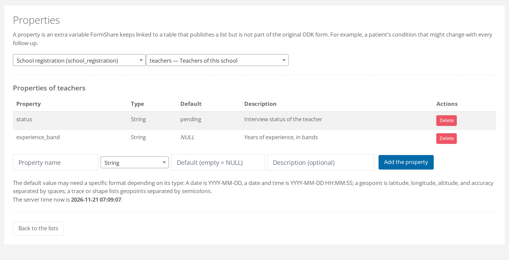

# Properties

A **property** is a typed column FormShare keeps beside a table that publishes a [list](published-lists.md), with one value per case. It lives in a side table (`<table>_properties`), it is born with a default, and it travels in the lists like any other column. Adding one does not touch the ODK form, so the case-creating form never has to be rewritten to carry a piece of state it was not designed for.

A school's `visit_round`, a teacher's `status`, a patient's `risk_level`: these belong to the case rather than to the submission that registered it, and the follow-ups change them through [actions](case-actions.md).

## Add a property

On the **Published lists** page, click **Properties**. Two drop-downs pick a form and then one of its tables. Only the tables that publish a list are offered, because a property exists to be served in a list and changed by follow-ups. The table drop-down names each one with the label it carries in the ODK form, so a repeat is easy to recognise.

<figure><figcaption>
The teachers have two properties: <code>status</code>, which an interview sets to <code>interviewed</code>, and <code>experience_band</code>, which an action in code fills. The line at the bottom gives the server's current time, for reference when you write a DateTime default.
</figcaption></figure>

Fill the row below the table: a **name**, a **type**, a **default** and an optional **description**, then click **Add the property**.

The name is lower case, starts with a letter, and holds letters, digits and underscores. It cannot be the name of a column the table already has, nor `name`, `label` or `rowuuid`.

| Type | Stored as | Default format |
| --- | --- | --- |
| String | text, up to 255 characters | any text |
| Integer | whole number | `0`, `12` |
| Decimal | number with up to 7 digits before the point and 3 after | `0`, `12.5` |
| Date | date | `YYYY-MM-DD` |
| DateTime | date and time | `YYYY-MM-DD HH:MM:SS` |
| GeoPoint | point | `latitude longitude altitude accuracy`, separated by spaces |
| GeoTrace | line | at least two geopoints, separated by semicolons |
| GeoShape | polygon | at least four geopoints, separated by semicolons, the last repeating the first |

An empty default means NULL. FormShare checks the default against the type, so `AAA` is refused for an integer and `0` for a date.

## What happens when you add one

The column is created at once. Every existing case gets the default, every future case is born with it, and the change is audited like the rest of the schema.

To serve the property to devices, open the list's page and add it on the **Served columns** tab, from the **Properties** group of the column drop-down. It then behaves like any other served column: you can give it a **Served as** name, filter on it with a `choice_filter`, read it with an `instance()` expression, and use it in the list's own [filter](list-filters.md).

## How a property changes

A property changes only through [actions](case-actions.md): a rule or code on a form that follows the case up, or on the registration form itself, which acts on its own rows. Nobody edits a property by hand. Properties do not appear in the data editor, and FormShare's built-in data products leave them out. To change a case, submit the form whose action changes it.

Each change is recorded in the repository's audit log under the assistant who sent the submission. When that submission is deleted, or moved to the error log, the change is taken back, unless the property has changed again since.

## Delete a property

A property cannot be deleted while something uses it, and FormShare names what does:

* a list serves it;
* a list's filter reads it;
* a filter given to assistants, on the list's **Case accessibility** tab, reads it;
* an [action](case-actions.md) reads or writes it: a rule that sets it, tests it or takes its value, or code that names it.

Remove it from the list's served columns, change the filter, or change or remove the action, then click **Delete** beside the property. There is no confirmation, and the column goes with every value in it.

## What's next

* Serve the property in a list: "[Published lists](published-lists.md)".
* Change it when a follow-up arrives: "[Form actions](case-actions.md)".
* See where properties sit in the picture: "[Workflow diagram](workflow-diagram.md)".
