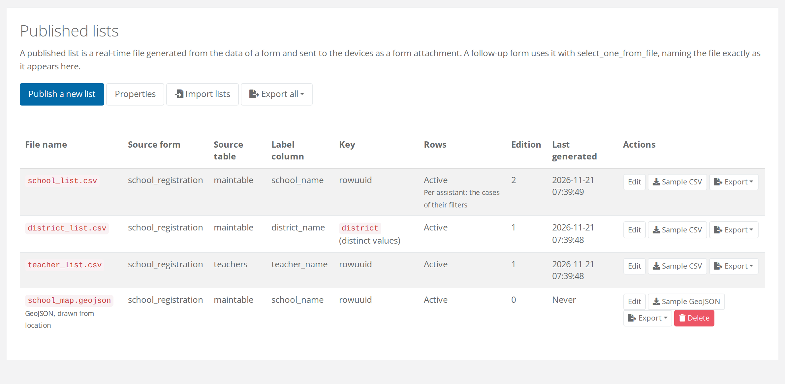
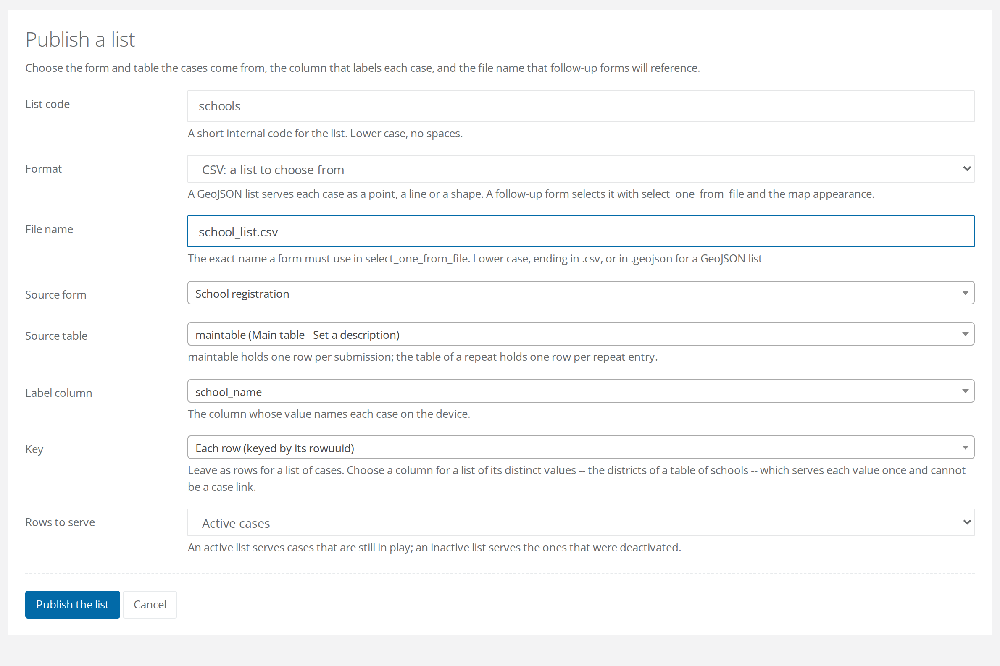
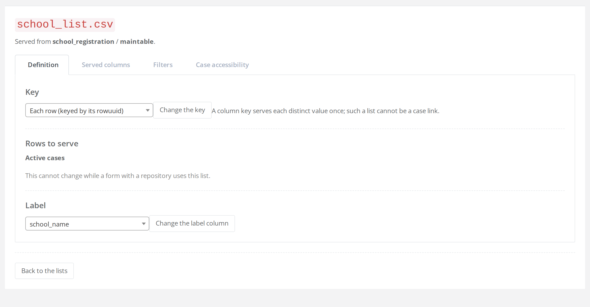
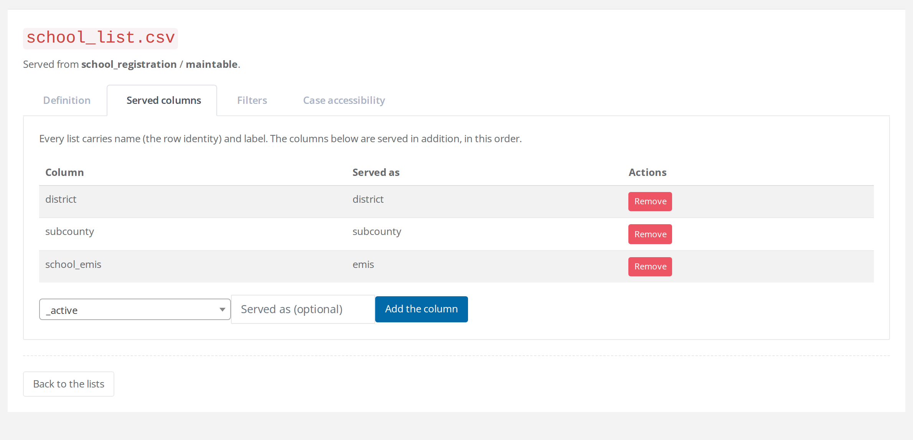

# Published lists

A **published list** is a file FormShare generates from a table of a form's [repository](../../fundamentals/repositories/README.md) and serves to devices as an attachment of any form whose XLSForm names the file. It refreshes as data arrives, so the choices an enumerator sees in the field come from the data the team has collected.

Most lists are CSV files, which a form offers as a list of choices. A list can also be a GeoJSON file, whose cases a form shows on a map: see "[GeoJSON lists](geojson-lists.md)".

## The Published lists page

Open a project and click **Published lists** in the right column, under the forms. The button appears once the project has a form with a repository.

The page lists every published list of the project:

| Column | Meaning |
| --- | --- |
| File name | The exact file name a form must use in `select_one_from_file`. A GeoJSON list adds the question it is drawn from, and how many cases the last generation left out for having no location. |
| Source form, Source table | Where the rows come from. |
| Label column | The column shown to the enumerator as the option's text. |
| Key | `rowuuid` for a list of cases, one row per case; a column name marked *(distinct values)* for a [value list](#value-lists-and-cascades). |
| Rows | *Active* or *Inactive*: which cases the list serves. A list that serves each assistant their own cases says which ones, such as *Per assistant: the cases of their filters*. |
| Edition | How many times the list has been regenerated. |
| Last generated | When it was last generated, or *Never* if no device has asked for it yet. |

Each list has its own actions:

| Action | What it does |
| --- | --- |
| Edit | Opens the [list's page](#the-lists-page). |
| Sample CSV, or Sample GeoJSON | Downloads ten rows of the list, generated now, to design your forms against. |
| Export | Downloads the list's definition as JSON or YAML: see "[Exporting and importing lists](exporting-and-importing-lists.md)". |
| Delete | Offered only while no form with a repository uses the list. It asks first, since forms that reference the file stop receiving fresh data. |

Above the table sit **Publish a new list**, **[Properties](properties.md)** once the project has at least one list, **Import lists**, and **Export all** once there is a list to export.

<figure><figcaption>
Four lists of one form. <code>school_list.csv</code> serves each assistant the cases of their filters, <code>district_list.csv</code> is a value list keyed by <code>district</code>, and <code>school_map.geojson</code> is drawn from the <code>location</code> question. <strong>Delete</strong> is offered only on the GeoJSON list, which no form with a repository uses yet.
</figcaption></figure>

## Publish a list

**Publish a new list** opens a short wizard:

| Field | What to enter |
| --- | --- |
| List code | A short internal code: lower case, no spaces. `schools`, `teachers`. |
| Format | *CSV: a list to choose from*, or *GeoJSON: cases to select on a map*. |
| File name | Lower case letters, digits and underscores, starting with a letter and ending in `.csv`, or in `.geojson` for a GeoJSON list: `school_list.csv`. |
| Source form | A form of this project that has a repository. |
| Source table | `maintable` for one row per submission, or the table of a repeat for one row per repeat entry. |
| Label column | The column whose value names each case on the device. |
| Location | GeoJSON only: the geopoint, geotrace or geoshape each case is drawn from. |
| Key | Leave *Each row (keyed by its rowuuid)* for a list of cases. Choose a column for a list of its distinct values. A GeoJSON list has no key. |
| Rows to serve | *Active cases*, the default, or *Inactive cases*. |

<figure><figcaption>
Every field carries its own hint. The source table drop-down names each table with its description, which is how you tell <code>maintable</code>, one row per submission, from the table of a repeat.
</figcaption></figure>


**The file name is the contract.** A form references a list by naming its file in `select_one_from_file`, so the name is the whole coupling between the list and your forms. Choose it once, before anyone writes a form against it, and do not rename it afterwards.


**Publish the list** creates it and opens its page on the **Served columns** tab, where you choose the columns it carries.

## The list's page

**Edit** opens the list's page, titled with its file name and its source. It has four tabs, and a change brings you back to the tab you made it in:

| Tab | What it holds |
| --- | --- |
| Definition | The key, or the location of a GeoJSON list, the rows to serve, and the label. |
| Served columns | The columns the list carries besides `name` and `label`. |
| Filters | The list's own filter. See "[List filters](list-filters.md)". |
| Case accessibility | Who receives which cases. See "[Who receives which cases](who-receives-which-cases.md)". |

Every change on this page marks the served copies stale. Devices get the new shape at their next update check, without waiting for new data to arrive.

### Definition

<figure><figcaption>
A form with a repository uses this list, so its rows to serve are shown without a button. The label can still change.
</figcaption></figure>

**Key**, **Rows to serve** and **Label** each have their own button, so a change to one is applied on its own. Once a form with a repository uses the list, the key and the rows to serve cannot change, because that form's database was shaped by them. The label can change at any time.

A GeoJSON list shows **Location** in place of the key. **Change the location** draws the list from another question at any time.

### Served columns

<figure><figcaption>
Three served columns, the last renamed. A form reads it as <code>emis</code>.
</figcaption></figure>

Every list carries two columns: `name`, the identity of the row, and `label`, the value of the label column. This tab adds the rest, served in the order shown.

* Pick a column of the source table, or a [property](properties.md) of it from the **Properties** group of the drop-down, and click **Add the column**. A property carries a *property* tag once it is served.
* The **Served as** name is optional. It is the name your form's `choice_filter` and `instance()` expressions will see. `name` and `label` are taken, and so is `fs_location` in a GeoJSON list. No two served columns may share a name.
* The **Remove** button beside a column takes it out again.

## Value lists and cascades

A list keyed by a column serves each distinct value of that column once, as `name`, with the label column as `label`. This is how you build a cascade from a single table: the districts of the schools, then the schools of a district.

* Choose the column under **Key** when publishing, or on the list's page later.
* The label column may be a different column, such as `district_name` beside `district`. Each distinct combination is served once, so keep the two in step: a code with two spellings of its label appears twice.
* The values come from the rows the list serves: the active rows, or the inactive ones, that its filter lets through.
* A value list has no row identity. It can never be the [case link](case-links.md), its selector gets no foreign key, and the value itself is what gets stored.
* A form that reads only a value list is not a follow-up of anything.
* A GeoJSON list cannot be a value list.

Cascades across tables work through identities instead: serve a repeat table's `parent_rowuuid` beside the parent list's `name`, as `teacher_list.csv` does with `school_id` in the [walkthrough](walkthrough.md).

## How lists reach the devices

* A list is an attachment. Devices download it through the form's manifest like any media file. ODK Collect, Enketo and FormShare Collect need nothing new.
* Lists are generated on demand. *Last generated: Never* means no device has asked yet. The first request for a form that attaches the list generates it. Each later request regenerates it if the source form received a submission since, or had its data changed by a person or by an [action](case-actions.md), or if the list's definition changed. A device that checks for updates gets the current rows; a device that does not keeps the rows it has.
* Every regeneration advances the edition and changes the file's hash, which is what makes the device report the form as updated.
* A list that serves each assistant their own cases is generated for each of them: every assistant downloads a file of their own, under the same name. See "[Who receives which cases](who-receives-which-cases.md)".
* Sample CSV and Sample GeoJSON run the list now, limited to ten rows, without touching the copies served to devices. They apply the list's filter, but not the choice of who receives which cases. Use the sample to design your forms, and as the placeholder to attach at upload.
* In a CSV list, `name` and `label` always come first, then the served columns in the order of the Served columns tab. Every field is quoted.
* A list can be empty. Before the first registration a CSV list holds only the header line. The form still opens, and the select shows nothing.


**For server administrators.** FormShare writes every list it serves with RSTools' `caselistgen`, so the server needs it installed.


## What's next

* Narrow the cases a list serves in "[List filters](list-filters.md)".
* Tell FormShare which list a form follows up in "[Links and the case link](case-links.md)".
* Add columns without touching the ODK form with "[Properties](properties.md)".
* See what FormShare refuses to change once a list is in use in "[Rules and safeguards](rules-and-safeguards.md)".
