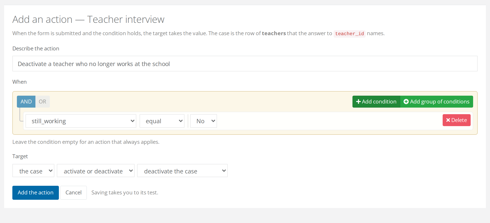
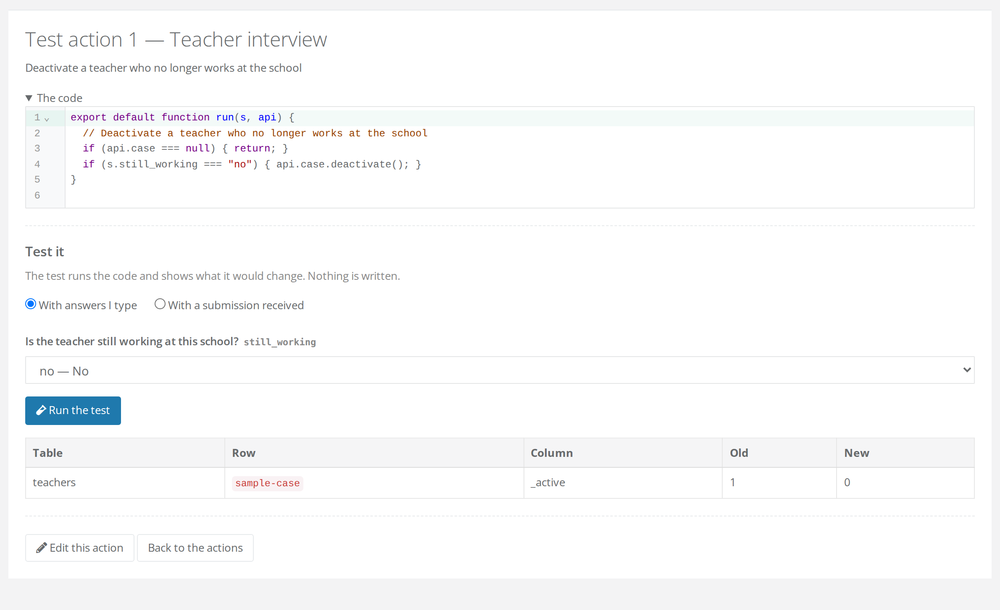
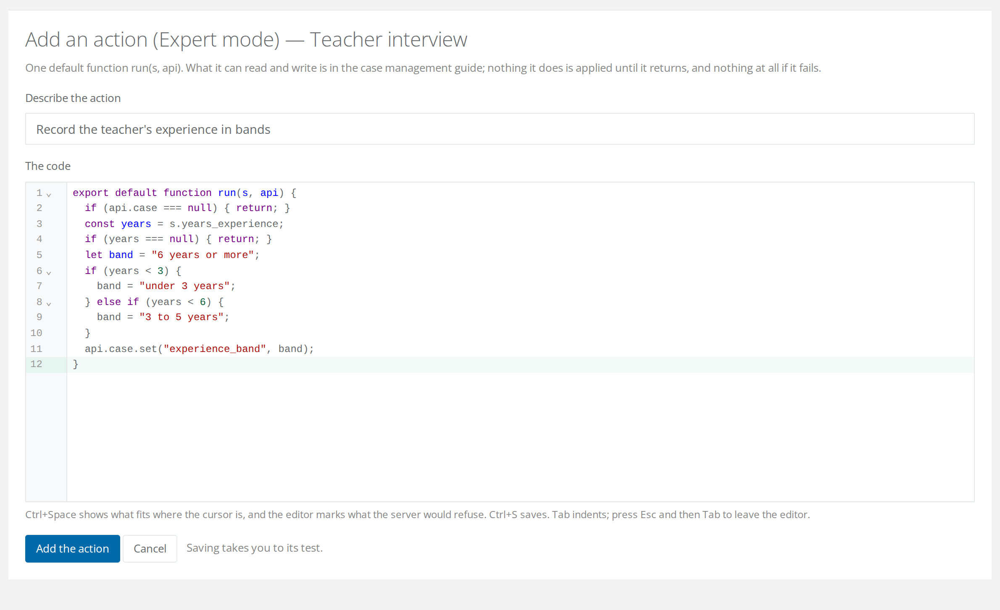
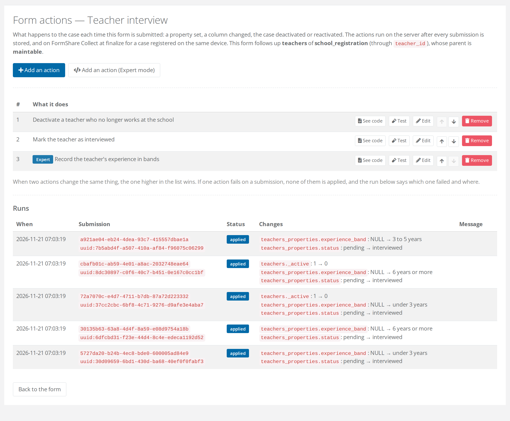

# Walkthrough: update cases with actions

This walkthrough continues "[Walkthrough: schools and teachers](walkthrough.md)". There, the interview reads the teachers but never changes them. Here you give the interview three [actions](case-actions.md), so that each interview it brings in updates the teacher it is about:

| # | The action | What it changes |
| --- | --- | --- |
| 1 | Deactivate a teacher who no longer works at the school | the teacher's case is deactivated when `still_working` is *No* |
| 2 | Mark the teacher as interviewed | the property `status` becomes `interviewed` |
| 3 | Record the teacher's experience in bands | the property `experience_band`, worked out in code from `years_experience` |

You need what the first walkthrough built: the registration with its repository, `teacher_list.csv`, the property `status`, and the interview with its case link to `teacher_list.csv`.



## Add the property the code action writes

Action 3 writes a property the first walkthrough did not create. On **Published lists**, click **Properties**, choose *School registration* and the table `teachers`, and add:

| Property name | Type | Default | Description |
| --- | --- | --- | --- |
| `experience_band` | String | *(leave empty)* | Years of experience, in bands |

Leaving the default empty makes it NULL until an interview sets it.



## Open the interview's actions

Open the form page of *Teacher interview* and click **Form actions**. The page says which list the form follows up and through which question: here, the teachers of *School registration*, through `teacher_id`. That row of `teachers` is "the case" every action talks about.

The page has two buttons. **Add an action** builds an action from choices. **Add an action (Expert mode)** takes code, for what the choices cannot say.



## Add a rule: deactivate a teacher who has left

Click **Add an action** and fill the page in:

1. **Describe the action**: `Deactivate a teacher who no longer works at the school`. The description is required. It is what the list of actions, the test page and the runs show.
2. **When**: click **Add condition** and choose `still_working`, `equal`, `No`.
3. **Target**: `the case`, `activate or deactivate`, `deactivate the case`.

<figure><figcaption><p>A target of <code>set property</code> or <code>set column</code> adds a <strong>Value</strong> row: a constant, the answer to a question, now, or a computed value.</p></figcaption></figure>

Click **Add the action**. Saving takes you to the action's test page.



## Test it without sending anything

The test page shows the code FormShare made from your choices, and asks only for the answers that code reads: here, `still_working`. Choose *no* and click **Run the test**.

<figure><figcaption><p>Nothing is written. The table shows what the action would change.</p></figcaption></figure>

The row is `sample-case`, a stand-in for the teacher an interview would name, because you typed answers instead of choosing a submission. Its `_active` would go from 1 to 0: the teacher would leave `teacher_list.csv` at the devices' next update. Choose *yes* and run it again, and nothing changes.

Once the form has submissions, **With a submission received** runs the action on one of them instead.



## Add a rule: mark the teacher as interviewed

Click **Back to the actions**, then **Add an action** again:

1. **Describe the action**: `Mark the teacher as interviewed`.
2. **When**: leave it empty. An action with no condition always applies.
3. **Target**: `the case`, `set property`, `status (string)`.
4. **Value**: `a constant`, `interviewed`.

Click **Add the action**, and test it if you like.



## Add an action in code: experience bands

Back on the list of actions, click **Add an action (Expert mode)**. Describe it as `Record the teacher's experience in bands`, and replace the code with:

```javascript
export default function run(s, api) {
  if (api.case === null) { return; }
  const years = s.years_experience;
  if (years === null) { return; }
  let band = "6 years or more";
  if (years < 3) {
    band = "under 3 years";
  } else if (years < 6) {
    band = "3 to 5 years";
  }
  api.case.set("experience_band", band);
}
```

`s` holds the submission's answers by name, and `api.case` is the teacher the interview names. `api.case.set` writes a property or a column of the case.

<figure><figcaption><p>Ctrl+Space offers the questions, properties and functions that fit where the cursor is. The editor underlines what the server would refuse, such as a property that does not exist, before you save.</p></figcaption></figure>

Click **Add the action**. The test page asks for `years_experience`, the one answer the code reads.



## Check the order

The list now holds the three actions, numbered. Code actions carry the label **Expert**.

<figure><figcaption><p>See code shows an action as code, a rule included. The arrows move an action up or down.</p></figcaption></figure>

Two things decide how actions combine:

* When two actions change the same thing, the one higher in the list wins.
* All or nothing: if one action fails on a submission, none of them is applied, and the run says which action failed and on which line.

None of these three change the same thing, so their order does not matter here.



## Send interviews and read the runs

Send a few interviews from a device, one of them answering *No* to "Is the teacher still working at this school?".

Each submission that arrives gets a row under **Runs**, with what it changed. In the example above, every run set `status` from `pending` to `interviewed` and wrote an `experience_band`, and two runs also turned `_active` from 1 to 0: those teachers had left.

A run that failed shows **failed**, the reason, and a **Retry** button. Fix what made it fail, such as a property that was missing, and retry it.

On **Published lists**, the teachers who left are gone from `teacher_list.csv` at the devices' next update, and every other teacher is served with `status` set to `interviewed`.



## What happens on the device

FormShare Collect runs the same actions when an enumerator finalizes an interview about a case registered on that device, so the device's copy of the case changes before anything is sent. See "[Offline in FormShare Collect](offline-in-formshare-collect.md)".

Other clients, such as ODK Collect and Enketo, do not run actions. Their interviews are acted on by the server, when they arrive.

## Taking it back

Deleting an interview, or moving it to the logs, takes back what its actions wrote: a value is put back where the case still holds what the run stored, and the run shows **taken back**. A value that someone or something changed since stays as it is.

## What's next

* Read "[Form actions](case-actions.md)" for everything a rule can do, what code can read and write, and what no action may change.
* Follow "[Filter lists and share cases out](walkthrough-sharing-cases.md)" to give each field officer the schools of their district.
