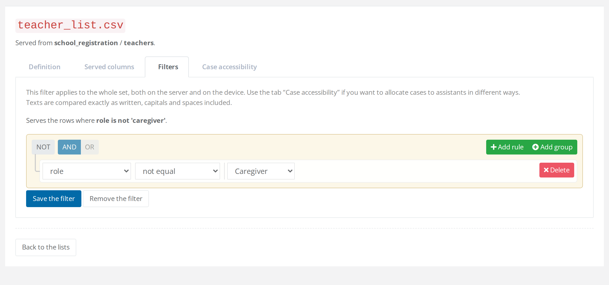
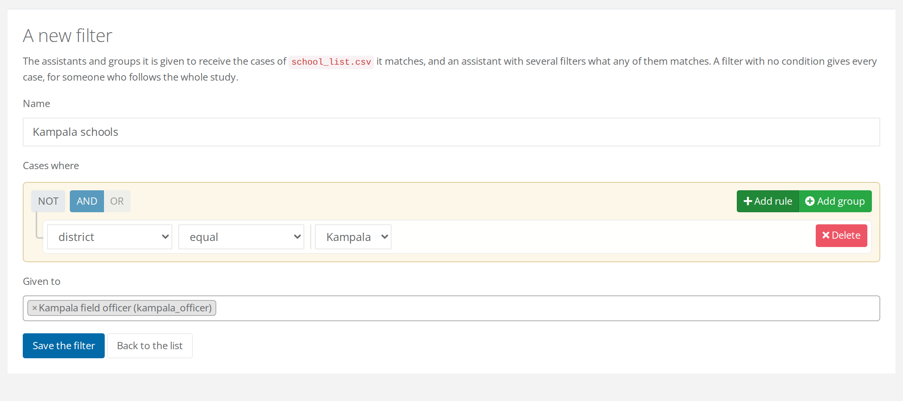
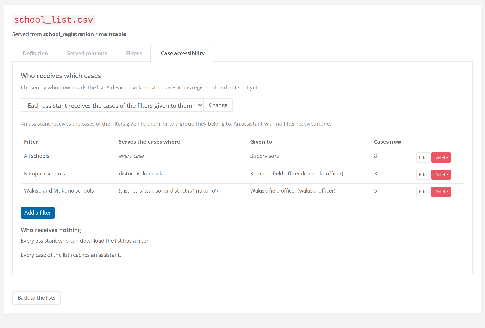

# Walkthrough: filter lists and share cases out

This walkthrough continues "[Walkthrough: schools and teachers](walkthrough.md)". There, every device receives every school and every teacher. Here you change two things:

* `teacher_list.csv` stops serving caregivers, for everyone. That is the list's own filter.
* `school_list.csv` serves each field officer the schools of their district, and the supervisors every school. That is the list's case accessibility.

The example project has three assistants: the *Kampala field officer*, the *Wakiso field officer*, who also covers Mukono, and the *Field supervisor*, a member of the assistant group *Supervisors*. Use your own.


Sharing cases out needs a project whose assistants sign in. In a crowdsourcing project every device receives every case, and FormShare does not offer the choice.




## Leave the caregivers out of the teacher list

On **Published lists**, click **Edit** on `teacher_list.csv` and open the **Filters** tab. Click **Add rule** and choose `role`, `not equal`, `Caregiver`. Click **Save the filter**.

<figure><figcaption>
The line above the rules says, in words, which rows the list serves.
</figcaption></figure>

This filter applies to the whole list, on the server and on the devices, which run the same filter over their copy. Texts are compared exactly as written: `Caregiver` and `caregiver` are different values, and so are values with and without a trailing space.

See "[List filters](list-filters.md)" for what a filter can test.



## Choose who receives which schools

Click **Back to the lists**, click **Edit** on `school_list.csv`, and open the **Case accessibility** tab. Under **Who receives which cases**, choose **Each assistant receives the cases of the filters given to them** and click **Change**.

The four choices:

| Choice | Each assistant receives |
| --- | --- |
| Every assistant receives every case | the whole list, as before |
| Each assistant receives the cases they registered | the schools they registered themselves |
| Each assistant receives the cases assigned to them | the schools assigned to them. A case is assigned to whoever registered it. |
| Each assistant receives the cases of the filters given to them | what any filter given to them, or to a group they belong to, matches. Nothing without a filter. |

Whatever you choose, a device also keeps the cases it registered and has not sent yet.



## Give the Kampala officer the Kampala schools

Click **Add a filter**:

1. **Name**: `Kampala schools`.
2. **Cases where**: click **Add rule** and choose `district`, `equal`, `Kampala`.
3. **Given to**: choose the *Kampala field officer*.

<figure><figcaption>
A filter can be given to several assistants and groups at once.
</figcaption></figure>

Click **Save the filter**.



## Give the Wakiso officer two districts

Click **Add a filter** again and name it `Wakiso and Mukono schools`. Add two rules, `district` `equal` `Wakiso` and `district` `equal` `Mukono`, and click **OR** at the top of the group, so that a school in either district matches. Give it to the *Wakiso field officer* and save.



## Give the supervisors every school

Add a third filter, `All schools`, with no rule at all, and give it to the group *Supervisors*. A filter with no condition matches every case: it is for someone who follows the whole study. Because it is given to the group, whoever joins *Supervisors* later receives every school too, and whoever leaves it stops receiving them.



## Check who receives what

The **Case accessibility** tab now lists the three filters, the condition of each in words, whom it is given to, and how many schools it matches now.

<figure><figcaption>
<strong>Who receives nothing</strong> names any assistant who can download the list but has no filter, and says whether some case reaches no assistant at all.
</figcaption></figure>

Read **Who receives nothing** after every change. An assistant with no filter gets an empty list, and a school that no filter matches reaches no device.



## Let the devices update

Nothing else changes for the enumerators. The next time each device updates its forms, FormShare serves it the schools its assistant receives: three for the Kampala officer, five for the Wakiso officer, eight for the supervisor. The interview's school question offers only those. The district question still offers every district, because `district_list.csv` is served to everyone.

A school registered later reaches whoever's filter matches it at their next update.



## What's next

* Read "[Who receives which cases](who-receives-which-cases.md)" for the details of each choice, assignments, and what a device keeps.
* Read "[Exporting and importing lists](exporting-and-importing-lists.md)" to copy these lists, their filters included, to another project.
