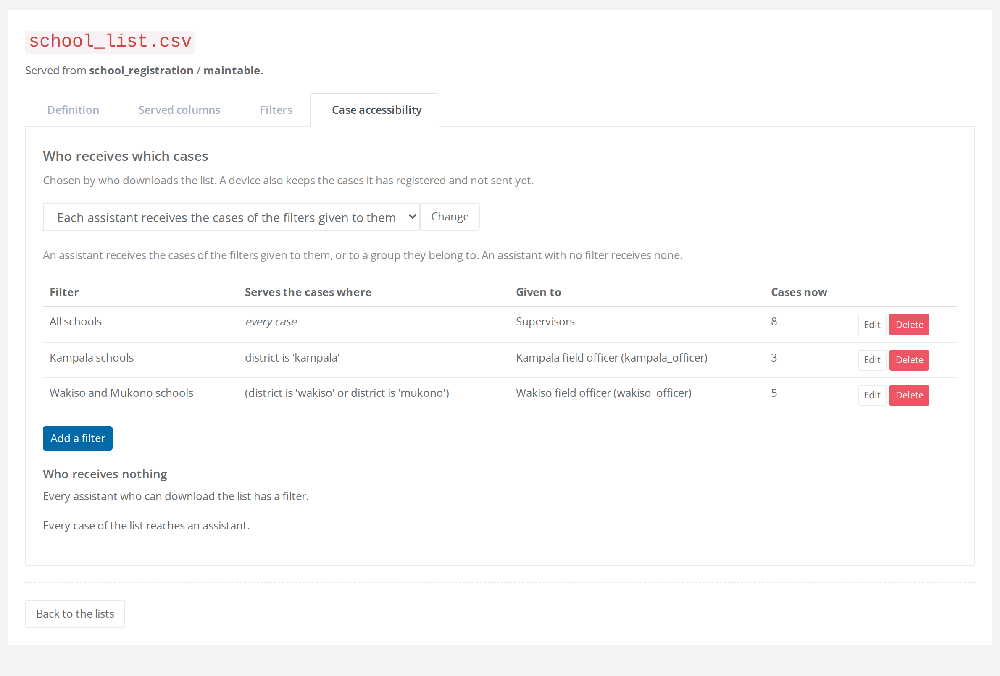
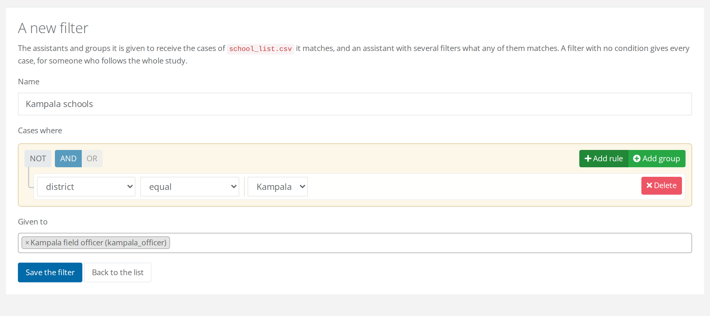

# Who receives which cases

By default, every assistant receives every case of a list. On the list's **Case accessibility** tab you can choose instead that each assistant receives only their own cases. An enumerator then scrolls through the schools they follow rather than the whole district, and a lost phone holds one zone's cases rather than the whole study's.

<figure><figcaption>
The school list split by district. The supervisors' filter has no condition, so it gives every school; each field officer receives the schools of their own district.
</figcaption></figure>

## The four choices

Under **Who receives which cases**, pick one and click **Change**.

| Choice | Each assistant receives |
| --- | --- |
| Every assistant receives every case | Every case of the list. This is the default. |
| Each assistant receives the cases they registered | The cases of the submissions they sent. |
| Each assistant receives the cases assigned to them | The cases assigned to them. A case is assigned to whoever registers it, until it is given to someone else. |
| Each assistant receives the cases of the filters given to them | The cases that any filter given to them, or to a group they belong to, matches. An assistant with no filter receives none. |

For a list drawn from a repeat, an assistant receives the rows of the submissions that qualify: the teachers of the schools they registered, for example.

The list's own [filter](list-filters.md) still applies to everyone: an assistant receives the cases their choice gives them, among those the filter lets through. On the Published lists page, the **Rows** column says when a list serves each assistant their own cases.

## How FormShare knows who is asking

By the assistant whose user name and password the device downloads the list with. Nothing in the form or on the device changes, and an assistant cannot ask for someone else's cases.

Each assistant gets a file of their own under the same file name. It is generated when they first ask for it, and again at a later update check when the list's source has changed. Their form reports an update only when their own cases change: another assistant's new case does not mark it as updated.

An assistant with no case receives the list's header line alone, or a GeoJSON list with no features. The follow-up form still opens, with nothing to select.

**Sample CSV** and **Sample GeoJSON** show the whole list, whatever the choice.

## The cases assigned to them

Every case is assigned to the assistant who registers it, so at first this choice serves the same cases as *the cases they registered*. The difference is that an assignment can change. Only the [Case Explorer](../../additional-functionality/case-explorer/reassigning-cases.md), a separate plugin, gives a case to another assistant. The new assistant gets the case at their next update check, and the first one no longer does.

Nothing else changes an assignment. The data editor shows it, in the `_assigned_to` column, without letting anyone edit it, and [actions](case-actions.md) cannot write it. A case in a repeat is assigned with the submission that registered it.


**A repository built before FormShare recorded assignments** cannot take this choice. The tab answers that the repository of the form was built before cases could be assigned, and asks you to merge a new version of the form into it. The merge adds the record, even for a new version that changes nothing else. When you then choose the mode, the cases already in the repository are assigned to whoever registered them, and so are the ones devices still send with the old version.


## Filters given to assistants and groups

With the last choice, the tab lists the list's filters, each with its conditions in words, whom it is given to, and how many cases it matches now. **Add a filter** adds one, and **Edit** and **Delete** change or remove one.

<figure><figcaption>
A filter for one district, given to one assistant. Giving it to a group instead gives it to every member of the group.
</figcaption></figure>

| Field | What it holds |
| --- | --- |
| Name | A name people recognise, such as *Kampala schools*. Two filters of one list cannot share a name. |
| Cases where | Conditions over the list's columns and properties, built and compared as the list's own [filter](list-filters.md) is: texts exactly as written, and a missing value matching nothing. A filter with no condition gives every case, for someone who follows the whole study. |
| Given to | Groups of the project, and assistants. |

An assistant receives what any of their filters matches, those given to them and those given to a group they belong to. An assistant with no filter receives no case at all, so that nobody receives a zone that is not theirs by mistake.

Saving or deleting a filter takes effect at each assistant's next update check.

## Who receives nothing

Below the choice, under **Who receives nothing**, the tab says what the choice leaves out:

* *No active assistant can download a form that carries this list yet*, when that is so;
* with filters, the assistants who can download the list and have no filter, so they receive no case, or *Every assistant who can download the list has a filter*;
* the cases no assistant receives, with the first ones by label and identity, and why: no filter matches them, whoever registered them cannot download the list, or they are assigned to nobody or to someone who cannot. When there are none, *Every case of the list reaches an assistant*.

An assistant can download a list when they are active and one of the project's forms that attaches the list's file is given to them, directly or through a group. The fix is usually one filter's conditions, or giving a form to an assistant.

## What a device keeps

FormShare Collect keeps the cases it has registered and not sent yet, whatever the choice: the enumerator always sees what they just registered. Once the submission is sent, the case comes back only if the assistant's own file serves it. With filters, a case outside the assistant's filters leaves their list at the refresh after the send, which is how the choice is meant to work.

A case that leaves an assistant's file, given to someone else or no longer matched by their filters, stays selectable on their device until its next update. The server still takes a follow-up on it. The choice decides who receives a case; it does not limit who may submit a follow-up about it.

## Crowdsourcing projects

A crowdsourcing project has no assistants to tell apart, because its devices name none. Its lists serve every case to every device, and the tab says so instead of offering the choice.

While one of a project's lists serves each assistant their own cases, the project cannot become crowdsourcing. On the project's edit page, **Requires authentication to accept data** stays checked, with the names of the lists to set back to every case first.

If a project became crowdsourcing outside FormShare's pages while a list served each assistant their own cases, that list serves no case to any device. Its tab says so and offers a button, **Serve every case to every device**.

## Exports

A list's export carries this choice, and its filters without whom they are given to: assistants and groups belong to the project they came from. See "[Exporting and importing lists](exporting-and-importing-lists.md)".

## What's next

* Follow "[Walkthrough: filter lists and share cases out](walkthrough-sharing-cases.md)" to give each field officer the schools of their district.
* Narrow what every assistant receives in "[List filters](list-filters.md)".
* See what a device does with its own cases in "[Offline in FormShare Collect](offline-in-formshare-collect.md)".
